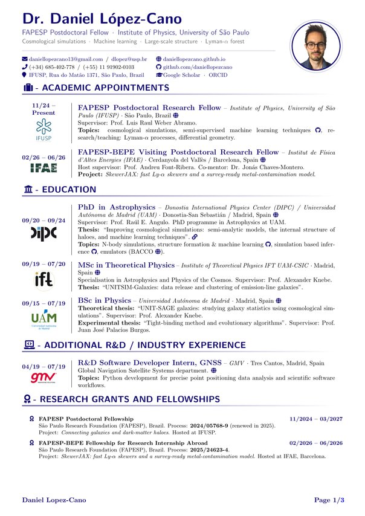
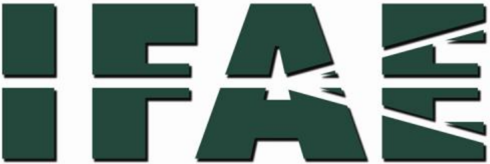
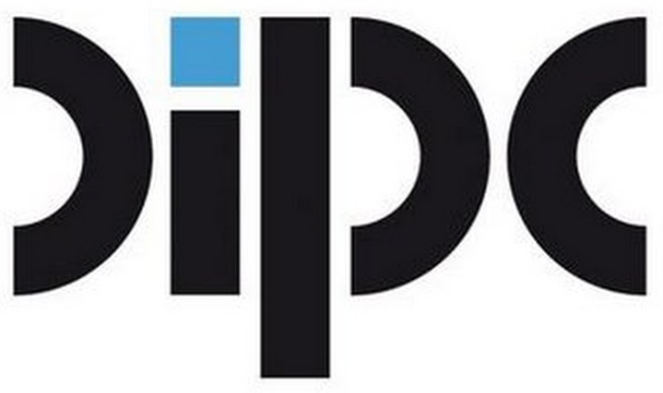
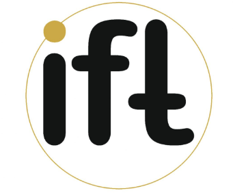
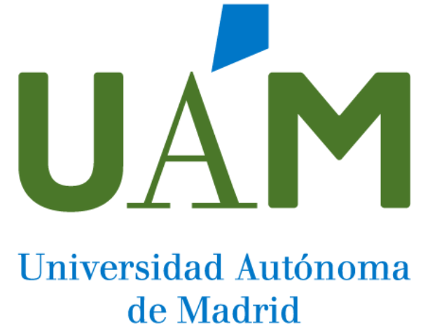

<!-- Generated by _cv/build.py from main.tex: do not edit; change main.tex (or the script) and run
     python3 _cv/build.py -->

```{=html}
<header class="cv-hero">
<a class="cv-photo-link" href="https://daniellopezcano.github.io"></a>
<div class="cv-hero-text">
<p class="cv-name">Dr. Daniel López-Cano</p>
<p class="cv-role">FAPESP Postdoctoral Fellow  ·  Institute of Physics, University of São Paulo</p>
<p class="cv-keywords">Cosmological simulations  ·  Machine learning  ·  Large-scale structure  ·  Lyman-<span class="cv-greek">α</span> forest</p>
<ul class="cv-contact">
<li><i class="bi bi-envelope" aria-hidden="true"></i> <span><a href="mailto:daniellopezcano13@gmail.com">daniellopezcano13@gmail.com</a>  /  <a href="mailto:dlopez@usp.br">dlopez@usp.br</a></span></li>
<li><i class="bi bi-globe" aria-hidden="true"></i> <span><a href="https://daniellopezcano.github.io">daniellopezcano.github.io</a></span></li>
<li><i class="bi bi-github" aria-hidden="true"></i> <span><a href="https://github.com/daniellopezcano?tab=repositories" target="_blank" rel="noopener">github.com/daniellopezcano</a></span></li>
<li><i class="bi bi-mortarboard" aria-hidden="true"></i> <span><a href="https://scholar.google.com/citations?user=2n98u-oAAAAJ" target="_blank" rel="noopener">Google Scholar</a> · <a href="https://orcid.org/0000-0002-0279-4874" target="_blank" rel="noopener">ORCID</a></span></li>
</ul>
<div class="media-actions cv-hero-actions">
<a href="assets/files/DLC_CV.pdf" class="btn btn-primary btn-sm"><i class="bi bi-file-earmark-text" aria-hidden="true"></i> Download PDF</a>
</div>
</div>
<a class="cv-pdf-link" href="assets/files/DLC_CV.pdf"></a>
</header>
```

## <i class="bi bi-briefcase cv-h-icon" aria-hidden="true"></i> ACADEMIC APPOINTMENTS {#academic-appointments}

```{=html}
<div class="trajectory-entry cv-entry">
<span class="cv-logo"></span>
<div class="trajectory-body">
<p class="cv-date">11/24 – Present</p>
<h3>FAPESP Postdoctoral Research Fellow</h3>
<p class="cv-meta"><em>Institute of Physics, University of São Paulo (IFUSP)</em> · São Paulo, Brazil <a href="https://portal.if.usp.br/ifusp/pt-br/users/dlopez" target="_blank" rel="noopener" class="cv-icon-link" aria-label="Website: portal.if.usp.br" title="Website: portal.if.usp.br"><i class="bi bi-globe" aria-hidden="true"></i></a></p>
<p>Supervisor: Prof. Luis Raul Weber Abramo.<br><strong>Topics:</strong> cosmological simulations, semi-supervised machine learning techniques <a href="https://github.com/daniellopezcano/JPAS_Domain_Adaptation/tree/main" target="_blank" rel="noopener" class="cv-icon-link" aria-label="GitHub: daniellopezcano/JPAS_Domain_Adaptation" title="GitHub: daniellopezcano/JPAS_Domain_Adaptation"><i class="bi bi-github" aria-hidden="true"></i></a>, research/teaching: Lyman-<span class="cv-greek">α</span> processes, differential geometry.</p>
</div>
</div>
<div class="trajectory-entry cv-entry">
<span class="cv-logo"></span>
<div class="trajectory-body">
<p class="cv-date">02/26 – 06/26</p>
<h3>FAPESP-BEPE Visiting Postdoctoral Research Fellow</h3>
<p class="cv-meta"><em>Institut de Física d’Altes Energies (IFAE)</em> · Cerdanyola del Vallès / Barcelona, Spain <a href="https://bv.fapesp.br/en/pesquisador/735607/daniel-lopez-cano/" target="_blank" rel="noopener" class="cv-icon-link" aria-label="Website: bv.fapesp.br" title="Website: bv.fapesp.br"><i class="bi bi-globe" aria-hidden="true"></i></a></p>
<p>Host supervisor: Prof. Andreu Font-Ribera. Co-mentor: Dr. Jonás Chaves-Montero.<br><strong>Project:</strong> <em>SkewerJAX: fast Ly-<span class="cv-greek">α</span> skewers and a survey-ready metal-contamination model</em>.</p>
</div>
</div>
```

## <i class="bi bi-bank cv-h-icon" aria-hidden="true"></i> EDUCATION {#education}

```{=html}
<div class="trajectory-entry cv-entry">
<span class="cv-logo"></span>
<div class="trajectory-body">
<p class="cv-date">09/20 – 09/24</p>
<h3>PhD in Astrophysics</h3>
<p class="cv-meta"><em>Donostia International Physics Center (DIPC) / Universidad Autónoma de Madrid (UAM)</em> · Donostia-San Sebastián / Madrid, Spain <a href="https://dipc.ehu.eus/en/career/phd-program/daniel-lopez-thesis-defense" target="_blank" rel="noopener" class="cv-icon-link" aria-label="Website: dipc.ehu.eus" title="Website: dipc.ehu.eus"><i class="bi bi-globe" aria-hidden="true"></i></a></p>
<p>Supervisor: Prof. Raúl E. Angulo. PhD programme in Astrophysics at UAM.<br><strong>Thesis:</strong> “Improving cosmological simulations: semi-analytic models, the internal structure of haloes, and machine learning techniques”. <a href="https://portalcientifico.uam.es/es/ipublic/item/10356678" target="_blank" rel="noopener" class="cv-icon-link" aria-label="Link: portalcientifico.uam.es" title="Link: portalcientifico.uam.es"><i class="bi bi-link-45deg" aria-hidden="true"></i></a><br><strong>Topics:</strong> N-body simulations, structure formation &amp; machine learning <a href="https://github.com/daniellopezcano/instance_halos/blob/main/notebooks/example.ipynb" target="_blank" rel="noopener" class="cv-icon-link" aria-label="GitHub: daniellopezcano/instance_halos" title="GitHub: daniellopezcano/instance_halos"><i class="bi bi-github" aria-hidden="true"></i></a>, simulation based inference <a href="https://github.com/daniellopezcano/SBI-baccoemu/tree/main" target="_blank" rel="noopener" class="cv-icon-link" aria-label="GitHub: daniellopezcano/SBI-baccoemu" title="GitHub: daniellopezcano/SBI-baccoemu"><i class="bi bi-github" aria-hidden="true"></i></a>, emulators (BACCO <a href="https://bacco.dipc.org/index.html" target="_blank" rel="noopener" class="cv-icon-link" aria-label="Website: bacco.dipc.org" title="Website: bacco.dipc.org"><i class="bi bi-globe" aria-hidden="true"></i></a>).</p>
</div>
</div>
<div class="trajectory-entry cv-entry">
<span class="cv-logo"></span>
<div class="trajectory-body">
<p class="cv-date">09/19 – 07/20</p>
<h3>MSc in Theoretical Physics</h3>
<p class="cv-meta"><em>Institute of Theoretical Physics IFT UAM-CSIC</em> · Madrid, Spain <a href="https://www.ift.uam-csic.es/en" target="_blank" rel="noopener" class="cv-icon-link" aria-label="Website: ift.uam-csic.es" title="Website: ift.uam-csic.es"><i class="bi bi-globe" aria-hidden="true"></i></a></p>
<p>Specialisation in Astrophysics and Physics of the Cosmos. Supervisor: Prof. Alexander Knebe.<br><strong>Thesis:</strong> “UNITSIM-Galaxies: data release and clustering of emission-line galaxies”.</p>
</div>
</div>
<div class="trajectory-entry cv-entry">
<span class="cv-logo"></span>
<div class="trajectory-body">
<p class="cv-date">09/15 – 07/19</p>
<h3>BSc in Physics</h3>
<p class="cv-meta"><em>Universidad Autónoma de Madrid</em> · Madrid, Spain <a href="https://www.uam.es/FisicaTeorica/Home.htm?language=en" target="_blank" rel="noopener" class="cv-icon-link" aria-label="Website: uam.es" title="Website: uam.es"><i class="bi bi-globe" aria-hidden="true"></i></a></p>
<p><strong>Theoretical thesis:</strong> “UNIT-SAGE galaxies: studying galaxy statistics using cosmological simulations”. Supervisor: Prof. Alexander Knebe.<br><strong>Experimental thesis:</strong> “Tight-binding method and evolutionary algorithms”. Supervisor: Prof. Juan José Palacios Burgos.</p>
</div>
</div>
```

## <i class="bi bi-laptop cv-h-icon" aria-hidden="true"></i> ADDITIONAL R&amp;D / INDUSTRY EXPERIENCE {#additional-r-d-industry-experience}

```{=html}
<div class="trajectory-entry cv-entry">
<span class="cv-logo"></span>
<div class="trajectory-body">
<p class="cv-date">04/19 – 07/19</p>
<h3>R&amp;D Software Developer Intern, GNSS</h3>
<p class="cv-meta"><em>GMV</em> · Tres Cantos, Madrid, Spain</p>
<p>Global Navigation Satellite Systems department. <a href="https://magicgnss.gmv.com/" target="_blank" rel="noopener" class="cv-icon-link" aria-label="Website: magicgnss.gmv.com" title="Website: magicgnss.gmv.com"><i class="bi bi-globe" aria-hidden="true"></i></a><br><strong>Topics:</strong> Python development for precise point positioning data analysis and scientific software workflows.</p>
</div>
</div>
```

## <i class="bi bi-award cv-h-icon" aria-hidden="true"></i> RESEARCH GRANTS AND FELLOWSHIPS {#research-grants-and-fellowships}

```{=html}
<div class="cv-grants">
<div class="cv-grant">
<div class="cv-grant-head"><i class="bi bi-award cv-grant-icon" aria-hidden="true"></i><h3 class="cv-grant-title"><strong>FAPESP Postdoctoral Fellowship</strong></h3><p class="cv-date">11/2024 – 03/2027</p></div>
<p>São Paulo Research Foundation (FAPESP), Brazil. Process: <strong>2024/05768-9</strong> (renewed in 2025).<br>Project: <em>Connecting galaxies and dark-matter haloes</em>. Hosted at IFUSP.</p>
</div>
<div class="cv-grant">
<div class="cv-grant-head"><i class="bi bi-award cv-grant-icon" aria-hidden="true"></i><h3 class="cv-grant-title"><strong>FAPESP-BEPE Fellowship for Research Internship Abroad</strong></h3><p class="cv-date">02/2026 – 06/2026</p></div>
<p>São Paulo Research Foundation (FAPESP), Brazil. Process: <strong>2025/24623-4</strong>.<br>Project: <em>SkewerJAX: fast Ly-<span class="cv-greek">α</span> skewers and a survey-ready metal-contamination model</em>. Hosted at IFAE, Barcelona.</p>
</div>
</div>
```

## <i class="bi bi-mortarboard-fill cv-h-icon" aria-hidden="true"></i> Supervision {#supervision}

### Supervised MSc students {#supervised-msc-students}

```{=html}
<div class="cv-item">
<span class="cv-year">2024–2026</span>
<div class="cv-item-body">
<p class="cv-item-head"><span class="cv-tag">Co-advisor</span> <strong class="cv-item-title">V. R. Soares da Silva</strong> <span class="cv-item-where">· MSc, IFUSP, Brazil, with Prof. L. R. Abramo</span></p>
<p class="cv-item-details">Completed (10/2024–07/2026). High-column-density absorbers in the Ly-<span class="cv-greek">α</span> forest. Resulting paper: arXiv:2609.19235 <a href="https://arxiv.org/abs/2609.19235" target="_blank" rel="noopener" class="cv-icon-link" aria-label="arXiv: 2609.19235" title="arXiv: 2609.19235"><i class="bi bi-file-earmark-text" aria-hidden="true"></i></a>.</p>
</div>
</div>
```

### Supervised PhD students {#supervised-phd-students}

```{=html}
<div class="cv-item">
<span class="cv-year">2026–now</span>
<div class="cv-item-body">
<p class="cv-item-head"><span class="cv-tag">Co-advisor</span> <strong class="cv-item-title">V. R. Soares da Silva</strong> <span class="cv-item-where">· PhD, IFUSP, Brazil, with Prof. L. R. Abramo</span></p>
<p class="cv-item-details">Ongoing (08/2026–present). High-column-density absorbers in the Ly-<span class="cv-greek">α</span> forest.</p>
</div>
</div>
```

## <i class="bi bi-easel cv-h-icon" aria-hidden="true"></i> Teaching {#teaching}

```{=html}
<div class="cv-item">
<span class="cv-year">2026</span>
<div class="cv-item-body">
<p class="cv-item-head"><span class="cv-tag">Instructor</span> <strong class="cv-item-title"><em>From Differential Geometry to GR</em></strong> <span class="cv-item-where">· 09–10/2026 · IFUSP</span></p>
<p class="cv-item-details">Graduate course, 3 credits (18 h lectures + 9 h practical). Open lecture notes with Python figures, animations and exercises <a href="notes/diffgeo-gr/index.html" class="cv-icon-link" aria-label="Link: this site, notes/diffgeo-gr/" title="Link: this site, notes/diffgeo-gr/"><i class="bi bi-link-45deg" aria-hidden="true"></i></a>.</p>
</div>
</div>
<div class="cv-item">
<span class="cv-year">2026</span>
<div class="cv-item-body">
<p class="cv-item-head"><span class="cv-tag">Instructor</span> <strong class="cv-item-title"><em>Neural Networks: Applications in Physics</em> <a href="https://portal.if.usp.br/pesquisa/pt-br/node/2745" target="_blank" rel="noopener" class="cv-icon-link" aria-label="Link: portal.if.usp.br" title="Link: portal.if.usp.br"><i class="bi bi-link-45deg" aria-hidden="true"></i></a> <a href="https://github.com/daniellopezcano/I-Escola-de-Inverno-do-IFUSP" target="_blank" rel="noopener" class="cv-icon-link" aria-label="GitHub: daniellopezcano/I-Escola-de-Inverno-do-IFUSP" title="GitHub: daniellopezcano/I-Escola-de-Inverno-do-IFUSP"><i class="bi bi-github" aria-hidden="true"></i></a></strong> <span class="cv-item-where">· 07/2026 · 1st IFUSP Winter School</span></p>
<p class="cv-item-details">4 lectures of 1.5 h: ML foundations and hands-on sessions.</p>
</div>
</div>
<div class="cv-item">
<span class="cv-year">2026</span>
<div class="cv-item-body">
<p class="cv-item-head"><span class="cv-tag">Notes/code</span> <strong class="cv-item-title"><em>Notes on the Ly-<span class="cv-greek">α</span> forest in cosmology</em></strong> <span class="cv-item-where">· open teaching material</span></p>
<p class="cv-item-details">Skewer generation, optical depth, transmitted flux, velocity-space mapping and metal lines, with JAX code <a href="notes/lya-forest/index.html" class="cv-icon-link" aria-label="Link: this site, notes/lya-forest/" title="Link: this site, notes/lya-forest/"><i class="bi bi-link-45deg" aria-hidden="true"></i></a>.</p>
</div>
</div>
```

## <i class="bi bi-mic cv-h-icon" aria-hidden="true"></i> Talks, Seminars &amp; Conferences {#talks-seminars-conferences}

```{=html}
<div class="cv-item">
<span class="cv-year">2026</span>
<div class="cv-item-body">
<p class="cv-item-head"><span class="cv-tag">Flash-talk</span> <strong class="cv-item-title">New Frontiers in Cosmology <a href="https://www.fundacion.udc.es/cosmology%2Dconference%2Dcoruna%2D2026/" target="_blank" rel="noopener" class="cv-icon-link" aria-label="Link: fundacion.udc.es" title="Link: fundacion.udc.es"><i class="bi bi-link-45deg" aria-hidden="true"></i></a></strong> <span class="cv-item-where">· 08/2026 · A Coruña, Spain</span></p>
</div>
</div>
<div class="cv-item">
<span class="cv-year">2026</span>
<div class="cv-item-body">
<p class="cv-item-head"><span class="cv-tag">Seminar</span> <strong class="cv-item-title">DFT &amp; CIAFF / DeCAF Seminar</strong> <span class="cv-item-where">· 02/2026 · UAM, Madrid</span></p>
</div>
</div>
<div class="cv-item">
<span class="cv-year">2025</span>
<div class="cv-item-body">
<p class="cv-item-head"><span class="cv-tag">Seminar</span> <strong class="cv-item-title">J-PAS Collaboration Seminar</strong> <span class="cv-item-where">· 12/2025 · online</span></p>
</div>
</div>
<div class="cv-item">
<span class="cv-year">2025</span>
<div class="cv-item-body">
<p class="cv-item-head"><span class="cv-tag">Invited</span> <strong class="cv-item-title">AstroInfo Meeting</strong> <span class="cv-item-where">· 11/2025 · online</span></p>
</div>
</div>
<div class="cv-item">
<span class="cv-year">2025</span>
<div class="cv-item-body">
<p class="cv-item-head"><span class="cv-tag">Invited</span> <strong class="cv-item-title">WEAVE Collaboration Meeting</strong> <span class="cv-item-where">· 09/2025 · Univ. Milano-Bicocca, Italy</span></p>
</div>
</div>
<div class="cv-item">
<span class="cv-year">2025</span>
<div class="cv-item-body">
<p class="cv-item-head"><span class="cv-tag">Seminar</span> <strong class="cv-item-title">IFAE Seminar <a href="https://indico.ifae.es/event/2074/" target="_blank" rel="noopener" class="cv-icon-link" aria-label="Link: indico.ifae.es" title="Link: indico.ifae.es"><i class="bi bi-link-45deg" aria-hidden="true"></i></a></strong> <span class="cv-item-where">· 04/2025 · IFAE, Barcelona</span></p>
</div>
</div>
<div class="cv-item">
<span class="cv-year">2024</span>
<div class="cv-item-body">
<p class="cv-item-head"><span class="cv-tag">Attended</span> <strong class="cv-item-title">Fundamental Physics Meets Current and Future Facilities in Cosmology <a href="https://www.ictp-saifr.org/fpcffc2024/" target="_blank" rel="noopener" class="cv-icon-link" aria-label="Link: ictp-saifr.org" title="Link: ictp-saifr.org"><i class="bi bi-link-45deg" aria-hidden="true"></i></a></strong> <span class="cv-item-where">· 12/2024 · ICTP-SAIFR, São Paulo</span></p>
</div>
</div>
<div class="cv-item">
<span class="cv-year">2024</span>
<div class="cv-item-body">
<p class="cv-item-head"><span class="cv-tag">Invited</span> <strong class="cv-item-title">São Paulo Group Meetings in Astro &amp; Cosmo <a href="https://www.youtube.com/watch?v=oZOMmPZpBAs&amp;ab_channel=ICTP-SAIFR" target="_blank" rel="noopener" class="cv-icon-link" aria-label="YouTube: youtube.com" title="YouTube: youtube.com"><i class="bi bi-youtube" aria-hidden="true"></i></a></strong> <span class="cv-item-where">· 11/2024 · IFT-UNESP / Principia</span></p>
</div>
</div>
<div class="cv-item">
<span class="cv-year">2024</span>
<div class="cv-item-body">
<p class="cv-item-head"><span class="cv-tag">Invited</span> <strong class="cv-item-title">Agorá Meeting DFMA <a href="https://sites.google.com/view/ifusp-department-symposium/home?authuser=0" target="_blank" rel="noopener" class="cv-icon-link" aria-label="Link: sites.google.com" title="Link: sites.google.com"><i class="bi bi-link-45deg" aria-hidden="true"></i></a></strong> <span class="cv-item-where">· 10/2024 · IFUSP, São Paulo</span></p>
</div>
</div>
<div class="cv-item">
<span class="cv-year">2024</span>
<div class="cv-item-body">
<p class="cv-item-head"><span class="cv-tag">Attended</span> <strong class="cv-item-title">ML4ASTRO2: International Conference on Machine Learning for Astrophysics <a href="https://indico.ict.inaf.it/event/2690/" target="_blank" rel="noopener" class="cv-icon-link" aria-label="Link: indico.ict.inaf.it" title="Link: indico.ict.inaf.it"><i class="bi bi-link-45deg" aria-hidden="true"></i></a></strong> <span class="cv-item-where">· 07/2024 · Univ. of Catania, Italy</span></p>
</div>
</div>
<div class="cv-item">
<span class="cv-year">2023</span>
<div class="cv-item-body">
<p class="cv-item-head"><span class="cv-tag">Seminar</span> <strong class="cv-item-title">University of Vienna Seminar</strong> <span class="cv-item-where">· 12/2023 · Univ. of Vienna, Austria</span></p>
</div>
</div>
<div class="cv-item">
<span class="cv-year">2023</span>
<div class="cv-item-body">
<p class="cv-item-head"><span class="cv-tag">Poster</span> <strong class="cv-item-title">Cosmic Connections: ML × Astrophysics Symposium</strong> <span class="cv-item-where">· 05/2023 · Flatiron Institute, New York</span></p>
</div>
</div>
<div class="cv-item">
<span class="cv-year">2023</span>
<div class="cv-item-body">
<p class="cv-item-head"><span class="cv-tag">Contributed</span> <strong class="cv-item-title">Cosmology with the Large-Scale Structure of the Universe</strong> <span class="cv-item-where">· 05/2023 · DIPC, Donostia</span></p>
</div>
</div>
<div class="cv-item">
<span class="cv-year">2022</span>
<div class="cv-item-body">
<p class="cv-item-head"><span class="cv-tag">Contributed</span> <strong class="cv-item-title">VIII Meeting on Fundamental Cosmology</strong> <span class="cv-item-where">· 11/2022 · IAA, Granada</span></p>
</div>
</div>
<div class="cv-item">
<span class="cv-year">2021</span>
<div class="cv-item-body">
<p class="cv-item-head"><span class="cv-tag">Contributed</span> <strong class="cv-item-title">18th MultiDark Consolider Workshop</strong> <span class="cv-item-where">· 10/2021 · UNIA, Spain</span></p>
</div>
</div>
```

## <i class="bi bi-camera cv-h-icon" aria-hidden="true"></i> Observing Experience {#observing-experience}

```{=html}
<div class="cv-item">
<span class="cv-year">2020</span>
<div class="cv-item-body">
<p class="cv-item-head"><span class="cv-tag">Observing</span> <strong class="cv-item-title">Calar Alto Observatory, CAHA-CAFOS</strong> <span class="cv-item-where">· 02/2020 · Almería, Spain</span></p>
<p class="cv-item-details">Optical follow-up of GRB 200215A <a href="https://gcn.gsfc.nasa.gov/gcn/gcn3/27088.gcn3" target="_blank" rel="noopener" class="cv-icon-link" aria-label="Link: gcn.gsfc.nasa.gov" title="Link: gcn.gsfc.nasa.gov"><i class="bi bi-link-45deg" aria-hidden="true"></i></a>; spectroscopy and photometry of Arp 269.</p>
</div>
</div>
```

## <i class="bi bi-forward cv-h-icon" aria-hidden="true"></i> Research Visits {#research-visits}

```{=html}
<div class="cv-item cv-item-has-logo">
<span class="cv-year">2023</span>
<div class="cv-item-body">
<p class="cv-item-head"><span class="cv-tag">Visit</span> <strong class="cv-item-title">Center for Computational Mathematics, Flatiron Institute</strong> <span class="cv-item-where">· 07–08/2023 · Simons Foundation, New York</span></p>
</div>
<span class="cv-item-logo"></span>
</div>
<div class="cv-item cv-item-has-logo">
<span class="cv-year">2022</span>
<div class="cv-item-body">
<p class="cv-item-head"><span class="cv-tag">Program</span> <strong class="cv-item-title">MIAPbP: Advances in Cosmology through Numerical Simulations</strong> <span class="cv-item-where">· 05–06/2022 · Garching, Germany</span></p>
</div>
<span class="cv-item-logo"></span>
</div>
```

## <i class="bi bi-code-slash cv-h-icon" aria-hidden="true"></i> Computational &amp; Technical Skills {#computational-technical-skills}

```{=html}
<dl class="cv-skills">
<div class="cv-skill"><dt>Programming</dt><dd>Python, C, C++, Fortran, Unix shell / Bash, MATLAB.</dd></div>
<div class="cv-skill"><dt>Scientific Python &amp; machine learning</dt><dd>JAX, PyTorch, TensorFlow/Keras, NumPy, SciPy, Pandas, Matplotlib, scikit-learn, Weights &amp; Biases.</dd></div>
<div class="cv-skill"><dt>Cosmological simulations &amp; survey modelling</dt><dd>N-body simulations, Gadget/L-Gadget, mock-catalogue construction, synthetic observables, Ly-<span class="cv-greek">α</span> skewer generation, photometric and spectroscopic survey data.</dd></div>
<div class="cv-skill"><dt>HPC &amp; reproducibility</dt><dd>Linux, SLURM, HTCondor, MPI workflows, OpenMP parallelisation, Git/GitHub, Jupyter, LaTeX.</dd></div>
</dl>
```

## <i class="bi bi-mortarboard cv-h-icon" aria-hidden="true"></i> Professional Training {#professional-training}

```{=html}
<div class="cv-item">
<span class="cv-year">2025</span>
<div class="cv-item-body">
<p class="cv-item-head"><span class="cv-tag">School</span> <strong class="cv-item-title">8th ICE Summer School <a href="https://workshops.ice.csic.es/event/1/" target="_blank" rel="noopener" class="cv-icon-link" aria-label="Link: workshops.ice.csic.es" title="Link: workshops.ice.csic.es"><i class="bi bi-link-45deg" aria-hidden="true"></i></a></strong> <span class="cv-item-where">· 06/2025 · ICE-CSIC, Barcelona</span></p>
</div>
</div>
<div class="cv-item">
<span class="cv-year">2023</span>
<div class="cv-item-body">
<p class="cv-item-head"><span class="cv-tag">Course</span> <strong class="cv-item-title">TensorFlow Specialization: Custom Models, Layers, and Loss Functions</strong> <span class="cv-item-where">· Coursera</span></p>
</div>
</div>
<div class="cv-item">
<span class="cv-year">2021</span>
<div class="cv-item-body">
<p class="cv-item-head"><span class="cv-tag">Course</span> <strong class="cv-item-title">Machine Learning</strong> <span class="cv-item-where">· Coursera</span></p>
</div>
</div>
<div class="cv-item">
<span class="cv-year">2021</span>
<div class="cv-item-body">
<p class="cv-item-head"><span class="cv-tag">Training</span> <strong class="cv-item-title">Scientific Writing and Presentation</strong> <span class="cv-item-where">· IAA, online</span></p>
</div>
</div>
<div class="cv-item">
<span class="cv-year">2020</span>
<div class="cv-item-body">
<p class="cv-item-head"><span class="cv-tag">School</span> <strong class="cv-item-title">XV Spanish Virtual Observatory School</strong> <span class="cv-item-where">· UAM, Madrid</span></p>
</div>
</div>
```

## <i class="bi bi-megaphone cv-h-icon" aria-hidden="true"></i> Outreach &amp; Public Engagement {#outreach-public-engagement}

```{=html}
<div class="cv-item">
<span class="cv-year">2021–2024</span>
<div class="cv-item-body">
<p class="cv-item-head"><span class="cv-tag">Outreach</span> <strong class="cv-item-title">Meet a Scientist: “Encuentro de vidas científicas” <a href="https://www.youtube.com/watch?v=tB_Qi9vEJ-s" target="_blank" rel="noopener" class="cv-icon-link" aria-label="YouTube: youtube.com" title="YouTube: youtube.com"><i class="bi bi-youtube" aria-hidden="true"></i></a></strong> <span class="cv-item-where">· four editions · Eureka! Zientzia Museoa</span></p>
</div>
</div>
<div class="cv-item">
<span class="cv-year">2023</span>
<div class="cv-item-body">
<p class="cv-item-head"><span class="cv-tag">Guide</span> <strong class="cv-item-title">STROM – Inclusive Astronomy exhibition <a href="https://dipc.ehu.eus/es/ciencia-sociedad/passion-for-knowledge/x" target="_blank" rel="noopener" class="cv-icon-link" aria-label="Link: dipc.ehu.eus" title="Link: dipc.ehu.eus"><i class="bi bi-link-45deg" aria-hidden="true"></i></a></strong> <span class="cv-item-where">· 10/2023 · Tabakalera, Donostia</span></p>
</div>
</div>
<div class="cv-item">
<span class="cv-year">2022</span>
<div class="cv-item-body">
<p class="cv-item-head"><span class="cv-tag">Outreach</span> <strong class="cv-item-title">Scientific monologues: <em>Bestiario Estelar</em> and <em>Las galaxias que vemos y que nunca alcanzaremos</em> <a href="https://www.youtube.com/watch?v=e7X5LF4FuOo&amp;ab_channel=IkerketaZabalik" target="_blank" rel="noopener" class="cv-icon-link" aria-label="YouTube: youtube.com" title="YouTube: youtube.com"><i class="bi bi-youtube" aria-hidden="true"></i></a></strong> <span class="cv-item-where">· 11/2022 · Zientzia Club &amp; Zientzia Astea UPV/EHU</span></p>
</div>
</div>
<div class="cv-item">
<span class="cv-year">2021</span>
<div class="cv-item-body">
<p class="cv-item-head"><span class="cv-tag">Outreach</span> <strong class="cv-item-title">Scale Up Your World: “Escala tu mundo”</strong> <span class="cv-item-where">· 11/2021 · Tabakalera, Donostia</span></p>
</div>
</div>
```

## <i class="bi bi-translate cv-h-icon" aria-hidden="true"></i> Languages {#languages}

```{=html}
<p class="cv-para"><strong>Spanish</strong>: native · <strong>English</strong>: fluent (C2) · <strong>Portuguese</strong>: working proficiency, including lecturing.</p>
```

## <i class="bi bi-book cv-h-icon" aria-hidden="true"></i> PUBLICATIONS {#publications}

```{=html}
<div class="cv-pub-masthead">
<p class="cv-pub-mast-title"><span>Publication list</span> <span class="cv-pub-mast-date">· updated November 2026</span></p>
<div class="media-actions"><a href="https://scholar.google.com/citations?user=2n98u-oAAAAJ&amp;hl=en" target="_blank" rel="noopener" class="btn btn-outline-info btn-sm">Google Scholar <i class="bi bi-google" aria-hidden="true"></i></a> <a href="https://orcid.org/0000-0002-0279-4874" target="_blank" rel="noopener" class="btn btn-outline-info btn-sm">ORCID <i class="bi bi-person-badge" aria-hidden="true"></i></a> <a href="https://ui.adsabs.harvard.edu/search/q=author%3A%22L%C3%B3pez-Cano%2C%20D%22&amp;sort=date%20desc" target="_blank" rel="noopener" class="btn btn-outline-info btn-sm">NASA ADS <i class="bi bi-broadcast" aria-hidden="true"></i></a> <a href="https://arxiv.org/search/?searchtype=author&amp;query=L%C3%B3pez-Cano%2C+D" target="_blank" rel="noopener" class="btn btn-outline-info btn-sm">arXiv <i class="bi bi-file-earmark-text" aria-hidden="true"></i></a> <a href="https://github.com/daniellopezcano" target="_blank" rel="noopener" class="btn btn-outline-info btn-sm">GitHub <i class="bi bi-github" aria-hidden="true"></i></a></div>
</div>
<div class="cv-metrics">
<div class="cv-metrics-group">
<p class="cv-metrics-title">PUBLICATIONS</p>
<ul class="cv-metrics-list">
<li><i class="bi bi-book cv-metric-icon" aria-hidden="true"></i><span class="cv-metric-num">7</span><span class="cv-metric-label">in total</span></li>
<li><i class="bi bi-check-circle cv-metric-icon" aria-hidden="true"></i><span class="cv-metric-num">6</span><span class="cv-metric-label">refereed</span></li>
<li><i class="bi bi-person cv-metric-icon" aria-hidden="true"></i><span class="cv-metric-num">3</span><span class="cv-metric-label">first author</span></li>
<li><i class="bi bi-people cv-metric-icon" aria-hidden="true"></i><span class="cv-metric-num">2</span><span class="cv-metric-label">second author</span></li>
</ul>
</div>
<div class="cv-metrics-group">
<p class="cv-metrics-title">IMPACT  ·  GOOGLE SCHOLAR, OCT 2026</p>
<ul class="cv-metrics-list">
<li><i class="bi bi-quote cv-metric-icon" aria-hidden="true"></i><span class="cv-metric-num">61</span><span class="cv-metric-label">citations</span></li>
<li><i class="bi bi-graph-up cv-metric-icon" aria-hidden="true"></i><span class="cv-metric-num">4</span><span class="cv-metric-label">h-index</span></li>
</ul>
</div>
</div>
```

### <i class="bi bi-book cv-h-icon" aria-hidden="true"></i> Refereed journal articles {#refereed-journal-articles}

```{=html}
<article class="cv-pub">
<span class="cv-pub-num">1</span>
<div class="cv-pub-body">
<p class="cv-pub-side"><span class="cv-year">2026</span> <span class="cv-tag">First author</span></p>
<h4 class="cv-pub-title">J-PAS: Semisupervised Sim-to-Obs Transfer for Robust Star–Galaxy–Quasar Classification</h4>
<p class="cv-pub-authors"><strong>D. López-Cano</strong>, L. R. Abramo, L. Nakazono, I. Pérez-Ràfols, et al.</p>
<p class="cv-pub-venue">ApJ 1008, 189</p>
<p class="cv-pub-summary">A classifier pre-trained on millions of simulated spectra and adapted to real J-PAS data with a small labelled subset, outperforming both simulation-only and data-only training.</p>
<div class="media-actions"><a href="https://arxiv.org/abs/2602.13902" target="_blank" rel="noopener" class="btn btn-outline-info btn-sm"><i class="bi bi-file-earmark-text" aria-hidden="true"></i> arXiv</a> <a href="https://iopscience.iop.org/article/10.3847/1538-4357/ae915c" target="_blank" rel="noopener" class="btn btn-outline-info btn-sm"><i class="bi bi-box-arrow-up-right" aria-hidden="true"></i> journal</a> <a href="https://github.com/daniellopezcano/JPAS_Domain_Adaptation" target="_blank" rel="noopener" class="btn btn-outline-info btn-sm"><i class="bi bi-github" aria-hidden="true"></i> code</a></div>
</div>
</article>
<article class="cv-pub">
<span class="cv-pub-num">2</span>
<div class="cv-pub-body">
<p class="cv-pub-side"><span class="cv-year">2026</span> <span class="cv-tag">Co-author</span></p>
<h4 class="cv-pub-title">OJALÁ: Optimizing J-PAS Astronomy for Large-scale Analysis. A transformer-based model for source classification and physical-parameter inference</h4>
<p class="cv-pub-authors">G. Martínez-Solaeche, R. M. González Delgado, R. García-Benito, …, <strong>D. López-Cano</strong>, et al.</p>
<p class="cv-pub-venue">A&amp;A, in press</p>
<p class="cv-pub-summary">Transformer-based model for the spectral energy distributions of J-PAS galaxies, quasars and stars, used for classification and physical-parameter inference.</p>
<div class="media-actions"><a href="https://arxiv.org/abs/2604.00661" target="_blank" rel="noopener" class="btn btn-outline-info btn-sm"><i class="bi bi-file-earmark-text" aria-hidden="true"></i> arXiv</a></div>
</div>
</article>
<article class="cv-pub">
<span class="cv-pub-num">3</span>
<div class="cv-pub-body">
<p class="cv-pub-side"><span class="cv-year">2024</span> <span class="cv-tag">First author</span></p>
<h4 class="cv-pub-title">Characterizing structure formation through instance segmentation</h4>
<p class="cv-pub-authors"><strong>D. López-Cano</strong>, J. Stücker, M. Pellejero Ibáñez, R. E. Angulo, D. Franco-Barranco</p>
<p class="cv-pub-venue">A&amp;A 685, A37</p>
<p class="cv-pub-summary">Protohalo formation recast as 3D instance segmentation of the initial conditions, recovering halo masses object by object above 10<sup>12</sup> <i>h</i><sup>−1</sup> <i>M</i><sub>⊙</sub>.</p>
<div class="media-actions"><a href="https://arxiv.org/abs/2311.12110" target="_blank" rel="noopener" class="btn btn-outline-info btn-sm"><i class="bi bi-file-earmark-text" aria-hidden="true"></i> arXiv</a> <a href="https://www.aanda.org/articles/aa/full_html/2024/05/aa48965-23/aa48965-23.html" target="_blank" rel="noopener" class="btn btn-outline-info btn-sm"><i class="bi bi-box-arrow-up-right" aria-hidden="true"></i> journal</a> <a href="https://github.com/daniellopezcano/instance_halos" target="_blank" rel="noopener" class="btn btn-outline-info btn-sm"><i class="bi bi-github" aria-hidden="true"></i> code</a></div>
</div>
</article>
<article class="cv-pub">
<span class="cv-pub-num">4</span>
<div class="cv-pub-body">
<p class="cv-pub-side"><span class="cv-year">2024</span> <span class="cv-tag">Co-author</span></p>
<h4 class="cv-pub-title">An improved halo occupation distribution prescription from UNITsim H<span class="cv-greek">α</span> emission-line galaxies: conformity and modified radial profile</h4>
<p class="cv-pub-authors">G. Reyes-Peraza, S. Avila, V. Gonzalez-Perez, <strong>D. López-Cano</strong>, A. Knebe, S. Ramakrishnan, G. Yepes</p>
<p class="cv-pub-venue">MNRAS 529, 3877–3893</p>
<p class="cv-pub-summary">An HOD for H<span class="cv-greek">α</span> emitters including conformity and a modified radial profile of satellites.</p>
<div class="media-actions"><a href="https://arxiv.org/abs/2312.13199" target="_blank" rel="noopener" class="btn btn-outline-info btn-sm"><i class="bi bi-file-earmark-text" aria-hidden="true"></i> arXiv</a> <a href="https://academic.oup.com/mnras/article/529/4/3877/7623782" target="_blank" rel="noopener" class="btn btn-outline-info btn-sm"><i class="bi bi-box-arrow-up-right" aria-hidden="true"></i> journal</a></div>
</div>
</article>
<article class="cv-pub">
<span class="cv-pub-num">5</span>
<div class="cv-pub-body">
<p class="cv-pub-side"><span class="cv-year">2022</span> <span class="cv-tag">First author</span></p>
<h4 class="cv-pub-title">The cosmology dependence of the concentration–mass–redshift relation</h4>
<p class="cv-pub-authors"><strong>D. López-Cano</strong>, R. E. Angulo, A. D. Ludlow, M. Zennaro, S. Contreras, J. Chaves-Montero, G. Aricò</p>
<p class="cv-pub-venue">MNRAS 517, 2000–2011</p>
<p class="cv-pub-summary">A model predicting halo concentrations as a function of mass, redshift and cosmology, now used in cosmology-rescaling algorithms.</p>
<div class="media-actions"><a href="https://arxiv.org/abs/2207.13718" target="_blank" rel="noopener" class="btn btn-outline-info btn-sm"><i class="bi bi-file-earmark-text" aria-hidden="true"></i> arXiv</a> <a href="https://academic.oup.com/mnras/article-abstract/517/2/2000/6731662" target="_blank" rel="noopener" class="btn btn-outline-info btn-sm"><i class="bi bi-box-arrow-up-right" aria-hidden="true"></i> journal</a></div>
</div>
</article>
<article class="cv-pub">
<span class="cv-pub-num">6</span>
<div class="cv-pub-body">
<p class="cv-pub-side"><span class="cv-year">2022</span> <span class="cv-tag">Second author</span></p>
<h4 class="cv-pub-title">UNITSIM-Galaxies: data release and clustering of emission-line galaxies</h4>
<p class="cv-pub-authors">A. Knebe, <strong>D. López-Cano</strong>, S. Avila, G. Favole, A. R. H. Stevens, V. Gonzalez-Perez, G. Reyes-Peraza, G. Yepes, C.-H. Chuang, F.-S. Kitaura</p>
<p class="cv-pub-venue">MNRAS 510, 5392–5407</p>
<p class="cv-pub-summary">Semi-analytic galaxy catalogues on the UNITSIM simulations, with H<span class="cv-greek">α</span> emitters for Euclid-like samples and their clustering.</p>
<div class="media-actions"><a href="https://arxiv.org/abs/2103.13088" target="_blank" rel="noopener" class="btn btn-outline-info btn-sm"><i class="bi bi-file-earmark-text" aria-hidden="true"></i> arXiv</a> <a href="https://academic.oup.com/mnras/article/510/4/5392/6505155" target="_blank" rel="noopener" class="btn btn-outline-info btn-sm"><i class="bi bi-box-arrow-up-right" aria-hidden="true"></i> journal</a></div>
</div>
</article>
```

### <i class="bi bi-send cv-h-icon" aria-hidden="true"></i> Submitted {#submitted}

```{=html}
<article class="cv-pub">
<span class="cv-pub-num">7</span>
<div class="cv-pub-body">
<p class="cv-pub-side"><span class="cv-year">2026</span> <span class="cv-tag">Second author</span></p>
<h4 class="cv-pub-title">Where the Forest Goes Dark: Halo-centered Characterization of High Column Density Systems with IllustrisTNG</h4>
<p class="cv-pub-authors">V. R. Soares da Silva, <strong>D. López-Cano</strong>, L. R. Abramo, J. Chaves-Montero, F. Maion</p>
<p class="cv-pub-venue">arXiv:2609.19235 <span class="cv-status cv-status-orange">To be submitted to ApJ</span></p>
<p class="cv-pub-summary">Spectral imprint of high-column-density absorbers on the Ly<span class="cv-greek">α</span> forest, characterised around their host haloes. First paper of the MSc thesis of V. R. Soares da Silva, which I co-supervised.</p>
<div class="media-actions"><a href="https://arxiv.org/abs/2609.19235" target="_blank" rel="noopener" class="btn btn-outline-info btn-sm"><i class="bi bi-file-earmark-text" aria-hidden="true"></i> arXiv</a></div>
</div>
</article>
```
