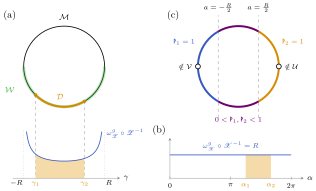

<!-- GENERATED by _port/convert/build.py from Appendices/examples_and_exercises/example_integration.tex, main.tex.
     Do not edit this file: edit the LaTeX notes and re-run the converter. -->

```{=html}
<header class="dg-head dg-head-section"><p class="dg-kicker">Appendix C <span class="dg-sep">•</span> <a href="index.html">Examples</a></p><h1 class="dg-title"><span class="dg-secnum">C.7</span> Example of Integration (§§<a class="dg-xref" href="../integrals/volume-forms-orientation.html" data-kind="section" data-label="section_Volume_Forms_Orientation">8.1</a>–<a class="dg-xref" href="../integrals/metric-volume-form.html" data-kind="section" data-label="section_Metric_Volume_Form">8.3</a>)</h1></header>
<p>The construction of Chapter <a class="dg-xref" href="../integrals/index.html" data-kind="chapter" data-label="chapter_Integrals">8</a> on the circle, where every step is a one-variable integral: the metric volume form in three charts, the length of an arc in two of them, and the length of the whole circle from a partition of unity (Figure <a class="dg-xref" href="#fig_Example_Integration" data-kind="figure" data-label="fig_Example_Integration">C.13</a>).</p>
<div class="dg-skip dg-medskip"></div>
<p><strong>Manifold and charts.</strong> Let <span class="math inline">\(\mathcal{M} \coloneqq \{ p = (a, b) \in \mathbb{R}^2 \mid a^2 + b^2 = R^2 \}\)</span>, <span class="math inline">\(R &gt; 0\)</span>, with the topology induced from <span class="math inline">\(\mathbb{R}^2\)</span>, and the charts, given through their inverses, <span class="math display">\[
    \begin{aligned}
        \mathcal{U} &amp;\coloneqq \mathcal{M} \setminus \{ (R, 0) \}, &amp;
        \mathscr{X}^{-1}(\alpha) &amp;= R \, (\cos \alpha, \sin \alpha), &amp;
        \alpha &amp;\in (0, 2\pi), \\
        \mathcal{V} &amp;\coloneqq \mathcal{M} \setminus \{ (-R, 0) \}, &amp;
        \mathscr{Y}^{-1}(\beta) &amp;= R \, (\cos \beta, \sin \beta), &amp;
        \beta &amp;\in (-\pi, \pi), \\
        \mathcal{W} &amp;\coloneqq \{ p \in \mathcal{M} \mid b &lt; 0 \}, &amp;
        \mathscr{Z}^{-1}(\gamma) &amp;= \big( \gamma, - \sqrt{R^2 - \gamma^2} \big), &amp;
        \gamma &amp;\in (-R, R),
    \end{aligned}
\]</span> the last one projecting the lower half onto the <span class="math inline">\(a\)</span>-axis. The transition maps to <span class="math inline">\(\mathscr{X}\)</span> and their Jacobians are <span class="math display">\[
    \textrm{\runic ᛖ}_{\mathcal{V}\mathcal{U}}(\beta) =
    \begin{cases} \beta, &amp; \beta &gt; 0 \\ \beta + 2\pi, &amp; \beta &lt; 0 \end{cases},
    \quad
    \textrm{\runic ᛞ}_{\mathcal{U}\mathcal{V}} = 1 ;
    \qquad
    \textrm{\runic ᛖ}_{\mathcal{W}\mathcal{U}}(\gamma) = 2\pi - \arccos \frac{\gamma}{R},
    \quad
    \textrm{\runic ᛞ}_{\mathcal{U}\mathcal{W}}(\gamma) = \frac{1}{\sqrt{R^2 - \gamma^2}} .
\]</span> Both are positive, and so is the one between <span class="math inline">\(\mathscr{Y}\)</span> and <span class="math inline">\(\mathscr{Z}\)</span>, their quotient on <span class="math inline">\(\mathcal{V} \cap \mathcal{W} \subseteq \mathcal{U}\)</span>: <span class="math inline">\(\mathcal{A}^\uparrow \coloneqq \{ (\mathcal{U}, \mathscr{X}), (\mathcal{V}, \mathscr{Y}), (\mathcal{W}, \mathscr{Z}) \}\)</span> is an oriented atlas.</p>
<div class="dg-skip dg-medskip"></div>
<p><strong>Metric volume form.</strong> The metric induced from <span class="math inline">\(\mathbb{R}^2\)</span>, <span class="math inline">\(g(\mathcal{X}_1, \mathcal{X}_2) \coloneqq \sum_{k=1}^2 d\xi^k\lceil \mathcal{X}_1 \rfloor \,
d\xi^k\lceil \mathcal{X}_2 \rfloor\)</span> with <span class="math inline">\(\xi^1, \xi^2\)</span> the scalar fields <span class="math inline">\(p \mapsto a, b\)</span>, has in a chart <span class="math inline">\(\mathscr{X}\)</span> the single component <span class="math inline">\((g_\mathscr{X})_{11} = \sum_k \big( \partial_1 [ \xi^k \circ \mathscr{X}^{-1} ] \big)^2\)</span>, the squared speed of <span class="math inline">\(\mathscr{X}^{-1}\)</span>. Hence <span class="math display">\[
    (g_\mathscr{X})_{11} = (g_\mathscr{Y})_{11} = R^2 \big( \sin^2 + \cos^2 \big) = R^2,
    \qquad
    (g_\mathscr{Z})_{11} = 1 + \frac{\gamma^2}{R^2 - \gamma^2} = \frac{R^2}{R^2 - \gamma^2},
\]</span> and, by (<a class="dg-xref" href="../integrals/metric-volume-form.html#eq_metric_volume_form" data-kind="equation" data-label="eq_metric_volume_form">8.5</a>), <span class="math display">\[
    \big( \omega^g_\mathscr{X} \circ \mathscr{X}^{-1} \big)(\alpha) = \big( \omega^g_\mathscr{Y} \circ \mathscr{Y}^{-1} \big)(\beta) = R,
    \qquad
    \big( \omega^g_\mathscr{Z} \circ \mathscr{Z}^{-1} \big)(\gamma) = \frac{R}{\sqrt{R^2 - \gamma^2}} ,
\]</span> in agreement with (<a class="dg-xref" href="../integrals/volume-forms-orientation.html#eq_scalar_density_transformation" data-kind="equation" data-label="eq_scalar_density_transformation">8.1</a>): <span class="math inline">\(\omega^g_\mathscr{Z} = \textrm{\runic ᛞ}_{\mathcal{U}\mathcal{W}} \, \omega^g_\mathscr{X}\)</span>. The projection <span class="math inline">\(\mathscr{Z}\)</span> compresses the circle near the ends of <span class="math inline">\(\mathcal{W}\)</span>, where it becomes vertical, and its density grows there.</p>
<div class="dg-skip dg-medskip"></div>
<p><strong>Integral over a region.</strong> Let <span class="math inline">\(\mathcal{D}\)</span> be the arc <span class="math inline">\(\alpha \in (\alpha_1, \alpha_2)\)</span>, with <span class="math inline">\(\pi &lt; \alpha_1 &lt; \alpha_2 &lt; 2\pi\)</span>, so that <span class="math inline">\(\overline{\mathcal{D}}\)</span> is compact and contained in <span class="math inline">\(\mathcal{U} \cap \mathcal{W}\)</span>, and <span class="math inline">\(f = 1\)</span>. By (<a class="dg-xref" href="../integrals/integration-manifolds.html#eq_integral_chart" data-kind="equation" data-label="eq_integral_chart">8.3</a>), its length in the two charts is, with <span class="math inline">\(\gamma_i \coloneqq R \cos \alpha_i\)</span>, <span class="math display">\begin{align*}
    \text{in } \mathscr{X} : \quad \int_\mathcal{D} \Omega^g
    &amp;= \int_{\alpha_1}^{\alpha_2} d\alpha \; R
    = R \, (\alpha_2 - \alpha_1), \\
    \text{in } \mathscr{Z} : \quad \int_\mathcal{D} \Omega^g
    &amp;= \int_{\gamma_1}^{\gamma_2} d\gamma \; \frac{R}{\sqrt{R^2 - \gamma^2}}
    = R \Big[ \arcsin \frac{\gamma}{R} \Big]_{\gamma_1}^{\gamma_2}
    \overset{\substack{\arcsin(\cos \alpha) \, = \, \alpha - 3\pi/2 \\ \text{on } (\pi, 2\pi)}}{=}
    R \, (\alpha_2 - \alpha_1) .
\end{align*}</span> Without the volume form, the chart representatives of <span class="math inline">\(f\)</span> alone give <span class="math inline">\(\alpha_2 - \alpha_1\)</span> and <span class="math inline">\(\gamma_2 - \gamma_1 = R \, (\cos \alpha_2 - \cos \alpha_1)\)</span>, which differ. With the chart <span class="math inline">\(\mathscr{Z}'(a, b) \coloneqq - a\)</span> instead of <span class="math inline">\(\mathscr{Z}\)</span>, the Jacobian, and with it the density <span class="math inline">\(-R / \sqrt{R^2 - \gamma^2}\)</span>, would be negative, and the chart integral would give <span class="math inline">\(- R \, (\alpha_2 - \alpha_1)\)</span>: <span class="math inline">\(\mathscr{Z}'\)</span> does not belong to <span class="math inline">\(\mathcal{A}^\uparrow\)</span>.</p>
<div class="dg-skip dg-medskip"></div>
<p><strong>Integral over the whole manifold.</strong> <span class="math inline">\(f = 1\)</span> does not vanish near <span class="math inline">\((R, 0) \notin \mathcal{U}\)</span>, nor near <span class="math inline">\((-R, 0) \notin \mathcal{V}\)</span>, so a partition of unity is needed. Let <span class="math inline">\(\chi : \mathbb{R} \to [0, 1]\)</span> be smooth, with <span class="math inline">\(\chi = 1\)</span> on <span class="math inline">\((-\infty, -\frac{1}{2}]\)</span> and <span class="math inline">\(\chi = 0\)</span> on <span class="math inline">\([\frac{1}{2}, \infty)\)</span>, and <span class="math display">\[
    \textrm{\runic ᚹ}_1(p) \coloneqq \chi(a / R),
    \qquad
    \textrm{\runic ᚹ}_2 \coloneqq 1 - \textrm{\runic ᚹ}_1 .
\]</span> <span class="math inline">\(\operatorname{supp} \textrm{\runic ᚹ}_1 \subseteq \{ a \leq R/2 \} \subset \mathcal{U}\)</span> and <span class="math inline">\(\operatorname{supp} \textrm{\runic ᚹ}_2 \subseteq \{ a \geq -R/2 \} \subset \mathcal{V}\)</span>, so <span class="math inline">\(\{ \textrm{\runic ᚹ}_1, \textrm{\runic ᚹ}_2 \}\)</span> is a partition of unity subordinate to <span class="math inline">\(\{ \mathcal{U}, \mathcal{V} \}\)</span>. By (<a class="dg-xref" href="../integrals/integration-manifolds.html#eq_integral_manifold" data-kind="equation" data-label="eq_integral_manifold">8.4</a>), computing each term in the chart of its domain, <span class="math display">\[
    \int_\mathcal{M} \Omega^g
    = \int_{0}^{2\pi} d\alpha \; R \, \chi(\cos \alpha) + \int_{-\pi}^{\pi} d\beta \; R \, \big( 1 - \chi(\cos \beta) \big)
    \overset{2\pi\text{-periodic}}{=}
    \int_{-\pi}^{\pi} d\beta \; R \, \big( \chi(\cos \beta) + 1 - \chi(\cos \beta) \big)
    = 2 \pi R ,
\]</span> and <span class="math inline">\(\chi\)</span>, i.e. the partition of unity, drops out. In practice one integrates in <span class="math inline">\(\mathscr{X}\)</span> alone, <span class="math inline">\(\int_0^{2\pi} d\alpha \, R = 2\pi R\)</span>, ignoring the single missing point <span class="math inline">\((R, 0)\)</span>; that it does not contribute agrees with the result above, but is not covered by (<a class="dg-xref" href="../integrals/integration-manifolds.html#eq_integral_chart" data-kind="equation" data-label="eq_integral_chart">8.3</a>).</p>
<figure class="dg-figure" id="fig_Example_Integration"><div class="dg-paper" style="--dg-frac:0.698"></div><figcaption><span class="dg-fignum">Figure C.13:</span>   Integration on the circle of Section <a class="dg-xref" href="#" data-kind="section" data-label="section_Example_Integration">C.7</a>. (a) An arc <span class="math inline">\(\mathcal{D}\)</span> (orange) in the lower half  <span class="math inline">\(\mathcal{W}\)</span> (green), projected by the chart <span class="math inline">\(\mathscr{Z}\)</span> onto <span class="math inline">\((\gamma_1, \gamma_2)\)</span>, with the density  <span class="math inline">\(\omega^g_\mathscr{Z} = R / \sqrt{R^2 - \gamma^2}\)</span> (blue), which grows where the projection compresses the circle. (b) The same arc  in the angle chart <span class="math inline">\(\mathscr{X}\)</span>, where the density is constant. The two shaded areas are equal, both being the length  <span class="math inline">\(R \, (\alpha_2 - \alpha_1)\)</span> of <span class="math inline">\(\mathcal{D}\)</span>; the two intervals alone, <span class="math inline">\(\gamma_2 - \gamma_1\)</span> and <span class="math inline">\(\alpha_2 - \alpha_1\)</span>, are not.  (c) The partition of unity: <span class="math inline">\(\textrm{\runic ᚹ}_1 = 1\)</span> on the left arc (blue), <span class="math inline">\(\textrm{\runic ᚹ}_2 = 1\)</span> on the right arc (orange), and both  share the arcs in between (purple). The support of <span class="math inline">\(\textrm{\runic ᚹ}_1\)</span> avoids the point missing from <span class="math inline">\(\mathcal{U}\)</span>, and that of  <span class="math inline">\(\textrm{\runic ᚹ}_2\)</span> the point missing from <span class="math inline">\(\mathcal{V}\)</span>. </figcaption></figure>
<nav class="dg-web dg-prevnext" aria-label="Previous and next page"><a class="dg-prev" href="example-variations.html" rel="prev"><span aria-hidden="true">←</span> <span><span class="dg-secnum">C.6</span> Example of Variations and Euler–Lagrange Equations (§<a class="dg-xref" href="../metric/length-geodesics.html#subsection_Variations_Euler_Lagrange" data-kind="subsection" data-label="subsection_Variations_Euler_Lagrange">7.2.1</a>)</span></a><a class="dg-next" href="example-schwarzschild.html" rel="next"><span aria-hidden="true">→</span> <span><span class="dg-secnum">C.9</span> Example: the Schwarzschild metric (§<span class="dg-xref dg-xref-pending" data-label="subsection_EH_variation">10.2.2</span>)</span></a></nav>
```
