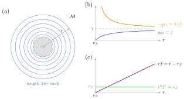

<!-- GENERATED by _port/convert/build.py from Appendices/examples_and_exercises/example_GR.tex, main.tex.
     Do not edit this file: edit the LaTeX notes and re-run the converter. -->

```{=html}
<header class="dg-head dg-head-section"><p class="dg-kicker">Appendix C <span class="dg-sep">•</span> <a href="index.html">Examples</a></p><h1 class="dg-title"><span class="dg-secnum">C.9</span> Example: the Schwarzschild metric (§<span class="dg-xref dg-xref-pending" data-label="subsection_EH_variation">10.2.2</span>)</h1></header>
<p>The vacuum Einstein equations of Subsection <span class="dg-xref dg-xref-pending" data-label="subsection_EH_variation">10.2.2</span>, checked on the Schwarzschild metric, where every component depends on one or two coordinates: the connection coefficients from the metric, the Ricci curvature from these, and the Newtonian limit fixing the one free constant (Figure <a class="dg-xref" href="#fig_Example_Schwarzschild" data-kind="figure" data-label="fig_Example_Schwarzschild">C.19</a>).</p>
<div class="dg-skip dg-medskip"></div>
<p><strong>Manifold, chart and metric.</strong> Let <span class="math inline">\(r_S \coloneqq 2 G_N M\)</span>, with <span class="math inline">\(M &gt; 0\)</span>, and <span class="math inline">\(\mathcal{M} \coloneqq \mathbb{R} \times (r_S, \infty) \times S^2\)</span>, with <span class="math inline">\(S^2 \subset \mathbb{R}^3\)</span> the unit sphere. The chart is given through its inverse, <span class="math display">\[
    \mathscr{X}^{-1}(t, r, \theta, \varphi) = \big( t, \, r, \, (\sin\theta \cos\varphi, \, \sin\theta \sin\varphi, \, \cos\theta) \big),
\]</span> for <span class="math inline">\((t, r, \theta, \varphi) \in \mathbb{R} \times (r_S, \infty) \times (0, \pi) \times (0, 2\pi)\)</span>, so <span class="math inline">\(\alpha = (\alpha^0, \alpha^1, \alpha^2, \alpha^3) \eqqcolon (t, r, \theta, \varphi)\)</span>, and <span class="math inline">\(\mathcal{U}\)</span> misses, on each sphere, the half great circle <span class="math inline">\(\varphi = 0\)</span> through the poles. On <span class="math inline">\(\mathcal{U}\)</span>, <span class="math display">\[
    \big( g_{ij}(\alpha) \big) = \mathrm{diag}\Big( f(r), \; - \frac{1}{f(r)}, \; - r^2, \; - r^2 \sin^2\theta \Big),
    \qquad
    f(r) \coloneqq 1 - \frac{r_S}{r} ,
\]</span> which extends to all of <span class="math inline">\(\mathcal{M}\)</span>, as the round metric of <span class="math inline">\(S^2\)</span> does, and has signature <span class="math inline">\((+, -, -, -)\)</span> since <span class="math inline">\(f &gt; 0\)</span> on <span class="math inline">\((r_S, \infty)\)</span>. As <span class="math inline">\(g(\partial x_0, \partial x_0) = f &gt; 0\)</span>, <span class="math inline">\(\partial x_0\)</span> fixes a time orientation. Only this chart is used, so its label is dropped, as in Subsection <span class="dg-xref dg-xref-pending" data-label="subsection_EH_variation">10.2.2</span>. By the remark on vacuum being Ricci-flat, <span class="math inline">\(G = 0\)</span> if and only if <span class="math inline">\(\mathrm{Ric} = 0\)</span>. We keep <span class="math inline">\(f\)</span> general until the end, and write <span class="math inline">\(' = d/dr\)</span>.</p>
<div class="dg-skip dg-medskip"></div>
<p><strong>Volume element.</strong> <span class="math inline">\(\det g = - r^4 \sin^2\theta\)</span>, so <span class="math inline">\(\sqrt{- \det g} = r^2 \sin\theta\)</span>, independent of <span class="math inline">\(f\)</span>, and, by Subsection <a class="dg-xref" href="../proofs-and-additional-material/metric-properties.html#subsection_metric_prop_det" data-kind="subsection" data-label="subsection_metric_prop_det">B.18.2</a>, <span class="math inline">\(\Gamma^m_{nm} = \partial_n \ln (r^2 \sin\theta)\)</span>: <span class="math display">\[
    \Gamma^m_{1m} = \frac{2}{r}, \qquad \Gamma^m_{2m} = \cot\theta, \qquad \Gamma^m_{0m} = \Gamma^m_{3m} = 0 .
\]</span></p>
<div class="dg-skip dg-medskip"></div>
<p><strong>Connection coefficients.</strong> As <span class="math inline">\(g\)</span> is diagonal, <span class="math inline">\(\Gamma^k_{ji} = \frac{1}{2} (g^{-1})^{kk} \big( \partial_i g_{kj} + \partial_j g_{ki} - \partial_k g_{ij} \big)\)</span> (no sum over <span class="math inline">\(k\)</span>), and <span class="math inline">\(g\)</span> only depends on <span class="math inline">\(r\)</span> and <span class="math inline">\(\theta\)</span>. Up to <span class="math inline">\(\Gamma^k_{ji} = \Gamma^k_{ij}\)</span>, the non-zero ones are <span class="math display">\[
    \Gamma^0_{01} = \frac{f'}{2f}, \quad
    \Gamma^1_{00} = \frac{f f'}{2}, \quad
    \Gamma^1_{11} = - \frac{f'}{2f}, \quad
    \Gamma^1_{22} = - r f, \quad
    \Gamma^1_{33} = - r f \sin^2\theta,
\]</span> <span class="math display">\[
    \Gamma^2_{12} = \Gamma^3_{13} = \frac{1}{r}, \quad
    \Gamma^2_{33} = - \sin\theta \cos\theta, \quad
    \Gamma^3_{23} = \cot\theta .
\]</span></p>
<div class="dg-skip dg-medskip"></div>
<p><strong>Ricci curvature.</strong> In the component formula of <span class="math inline">\(\mathrm{Ric}\)</span> (dummy <span class="math inline">\(r\)</span> renamed <span class="math inline">\(n\)</span>, as <span class="math inline">\(r\)</span> is now a coordinate), the second term is <span class="math inline">\(\partial_b \Gamma^m_{am} = \partial_a \partial_b \ln(r^2 \sin\theta)\)</span>, by the volume element: <span class="math display">\[
    \mathrm{Ric}_{ab} = \partial_m \Gamma^m_{ab} - \partial_a \partial_b \ln(r^2 \sin\theta) + \Gamma^m_{nm} \, \Gamma^n_{ab} - \Gamma^m_{nb} \, \Gamma^n_{am} .
\]</span> Every non-zero <span class="math inline">\(\Gamma^k_{ji}\)</span> carries the index <span class="math inline">\(0\)</span> an even number of times, and so does every term above, its dummy indices counting twice: <span class="math inline">\(\mathrm{Ric}_{0b} = 0\)</span> for <span class="math inline">\(b \neq 0\)</span>, and likewise for the index <span class="math inline">\(3\)</span>. The remaining off-diagonal component is <span class="math inline">\(\mathrm{Ric}_{12} = \Gamma^2_{12} \cot\theta - \Gamma^3_{32} \, \Gamma^3_{13} = \frac{\cot\theta}{r} - \frac{\cot\theta}{r} = 0\)</span>. On the diagonal, <span class="math display">\begin{align*}
    \mathrm{Ric}_{00}
    &amp;= \partial_1 \Gamma^1_{00} + \frac{2}{r} \, \Gamma^1_{00} - 2 \, \Gamma^0_{10} \, \Gamma^1_{00}
    = \Big( \frac{f f'}{2} \Big)' + \frac{f f'}{r} - \frac{f'^2}{2}
    = \frac{f}{2 r^2} \big( r^2 f' \big)' , \\
    \mathrm{Ric}_{11}
    &amp;= \partial_1 \Gamma^1_{11} + \frac{2}{r^2} + \frac{2}{r} \, \Gamma^1_{11}
    - \big( \Gamma^0_{01} \big)^2 - \big( \Gamma^1_{11} \big)^2 - \big( \Gamma^2_{12} \big)^2 - \big( \Gamma^3_{13} \big)^2 \\
    &amp;= - \Big( \frac{f'}{2f} \Big)' - \frac{f'}{r f} - \frac{f'^2}{2 f^2}
    = - \frac{1}{2 f r^2} \big( r^2 f' \big)' , \\
    \mathrm{Ric}_{22}
    &amp;= \partial_1 \Gamma^1_{22} + \frac{1}{\sin^2\theta} + \frac{2}{r} \, \Gamma^1_{22} - 2 \, \Gamma^1_{22} \, \Gamma^2_{21} - \big( \Gamma^3_{23} \big)^2 \\
    &amp;= - (r f)' + \frac{1}{\sin^2\theta} - \cot^2\theta
    = 1 - (r f)' , \\
    \mathrm{Ric}_{33}
    &amp;= \sin^2\theta \; \mathrm{Ric}_{22} \qquad \text{(same computation)} .
\end{align*}</span> Only two combinations of <span class="math inline">\(f\)</span> appear: <span class="math inline">\((r^2 f')'\)</span> in the <span class="math inline">\(t\)</span> and <span class="math inline">\(r\)</span> components, <span class="math inline">\((r f)'\)</span> in the angular ones.</p>
<div class="dg-skip dg-medskip"></div>
<p><strong>Einstein equations.</strong> For <span class="math inline">\(f = 1 - r_S / r\)</span>, <span class="math inline">\(r^2 f' = r_S\)</span> is constant and <span class="math inline">\(r f = r - r_S\)</span> has slope <span class="math inline">\(1\)</span> (Figure <a class="dg-xref" href="#fig_Example_Schwarzschild" data-kind="figure" data-label="fig_Example_Schwarzschild">C.19</a>c), so every component vanishes: <span class="math inline">\(\mathrm{Ric} = 0\)</span>, hence <span class="math inline">\(G = 0\)</span>, and the Schwarzschild metric solves the vacuum Einstein equations. Conversely, among metrics of this form, <span class="math inline">\(\mathrm{Ric}_{22} = 0\)</span> forces <span class="math inline">\((r f)' = 1\)</span>, i.e. <span class="math inline">\(f = 1 - c/r\)</span> for a constant <span class="math inline">\(c\)</span>, which then also gives <span class="math inline">\((r^2 f')' = 0\)</span>. At large <span class="math inline">\(r\)</span>, <span class="math inline">\(g_{00} \approx 1 + 2 \Phi\)</span> with the Newtonian potential <span class="math inline">\(\Phi = - G_N M / r\)</span> of a mass <span class="math inline">\(M\)</span> (Chapter <a class="dg-xref" href="../newtonian/index.html" data-kind="chapter" data-label="chapter_Newtonian">9</a>) fixes <span class="math inline">\(c = 2 G_N M = r_S\)</span>.</p>
<div class="dg-skip dg-medskip"></div>
<p><strong>What the coordinate <span class="math inline">\(r\)</span> measures.</strong> On a sphere <span class="math inline">\(t, r = \text{const}\)</span>, the metric is <span class="math inline">\(r^2\)</span> times that of <span class="math inline">\(S^2\)</span>: its area is <span class="math inline">\(4 \pi r^2\)</span>, and <span class="math inline">\(r\)</span> is the radius obtained from it, not the distance from a centre, which <span class="math inline">\(\mathcal{M}\)</span> does not contain. Along a radial segment <span class="math inline">\(t, \theta, \varphi = \text{const}\)</span>, <span class="math inline">\(r \in (r_1, r_2)\)</span>, the length is <span class="math inline">\(\int_{r_1}^{r_2} dr \, \sqrt{|g_{11}|} = \int_{r_1}^{r_2} dr / \sqrt{f} &gt; r_2 - r_1\)</span>. For a short segment, the ratio of the two is about <span class="math inline">\(1 / \sqrt{f(r_1)}\)</span>, which diverges as <span class="math inline">\(r_1 \to r_S\)</span> (although the length from <span class="math inline">\(r_S\)</span> to any <span class="math inline">\(r_2\)</span> stays finite): spheres at equal radial distances crowd together in <span class="math inline">\(r\)</span> near <span class="math inline">\(r_S\)</span> (Figure <a class="dg-xref" href="#fig_Example_Schwarzschild" data-kind="figure" data-label="fig_Example_Schwarzschild">C.19</a>a).</p>
<figure class="dg-figure" id="fig_Example_Schwarzschild"><div class="dg-paper" style="--dg-frac:0.693"></div><figcaption><span class="dg-fignum">Figure C.19:</span>   The Schwarzschild metric of Section <a class="dg-xref" href="#" data-kind="section" data-label="section_Example_Schwarzschild">C.9</a>. (a) The slice <span class="math inline">\(t = \text{const}\)</span>, <span class="math inline">\(\theta = \pi / 2\)</span> of  <span class="math inline">\(\mathcal{M}\)</span>, drawn with the radius of each circle equal to its coordinate <span class="math inline">\(r\)</span>, so that its length is <span class="math inline">\(2 \pi r\)</span>. The circles  (blue) are at equal radial distances <span class="math inline">\(\int dr / \sqrt{f}\)</span> from each other, and crowd together near <span class="math inline">\(r = r_S\)</span>; the grey disc  <span class="math inline">\(r \leq r_S\)</span> is not part of <span class="math inline">\(\mathcal{M}\)</span>. (b) The components <span class="math inline">\(g_{00} = f\)</span> (blue), which vanishes at <span class="math inline">\(r_S\)</span>, and <span class="math inline">\(- g_{11} = 1/f\)</span>  (orange), which diverges there; both tend to <span class="math inline">\(1\)</span> at large <span class="math inline">\(r\)</span>. (c) The two combinations of <span class="math inline">\(f\)</span> in <span class="math inline">\(\mathrm{Ric}\)</span>:  <span class="math inline">\(r^2 f'\)</span> (green) is constant, so <span class="math inline">\(\mathrm{Ric}_{00} = \mathrm{Ric}_{11} = 0\)</span>, and <span class="math inline">\(r f\)</span> (purple) has slope <span class="math inline">\(1\)</span>, so  <span class="math inline">\(\mathrm{Ric}_{22} = \mathrm{Ric}_{33} = 0\)</span>. </figcaption></figure>
<nav class="dg-web dg-prevnext" aria-label="Previous and next page"><a class="dg-prev" href="example-integration.html" rel="prev"><span aria-hidden="true">←</span> <span><span class="dg-secnum">C.7</span> Example of Integration (§§8.1–8.3)</span></a><span></span></nav>
```
