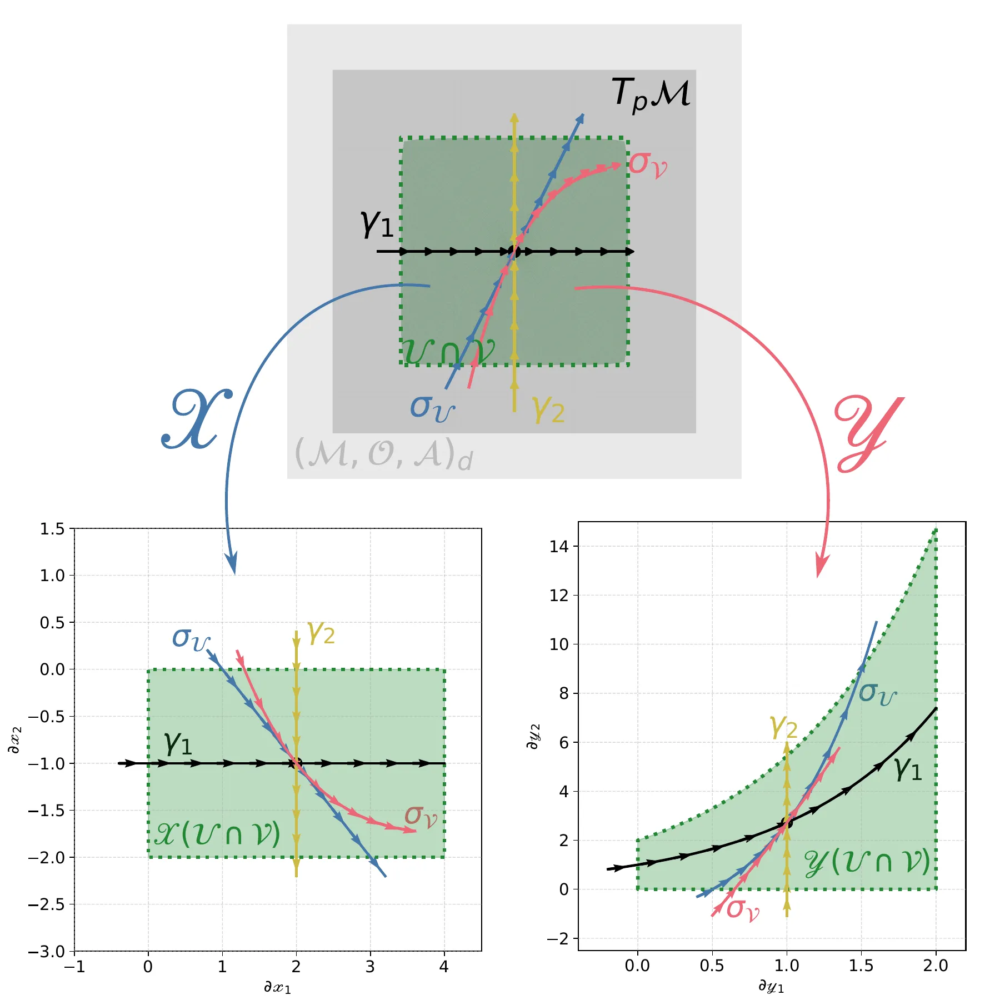

<!-- GENERATED by _port/convert/build.py from Appendices/examples_and_exercises/example_tangent_spaces.tex, main.tex.
     Do not edit this file: edit the LaTeX notes and re-run the converter. -->

```{=html}
<header class="dg-head dg-head-section"><p class="dg-kicker">Appendix C <span class="dg-sep">•</span> <a href="index.html">Examples</a></p><h1 class="dg-title"><span class="dg-secnum">C.3</span> Example of Tangent, Cotangent and Tensor Spaces (§§<a class="dg-xref" href="../tangent-spaces/tangent-space.html" data-kind="section" data-label="section_Tangent_Space">4.1</a>–<a class="dg-xref" href="../tangent-spaces/tensor-space.html" data-kind="section" data-label="section_Tensor_Space">4.3</a>)</h1></header>
<figure class="dg-figure" id="fig_TpM"><div class="dg-paper" style="--dg-frac:1.000"></div><figcaption><span class="dg-fignum">Figure C.4:</span>   Visualization of the curves <span class="math inline">\(\gamma_1\)</span> and <span class="math inline">\(\gamma_2\)</span> (from the example in Appendix <a class="dg-xref" href="#" data-kind="section" data-label="section_Example_TpM">C.3</a>) on the smooth manifold <span class="math inline">\(\left( \mathcal{M}, \mathcal{O}_{\mathcal{M}}, \mathcal{A}_{C^\infty} \right)_2\)</span>, with <span class="math inline">\(\mathcal{M} = \mathbb{R}^2\)</span>, both passing through the point <span class="math inline">\(p = (1,1)\)</span>. At that point, the velocities of the curves define elements of the tangent space <span class="math inline">\(T_p\mathcal{M}\)</span>. Arrowheads indicate the local direction of each curve. This figure illustrates that although the curves can be added within a chart, the resulting curve is chart-dependent and not intrinsic to the manifold.  </figcaption></figure>
<p>Consider the 2-dim. (topological) manifold <span class="math inline">\(\left( \mathcal{M}, \mathcal{O}_{\mathcal{M}}, \mathcal{A} \right)_2\)</span>, with <span class="math inline">\(\mathcal{M} \coloneqq \mathbb{R}^2\)</span> and <span class="math inline">\(\mathcal{O}_{\mathcal{M}} \coloneqq \mathcal{O}_{\mathbb{R}^2}\)</span> the standard topology. We denote generic points of the manifold by <span class="math inline">\(q = (q_1, q_2) \in \mathcal{M}\)</span>, reserving the letter <span class="math inline">\(p\)</span> for the specific point introduced below. The atlas <span class="math inline">\(\mathcal{A}\)</span> is formed by the two charts: <span class="math display">\[
    \mathcal{A} \coloneqq \left\lbrace
    \begin{array}{c@{\quad} | @{\quad} c}
        \textbf{Chart $(\mathcal{U}, \mathscr{X})$} &amp;
        \textbf{Chart $(\mathcal{V}, \mathscr{Y})$} \\[6pt]
        \begin{aligned}
            \mathcal{U}                    &amp;\coloneqq \mathcal{M} \\
            \mathscr{X} \colon \mathcal{U} &amp;\longrightarrow \mathscr{X}(\mathcal{U}) = \mathbb{R}^2 \\
            q                              &amp;\longmapsto \mathscr{X}(q) \coloneqq (2 q_1, -q_2)
        \end{aligned}
        &amp;
        \begin{aligned}
            \mathcal{V}                    &amp;\coloneqq \mathcal{M} \\
            \mathscr{Y} \colon \mathcal{V} &amp;\longrightarrow \mathscr{Y}(\mathcal{V}) = \mathbb{R}^2 \\
            q                              &amp;\longmapsto \mathscr{Y}(q) \coloneqq (q_1, q_2 e^{q_1})
        \end{aligned}
    \end{array}
    \right\rbrace
\]</span> Both chart domains cover the whole manifold, hence <span class="math inline">\(\mathcal{U} \cap \mathcal{V} = \mathcal{M}\)</span>. Both chart maps are homeomorphisms w.r.t. the standard topologies, with continuous inverse chart maps: <span class="math display">\[
    \begin{aligned}
        &amp;\begin{array}{c}
            \begin{aligned}
                \mathscr{X}^{-1} \colon \mathscr{X}(\mathcal{U}) &amp;\longrightarrow \mathcal{U} \\
                (\alpha_1, \alpha_2) &amp;\longmapsto \mathscr{X}^{-1}(\alpha_1, \alpha_2) = (\alpha_1/2, -\alpha_2)
            \end{aligned}
        \end{array}
        \quad
        &amp;\begin{array}{c}
            \begin{aligned}
                \mathscr{Y}^{-1} \colon \mathscr{Y}(\mathcal{V}) &amp;\longrightarrow \mathcal{V} \\
                (\beta_1, \beta_2)                               &amp;\longmapsto \mathscr{Y}^{-1}(\beta_1, \beta_2) = (\beta_1, \beta_2 e^{-\beta_1})
            \end{aligned}
        \end{array}
    \end{aligned}
\]</span></p>
<div class="dg-skip dg-medskip"></div>
<p>The atlas <span class="math inline">\(\mathcal{A}\)</span> is <span class="math inline">\(C^\infty\)</span>-compatible, since both chart transition maps are built from polynomials and exponentials, hence <span class="math inline">\(C^\infty\)</span> in the ordinary multivariable calculus sense: <span class="math display">\begin{align*}
    \textrm{\runic ᛖ}_{\mathcal{V}\mathcal{U}} \colon \mathscr{Y}(\mathcal{U} \cap \mathcal{V}) &amp;\longrightarrow \mathscr{X}(\mathcal{U} \cap \mathcal{V}) \\
    (\beta_1, \beta_2) &amp;\longmapsto \textrm{\runic ᛖ}_{\mathcal{V}\mathcal{U}}(\beta_1, \beta_2) \coloneqq
    \left( \mathscr{X} \circ \mathscr{Y}^{-1} \right)(\beta_1, \beta_2) = (2\beta_1, -\beta_2 e^{-\beta_1}), \\[6pt]
    \textrm{\runic ᛖ}_{\mathcal{U}\mathcal{V}} \colon \mathscr{X}(\mathcal{U} \cap \mathcal{V}) &amp;\longrightarrow \mathscr{Y}(\mathcal{U} \cap \mathcal{V}) \\
    (\alpha_1, \alpha_2) &amp;\longmapsto \textrm{\runic ᛖ}_{\mathcal{U}\mathcal{V}}(\alpha_1, \alpha_2) \coloneqq
    \left( \mathscr{Y} \circ \mathscr{X}^{-1} \right)(\alpha_1, \alpha_2) = (\alpha_1/2, -\alpha_2 e^{\alpha_1/2}).
\end{align*}</span> Therefore <span class="math inline">\(\mathcal{A} \equiv \mathcal{A}_{C^\infty}\)</span>, and <span class="math inline">\(\left( \mathcal{M}, \mathcal{O}_{\mathcal{M}}, \mathcal{A}_{C^\infty} \right)_2\)</span> is a 2-dim. smooth manifold.</p>
<div class="dg-skip dg-medskip"></div>
<p>Now consider the following two curves on the manifold: <span class="math display">\[
    \begin{aligned}
        &amp;\begin{array}{c}
            \begin{aligned}
                \gamma_1 \colon \mathbb{R} &amp;\longrightarrow \mathcal{M} \\
                \lambda &amp;\longmapsto \gamma_1(\lambda) \coloneqq (\lambda, 1)
            \end{aligned}
        \end{array}
        \quad
        &amp;\begin{array}{c}
            \begin{aligned}
                \gamma_2 \colon \mathbb{R} &amp;\longrightarrow \mathcal{M} \\
                \lambda                    &amp;\longmapsto \gamma_2(\lambda) \coloneqq (1, 2\lambda).
            \end{aligned}
        \end{array}
    \end{aligned}
\]</span> Both curves pass through the point <span class="math inline">\(p \coloneqq (1,1) \in \mathcal{M}\)</span>: <span class="math inline">\(\gamma_1(\lambda_1) = p\)</span> at <span class="math inline">\(\lambda_1 \coloneqq 1\)</span>, and <span class="math inline">\(\gamma_2(\lambda_2) = p\)</span> at <span class="math inline">\(\lambda_2 \coloneqq 1/2\)</span> (see Figure <a class="dg-xref" href="#fig_TpM" data-kind="figure" data-label="fig_TpM">C.4</a>). Their chart representatives, together with the coordinates of <span class="math inline">\(p\)</span> in each chart, are: <span class="math display">\[
    \begin{aligned}
        &amp;\begin{array}{c}
            \begin{aligned}
                (\mathscr{X} \circ \gamma_1)(\lambda) &amp;= (2\lambda, -1) \\
                (\mathscr{Y} \circ \gamma_1)(\lambda) &amp;= (\lambda, e^{\lambda})
            \end{aligned}
        \end{array}
        \qquad
        &amp;\begin{array}{c}
            \begin{aligned}
                (\mathscr{X} \circ \gamma_2)(\lambda) &amp;= (2, -2\lambda) \\
                (\mathscr{Y} \circ \gamma_2)(\lambda) &amp;= (1, 2e\lambda)
            \end{aligned}
        \end{array}
        \qquad
        &amp;\begin{array}{c}
            \begin{aligned}
                \mathscr{X}(p) &amp;= (2, -1) \\
                \mathscr{Y}(p) &amp;= (1, e)
            \end{aligned}
        \end{array}
    \end{aligned}
\]</span></p>
<div class="dg-skip dg-medskip"></div>
<p>We can explicitly add these curves <strong>in each chart</strong>, i.e., by adding their chart representatives component-wise in <span class="math inline">\(\mathbb{R}^2\)</span>. Recall that a manifold carries no notion of addition of its points: even though <span class="math inline">\(\mathcal{M} = \mathbb{R}^2\)</span> here, the vector-space structure of <span class="math inline">\(\mathbb{R}^2\)</span> is not part of <span class="math inline">\(\left( \mathcal{M}, \mathcal{O}_{\mathcal{M}}, \mathcal{A}_{C^\infty} \right)_2\)</span>, and we deliberately ignore it. We define the curves <span class="math inline">\(\sigma_{\mathcal{U}}\)</span> and <span class="math inline">\(\sigma_{\mathcal{V}}\)</span> through their chart representatives in <span class="math inline">\((\mathcal{U}, \mathscr{X})\)</span> and <span class="math inline">\((\mathcal{V}, \mathscr{Y})\)</span>, respectively: <span class="math display">\begin{align*}
    (\mathscr{X} \circ \sigma_{\mathcal{U}})(\lambda)
    &amp;\coloneqq (\mathscr{X} \circ \gamma_1)(\lambda_1 + \lambda)
    + (\mathscr{X} \circ \gamma_2)(\lambda_2 + \lambda)
    - \mathscr{X}(p) \\
    &amp;= (2 + 2\lambda, -1) + (2, -1 - 2\lambda) - (2, -1)
    = (2\lambda + 2, -2\lambda - 1), \\[6pt]
    (\mathscr{Y} \circ \sigma_{\mathcal{V}})(\lambda)
    &amp;\coloneqq (\mathscr{Y} \circ \gamma_1)(\lambda_1 + \lambda)
    + (\mathscr{Y} \circ \gamma_2)(\lambda_2 + \lambda)
    - \mathscr{Y}(p) \\
    &amp;= (1 + \lambda, e^{1 + \lambda}) + (1, e + 2e\lambda) - (1, e)
    = (\lambda + 1, e^{\lambda + 1} + 2e\lambda).
\end{align*}</span> Subtracting <span class="math inline">\(\mathscr{X}(p)\)</span> (resp. <span class="math inline">\(\mathscr{Y}(p)\)</span>) ensures that both curves pass through <span class="math inline">\(p\)</span> at <span class="math inline">\(\lambda_0 = 0\)</span>. Mapping these chart-level curves back to the manifold with the inverse chart maps, we explicitly observe that they differ: <span class="math display">\begin{align*}
    \sigma_{\mathcal{U}}(\lambda)
    &amp;= \mathscr{X}^{-1}\big( (\mathscr{X} \circ \sigma_{\mathcal{U}})(\lambda) \big)
    = (\lambda + 1, 2\lambda + 1)
    \longrightarrow \sigma_{\mathcal{U}}'(\lambda) = (1, 2), \\
    \sigma_{\mathcal{V}}(\lambda)
    &amp;= \mathscr{Y}^{-1}\big( (\mathscr{Y} \circ \sigma_{\mathcal{V}})(\lambda) \big)
    = (\lambda + 1, 1 + 2\lambda e^{-\lambda})
    \longrightarrow \sigma_{\mathcal{V}}'(\lambda) = \big( 1, 2e^{-\lambda}(1 - \lambda) \big).
\end{align*}</span></p>
<div class="dg-skip dg-medskip"></div>
<p>However, what does not depend on the chart is the velocity of these curves at <span class="math inline">\(p\)</span>, i.e., the vector they define in <span class="math inline">\(T_p\mathcal{M}\)</span>. Let us explicitly check this. For any scalar field <span class="math inline">\(f \in C^\infty(\mathcal{M})\)</span> we have<sup class="dg-fnref"><a href="#fn-1" id="fnref-1" aria-label="Footnote 1">1</a></sup>: <span class="math display">\begin{align*}
    v_{\sigma_{\mathcal{U}}, p}(f)
    &amp;\coloneqq (f \circ \sigma_{\mathcal{U}})'(0)
    = \sum_{i=1}^{2} (\sigma_{\mathcal{U}})_i'(0) \cdot \partial_i f\big( \sigma_{\mathcal{U}}(0) \big)
    = \partial_1 f(1,1) + 2 \cdot \partial_2 f(1,1), \\[6pt]
    v_{\sigma_{\mathcal{V}}, p}(f)
    &amp;\coloneqq (f \circ \sigma_{\mathcal{V}})'(0)
    = \sum_{i=1}^{2} (\sigma_{\mathcal{V}})_i'(0) \cdot \partial_i f\big( \sigma_{\mathcal{V}}(0) \big)
    = \partial_1 f(1,1) + 2 \cdot \partial_2 f(1,1), \\[6pt]
    \big( v_{\gamma_1, p} \oplus_T v_{\gamma_2, p} \big)(f)
    &amp;\coloneqq v_{\gamma_1, p}(f) + v_{\gamma_2, p}(f)
    = (f \circ \gamma_1)'(\lambda_1) + (f \circ \gamma_2)'(\lambda_2) \\
    &amp;= \sum_{i=1}^{2} (\gamma_1)_i'(\lambda_1) \cdot \partial_i f\big( \gamma_1(\lambda_1) \big)
    + \sum_{i=1}^{2} (\gamma_2)_i'(\lambda_2) \cdot \partial_i f\big( \gamma_2(\lambda_2) \big) \\
    &amp;= \big( 1 \cdot \partial_1 f(1,1) + 0 \cdot \partial_2 f(1,1) \big)
    + \big( 0 \cdot \partial_1 f(1,1) + 2 \cdot \partial_2 f(1,1) \big) \\
    &amp;= \partial_1 f(1,1) + 2 \cdot \partial_2 f(1,1).
\end{align*}</span> Since this holds <span class="math inline">\(\forall f \in C^\infty(\mathcal{M})\)</span>, we conclude: <span class="math display">\[
    v_{\sigma_{\mathcal{U}}, p} = v_{\sigma_{\mathcal{V}}, p} = v_{\gamma_1, p} \oplus_T v_{\gamma_2, p}.
\]</span> That is, the curve realizing the sum <span class="math inline">\(v_{\gamma_1, p} \oplus_T v_{\gamma_2, p}\)</span> depends on the chart used to construct it, but the element of <span class="math inline">\(T_p\mathcal{M}\)</span> it defines does not (cf. Appendix <a class="dg-xref" href="../proofs-and-additional-material/proof-existence-sum-prod-curves-tpm.html" data-kind="section" data-label="section_proof_existence_sum_prod_curves_TpM">B.4</a>).</p>
<div class="dg-footnotes"><div class="dg-fn" id="fn-1"><a class="dg-fn-num" href="#fnref-1" aria-label="Back to the text">1</a><div class="dg-fn-body"><p>Since <span class="math inline">\(\mathcal{M} = \mathbb{R}^2\)</span>, any <span class="math inline">\(f \in C^\infty(\mathcal{M})\)</span> is also a function <span class="math inline">\(f \colon \mathbb{R}^2 \to \mathbb{R}\)</span> that is smooth in the ordinary multivariable calculus sense: <span class="math inline">\(f = (f \circ \mathscr{X}^{-1}) \circ \mathscr{X}\)</span> is a composition of ordinarily smooth maps (equivalently, <span class="math inline">\(\mathcal{A} \cup \{ (\mathcal{M}, \mathrm{id}_{\mathbb{R}^2}) \}\)</span> is still a <span class="math inline">\(C^\infty\)</span>-compatible atlas). The same holds for the curves, viewed as maps <span class="math inline">\(\mathbb{R} \to \mathbb{R}^2\)</span>. We can therefore apply the multivariable chain rule directly to <span class="math inline">\(f \circ \sigma \colon \mathbb{R} \to \mathbb{R}\)</span>, where <span class="math inline">\(\partial_i f\)</span> denotes the ordinary partial derivative of <span class="math inline">\(f\)</span> w.r.t. its <span class="math inline">\(i\)</span>-th entry, and <span class="math inline">\((\sigma)_i'\)</span> the derivative of the <span class="math inline">\(i\)</span>-th component of <span class="math inline">\(\sigma\)</span>.</p></div></div></div>
<nav class="dg-web dg-prevnext" aria-label="Previous and next page"><a class="dg-prev" href="example-d-dim-mfld.html" rel="prev"><span aria-hidden="true">←</span> <span><span class="dg-secnum">C.2</span> Example of a <span class="math inline">\(d\)</span>-dimensional Smooth Manifold (§§3.2–3.3)</span></a><a class="dg-next" href="example-fields.html" rel="next"><span aria-hidden="true">→</span> <span><span class="dg-secnum">C.4</span> Example of Fields (§§5.1–5.3)</span></a></nav>
```
