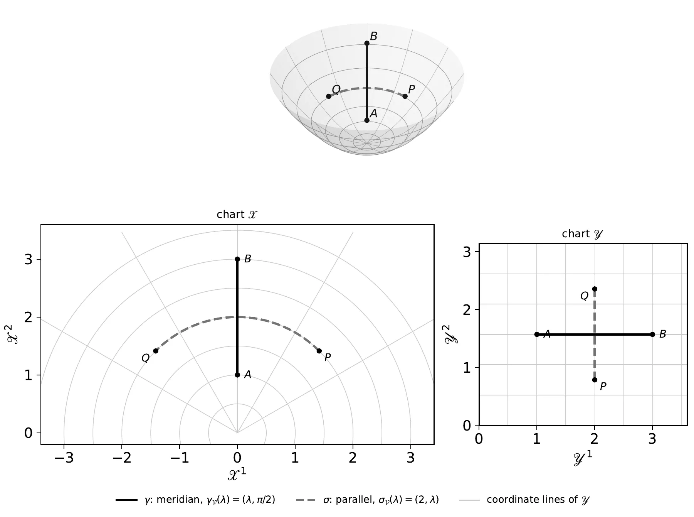
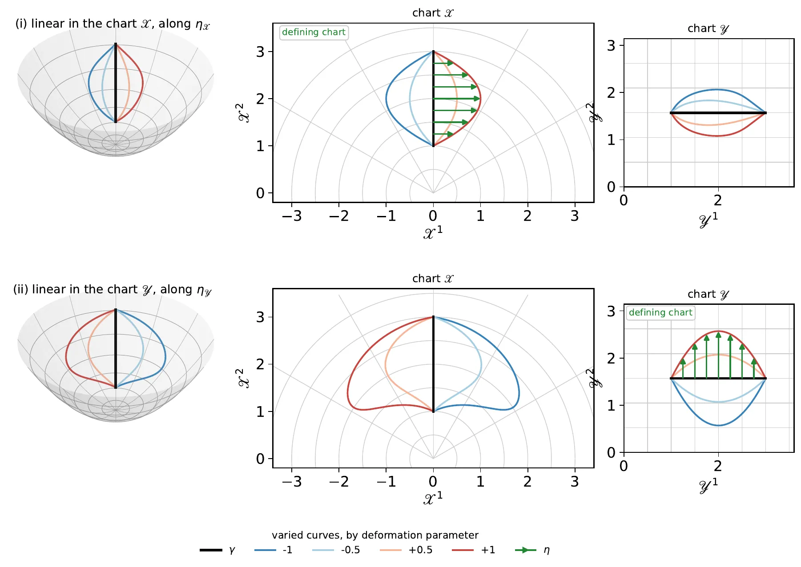
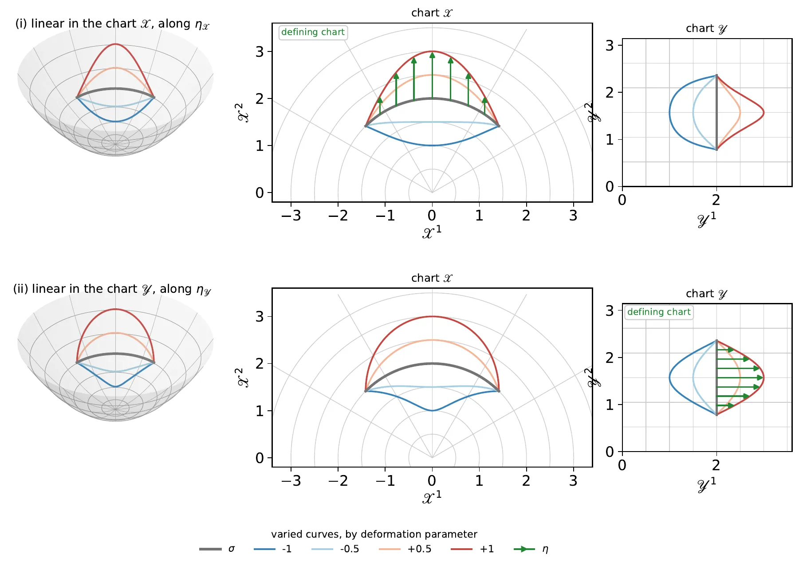
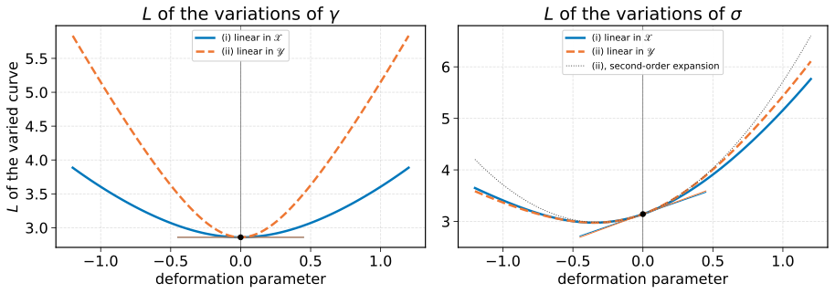

<!-- GENERATED by _port/convert/build.py from Appendices/examples_and_exercises/example_variations_euler_lagrange.tex, main.tex.
     Do not edit this file: edit the LaTeX notes and re-run the converter. -->

```{=html}
<header class="dg-head dg-head-section"><p class="dg-kicker">Appendix C <span class="dg-sep">•</span> <a href="index.html">Examples</a></p><h1 class="dg-title"><span class="dg-secnum">C.6</span> Example of Variations and Euler–Lagrange Equations (§<a class="dg-xref" href="../metric/length-geodesics.html#subsection_Variations_Euler_Lagrange" data-kind="subsection" data-label="subsection_Variations_Euler_Lagrange">7.2.1</a>)</h1></header>
<p>We follow the variational definition of geodesics of Chapter <a class="dg-xref" href="../metric/index.html" data-kind="chapter" data-label="chapter_Metric">7</a> on a manifold where every step can be done by hand: the Lagrangian in two charts, its Euler–Lagrange equations, how these change between charts, and the length of two families of variations of two curves, one geodesic and one not. Dots denote <span class="math inline">\(d/d\lambda\)</span>, and functions of <span class="math inline">\(p\)</span> written along a curve are evaluated at <span class="math inline">\(\gamma(\lambda)\)</span>.</p>
<div class="dg-skip dg-medskip"></div>
```

## `<span class="dg-secnum">C.6.1</span> Setting`{=html} {#subsection_Example_Variations_setting}

```{=html}
<p><strong>Manifold.</strong> Let <span class="math inline">\(\left( \mathcal{M}, \mathcal{O}_\mathcal{M}, \mathcal{A}_{C^\infty} \right)_2\)</span> be the paraboloid <span class="math display">\[
    \mathcal{M} \coloneqq \Big\{ p = (a, b, c) \in \mathbb{R}^3 \;\Big|\; c = \frac{1}{4} \big( a^2 + b^2 \big) \Big\},
\]</span> with the topology induced from <span class="math inline">\(\left( \mathbb{R}^3, \mathcal{O}_{\mathbb{R}^3} \right)\)</span>, and the atlas <span class="math inline">\(\mathcal{A} \coloneqq \{ (\mathcal{U}, \mathscr{X}), (\mathcal{V}, \mathscr{Y}) \}\)</span> formed by the cartesian and the polar charts: <span class="math display">\[
    \begin{array}{c@{\;\;} | @{\;\;} c}
        \textbf{Chart $(\mathcal{U}, \mathscr{X})$} &amp; \textbf{Chart $(\mathcal{V}, \mathscr{Y})$} \\[6pt]
        \begin{aligned}
            \mathcal{U}                    &amp;\coloneqq \mathcal{M} \\[2pt]
            \mathscr{X} \colon \mathcal{U} &amp;\longrightarrow \mathbb{R}^2 \\
            (a, b, c)                      &amp;\longmapsto \big( a \,,\, b \big)
        \end{aligned}
        &amp;
        \begin{aligned}
            \mathcal{V}                    &amp;\coloneqq \mathcal{M} \setminus \{ (a, 0, c) \in \mathcal{M} \mid a \leq 0 \} \\[2pt]
            \mathscr{Y} \colon \mathcal{V} &amp;\longrightarrow \{ (\beta_1, \beta_2) \in \mathbb{R}^2 \mid \beta_1 &gt; 0, \; -\pi &lt; \beta_2 &lt; \pi \} \\
            (a, b, c)                      &amp;\longmapsto \big( \sqrt{a^2 + b^2} \,,\, \operatorname{atan2}(b, a) \big)
        \end{aligned}
    \end{array}
\]</span> with inverses <span class="math inline">\(\mathscr{X}^{-1}(\alpha_1, \alpha_2) = \big( \alpha_1, \alpha_2, \frac{1}{4}(\alpha_1^2 + \alpha_2^2) \big)\)</span> and <span class="math inline">\(\mathscr{Y}^{-1}(\beta_1, \beta_2) = \big( \beta_1 \cos \beta_2, \beta_1 \sin \beta_2, \frac{1}{4} \beta_1^2 \big)\)</span>. At a point <span class="math inline">\(p = (a, b, c) \in \mathcal{V}\)</span> we write <span class="math inline">\(\mathscr{X}(p) = (a, b)\)</span> and <span class="math inline">\(\mathscr{Y}(p) = (\beta_1, \beta_2)\)</span>, so that <span class="math inline">\(a = \beta_1 \cos \beta_2\)</span>, <span class="math inline">\(b = \beta_1 \sin \beta_2\)</span> and <span class="math inline">\(c = \frac{1}{4} \beta_1^2\)</span>. The transition map <span class="math inline">\(\textrm{\runic ᛖ}_{\mathcal{V}\mathcal{U}}(\beta_1, \beta_2) = (\beta_1 \cos \beta_2, \beta_1 \sin \beta_2)\)</span> and its inverse are smooth on <span class="math inline">\(\mathscr{Y}(\mathcal{V})\)</span> and <span class="math inline">\(\mathscr{X}(\mathcal{V})\)</span>, and their Jacobians are <span class="math display">\[
    \left( \frac{\partial \mathscr{X}^i}{\partial \mathscr{Y}^k} \right)_p =
    \begin{bmatrix} \cos \beta_2 &amp; -\beta_1 \sin \beta_2 \\ \sin \beta_2 &amp; \beta_1 \cos \beta_2 \end{bmatrix}_{ik},
    \qquad
    \left( \frac{\partial \mathscr{Y}^k}{\partial \mathscr{X}^i} \right)_p =
    \begin{bmatrix} \cos \beta_2 &amp; \sin \beta_2 \\ -\sin \beta_2 / \beta_1 &amp; \cos \beta_2 / \beta_1 \end{bmatrix}_{ki}.
\]</span></p>
<div class="dg-skip dg-medskip"></div>
<p><strong>Height.</strong> The scalar field <span class="math inline">\(f(p) \coloneqq c\)</span> has chart representatives <span class="math inline">\(\big( f \circ \mathscr{X}^{-1} \big)(\alpha_1, \alpha_2) = \frac{1}{4} (\alpha_1^2 + \alpha_2^2)\)</span> and <span class="math inline">\(\big( f \circ \mathscr{Y}^{-1} \big)(\beta_1, \beta_2) = \frac{1}{4} \beta_1^2\)</span>, whose partial derivatives give the component functions of <span class="math inline">\(df\)</span> in each chart: <span class="math display">\[
    \mathtt{X}_1 = \frac{a}{2}, \qquad \mathtt{X}_2 = \frac{b}{2},
    \qquad\qquad
    \mathtt{Y}_1 = \frac{\beta_1}{2}, \qquad \mathtt{Y}_2 = 0 ,
\]</span> consistently with <span class="math inline">\(\mathtt{Y}_k = \big( \partial \mathscr{X}^i / \partial \mathscr{Y}^k \big) \mathtt{X}_i\)</span>.</p>
<div class="dg-skip dg-medskip"></div>
<p><strong>Metric.</strong> Since <span class="math inline">\(\mathcal{U} = \mathcal{M}\)</span>, the covector fields <span class="math inline">\(dx^1\)</span>, <span class="math inline">\(dx^2\)</span> are defined on all of <span class="math inline">\(\mathcal{M}\)</span>, and we define, for all <span class="math inline">\(\mathcal{X}_1, \mathcal{X}_2 \in \Gamma T\mathcal{M}\)</span>, <span class="math display">\[
    g(\mathcal{X}_1, \mathcal{X}_2) \coloneqq
    dx^1\left\lceil \mathcal{X}_1 \right\rfloor dx^1\left\lceil \mathcal{X}_2 \right\rfloor
    + dx^2\left\lceil \mathcal{X}_1 \right\rfloor dx^2\left\lceil \mathcal{X}_2 \right\rfloor
    + df\left\lceil \mathcal{X}_1 \right\rfloor df\left\lceil \mathcal{X}_2 \right\rfloor .
\]</span> With <span class="math inline">\(dx^k\left\lceil \partial x_i \right\rfloor = \delta^k_i\)</span> and <span class="math inline">\(df\left\lceil \partial x_i \right\rfloor = \mathtt{X}_i\)</span>, its components in <span class="math inline">\((\mathcal{U}, \mathscr{X})\)</span> are <span class="math display">\[
    (g_\mathscr{X})_{ij} = g(\partial x_i, \partial x_j) = \delta^1_i \delta^1_j + \delta^2_i \delta^2_j + \mathtt{X}_i \, \mathtt{X}_j =
    \begin{bmatrix} 1 + \frac{a^2}{4} &amp; \frac{ab}{4} \\[2pt] \frac{ab}{4} &amp; 1 + \frac{b^2}{4} \end{bmatrix}_{ij}.
\]</span> In <span class="math inline">\((\mathcal{V}, \mathscr{Y})\)</span>, the transformation law <span class="math inline">\((g_\mathscr{Y})_{kl} = \frac{\partial \mathscr{X}^i}{\partial \mathscr{Y}^k} \frac{\partial \mathscr{X}^j}{\partial \mathscr{Y}^l} (g_\mathscr{X})_{ij}\)</span> turns the first two terms into <span class="math inline">\(\sum_i \frac{\partial \mathscr{X}^i}{\partial \mathscr{Y}^k} \frac{\partial \mathscr{X}^i}{\partial \mathscr{Y}^l}\)</span>, i.e. <span class="math inline">\(1\)</span> for <span class="math inline">\(k = l = 1\)</span>, <span class="math inline">\(\beta_1^2\)</span> for <span class="math inline">\(k = l = 2\)</span> and <span class="math inline">\(0\)</span> otherwise, and the last one into <span class="math inline">\(\mathtt{Y}_k \, \mathtt{Y}_l\)</span>: <span class="math display">\[
    (g_\mathscr{Y})_{kl} =
    \begin{bmatrix} W &amp; 0 \\ 0 &amp; \beta_1^2 \end{bmatrix}_{kl},
    \qquad
    W \coloneqq 1 + \frac{\beta_1^2}{4} = 1 + \frac{a^2 + b^2}{4} .
\]</span> Both <span class="math inline">\(\det(g_\mathscr{X}) = W\)</span> and <span class="math inline">\(\det(g_\mathscr{Y}) = \beta_1^2 \, W\)</span> are positive, and <span class="math inline">\(g\)</span> is positive definite: a Riemannian metric.</p>
<div class="dg-skip dg-medskip"></div>
<p><strong>Curves.</strong> For a smooth curve <span class="math inline">\(\gamma : \mathbb{R} \to \mathcal{M}\)</span> we name the component functions of its chart representatives and its height, <span class="math display">\[
    \gamma_\mathcal{U}(\lambda) \coloneqq (\mathscr{X} \circ \gamma)(\lambda) = \big( a(\lambda), b(\lambda) \big),
    \qquad
    \gamma_\mathcal{V}(\lambda) \coloneqq (\mathscr{Y} \circ \gamma)(\lambda) = \big( r(\lambda), \theta(\lambda) \big),
    \qquad
    c(\lambda) \coloneqq (f \circ \gamma)(\lambda),
\]</span> the second one for those <span class="math inline">\(\lambda\)</span> with <span class="math inline">\(\gamma(\lambda) \in \mathcal{V}\)</span>. They are the coordinates <span class="math inline">\((a, b)\)</span>, <span class="math inline">\((\beta_1, \beta_2)\)</span> and <span class="math inline">\(c\)</span> of the point <span class="math inline">\(\gamma(\lambda)\)</span>, now as functions of <span class="math inline">\(\lambda\)</span>, so that <span class="math inline">\(a = r \cos \theta\)</span>, <span class="math inline">\(b = r \sin \theta\)</span> and <span class="math inline">\(c = \frac{1}{4} (a^2 + b^2) = \frac{1}{4} r^2\)</span>. The components of the velocity <span class="math inline">\(v_{\gamma(\lambda)}\)</span> are <span class="math inline">\(\dot{\gamma}_\mathcal{U} = (\dot{a}, \dot{b})\)</span> and <span class="math inline">\(\dot{\gamma}_\mathcal{V} = (\dot{r}, \dot{\theta})\)</span>, and the rate of change of the height is <span class="math display">\[
    \dot{c} = (df)_{\gamma(\lambda)}\big( v_{\gamma(\lambda)} \big) = \mathtt{X}_i \, \dot{\gamma}^i_\mathcal{U} = \frac{1}{2} \big( a \, \dot{a} + b \, \dot{b} \big)
    = \mathtt{Y}_k \, \dot{\gamma}^k_\mathcal{V} = \frac{1}{2} \, r \, \dot{r} .
\]</span> Since <span class="math inline">\(g\)</span> is Riemannian, <span class="math inline">\(\textrm{\runic ᛇ}_\gamma = +1\)</span> wherever <span class="math inline">\(v_\gamma \neq 0\)</span>, and the speed reads, in each chart, <span class="math display">\[
    s_\gamma^2 = (g_\mathscr{X})_{ij} \, \dot{\gamma}^i_\mathcal{U} \, \dot{\gamma}^j_\mathcal{U}
    = \dot{a}^2 + \dot{b}^2 + \frac{1}{4} \big( a \, \dot{a} + b \, \dot{b} \big)^2
    = \dot{a}^2 + \dot{b}^2 + \dot{c}^2 ,
    \qquad
    s_\gamma^2 = (g_\mathscr{Y})_{kl} \, \dot{\gamma}^k_\mathcal{V} \, \dot{\gamma}^l_\mathcal{V} = W \, \dot{r}^2 + r^2 \, \dot{\theta}^2 ,
\]</span> the two expressions agreeing since <span class="math inline">\(\dot{a}^2 + \dot{b}^2 = \dot{r}^2 + r^2 \dot{\theta}^2\)</span> and <span class="math inline">\(\dot{c}^2 = \frac{1}{4} r^2 \dot{r}^2\)</span>. The first one is the euclidean speed of <span class="math inline">\(\lambda \mapsto (a, b, c) \in \mathbb{R}^3\)</span>: <span class="math inline">\(g\)</span> is the metric induced by <span class="math inline">\(\mathbb{R}^3\)</span>.</p>
<div class="dg-skip dg-medskip"></div>
<p><strong>Euler–Lagrange expressions.</strong> For a curve <span class="math inline">\(\gamma\)</span> with <span class="math inline">\(\gamma([a,b]) \subseteq \mathcal{U}\)</span>, define, for <span class="math inline">\(m = 1, 2\)</span>, <span class="math display">\[
    (E_\mathscr{X})_m(\lambda) \coloneqq
    \frac{d}{d\lambda} \Big[ (\partial_{2+m} \mathcal{L}_\mathscr{X})(\gamma_\mathcal{U} ; \dot{\gamma}_\mathcal{U}) \Big]
    - (\partial_m \mathcal{L}_\mathscr{X})(\gamma_\mathcal{U} ; \dot{\gamma}_\mathcal{U}),
\]</span> and likewise <span class="math inline">\((E_\mathscr{Y})_m\)</span> with <span class="math inline">\(\mathcal{L}_\mathscr{Y}\)</span> and <span class="math inline">\((\gamma_\mathcal{V} ; \dot{\gamma}_\mathcal{V})\)</span>, so that <span class="math inline">\(\gamma\)</span> is a geodesic if and only if <span class="math inline">\(E_\mathscr{X} = 0\)</span> (or <span class="math inline">\(E_\mathscr{Y} = 0\)</span>). Here <span class="math inline">\(\partial_1, \partial_2\)</span> differentiate the position slots and <span class="math inline">\(\partial_3, \partial_4\)</span> the velocity slots of the chart representatives <span class="math display">\[
    \mathcal{L}_\mathscr{X}\big( a, b \, ; x^1_p, x^2_p \big) = \sqrt{ (x^1_p)^2 + (x^2_p)^2 + \tfrac{1}{4} \big( a \, x^1_p + b \, x^2_p \big)^2 },
    \qquad
    \mathcal{L}_\mathscr{Y}\big( \beta_1, \beta_2 \, ; y^1_p, y^2_p \big) = \sqrt{ W \, (y^1_p)^2 + \beta_1^2 \, (y^2_p)^2 } .
\]</span> Every partial derivative of <span class="math inline">\(\mathcal{L} = \sqrt{F}\)</span> carries a factor <span class="math inline">\(1 / \mathcal{L}\)</span>, which equals <span class="math inline">\(1 / s_\gamma\)</span> on the curve. Since <span class="math inline">\(s_\gamma &gt; 0\)</span>, we clear it by computing <span class="math inline">\(s_\gamma \, E\)</span>, which vanishes if and only if <span class="math inline">\(E\)</span> does.</p>
<div class="dg-skip dg-medskip"></div>
<p><strong>Cartesian chart.</strong></p>
<ol class="dg-enumerate dg-depth-1">
<li><p><em>Partial derivatives.</em> With <span class="math inline">\(u \coloneqq a \, x^1_p + b \, x^2_p\)</span> and <span class="math inline">\(\partial \sqrt{F} = \partial F / (2 \sqrt{F})\)</span>,  <span class="math display">\[
            \partial_1 \mathcal{L}_\mathscr{X} = \frac{u \, x^1_p}{4 \mathcal{L}_\mathscr{X}}, \qquad
            \partial_2 \mathcal{L}_\mathscr{X} = \frac{u \, x^2_p}{4 \mathcal{L}_\mathscr{X}}, \qquad
            \partial_3 \mathcal{L}_\mathscr{X} = \frac{x^1_p + \frac{1}{4} u \, a}{\mathcal{L}_\mathscr{X}}, \qquad
            \partial_4 \mathcal{L}_\mathscr{X} = \frac{x^2_p + \frac{1}{4} u \, b}{\mathcal{L}_\mathscr{X}} .
        \]</span></p></li>
<li><p><em>On the curve.</em> With <span class="math inline">\((a, b \, ; x^1_p, x^2_p) = (a, b \, ; \dot{a}, \dot{b})\)</span>: <span class="math inline">\(u = a \dot{a} + b \dot{b} = 2 \dot{c}\)</span>, <span class="math inline">\(\frac{1}{4} u \, a = \dot{c} \, \mathtt{X}_1\)</span>, <span class="math inline">\(\frac{1}{4} u \, b = \dot{c} \, \mathtt{X}_2\)</span> and <span class="math inline">\(\mathcal{L}_\mathscr{X} = s_\gamma\)</span>, so  <span class="math display">\[
            \partial_1 \mathcal{L}_\mathscr{X} = \frac{\dot{c} \, \dot{a}}{2 s_\gamma}, \qquad
            \partial_2 \mathcal{L}_\mathscr{X} = \frac{\dot{c} \, \dot{b}}{2 s_\gamma}, \qquad
            \partial_3 \mathcal{L}_\mathscr{X} = \frac{\dot{a} + \dot{c} \, \mathtt{X}_1}{s_\gamma}, \qquad
            \partial_4 \mathcal{L}_\mathscr{X} = \frac{\dot{b} + \dot{c} \, \mathtt{X}_2}{s_\gamma} .
        \]</span></p></li>
<li><p><em><span class="math inline">\(\lambda\)</span>-derivative.</em> By the quotient rule and <span class="math inline">\(\frac{d}{d\lambda} (\mathtt{X}_1 \circ \gamma) = \frac{1}{2} \dot{a}\)</span>,  <span class="math display">\[
            \frac{d}{d\lambda} \big[ \partial_3 \mathcal{L}_\mathscr{X} \big]
            = \frac{\ddot{a} + \ddot{c} \, \mathtt{X}_1 + \frac{1}{2} \dot{c} \, \dot{a}}{s_\gamma} - \frac{s_\gamma'}{s_\gamma^2} \big( \dot{a} + \dot{c} \, \mathtt{X}_1 \big).
        \]</span>  Subtracting <span class="math inline">\(\partial_1 \mathcal{L}_\mathscr{X}\)</span> cancels the term <span class="math inline">\(\frac{1}{2} \dot{c} \, \dot{a} / s_\gamma\)</span>, and likewise for <span class="math inline">\(m = 2\)</span>:  <span class="math display">\[
            \boxed{
                s_\gamma (E_\mathscr{X})_1 = \ddot{a} + \mathtt{X}_1 \, \ddot{c} - \frac{s_\gamma'}{s_\gamma} \big( \dot{a} + \dot{c} \, \mathtt{X}_1 \big),
                \qquad
                s_\gamma (E_\mathscr{X})_2 = \ddot{b} + \mathtt{X}_2 \, \ddot{c} - \frac{s_\gamma'}{s_\gamma} \big( \dot{b} + \dot{c} \, \mathtt{X}_2 \big) .
            }
        \]</span></p></li>
</ol>
<p><strong>Polar chart.</strong></p>
<ol class="dg-enumerate dg-depth-1">
<li><p><em>Partial derivatives on the curve.</em> With <span class="math inline">\(\partial_1 W = \frac{1}{2} \beta_1\)</span> and <span class="math inline">\((\beta_1, \beta_2 \, ; y^1_p, y^2_p) = (r, \theta \, ; \dot{r}, \dot{\theta})\)</span>,  <span class="math display">\[
            \partial_1 \mathcal{L}_\mathscr{Y} = \frac{\frac{1}{4} r \dot{r}^2 + r \dot{\theta}^2}{s_\gamma}, \qquad
            \partial_2 \mathcal{L}_\mathscr{Y} = 0, \qquad
            \partial_3 \mathcal{L}_\mathscr{Y} = \frac{W \dot{r}}{s_\gamma}, \qquad
            \partial_4 \mathcal{L}_\mathscr{Y} = \frac{r^2 \dot{\theta}}{s_\gamma} .
        \]</span></p></li>
<li><p><em><span class="math inline">\(\lambda\)</span>-derivative.</em> By the quotient rule and <span class="math inline">\(\frac{d}{d\lambda} (W \circ \gamma) = \frac{1}{2} r \dot{r}\)</span>,  <span class="math display">\[
            \boxed{
                s_\gamma (E_\mathscr{Y})_1 = W \ddot{r} + \tfrac{1}{4} r \dot{r}^2 - r \dot{\theta}^2 - \frac{s_\gamma'}{s_\gamma} \, W \dot{r},
                \qquad
                s_\gamma (E_\mathscr{Y})_2 = r^2 \ddot{\theta} + 2 r \dot{r} \dot{\theta} - \frac{s_\gamma'}{s_\gamma} \, r^2 \dot{\theta} .
            }
        \]</span>  Since <span class="math inline">\(\partial_2 \mathcal{L}_\mathscr{Y} = 0\)</span> (the angle is <strong>cyclic</strong>), <span class="math inline">\((E_\mathscr{Y})_2 = \frac{d}{d\lambda} \big[ r^2 \dot{\theta} / s_\gamma \big]\)</span>, so <span class="math inline">\(r^2 \dot{\theta} / s_\gamma\)</span> is constant along every geodesic.</p></li>
</ol>
<p>For a constant-speed parametrization, <span class="math inline">\(s_\gamma' = 0\)</span> and the last term of every boxed expression drops.</p>
<div class="dg-skip dg-medskip"></div>
<p><em>Contraction with the velocity.</em> For every curve, <span class="math inline">\((E_\mathscr{X})_m \, \dot{\gamma}^m_\mathcal{U} = 0\)</span>. Using <span class="math inline">\(\mathtt{X}_1 \dot{a} + \mathtt{X}_2 \dot{b} = \dot{c}\)</span> and <span class="math inline">\(s_\gamma s_\gamma' = \dot{a} \ddot{a} + \dot{b} \ddot{b} + \dot{c} \ddot{c}\)</span>, <span class="math display">\[
    s_\gamma \, (E_\mathscr{X})_m \, \dot{\gamma}^m_\mathcal{U}
    = \big( \dot{a} \ddot{a} + \dot{b} \ddot{b} + \dot{c} \ddot{c} \big) - \frac{s_\gamma'}{s_\gamma} \big( \dot{a}^2 + \dot{b}^2 + \dot{c}^2 \big)
    = s_\gamma s_\gamma' - \frac{s_\gamma'}{s_\gamma} \, s_\gamma^2 = 0 .
\]</span> Only the component of <span class="math inline">\(E_\mathscr{X}\)</span> transverse to the curve carries information: a variation with <span class="math inline">\(\textrm{\runic ᛉ} \propto \dot{\gamma}_\mathcal{U}\)</span> moves the curve along itself, which to first order is a reparametrization and leaves the length unchanged.</p>
<div class="dg-skip dg-medskip"></div>
```

## `<span class="dg-secnum">C.6.2</span> Change of chart`{=html} {#subsection_Example_Variations_change}

```{=html}
<p><strong>Claim.</strong> Along any curve in <span class="math inline">\(\mathcal{U} \cap \mathcal{V}\)</span>, <span class="math display">\[
    \boxed{
        (E_\mathscr{Y})_k = \frac{\partial \mathscr{X}^i}{\partial \mathscr{Y}^k} \, (E_\mathscr{X})_i ,
    }
\]</span> the transformation law of the components of a covector. Hence <span class="math inline">\(E_\mathscr{X} = 0 \iff E_\mathscr{Y} = 0\)</span>: being a geodesic does not depend on the chart.</p>
<div class="dg-skip dg-medskip"></div>
<p><strong>Proof</strong> (any <span class="math inline">\(d\)</span>, any two charts). Let <span class="math inline">\(\textrm{\runic ᛖ}_{\mathcal{V}\mathcal{U}} \coloneqq \mathscr{X} \circ \mathscr{Y}^{-1}\)</span> and <span class="math inline">\(J^i_k \coloneqq \partial_k \textrm{\runic ᛖ}_{\mathcal{V}\mathcal{U}}^i\)</span>.</p>
<ol class="dg-enumerate dg-depth-1">
<li><p>Since <span class="math inline">\(x^i = J^i_l \, y^l\)</span> are the components of the same vector, <span class="math inline">\(\mathcal{L}_\mathscr{Y}(\beta \, ; y) = \mathcal{L}_\mathscr{X}\big( \textrm{\runic ᛖ}_{\mathcal{V}\mathcal{U}}(\beta) \, ; J(\beta) \, y \big)\)</span>.</p></li>
<li><p>Chain rule: <span class="math inline">\(\partial_{d+k} \mathcal{L}_\mathscr{Y} = J^i_k \, \partial_{d+i} \mathcal{L}_\mathscr{X}\)</span> and <span class="math inline">\(\partial_k \mathcal{L}_\mathscr{Y} = J^i_k \, \partial_i \mathcal{L}_\mathscr{X} + (\partial_k J^i_l) \, y^l \, \partial_{d+i} \mathcal{L}_\mathscr{X}\)</span>.</p></li>
<li><p>Along the curve, <span class="math inline">\(\frac{d}{d\lambda} J^i_k = (\partial_l J^i_k) \, \dot{\gamma}^l_\mathcal{V} = (\partial_k J^i_l) \, \dot{\gamma}^l_\mathcal{V}\)</span> by Schwarz’s theorem, so  <span class="math display">\[
            \begin{aligned}
                (E_\mathscr{Y})_k
                &amp;= J^i_k \, \frac{d}{d\lambda} \big[ \partial_{d+i} \mathcal{L}_\mathscr{X} \big] + (\partial_k J^i_l) \, \dot{\gamma}^l_\mathcal{V} \, \partial_{d+i} \mathcal{L}_\mathscr{X}
                - J^i_k \, \partial_i \mathcal{L}_\mathscr{X} - (\partial_k J^i_l) \, \dot{\gamma}^l_\mathcal{V} \, \partial_{d+i} \mathcal{L}_\mathscr{X} \\
                &amp;= J^i_k \, (E_\mathscr{X})_i . \qquad \square
            \end{aligned}
        \]</span></p></li>
</ol>
<div class="dg-skip dg-medskip"></div>
```

## `<span class="dg-secnum">C.6.3</span> Two curves`{=html} {#subsection_Example_Variations_curves}

```{=html}
<p>Consider the meridian <span class="math inline">\(\gamma\)</span> from <span class="math inline">\(A \coloneqq \mathscr{X}^{-1}(0, 1)\)</span> to <span class="math inline">\(B \coloneqq \mathscr{X}^{-1}(0, 3)\)</span>, and the arc <span class="math inline">\(\sigma\)</span> of the parallel <span class="math inline">\(\beta_1 = 2\)</span> from <span class="math inline">\(P \coloneqq \mathscr{X}^{-1}(\sqrt{2}, \sqrt{2})\)</span> to <span class="math inline">\(Q \coloneqq \mathscr{X}^{-1}(-\sqrt{2}, \sqrt{2})\)</span> (Figure <a class="dg-xref" href="#fig_Example_Variations_curves" data-kind="figure" data-label="fig_Example_Variations_curves">C.9</a>): <span class="math display">\[
    \begin{aligned}
        \gamma_\mathcal{U}(\lambda) &amp;= (0, \lambda),                     &amp; \gamma_\mathcal{V}(\lambda) &amp;= \big( \lambda, \tfrac{\pi}{2} \big), &amp; \lambda &amp;\in [1, 3], \\
        \sigma_\mathcal{U}(\lambda) &amp;= (2 \cos \lambda, 2 \sin \lambda), &amp; \sigma_\mathcal{V}(\lambda) &amp;= (2, \lambda),                        &amp; \lambda &amp;\in \big[ \tfrac{\pi}{4}, \tfrac{3\pi}{4} \big].
    \end{aligned}
\]</span></p>
<figure class="dg-figure" id="fig_Example_Variations_curves"><div class="dg-paper" style="--dg-frac:0.750"></div><figcaption><span class="dg-fignum">Figure C.9:</span>   The meridian <span class="math inline">\(\gamma\)</span> (black) from <span class="math inline">\(A\)</span> to <span class="math inline">\(B\)</span> and the arc of parallel <span class="math inline">\(\sigma\)</span> (grey, dashed) from <span class="math inline">\(P\)</span> to <span class="math inline">\(Q\)</span> of Subsection <a class="dg-xref" href="#subsection_Example_Variations_curves" data-kind="subsection" data-label="subsection_Example_Variations_curves">C.6.3</a>, on <span class="math inline">\(\mathcal{M}\)</span> (top) and in the charts <span class="math inline">\((\mathcal{U}, \mathscr{X})\)</span> and <span class="math inline">\((\mathcal{V}, \mathscr{Y})\)</span> (bottom, same scale), with the coordinate lines of <span class="math inline">\(\mathscr{Y}\)</span> in light grey. Both curves are straight in <span class="math inline">\(\mathscr{Y}\)</span>; only <span class="math inline">\(\gamma\)</span> is a geodesic.</figcaption></figure>
<p><strong>The meridian is a geodesic.</strong> Its parametrization does not have constant speed, so the terms with <span class="math inline">\(s_\gamma'\)</span> matter.</p>
<ol class="dg-enumerate dg-depth-1">
<li><p><em>Ingredients.</em> <span class="math inline">\(\dot{a} = \ddot{a} = 0\)</span>, <span class="math inline">\(\dot{b} = 1\)</span>, <span class="math inline">\(\ddot{b} = 0\)</span>, <span class="math inline">\(c = \frac{\lambda^2}{4}\)</span>, <span class="math inline">\(\dot{c} = \frac{\lambda}{2}\)</span>, <span class="math inline">\(\ddot{c} = \frac{1}{2}\)</span>, <span class="math inline">\(\mathtt{X}_1 = 0\)</span>, <span class="math inline">\(\mathtt{X}_2 = \frac{\lambda}{2}\)</span>, <span class="math inline">\(W = 1 + \frac{\lambda^2}{4}\)</span>, and <span class="math inline">\(s_\gamma = \sqrt{1 + \dot{c}^2} = \sqrt{W}\)</span>, so <span class="math inline">\(\frac{s_\gamma'}{s_\gamma} = \frac{\dot{W}}{2W} = \frac{\lambda}{4W}\)</span>.</p></li>
<li><p><em>Cartesian chart.</em> <span class="math inline">\(s_\gamma (E_\mathscr{X})_1 = 0\)</span>, and  <span class="math display">\[
            s_\gamma (E_\mathscr{X})_2 = 0 + \frac{\lambda}{2} \cdot \frac{1}{2} - \frac{\lambda}{4W} \Big( 1 + \frac{\lambda}{2} \cdot \frac{\lambda}{2} \Big) = \frac{\lambda}{4} - \frac{\lambda}{4W} \, W = 0 .
        \]</span></p></li>
<li><p><em>Polar chart.</em> <span class="math inline">\(r = \lambda\)</span>, <span class="math inline">\(\dot{r} = 1\)</span>, <span class="math inline">\(\ddot{r} = 0\)</span>, <span class="math inline">\(\dot{\theta} = \ddot{\theta} = 0\)</span>: <span class="math inline">\(s_\gamma (E_\mathscr{Y})_1 = 0 + \frac{\lambda}{4} - 0 - \frac{\lambda}{4W} \, W = 0\)</span> and <span class="math inline">\(s_\gamma (E_\mathscr{Y})_2 = 0\)</span>.</p></li>
<li><p><em>Length.</em> With <span class="math inline">\(F(\lambda) \coloneqq \frac{\lambda}{2} \sqrt{W} + \operatorname{arsinh} \frac{\lambda}{2}\)</span>, which satisfies <span class="math inline">\(F' = \sqrt{W}\)</span>,  <span class="math display">\[
            L_{[1,3]}[\gamma] = \int_1^3 \sqrt{1 + \tfrac{\lambda^2}{4}} \; d\lambda = F(3) - F(1) = \frac{3 \sqrt{13} - \sqrt{5}}{4} + \operatorname{arsinh} \tfrac{3}{2} - \operatorname{arsinh} \tfrac{1}{2} .
        \]</span></p></li>
</ol>
<p><strong>The parallel is not a geodesic.</strong></p>
<ol class="dg-enumerate dg-depth-1">
<li><p><em>Ingredients.</em> <span class="math inline">\(c = 1\)</span>, so <span class="math inline">\(\dot{c} = \ddot{c} = 0\)</span>; <span class="math inline">\(\dot{\sigma}_\mathcal{U} = (-2 \sin \lambda, 2 \cos \lambda)\)</span>, <span class="math inline">\(\ddot{\sigma}_\mathcal{U} = -\sigma_\mathcal{U}\)</span>; <span class="math inline">\(s_\sigma = 2\)</span> and <span class="math inline">\(s_\sigma' = 0\)</span>.</p></li>
<li><p><em>Cartesian chart.</em> Only the accelerations survive:  <span class="math display">\[
            (E_\mathscr{X})_1 = \tfrac{1}{2} (-2 \cos \lambda) = -\cos \lambda, \qquad (E_\mathscr{X})_2 = \tfrac{1}{2} (-2 \sin \lambda) = -\sin \lambda .
        \]</span></p></li>
<li><p><em>Polar chart.</em> <span class="math inline">\(r = 2\)</span>, <span class="math inline">\(\dot{r} = \ddot{r} = 0\)</span>, <span class="math inline">\(\dot{\theta} = 1\)</span>, <span class="math inline">\(\ddot{\theta} = 0\)</span>:  <span class="math display">\[
            (E_\mathscr{Y})_1 = \tfrac{1}{2} (-2) = -1, \qquad (E_\mathscr{Y})_2 = 0 .
        \]</span></p></li>
<li><p><em>Change of chart.</em> With <span class="math inline">\(\beta_2 = \lambda\)</span>: <span class="math inline">\(\cos \lambda \, (-\cos \lambda) + \sin \lambda \, (-\sin \lambda) = -1\)</span> and <span class="math inline">\(-2 \sin \lambda \, (-\cos \lambda) + 2 \cos \lambda \, (-\sin \lambda) = 0\)</span>, as the Claim of Subsection <a class="dg-xref" href="#subsection_Example_Variations_change" data-kind="subsection" data-label="subsection_Example_Variations_change">C.6.2</a> requires. ✓ <span class="math inline">\(E\)</span> has no component along <span class="math inline">\(\dot{\sigma}\)</span>, which points in the direction of <span class="math inline">\(\partial y_2\)</span>.</p></li>
<li><p><em>Length.</em> <span class="math inline">\(L_{[\pi/4, 3\pi/4]}[\sigma] = \int_{\pi/4}^{3\pi/4} 2 \, d\lambda = \pi\)</span>.</p></li>
</ol>
<div class="dg-skip dg-medskip"></div>
```

## `<span class="dg-secnum">C.6.4</span> Variations of the meridian`{=html} {#subsection_Example_Variations_gamma}

```{=html}
<p>With <span class="math inline">\(\varphi(\lambda) \coloneqq (\lambda - 1)(3 - \lambda)\)</span>, which vanishes at <span class="math inline">\(\lambda = 1, 3\)</span>, and <span class="math inline">\(\varphi' = 4 - 2\lambda\)</span>, consider (Figure <a class="dg-xref" href="#fig_Example_Variations_gamma" data-kind="figure" data-label="fig_Example_Variations_gamma">C.10</a>) <span class="math display">\[
    \text{(i)} \quad \mathscr{X} \circ \gamma_{\textrm{\runic ᛊ}} = \big( \textrm{\runic ᛊ} \, \varphi, \, \lambda \big), \quad \textrm{\runic ᛉ}_\mathscr{X} = (\varphi, 0);
    \qquad
    \text{(ii)} \quad \mathscr{Y} \circ \gamma_{\textrm{\runic ᛊ}} = \big( \lambda, \, \tfrac{\pi}{2} + \textrm{\runic ᛊ} \, \varphi \big), \quad \textrm{\runic ᛉ}_\mathscr{Y} = (0, \varphi).
\]</span> Family (i) pushes <span class="math inline">\(\gamma\)</span> sideways in the chart <span class="math inline">\(\mathscr{X}\)</span>, family (ii) rotates it in the chart <span class="math inline">\(\mathscr{Y}\)</span> (admissible for <span class="math inline">\(|\textrm{\runic ᛊ}| &lt; \frac{\pi}{2}\)</span>, since <span class="math inline">\(\varphi \leq 1\)</span>). Neither is a straight shift in the other chart: e.g. for (ii), <span class="math inline">\(\mathscr{X} \circ \gamma_{\textrm{\runic ᛊ}} = \lambda \big( -\sin(\textrm{\runic ᛊ} \varphi), \cos(\textrm{\runic ᛊ} \varphi) \big)\)</span> is not affine in <span class="math inline">\(\textrm{\runic ᛊ}\)</span>.</p>
<figure class="dg-figure" id="fig_Example_Variations_gamma"><div class="dg-paper" style="--dg-frac:1.000"></div><figcaption><span class="dg-fignum">Figure C.10:</span>   Families (i) (top) and (ii) (bottom) of Subsection <a class="dg-xref" href="#subsection_Example_Variations_gamma" data-kind="subsection" data-label="subsection_Example_Variations_gamma">C.6.4</a>, for deformation parameter <span class="math inline">\(\pm 0.5\)</span>, <span class="math inline">\(\pm 1\)</span> (blue negative, red positive), on <span class="math inline">\(\mathcal{M}\)</span> and in both charts. The vectors <span class="math inline">\(\textrm{\runic ᛉ}\)</span> (green, deformation parameter <span class="math inline">\(1\)</span>) are drawn in the chart that defines each family, where the varied curves are straight shifts of <span class="math inline">\(\gamma\)</span>.</figcaption></figure>
<ol class="dg-enumerate dg-depth-1">
<li><p><em>First variation.</em> By step 5 of Appendix <a class="dg-xref" href="../proofs-and-additional-material/proof-euler-lagrange.html" data-kind="section" data-label="section_proof_Euler_Lagrange">B.14</a>, in the chart defining each family,  <span class="math display">\[
            \text{(i)} \;\; \frac{d}{d\textrm{\runic ᛊ}} L_{[1,3]}[\gamma_{\textrm{\runic ᛊ}}] \Big|_{\textrm{\runic ᛊ}=0} = -\int_1^3 (E_\mathscr{X})_1 \, \varphi \, d\lambda = 0,
            \qquad
            \text{(ii)} \;\; \frac{d}{d\textrm{\runic ᛊ}} L_{[1,3]}[\gamma_{\textrm{\runic ᛊ}}] \Big|_{\textrm{\runic ᛊ}=0} = -\int_1^3 (E_\mathscr{Y})_2 \, \varphi \, d\lambda = 0 .
        \]</span></p></li>
<li><p><em>Family (ii), exactly.</em> The varied curve has <span class="math inline">\(r = \lambda\)</span>, <span class="math inline">\(\dot{r} = 1\)</span>, <span class="math inline">\(\dot{\theta} = \textrm{\runic ᛊ} \, \varphi'\)</span>, so  <span class="math display">\[
            L_{[1,3]}[\gamma_{\textrm{\runic ᛊ}}] = \int_1^3 \sqrt{W + \textrm{\runic ᛊ}^2 \lambda^2 \varphi'^2} \; d\lambda \;\geq\; \int_1^3 \sqrt{W} \, d\lambda = L_{[1,3]}[\gamma] ,
        \]</span>  with equality only for <span class="math inline">\(\textrm{\runic ᛊ} = 0\)</span>: rotating any part of the meridian makes it longer.</p></li>
<li><p><em>Family (i), to second order.</em> The varied curve has <span class="math inline">\((a, b; \dot{a}, \dot{b}) = (\textrm{\runic ᛊ} \varphi, \lambda; \textrm{\runic ᛊ} \varphi', 1)\)</span>, so <span class="math inline">\(u = \lambda + \textrm{\runic ᛊ}^2 \varphi \varphi'\)</span> and  <span class="math display">\[
            \mathcal{L}_\mathscr{X}^2 = \textrm{\runic ᛊ}^2 \varphi'^2 + 1 + \tfrac{1}{4} \big( \lambda + \textrm{\runic ᛊ}^2 \varphi \varphi' \big)^2
            = W + \textrm{\runic ᛊ}^2 \big( \varphi'^2 + \tfrac{1}{2} \lambda \varphi \varphi' \big) + O(\textrm{\runic ᛊ}^4) .
        \]</span>  With <span class="math inline">\(\sqrt{W + \delta} = \sqrt{W} + \delta / (2 \sqrt{W}) + O(\delta^2)\)</span>, <span class="math inline">\(L_{[1,3]}[\gamma_{\textrm{\runic ᛊ}}] = L_{[1,3]}[\gamma] + \frac{1}{2} \textrm{\runic ᛊ}^2 \, I + O(\textrm{\runic ᛊ}^4)\)</span>, where, integrating by parts with <span class="math inline">\(\frac{1}{2} \lambda \varphi \varphi' = \frac{1}{4} \lambda (\varphi^2)'\)</span>, <span class="math inline">\(\varphi(1) = \varphi(3) = 0\)</span> and <span class="math inline">\((\lambda W^{-1/2})' = W^{-3/2}\)</span>,  <span class="math display">\[
            I = \int_1^3 \frac{\varphi'^2 + \frac{1}{2} \lambda \varphi \varphi'}{\sqrt{W}} \, d\lambda = \int_1^3 \Big( \frac{\varphi'^2}{\sqrt{W}} - \frac{\varphi^2}{4 W^{3/2}} \Big) d\lambda .
        \]</span></p></li>
<li><p><em>Sign of <span class="math inline">\(I\)</span>.</em> On <span class="math inline">\([1,3]\)</span>, <span class="math inline">\(\frac{5}{4} \leq W \leq \frac{13}{4}\)</span>, and Wirtinger’s inequality for functions vanishing at both ends of an interval of length <span class="math inline">\(2\)</span> gives <span class="math inline">\(\int_1^3 \varphi'^2 \, d\lambda \geq \frac{\pi^2}{4} \int_1^3 \varphi^2 \, d\lambda\)</span>. Therefore  <span class="math display">\[
            I \;\geq\; \frac{2}{\sqrt{13}} \cdot \frac{\pi^2}{4} \int_1^3 \varphi^2 \, d\lambda - \frac{1}{4} \Big( \frac{4}{5} \Big)^{3/2} \int_1^3 \varphi^2 \, d\lambda
            = \Big( \frac{\pi^2}{2 \sqrt{13}} - \frac{2}{5 \sqrt{5}} \Big) \int_1^3 \varphi^2 \, d\lambda &gt; 0 ,
        \]</span>  since <span class="math inline">\(\frac{\pi^2}{2 \sqrt{13}} &gt; 1 &gt; \frac{2}{5 \sqrt{5}}\)</span>. The argument only uses <span class="math inline">\(\varphi(1) = \varphi(3) = 0\)</span>, so <span class="math inline">\(\textrm{\runic ᛊ} = 0\)</span> is a strict local minimum of the length for every sideways push <span class="math inline">\(\textrm{\runic ᛉ}_\mathscr{X} = (\varphi, 0)\)</span>, not only for this <span class="math inline">\(\varphi\)</span> (Figure <a class="dg-xref" href="#fig_Example_Variations_length" data-kind="figure" data-label="fig_Example_Variations_length">C.12</a>, left).</p></li>
</ol>
<div class="dg-skip dg-medskip"></div>
```

## `<span class="dg-secnum">C.6.5</span> Variations of the parallel`{=html} {#subsection_Example_Variations_sigma}

```{=html}
<p>With <span class="math inline">\(\psi(\lambda) \coloneqq -\cos 2\lambda\)</span>, which vanishes at <span class="math inline">\(\lambda = \frac{\pi}{4}, \frac{3\pi}{4}\)</span> and is positive in between, and <span class="math inline">\(\psi' = 2 \sin 2\lambda\)</span>, consider (Figure <a class="dg-xref" href="#fig_Example_Variations_sigma" data-kind="figure" data-label="fig_Example_Variations_sigma">C.11</a>) <span class="math display">\[
    \text{(i)} \quad \mathscr{X} \circ \sigma_{\textrm{\runic ᛊ}} = \sigma_\mathcal{U} + \textrm{\runic ᛊ} \, \textrm{\runic ᛉ}_\mathscr{X}, \quad \textrm{\runic ᛉ}_\mathscr{X} = (0, \psi);
    \qquad
    \text{(ii)} \quad \mathscr{Y} \circ \sigma_{\textrm{\runic ᛊ}} = \big( 2 + \textrm{\runic ᛊ} \, \psi, \, \lambda \big), \quad \textrm{\runic ᛉ}_\mathscr{Y} = (\psi, 0),
\]</span> (ii) being admissible for <span class="math inline">\(|\textrm{\runic ᛊ}| &lt; 2\)</span>. Family (i) pushes <span class="math inline">\(\sigma\)</span> in the direction of <span class="math inline">\(\partial x_2\)</span>, family (ii) radially, up (<span class="math inline">\(\textrm{\runic ᛊ} &gt; 0\)</span>) or down (<span class="math inline">\(\textrm{\runic ᛊ} &lt; 0\)</span>) the wall of the bowl. We write <span class="math inline">\(L \coloneqq L_{[\pi/4, 3\pi/4]}\)</span>.</p>
<figure class="dg-figure" id="fig_Example_Variations_sigma"><div class="dg-paper" style="--dg-frac:1.000"></div><figcaption><span class="dg-fignum">Figure C.11:</span>   Families (i) (top) and (ii) (bottom) of Subsection <a class="dg-xref" href="#subsection_Example_Variations_sigma" data-kind="subsection" data-label="subsection_Example_Variations_sigma">C.6.5</a>, as in Figure <a class="dg-xref" href="#fig_Example_Variations_gamma" data-kind="figure" data-label="fig_Example_Variations_gamma">C.10</a>. Since <span class="math inline">\(\mathscr{X} \circ \mathscr{Y}^{-1}\)</span> is linear in its first slot, family (ii) is also a straight (radial) shift in <span class="math inline">\(\mathscr{X}\)</span>; family (i) is not a straight shift in <span class="math inline">\(\mathscr{Y}\)</span>.</figcaption></figure>
<ol class="dg-enumerate dg-depth-1">
<li><p><em>First variation, family (i).</em> With <span class="math inline">\((E_\mathscr{X})_2 = -\sin \lambda\)</span>, and substituting <span class="math inline">\(w = \cos \lambda\)</span>, <span class="math inline">\(\cos 2\lambda = 2w^2 - 1\)</span>,  <span class="math display">\[
            \frac{d}{d\textrm{\runic ᛊ}} L[\sigma_{\textrm{\runic ᛊ}}] \Big|_{\textrm{\runic ᛊ}=0} = \int_{\pi/4}^{3\pi/4} \sin \lambda \, (-\cos 2\lambda) \, d\lambda
            = \int_{-\sqrt{2}/2}^{\sqrt{2}/2} \big( 1 - 2w^2 \big) \, dw = 2 \Big( \frac{\sqrt{2}}{2} - \frac{2}{3} \cdot \frac{\sqrt{2}}{4} \Big)
            = \frac{2\sqrt{2}}{3} .
        \]</span></p></li>
<li><p><em>First variation, family (ii).</em> With <span class="math inline">\((E_\mathscr{Y})_1 = -1\)</span>,  <span class="math display">\[
            \frac{d}{d\textrm{\runic ᛊ}} L[\sigma_{\textrm{\runic ᛊ}}] \Big|_{\textrm{\runic ᛊ}=0} = \int_{\pi/4}^{3\pi/4} \psi \, d\lambda = \Big[ -\tfrac{1}{2} \sin 2\lambda \Big]_{\pi/4}^{3\pi/4} = 1 .
        \]</span>  The same in the chart <span class="math inline">\(\mathscr{X}\)</span>: there family (ii) is <span class="math inline">\(\sigma_\mathcal{U} + \textrm{\runic ᛊ} \, \tilde{\textrm{\runic ᛉ}}\)</span> with <span class="math inline">\(\tilde{\textrm{\runic ᛉ}}^i = \frac{\partial \mathscr{X}^i}{\partial \mathscr{Y}^k} \textrm{\runic ᛉ}_\mathscr{Y}^k = \psi \, (\cos \lambda, \sin \lambda)^i\)</span>, and <span class="math inline">\(-\int (E_\mathscr{X})_i \, \tilde{\textrm{\runic ᛉ}}^i \, d\lambda = \int \psi \, (\cos^2 \lambda + \sin^2 \lambda) \, d\lambda = 1\)</span>.  ✓</p></li>
<li><p><em>Interpretation.</em> Both derivatives are positive: pushing <span class="math inline">\(\sigma\)</span> up the bowl lengthens it, pushing it down shortens it, so <span class="math inline">\(\sigma\)</span> is not the shortest curve from <span class="math inline">\(P\)</span> to <span class="math inline">\(Q\)</span>.</p></li>
<li><p><em>Family (ii), to second order.</em> Here <span class="math inline">\(r = 2 + \textrm{\runic ᛊ} \psi\)</span>, <span class="math inline">\(\dot{r} = \textrm{\runic ᛊ} \psi'\)</span>, <span class="math inline">\(\dot{\theta} = 1\)</span>, and <span class="math inline">\(W = 2 + O(\textrm{\runic ᛊ})\)</span>, so  <span class="math display">\[
            \mathcal{L}_\mathscr{Y}^2 = (2 + \textrm{\runic ᛊ} \psi)^2 + W \textrm{\runic ᛊ}^2 \psi'^2 = 4 + \delta,
            \qquad
            \delta = 4 \textrm{\runic ᛊ} \psi + \textrm{\runic ᛊ}^2 \big( \psi^2 + 2 \psi'^2 \big) + O(\textrm{\runic ᛊ}^3) .
        \]</span>  From <span class="math inline">\(\sqrt{4 + \delta} = 2 + \frac{\delta}{4} - \frac{\delta^2}{64} + O(\delta^3)\)</span>, with <span class="math inline">\(\frac{\delta^2}{64} = \frac{1}{4} \textrm{\runic ᛊ}^2 \psi^2 + O(\textrm{\runic ᛊ}^3)\)</span>, the <span class="math inline">\(\psi^2\)</span> terms cancel:  <span class="math display">\[
            \mathcal{L}_\mathscr{Y} = 2 + \textrm{\runic ᛊ} \, \psi + \tfrac{1}{2} \textrm{\runic ᛊ}^2 \psi'^2 + O(\textrm{\runic ᛊ}^3),
            \qquad
            L[\sigma_{\textrm{\runic ᛊ}}] = \pi + \textrm{\runic ᛊ} + \frac{\pi}{2} \, \textrm{\runic ᛊ}^2 + O(\textrm{\runic ᛊ}^3),
        \]</span>  using <span class="math inline">\(\int \psi \, d\lambda = 1\)</span> and <span class="math inline">\(\int \psi'^2 \, d\lambda = \int 4 \sin^2 2\lambda \, d\lambda = \pi\)</span>. Moving down the bowl shortens the arc (first order), at the cost of the extra radial motion <span class="math inline">\(\psi'\)</span> (second order); the two balance near <span class="math inline">\(\textrm{\runic ᛊ} = -\frac{1}{\pi}\)</span>, where the length is about <span class="math inline">\(\pi - \frac{1}{2\pi}\)</span> (Figure <a class="dg-xref" href="#fig_Example_Variations_length" data-kind="figure" data-label="fig_Example_Variations_length">C.12</a>, right).</p></li>
</ol>
<figure class="dg-figure" id="fig_Example_Variations_length"><div class="dg-paper" style="--dg-frac:1.000"></div><figcaption><span class="dg-fignum">Figure C.12:</span>   Length of the varied curves as a function of the deformation parameter, for families (i) (blue, solid) and (ii) (orange, dashed). <strong>Left:</strong> the meridian <span class="math inline">\(\gamma\)</span>: vanishing first variations and a minimum at <span class="math inline">\(0\)</span> (Subsection <a class="dg-xref" href="#subsection_Example_Variations_gamma" data-kind="subsection" data-label="subsection_Example_Variations_gamma">C.6.4</a>). <strong>Right:</strong> the parallel <span class="math inline">\(\sigma\)</span>: tangent lines of slopes <span class="math inline">\(\frac{2\sqrt{2}}{3}\)</span> and <span class="math inline">\(1\)</span> at <span class="math inline">\(0\)</span>, and the second-order expansion <span class="math inline">\(\pi + \textrm{\runic ᛊ} + \frac{\pi}{2} \textrm{\runic ᛊ}^2\)</span> of family (ii) (dotted) (Subsection <a class="dg-xref" href="#subsection_Example_Variations_sigma" data-kind="subsection" data-label="subsection_Example_Variations_sigma">C.6.5</a>).</figcaption></figure><aside class="dg-web dg-interactive" data-module="variations" data-for="fig_Example_Variations_length" aria-label="Interactive figure"><div class="dg-interactive-bar"><span class="dg-badge">Interactive</span></div><div class="dg-interactive-body"></div></aside>
<nav class="dg-web dg-prevnext" aria-label="Previous and next page"><a class="dg-prev" href="example-connection-torsion-curvature.html" rel="prev"><span aria-hidden="true">←</span> <span><span class="dg-secnum">C.5</span> Examples of Connections, Torsion and Curvature (§§<a class="dg-xref" href="../covariant-derivative/connections-affine-manifolds.html" data-kind="section" data-label="section_Connections_Affine_Manifolds">6.1</a>–<a class="dg-xref" href="../covariant-derivative/torsion-curvature.html" data-kind="section" data-label="section_Torsion_Curvature">6.4</a>)</span></a><a class="dg-next" href="example-integration.html" rel="next"><span aria-hidden="true">→</span> <span><span class="dg-secnum">C.7</span> Example of Integration (§§<a class="dg-xref" href="../integrals/volume-forms-orientation.html" data-kind="section" data-label="section_Volume_Forms_Orientation">8.1</a>–<a class="dg-xref" href="../integrals/metric-volume-form.html" data-kind="section" data-label="section_Metric_Volume_Form">8.3</a>)</span></a></nav>
```
