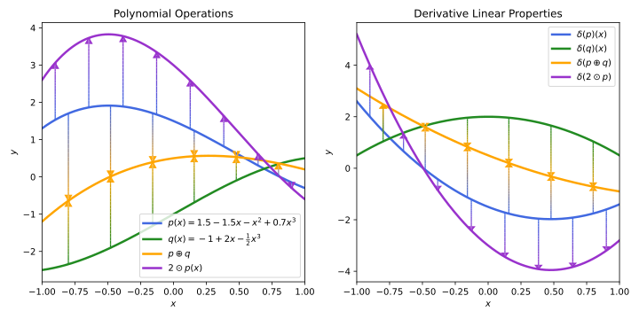
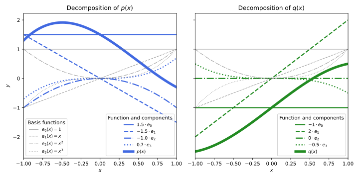
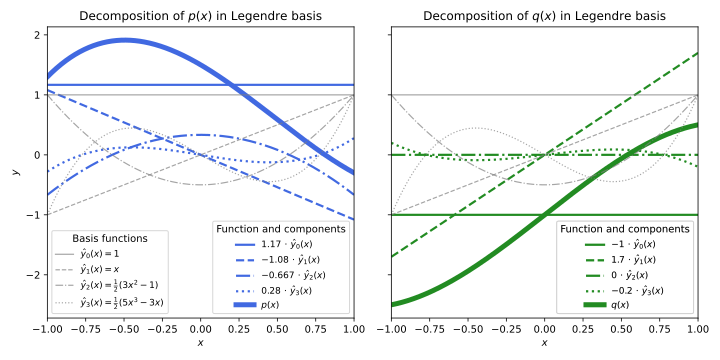

<!-- GENERATED by _port/convert/build.py from Appendices/examples_and_exercises/example_vector_spaces.tex, main.tex.
     Do not edit this file: edit the LaTeX notes and re-run the converter. -->

```{=html}
<header class="dg-head dg-head-section"><p class="dg-kicker">Appendix C <span class="dg-sep">•</span> <a href="index.html">Examples</a></p><h1 class="dg-title"><span class="dg-secnum">C.1</span> Example of Vector Spaces (§§<a class="dg-xref" href="../vector-spaces/vectors-duals-tensors.html" data-kind="section" data-label="section_Vectors_Duals_Tensors">2.2</a>–<a class="dg-xref" href="../vector-spaces/basis-components-transformations.html" data-kind="section" data-label="section_Basis_Components_Transformations">2.3</a>)</h1></header>
<p>Consider the <span class="dg-term dg-term-orange"><span class="math inline">\(\mathbb{R}\)</span>-vector space <span class="math inline">\(\left( P_N, \oplus, \odot \right)\)</span></span> equipped with the <span class="dg-term dg-term-purple">field of real numbers <span class="math inline">\((\mathbb{R}, +, \cdot)\)</span></span>, where: <span class="math display">\[
    P_N := \left\{
    \begin{aligned}
        p : \mathbb{R} &amp;\to \mathbb{R}\\
        x              &amp;\mapsto p(x) := p^0 + p^1 x + \cdots + p^N x^N,\; p^i \in \mathbb{R}, \, N \in \mathbb{N}
    \end{aligned}
    \right\},
\]</span> <span class="math display">\[
    \begin{aligned}
        &amp;\begin{array}{c}
            \textbf{Pointwise addition } \oplus: \\[6pt]
            \begin{aligned}
                \oplus : P_N \times P_N &amp;\to P_N \\
                (p, q) &amp;\mapsto p \oplus q
            \end{aligned} \\[6pt]
            \text{with } (p \oplus q)(x) := p(x) + q(x).
        \end{array}
        \quad
        &amp;\begin{array}{c}
            \textbf{Pointwise s-multiplication } \odot: \\[6pt]
            \begin{aligned}
                \odot_H : \mathbb{R} \times P_N &amp;\to P_N \\
                (\alpha, p)                     &amp;\mapsto \alpha \odot p
            \end{aligned} \\[6pt]
            \text{with } (\alpha \odot p)(x) := \alpha \cdot p(x).
        \end{array}
    \end{aligned}
\]</span></p>
```

## `<span class="dg-secnum">C.1.1</span> Check for Vector Space Properties (§<a class="dg-xref" href="../vector-spaces/vectors-duals-tensors.html" data-kind="section" data-label="section_Vectors_Duals_Tensors">2.2</a>)`{=html} {#subsection_appendix_Check_for_Vector_Space_Properties}

```{=html}
<p>We can verify that <span class="math inline">\( \left( P_N, \oplus, \odot \right) \)</span> is a vector space over <span class="math inline">\( \mathbb{R}, +, \cdot \)</span> by checking the required axioms:</p>
<ol class="dg-enumerate dg-depth-1">
<li><p><span class="dg-term dg-term-orange">Commutativity (for <span class="math inline">\(\oplus\)</span>)</span>:  <span class="math display">\[
            \forall p, q \in P_N \longrightarrow (p \oplus q)(x) = p(x) + q(x) = q(x) + p(x) = (q \oplus p)(x),
        \]</span></p></li>
<li><p><span class="dg-term dg-term-orange">Associativity (for <span class="math inline">\(\oplus\)</span>)</span>:  <span class="math display">\[
            \forall p, q, r \in P_N \longrightarrow ((p \oplus q) \oplus r)(x) = (p(x) + q(x)) + r(x) = p(x) + (q(x) + r(x)) = (p \oplus (q \oplus r))(x).
        \]</span></p></li>
<li><p><span class="dg-term dg-term-orange">Neutral element (for <span class="math inline">\(\oplus\)</span>)</span>: The zero polynomial <span class="math inline">\( \mathbf{0} \in P_N \)</span>, defined by <span class="math inline">\( \mathbf{0}(x) := 0 \)</span>, satisfies  <span class="math display">\[
            (p \oplus \mathbf{0})(x) = p(x) + 0 = p(x),
            \quad \forall p \in P_N.
        \]</span></p></li>
<li><p><span class="dg-term dg-term-orange">Inverse element (for <span class="math inline">\(\oplus\)</span>)</span>: For each <span class="math inline">\( p \in P_N \)</span>, define <span class="math inline">\( -p \in P_N \)</span> by <span class="math inline">\( (-p)(x) := -p(x) \)</span>. Then,  <span class="math display">\[
            (p \oplus (-p))(x) = p(x) - p(x) = 0 = \mathbf{0}(x).
        \]</span></p></li>
<li><p><span class="dg-term dg-term-orange">Associativity (for <span class="math inline">\(\odot\)</span>)</span>:  <span class="math display">\[
            \begin{aligned}
                \forall \alpha, \beta \in \mathbb{R}, \, p \in P_N \longrightarrow \left((\alpha \cdot \beta) \odot p\right)(x)
                = (\alpha \cdot \beta) \cdot p(x)
                = \alpha \cdot (\beta \cdot p(x))
                = \left(\alpha \odot (\beta \odot p)\right)(x),
            \end{aligned}
        \]</span></p></li>
<li><p><span class="dg-term dg-term-orange">Distributivity (of <span class="math inline">\(+\)</span> over <span class="math inline">\(\odot\)</span>)</span>: For <span class="math inline">\( \alpha, \beta \in \mathbb{R} \)</span>, and <span class="math inline">\( p \in P_N \)</span>,  <span class="math display">\[
            \begin{aligned}
                \left((\alpha + \beta) \odot p\right)(x)
                = (\alpha + \beta) \cdot p(x)
                = \alpha \cdot p(x) + \beta \cdot p(x) = ...\\
                ... = (\alpha \odot p)(x) + (\beta \odot p)(x)
                = \left((\alpha \odot p) \oplus (\beta \odot p)\right)(x),
            \end{aligned}
        \]</span></p></li>
<li><p><span class="dg-term dg-term-orange">Distributivity (of <span class="math inline">\(\odot\)</span> over <span class="math inline">\(\oplus\)</span>)</span>: For <span class="math inline">\( \alpha \in \mathbb{R} \)</span>, and <span class="math inline">\( p, q \in P_N \)</span>,  <span class="math display">\[
            \begin{aligned}
                \left(\alpha \odot (p \oplus q)\right)(x)
                = \alpha \cdot (p(x) + q(x))
                = \alpha \cdot p(x) + \alpha \cdot q(x)
                = ...\\
                ...= (\alpha \odot p)(x) + (\alpha \odot q)(x)
                = \left((\alpha \odot p) \oplus (\alpha \odot q)\right)(x),
            \end{aligned}
        \]</span></p></li>
<li><p><span class="dg-term dg-term-orange">Unitary element (for <span class="math inline">\(\odot\)</span>)</span>: The one polynomial <span class="math inline">\( \mathbf{1} \in P_N \)</span>, defined by <span class="math inline">\( \mathbf{1}(x) := 1 \)</span>, satisfies  <span class="math display">\[
            (\mathbf{1} \odot p)(x) = 1 \cdot p(x) = p(x).
        \]</span></p></li>
</ol>
<figure class="dg-figure" id="fig_vector_space_operations"><div class="dg-paper" style="--dg-frac:1.000"></div><figcaption><span class="dg-fignum">Figure C.1:</span>   This figure provides a visual illustration of the polynomial vector space operations introduced in Appendix <a class="dg-xref" href="#" data-kind="section" data-label="section_Example_vector_space">C.1</a>. It depicts pointwise addition and scalar multiplication, together with their compatibility under the derivative linear map <span class="math inline">\(\delta\)</span>. Colored curves represent different elements of the vector space and their transformations.  </figcaption></figure>
```

## `<span class="dg-secnum">C.1.2</span> Examples of Objects associated with a Vector Space (§<a class="dg-xref" href="../vector-spaces/vectors-duals-tensors.html" data-kind="section" data-label="section_Vectors_Duals_Tensors">2.2</a>)`{=html} {#subsection_appendix_example_vector_space_objects}

```{=html}
<p>We can now provide an example of a <span class="dg-term dg-term-orange">linear map</span>. Let’s consider the differential operator: <span class="math display">\begin{align*}
    \delta : P_N &amp;\overset{\sim}{\to} P_N\\
    p            &amp;\mapsto \delta(p) := p'
\end{align*}</span> Where <span class="math inline">\(\left( P_N, \oplus, \odot \right)\)</span>, serves both as the domain and the target vector space for <span class="math inline">\(\delta\)</span>. We can explicitly check that it satisfies the properties for linear maps: <span class="math display">\[
    \delta \left[ \left(p \oplus q\right)(x) \right] = (p(x) + q(x))' = p'(x) + q'(x) = \delta(p)(x) \oplus \delta(q)(x),
\]</span> <span class="math display">\[
    \delta \left[ \left(\alpha \odot p\right) (x) \right]= (\alpha \cdot p(x) )' = \alpha \cdot p'(x) = \alpha \odot \delta(p)(x).
\]</span></p>
<div class="dg-skip dg-medskip"></div>
<p>We can also define the vector space of <span class="dg-term dg-term-orange">homomorphisms</span> between the vector space <span class="math inline">\(\left( P_N, \oplus, \odot \right)\)</span>, and itself using the definitions from Chapter <a class="dg-xref" href="../vector-spaces/index.html" data-kind="chapter" data-label="chapter_Vector_Spaces">2</a>: <span class="math inline">\( \left( \text{Hom}(P_N, P_N), \oplus_H, \odot_H \right) \)</span>. For example: <span class="math inline">\(5 \odot \delta \oplus (\delta \circ \delta) \in \text{Hom}(P_N, P_N)\)</span>.<br></p>
<p>The <span class="dg-term dg-term-red">dual vector space</span> of <span class="math inline">\(\left( P_N, \oplus, \odot \right)\)</span> is the homomorphism between our original vector space and the real numbers, i.e, <span class="math inline">\(\left( P_N^* := \text{Hom}(P_N, \mathbb{R}), \oplus^*, \odot^* \right)\)</span>.</p>
<div class="dg-skip dg-medskip"></div>
<p>The following operator for integration is therefore an element of the dual space, that is, a <span class="dg-term dg-term-red">covector</span>: <span class="math display">\begin{align*}
    I : P_N &amp;\overset{\sim}{\to} \mathbb{R}\\
    p       &amp;\mapsto I(p) := \int_0^1 p(x) dx\, .
\end{align*}</span> And we need to verify if it is indeed linear: <span class="math display">\[
    I \left[ \left(p \oplus q\right)(x) \right] = I\left[p(x) + q(x)\right] = I\left[p(x)\right] + I\left[q(x)\right],
\]</span> <span class="math display">\[
    I \left[ \left(\alpha \odot p\right) (x) \right]= I\left[\alpha \cdot p(x)\right] = \alpha \cdot I\left[p(x)\right].
\]</span></p>
<div class="dg-skip dg-medskip"></div>
<p>Finally, we provide an example of a higher-order <span class="dg-term dg-term-brown">tensor</span>: The inner product on the real numbers is a <span class="math inline">\((0,2)\)</span>-tensor over <span class="math inline">\( P_N \)</span> defined by the <span class="dg-term dg-term-brown">(multi-)linear</span> map: <span class="math display">\begin{align*}
    g : P_N \times P_N &amp;\overset{\sim}{\to} \mathbb{R}\\
    (p, q)&amp;\mapsto g(p, q) := \int_{-1}^{1} p(x) q(x) dx \,.
\end{align*}</span> Again, let’s verify if it is indeed (multi-)linear: <span class="math display">\begin{align*}
    g\left[\left(p_1 \oplus p_2\right)(x),\; q(x)\right] &amp;= \int_{-1}^{1} \left(p_1(x) + p_2(x)\right) q(x) dx = ...\\
    &amp;...= \int_{-1}^{1} p_1(x) q(x) dx + \int_{-1}^{1} p_2(x) q(x) dx = g(p_1, q) + g(p_2, q),
\end{align*}</span> <span class="math display">\[
    g\left[\left(\alpha \odot p\right)(x),\; q(x)\right] = \int_{-1}^{1} \left(\alpha \cdot p(x)\right) q(x) dx = \alpha \cdot \int_{-1}^{1} p(x) q(x) dx = \alpha \cdot g(p, q),
\]</span> The same is true for the second entry, confirming it’s (multi-)linear, and therefore a <span class="math inline">\((0,2)\)</span>-tensor.</p>
<div class="dg-skip dg-medskip"></div>
```

## `<span class="dg-secnum">C.1.3</span> Basis, Dual Basis and Coordinate Components (§<a class="dg-xref" href="../vector-spaces/basis-components-transformations.html" data-kind="section" data-label="section_Basis_Components_Transformations">2.3</a>)`{=html} {#subsection_appendix_example_vector_space_basis}

```{=html}
<p>If we now fix the order of our polinomials to a finite number, let’s say <span class="math inline">\( N = 3 \)</span>, we can define the following (Hamel) <span class="dg-term dg-term-orange">basis</span> for our vector space: <span class="math display">\[
    B \coloneq \left\lbrace \hat{x}_i \right\rbrace =
    \left\lbrace \hat{x}_0(x) = 1,
    \quad \hat{x}_1(x) = x,
    \quad \hat{x}_2(x) = x^2,
    \quad \hat{x}_3(x) = x^3
    \right\rbrace.
\]</span> We can express any polynomial (of degree <span class="math inline">\(N \leq 3\)</span>) as a linear combination of these elements .</p>
<div class="dg-skip dg-medskip"></div>
<p>The corresponding <span class="dg-term dg-term-red">dual induced cobasis</span> <span class="math inline">\(B^* \coloneq \left\lbrace \hat{\mathfrak{x}}^i \right\rbrace = \{\hat{\mathfrak{x}}^0,\hat{\mathfrak{x}}^1,\hat{\mathfrak{x}}^2,\hat{\mathfrak{x}}^3\}\subset P^*\)</span> is defined as follows: <span class="math display">\[
    \begin{aligned}
        \hat{\mathfrak{x}}^0 : P &amp;{\to} \mathbb{R}, &amp; p &amp;\mapsto \hat{\mathfrak{x}}^0(p) := p(0),\\
        \hat{\mathfrak{x}}^1 : P &amp;{\to} \mathbb{R}, &amp; p &amp;\mapsto \hat{\mathfrak{x}}^1(p) := \left.\frac{d}{dx}p(x)\right|_{x=0},\\
        \hat{\mathfrak{x}}^2 : P &amp;{\to} \mathbb{R}, &amp; p &amp;\mapsto \hat{\mathfrak{x}}^2(p) := \left.\frac{1}{2}\frac{d^2}{dx^2}p(x)\right|_{x=0},\\
        \hat{\mathfrak{x}}^3 : P &amp;{\to} \mathbb{R}, &amp; p &amp;\mapsto \hat{\mathfrak{x}}^3(p) := \left.\frac{1}{6}\frac{d^3}{dx^3}p(x)\right|_{x=0}.
    \end{aligned}
\]</span></p>
<p>In operator shorthand, <span class="math display">\[
    \hat{\mathfrak{x}}^k \;\equiv\; \left.\frac{1}{k!}\frac{d^k}{dx^k}\right|_{x=0}, \qquad k=0,1,2,3,
\]</span> Each <span class="math inline">\(\hat{\mathfrak{x}}^k\)</span> acts on vectors (polynomials) <span class="math inline">\(p\in P_N\)</span> and returns a real number by first differentiating and then evaluating it at a point, for example <span class="math inline">\(x=0\)</span>.<br></p>
<p>We can verify that <span class="math inline">\(B^*\)</span> is indeed the corresponding induced dual cobasis to <span class="math inline">\(B\)</span> by explicitly checking if <span class="math inline">\(\hat{\mathfrak{x}}^i(\hat{x}_j) = \delta^i_j \quad \forall \, i, j \in \left[0, N\right]\)</span>: <span class="math display">\[
    \hat{\mathfrak{x}}^i(\hat{x}_j)=
    \left.\frac{1}{i!}\frac{d^i}{dx^i}x^j\right|_{x=0}
    =\delta^i_j.
\]</span></p>
<div class="dg-skip dg-medskip"></div>
<p>Now we are going to show explicitly how to extract the components of <span class="dg-term dg-term-orange">vectors</span> in the provided <span class="dg-term dg-term-orange">basis</span> employing the <span class="dg-term dg-term-red">dual induced cobasis</span>. Given any <span class="math inline">\(p\in P_N\)</span>, we write it in coordinates w.r.t. <span class="math inline">\(B\)</span> as <span class="math display">\[
    p \;=\; \sum_{i=0}^3 p^{i}\, \hat{x}_i.
\]</span> Applying <span class="math inline">\(\hat{\mathfrak{x}}^j\)</span> to both sides isolates the <span class="math inline">\(j\)</span>-th coordinate because <span class="math inline">\(\hat{\mathfrak{x}}^j(\hat{x}_i)=\delta^j_i\)</span>: <span class="math display">\[
    \hat{\mathfrak{x}}^j(p) \;=\; \sum_{i=0}^3 p^{i}\,
    \hat{\mathfrak{x}}^j(\hat{x}_i)=
    \sum_{i=0}^3 p^{i}\,\delta^j_i =
    \; p^{\,i}.
\]</span></p>
<p>For a concrete instance, take the polynomial <span class="math inline">\(p(x)=1.5 - 1.5\,x - x^2 + 0.7\,x^3\)</span>. Then <span class="math display">\[
    p(0)=1.5,\qquad \left.\frac{d}{dx}p(x)\right|_{x=0}=-1.5,\qquad
    \left.\frac{d^2}{dx^2}p(x)\right|_{x=0}=-2,\qquad
    \left.\frac{d^3}{dx^3}p(x)\right|_{x=0}=4.2,
\]</span> and therefore <span class="math display">\[
    [p]_{B}
    =\bigl(p^{\,0},p^{\,1},p^{\,2},p^{\,3}\bigr)^\top
    =\left(1.5,\,-1.5,\,\tfrac{1}{2}\cdot(-2),\,\tfrac{1}{6}\cdot 4.2\right)^\top
    =\left(1.5,\,-1.5,\,-1,\,0.7\right)^\top
\]</span></p>
<figure class="dg-figure" id="fig_vector_space_decomposition"><div class="dg-paper" style="--dg-frac:1.000"></div><figcaption><span class="dg-fignum">Figure C.2:</span>   This figure illustrates the decomposition of two polynomial vectors <span class="math inline">\(p(x)\)</span> and <span class="math inline">\(q(x)\)</span> into the canonical monomial basis <span class="math inline">\(\{1, x, x^2, x^3\}\)</span>, as discussed in Appendix <a class="dg-xref" href="#" data-kind="section" data-label="section_Example_vector_space">C.1</a>. The colored lines correspond to the scaled coordinate components, while the gray curves represent the normalized basis functions. Together, they show how elements of the polynomial vector space can be written as linear combinations of basis elements.  </figcaption></figure>
<div class="dg-skip dg-medskip"></div>
<p>For an example of how this process works in the case of a <span class="dg-term dg-term-red">covector</span>, let’s take the integral functional <span class="math inline">\(I\in P_N^*\)</span> previously defined. We can obtain it’s components in the <span class="dg-term dg-term-red">dual induced cobasis</span> by directly evaluating how it acts upon the <span class="dg-term dg-term-orange">basis</span> elements <span class="math inline">\(B = \left\lbrace \hat{x}_j \right\rbrace\)</span>: <span class="math display">\[
    I_j \;=\; I(\hat{x}_j)\;=\;\int_0^1 x^j\,dx\;=\;\frac{1}{j+1}, \qquad j\in [0,N].
\]</span> hence <span class="math display">\[
    [I]_{B^*}
    =\begin{bmatrix}
        1 &amp; \tfrac12, &amp; \tfrac13, &amp; \tfrac14
    \end{bmatrix} \quad \longrightarrow
    \qquad
    I \;=\; \hat{\mathfrak{x}}^0 \;+\; \tfrac12\,\hat{\mathfrak{x}}^1 \;+\; \tfrac13\,\hat{\mathfrak{x}}^2 \;+\; \tfrac14\,\hat{\mathfrak{x}}^3.
\]</span></p>
<div class="dg-skip dg-medskip"></div>
<p>Having shown how to decompose <span class="dg-term dg-term-orange">vectors</span> and <span class="dg-term dg-term-red">covectors</span> in a given <span class="dg-term dg-term-orange">basis</span>/<span class="dg-term dg-term-red">cobasis</span>, we explore how these components can be employed in matrix form to perform operations—specifically, the direct integration of polynomials—via a simple matrix multiplication. Let <span class="math inline">\([I]_{B^*}\)</span> denote the coordinate row of the integral covector and <span class="math inline">\([p]_{B}\)</span> the coordinate column of a polynomial <span class="math inline">\(p\in P_N\)</span> in our fixed bases. Since <span class="math inline">\(\hat{\mathfrak{x}}^i(\hat{x}_j)=\delta^i_j\)</span>, the pairing matrix is the identity and the action of <span class="math inline">\(I\)</span> on <span class="math inline">\(p\)</span> reduces to: <span class="math display">\[
    I(p)
    \;=\;
    [I]_{B^*}\,[p]_{B}
    \;=\;
    \begin{bmatrix}
        1 &amp; \tfrac12 &amp; \tfrac13 &amp; \tfrac14
    \end{bmatrix}
    \begin{bmatrix}
        p^{\,0}\\[2pt] p^{\,1}\\[2pt] p^{\,2}\\[2pt] p^{\,3}
    \end{bmatrix}
    \;=\;
    p^{\,0}\;+\;\tfrac12\,p^{\,1}\;+\;\tfrac13\,p^{\,2}\;+\;\tfrac14\,p^{\,3}.
\]</span></p>
<p>Equivalently, the same computation done explicitly reads <span class="math display">\[
    I(p)\;=\;\sum_{j=0}^3 p^{\,j}\,I(\hat{x}_j)
    \;=\;\sum_{j=0}^3 p^{\,j}\!\int_0^1 x^j\,dx
    \;=\;\sum_{j=0}^3 \frac{p^{\,j}}{j+1},
\]</span> which is exactly the scalar obtained by the vector multiplication above.</p>
<div class="dg-skip dg-medskip"></div>
<p>We now extend the component extraction procedure to higher-order tensors. Let’s employ as an example the the inner product <span class="math inline">\(g\)</span>, a <span class="dg-term dg-term-brown"><span class="math inline">\((0,2)\)</span>-tensor</span> defined above. Its components in the monomial basis <span class="math inline">\(B\)</span> are: <span class="math display">\[
    g_{ij} \;=\; g(\hat{x}_i,\hat{x}_j)\;=\;\int_{-1}^{1} x^{\,i}\,x^{\,j}\,dx
    \;=\;\int_{-1}^{1} x^{\,i+j}\,dx
    \;=\;
    \begin{cases}
        \;\;0, &amp; i+j\ \text{odd},\\[2pt]
        \displaystyle \frac{2}{\,i+j+1\,}, &amp; i+j\ \text{even}.
    \end{cases}
\]</span> In particular, for <span class="math inline">\(i,j\in [0, N]\)</span> we obtain the <span class="dg-term dg-term-brown">Gram matrix</span> <span class="math display">\[
    [g]_{B}
    =\begin{pmatrix}
        \frac{2}{1} &amp; 0 &amp; \frac{2}{3} &amp; 0\\[4pt]
        0 &amp; \frac{2}{3} &amp; 0 &amp; \frac{2}{5}\\[4pt]
        \frac{2}{3} &amp; 0 &amp; \frac{2}{5} &amp; 0\\[4pt]
        0 &amp; \frac{2}{5} &amp; 0 &amp; \frac{2}{7}
    \end{pmatrix}.
\]</span> Hence, for <span class="math inline">\(p=\sum_i p^{i} \hat{x}_i\)</span> and <span class="math inline">\(q=\sum_j q^{j} \hat{x}_j\)</span>, <span class="math display">\[
    g(p, q) \;=\; \sum_{i,j=0}^3 p^{i} q^{j}\, g_{ij}.
\]</span></p>
```

## `<span class="dg-secnum">C.1.4</span> Change of Basis (§<a class="dg-xref" href="../vector-spaces/basis-components-transformations.html" data-kind="section" data-label="section_Basis_Components_Transformations">2.3</a>)`{=html} {#subsection_appendix_example_vector_space_change_basis}

```{=html}
<p>We now consider an alternative <span class="dg-term dg-term-orange">basis</span> of <span class="math inline">\(P_{N=3}\)</span>: the (unnormalized) Legendre polynomials on <span class="math inline">\([-1,1]\)</span>: <span class="math display">\[
    B_L
    \coloneq \left\lbrace \hat{y}_i \right\rbrace =
    \Bigl\{
    \hat{y}_0(x)=1,\quad
    \hat{y}_1(x)=x,\quad
    \hat{y}_2(x)=\tfrac12(3x^2-1),\quad
    \hat{y}_3(x)=\tfrac12(5x^3-3x)
    \Bigr\}.
\]</span> First, let’s show that <span class="math inline">\(B_L\)</span> is a basis of <span class="math inline">\(P_3\)</span>, i.e., that <span class="math inline">\(\left\lbrace \hat{y}_i \right\rbrace\)</span> are linearly independent and span <span class="math inline">\(P_3\)</span>. To do so we are going to obtain the change-of-basis matrix by expressing each <span class="math inline">\(\hat{y}_j \in B_L\)</span> in the monomial basis <span class="math inline">\(B \coloneq \{\hat{x}_i\}\)</span>: <span class="math display">\[
    \hat{y}_0=\hat{x}_0,\qquad
    \hat{y}_1=\hat{x}_1,\qquad
    \hat{y}_2=-\tfrac12\,\hat{x}_0+\tfrac32\,\hat{x}_2,\qquad
    \hat{y}_3=-\tfrac32\,\hat{x}_1+\tfrac52\,\hat{x}_3.
\]</span> Hence the change-of-basis matrix (columns are the coordinates of <span class="math inline">\(B_L\)</span> expressed in <span class="math inline">\(B\)</span>) is: <span class="math display">\[
    \left(J^{-1}\right)^i_j = \left(\textrm{\runic ᛞ}_{B \leftarrow B_L}\right)^i_j
    =\begin{pmatrix}
        1 &amp; 0 &amp; -\tfrac12 &amp; 0\\[4pt]
        0 &amp; 1 &amp; 0 &amp; -\tfrac32\\[4pt]
        0 &amp; 0 &amp; \tfrac32 &amp; 0\\[4pt]
        0 &amp; 0 &amp; 0 &amp; \tfrac52
    \end{pmatrix},
    \qquad \longrightarrow \qquad
    \det \textrm{\runic ᛞ}_{B \leftarrow B_L}\neq 0.
\]</span> Therefore the columns are linearly independent and so is <span class="math inline">\(B_L\)</span>. Since <span class="math inline">\(\dim P_3=4\)</span> and we have <span class="math inline">\(4\)</span> independent vectors, they span <span class="math inline">\(P_3\)</span> and hence constitutes a basis.</p>
<figure class="dg-figure" id="fig_vector_space_decomposition_legendre"><div class="dg-paper" style="--dg-frac:1.000"></div><figcaption><span class="dg-fignum">Figure C.3:</span>   This figure illustrates the decomposition of two polynomial vectors <span class="math inline">\(p(x)\)</span> and <span class="math inline">\(q(x)\)</span> into the Legendre basis <span class="math inline">\(\{\hat{y}_0(x)=1,\;\hat{y}_1(x)=x,\;\hat{y}_2(x)=\tfrac{1}{2}(3x^2-1),\;\hat{y}_3(x)=\tfrac{1}{2}(5x^3-3x)\}\)</span>, as discussed in Appendix <a class="dg-xref" href="#subsection_appendix_example_vector_space_change_basis" data-kind="subsection" data-label="subsection_appendix_example_vector_space_change_basis">C.1.4</a>. The colored lines correspond to the scaled coordinate components (each coefficient times its Legendre basis function), while the gray curves represent the normalized basis functions themselves. Together, they show how elements of the polynomial vector space can be written as linear combinations of Legendre polynomials.  </figcaption></figure>
<div class="dg-skip dg-medskip"></div>
<p>The corresponding <span class="dg-term dg-term-red">induced dual cobasis</span> <span class="math inline">\(B_L^* \coloneq \left\lbrace \hat{\mathfrak{y}}^i \right\rbrace \subset P_N^*\)</span> is naturally defined using orthogonality of Legendre polynomials w.r.t. the inner product <span class="math inline">\(g(p,q)=\int_{-1}^{1}p(x)q(x)\,dx\)</span>: <span class="math display">\[
    \hat{\mathfrak{y}}^i : P_N \to \mathbb{R},\qquad
    p \longmapsto \hat{\mathfrak{y}}^i(p)
    \;\coloneq\;
    \frac{2i+1}{2}\int_{-1}^{1} p(x)\,\hat{y}_i(x)\,dx,
    \quad i \in [0, N].
\]</span> Using <span class="math inline">\(\int_{-1}^{1}\hat{y}_i\hat{y}_j\,dx=\tfrac{2}{2i+1}\delta^i_j\)</span>, we get <span class="math inline">\(\hat{\mathfrak{y}}^i(\hat{y}_j)=\delta^i_j\)</span>, so indeed <span class="math inline">\(B_L^*\coloneq\{\hat{\mathfrak{y}}^i\}\)</span> is the induced dual cobasis of <span class="math inline">\(\{\hat{y}_i\}\)</span>.</p>
<div class="dg-skip dg-medskip"></div>
<p>As previously demonstrated, we can obtain the components of a vector <span class="math inline">\(p\in P_3\)</span> in a given basis, e.g. <span class="math inline">\(B_L\)</span>, by letting the elements of the induced dual cobasis, <span class="math inline">\(B_L^*\)</span>, act on <span class="math inline">\(p\)</span>.</p>
<p>Writting down explicitly the components for the example polynomial we have been working with, <span class="math inline">\(p(x)=1.5 - 1.5\,x - x^2 + 0.7\,x^3\)</span>, we get: <span class="math display">\begin{align*}
    \hat{\mathfrak{y}}^0\left(p\right) &amp;= \frac{1}{2}\int_{-1}^{1} p(x) \hat{y}_0(x)\,dx = \frac{1}{2}\int_{-1}^{1} p(x) \cdot 1\,dx = \frac{7}{6}\\
    \hat{\mathfrak{y}}^1\left(p\right) &amp;= \frac{3}{2}\int_{-1}^{1} p(x) \hat{y}_1(x)\,dx = \frac{3}{2}\int_{-1}^{1} p(x) \cdot x\,dx = -\frac{27}{25}\\
    \hat{\mathfrak{y}}^2\left(p\right) &amp;= \frac{5}{2}\int_{-1}^{1} p(x) \hat{y}_2(x)\,dx = \frac{5}{2}\int_{-1}^{1} p(x) \cdot \frac{1}{2}\left(3x^2-1\right)\,dx = -\frac{2}{3}\\
    \hat{\mathfrak{y}}^3\left(p\right) &amp;= \frac{7}{2}\int_{-1}^{1} p(x) \hat{y}_3(x)\,dx = \frac{7}{2}\int_{-1}^{1} p(x) \cdot \frac{1}{2}\left(5x^3-3x\right)\,dx = \frac{7}{25}
\end{align*}</span> Therefore <span class="math inline">\([p]_{B_L} = \left(\frac{7}{6}, -\frac{27}{25}, -\frac{2}{3}, \frac{7}{25}\right)^T\)</span>.</p>
<div class="dg-skip dg-medskip"></div>
<p>We can verify that this is equivalent to employing the inverse of the change of basis matrix transformation previously defined: <span class="math display">\begin{align*}
    J = \textrm{\runic ᛞ}_{B_L \leftarrow B}
    = \left(\textrm{\runic ᛞ}_{B \leftarrow B_L}\right)^{-1}
    = \begin{pmatrix}
        1 &amp; 0 &amp; \tfrac{1}{3} &amp; 0\\[4pt]
        0 &amp; 1 &amp; 0 &amp; \tfrac{3}{5}\\[4pt]
        0 &amp; 0 &amp; \tfrac{2}{3} &amp; 0\\[4pt]
        0 &amp; 0 &amp; 0 &amp; \tfrac{2}{5}
    \end{pmatrix},
    \quad
    [p]_{B_L}
    =
    J\,[p]_B
    =
    \begin{pmatrix}
        1 &amp; 0 &amp; \tfrac{1}{3} &amp; 0\\
        0 &amp; 1 &amp; 0 &amp; \tfrac{3}{5}\\
        0 &amp; 0 &amp; \tfrac{2}{3} &amp; 0\\
        0 &amp; 0 &amp; 0 &amp; \tfrac{2}{5}
    \end{pmatrix}
    \begin{pmatrix}
        \tfrac{3}{2}\\[2pt] -\tfrac{3}{2}\\[2pt] -1\\[2pt] \tfrac{7}{10}
    \end{pmatrix}
    =
    \begin{pmatrix}
        \tfrac{7}{6}\\[2pt] -\tfrac{27}{25}\\[2pt] -\tfrac{2}{3}\\[2pt] \tfrac{7}{25}
    \end{pmatrix}.
\end{align*}</span> Where it is immediate to verify that the inverse change of basis is indeed the one given above, since explicitly <span class="math inline">\(J \cdot J^{-1} \;=\; I_4\)</span>.</p>
<div class="dg-skip dg-medskip"></div>
<p>The same logic applies to <span class="dg-term dg-term-red">covectors</span> and higher-order <span class="dg-term dg-term-brown">tensors</span>. We leave to the reader repeating the same exercise for the components of the integral covector <span class="math inline">\(I\)</span> in the basis <span class="math inline">\(B_L^*\)</span>.</p>
<nav class="dg-web dg-prevnext" aria-label="Previous and next page"><a class="dg-prev" href="index.html" rel="prev"><span aria-hidden="true">←</span> <span><span class="dg-secnum">C</span> Examples</span></a><a class="dg-next" href="example-d-dim-mfld.html" rel="next"><span aria-hidden="true">→</span> <span><span class="dg-secnum">C.2</span> Example of a <span class="math inline">\(d\)</span>-dimensional Smooth Manifold (§§3.2–3.3)</span></a></nav>
```
