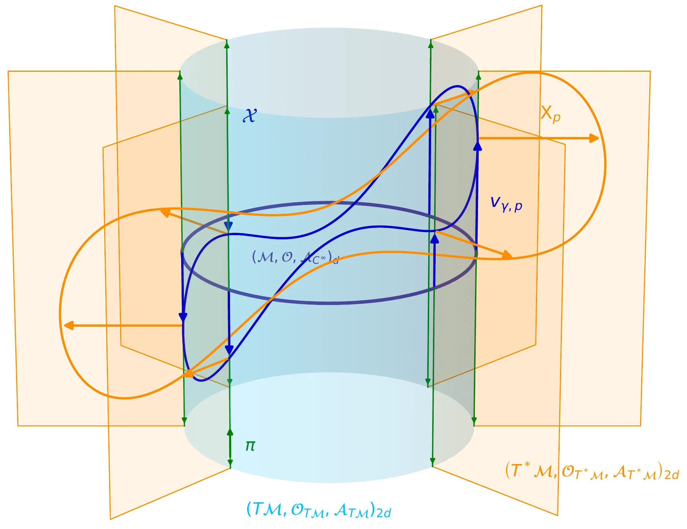

<!-- GENERATED by _port/convert/build.py from Chapters/Fields/Covector_Fields.tex, main.tex.
     Do not edit this file: edit the LaTeX notes and re-run the converter. -->

```{=html}
<header class="dg-head dg-head-section"><p class="dg-kicker">Chapter 5 <span class="dg-sep">•</span> <a href="index.html">Fields</a></p><h1 class="dg-title"><span class="dg-secnum">5.2</span> Covector Fields</h1></header>
<ul class="dg-itemize dg-depth-1">
<li><p>The (smooth) <span class="dg-term dg-term-red">cotangent bundle</span> upon the (smooth) manifold <span class="math inline">\((\mathcal{M}, \mathcal{O}, \mathcal{A})\)</span> is:  <span class="math display">\begin{align*}
            (T^*\mathcal{M}, \mathcal{O}_{T^*\mathcal{M}}, \mathcal{A}_{T^*\mathcal{M}})
            \xrightarrow[]{\pi^*}
            (\mathcal{M}, \mathcal{O}, \mathcal{A})
        \end{align*}</span>  Here we are considering the following definitions:</p>
<ol class="dg-enumerate dg-depth-1">
<li><p><span class="math inline">\(T^*\mathcal{M}\)</span> is the disjoint union of cotangent spaces <span class="math inline">\(T^*_p\mathcal{M}\)</span>, i.e.,  <span class="math display">\begin{align*}
                    T^*\mathcal{M} := \dot{\bigcup_{p \in \mathcal{M}}} T^*_p \mathcal{M}.
                \end{align*}</span></p></li>
<li><p>The projection map, <span class="math inline">\(\pi^*\)</span>, is given by  <span class="math display">\begin{align*}
                    \pi^* : T^*\mathcal{M} &amp;\to \mathcal{M} \\
                    \mathsf{X}_p           &amp;\mapsto \pi^* (\mathsf{X}_p) := p,
                \end{align*}</span>  where <span class="math inline">\( p \)</span> is the unique point such that <span class="math inline">\( \mathsf{X}_p \in T^*_p \mathcal{M} \)</span>.</p></li>
<li><p>The <span class="dg-term dg-term-red">bundle chart maps</span>. For every chart <span class="math inline">\((\mathcal{U}, \mathscr{X}) \in \mathcal{A}\)</span>, let <span class="math inline">\(T^*\mathcal{U} \coloneqq \operatorname{preim}_{\pi^*}(\mathcal{U})\)</span> and define  <span class="math display">\begin{align*}
                    \xi^*_{\mathscr{X}} : T^*\mathcal{U} &amp;\longrightarrow \mathscr{X}(\mathcal{U}) \times \mathbb{R}^{d} \subseteq \mathbb{R}^{2d} \\
                    \mathsf{X}_p                         &amp;\longmapsto \xi^*_{\mathscr{X}} (\mathsf{X}_p),
                \end{align*}</span>  where  <span class="math display">\begin{align*}
                    \xi^*_{\mathscr{X}} (\mathsf{X}_p) := \big(
                    \underbrace{..., (\mathscr{X}^i \circ \pi^*)(\mathsf{X}_p), ...}_{\substack{i\in [1, d] \text{ terms.}\\ \text{Chart coordinates w.r.t. } (\mathcal{U}, \mathscr{X}) \\ \text{for the base point } p \text{ of } \mathsf{X}_p}} ;
                    \underbrace{..., \mathsf{X}_p\left(\left(\frac{\partial}{\partial \mathscr{X}^j} \right)_{p}\right), ... }_{\substack{j\in [1, d] \text{ terms.}\\ \text{Components of } \mathsf{X}_p \text{ w.r.t. the}\\ \text{dual chart-induced basis}}}
                    \big) = \big(
                    ..., \mathscr{X}^i(p), ...\, ; ..., \mathtt{x}^p_j, ...
                    \big),
                \end{align*}</span>  a bijection onto the open set <span class="math inline">\(\mathscr{X}(\mathcal{U}) \times \mathbb{R}^d\)</span>, with inverse  <span class="math display">\begin{align*}
                    {\xi^*_{\mathscr{X}}}^{-1} : \mathscr{X}(\mathcal{U}) \times \mathbb{R}^{d} &amp;\longrightarrow T^*\mathcal{U} \\
                    (\underbrace{..., \alpha^i, ...}_{i\in [1, d]} ; \underbrace{..., \beta_j, ...}_{j\in [1, d]}) &amp;\longmapsto
                    \sum_{k=1}^{d} \beta_k \, (d\mathscr{X}^{k})_{p=\mathscr{X}^{-1}\left(\dots, \alpha^i, \dots \right)}.
                \end{align*}</span>  Given a second chart <span class="math inline">\((\mathcal{V}, \mathscr{Y}) \in \mathcal{A}\)</span> and <span class="math inline">\(p = \mathscr{X}^{-1}(\alpha)\)</span>, using <span class="math inline">\((d\mathscr{X}^k)_p\big( (\partial / \partial \mathscr{Y}^j)_p \big) = \left( \textrm{\runic ᛞ}_{\mathcal{U}\mathcal{V}} \right)^k_{j}\big( \mathscr{Y}(p) \big)\)</span> and <span class="math inline">\(\mathscr{Y}(p) = \textrm{\runic ᛖ}_{\mathcal{U}\mathcal{V}}(\alpha)\)</span>,  <span class="math display">\begin{align*}
                    (\xi^*_{\mathscr{Y}} \circ {\xi^*_{\mathscr{X}}}^{-1})(\alpha \,;\, \beta)
                    = \Big( \textrm{\runic ᛖ}_{\mathcal{U}\mathcal{V}}(\alpha) \,;\, \dots, \sum_{k=1}^{d}
                    \left( \textrm{\runic ᛞ}_{\mathcal{U}\mathcal{V}} \right)^k_{j}\big( \textrm{\runic ᛖ}_{\mathcal{U}\mathcal{V}}(\alpha) \big) \, \beta_k, \dots \Big),
                \end{align*}</span>  which is <span class="math inline">\(C^\infty\)</span>, being built from the smooth maps <span class="math inline">\(\textrm{\runic ᛖ}_{\mathcal{U}\mathcal{V}}\)</span> and the entries of <span class="math inline">\(\textrm{\runic ᛞ}_{\mathcal{U}\mathcal{V}}\)</span>, and linear in <span class="math inline">\(\beta\)</span>. Fibre coordinates now change with the <em>inverse</em> Jacobian, as the covector components of Subsection <a class="dg-xref" href="../tangent-spaces/cotangent-space.html#subsection_Basis_and_Coordinate_Components_of_TstarpM" data-kind="subsection" data-label="subsection_Basis_and_Coordinate_Components_of_TstarpM">4.2.1</a>.</p></li>
<li><p>The topology <span class="math inline">\(\mathcal{O}_{T^*\mathcal{M}}\)</span> is defined exactly as for the tangent bundle, as the one turning every bundle chart map into a homeomorphism,  <span class="math display">\begin{align*}
                    \mathcal{O}_{T^*\mathcal{M}} \coloneqq \Big\{ W \subseteq T^*\mathcal{M} \;\Big|\;
                    \xi^*_{\mathscr{X}}(W \cap T^*\mathcal{U}) \in \mathcal{O}_{\mathbb{R}^{2d}} \;\; \forall \, (\mathcal{U}, \mathscr{X}) \in \mathcal{A} \Big\},
                \end{align*}</span>  and the proof of Appendix <a class="dg-xref" href="../proofs-and-additional-material/proof-topology-tm.html" data-kind="section" data-label="section_proof_topology_TM">B.7</a> applies verbatim, with <span class="math inline">\(\xi_{\mathscr{X}}\)</span> replaced by <span class="math inline">\(\xi^*_{\mathscr{X}}\)</span>.</p></li>
<li><p>The smooth atlas <span class="math inline">\(\mathcal{A}_{T^*\mathcal{M}} \coloneqq \{ (T^*\mathcal{U}, \xi^*_{\mathscr{X}}) \mid (\mathcal{U}, \mathscr{X}) \in \mathcal{A} \}\)</span> is <span class="math inline">\(C^\infty\)</span>-compatible by the transition computation above, so that <span class="math inline">\((T^*\mathcal{M}, \mathcal{O}_{T^*\mathcal{M}}, \mathcal{A}_{T^*\mathcal{M}})_{2d}\)</span> is a <span class="math inline">\(2d\)</span>-dimensional smooth manifold.</p></li>
</ol></li>
<li><p>A <span class="dg-term dg-term-red">smooth covector field</span> is a smooth section of the cotangent bundle,  <span class="math display">\begin{align*}
            \mathsf{X} : \mathcal{M} &amp;\to T^*\mathcal{M} \\
            p                        &amp;\mapsto \mathsf{X}(p) := \mathsf{X}_p,
        \end{align*}</span>  with <span class="math inline">\((\pi^* \circ \mathsf{X}) = \mathbb{I}_{\mathcal{M}}\)</span>, i.e. a smooth assignment of a covector <span class="math inline">\(\mathsf{X}_p \in T^*_p\mathcal{M}\)</span> to every point <span class="math inline">\(p \in \mathcal{M}\)</span>. As for covectors at a single point, sans-serif capitals <span class="math inline">\(\mathsf{X}, \mathsf{Y}, \dots\)</span> denote generic covector fields, so that <span class="math inline">\(\mathsf{X}_p = \mathtt{x}_i^p \cdot (dx^i)_p = \mathtt{y}_i^p \cdot (dy^i)_p\)</span> at every point <span class="math inline">\(p\)</span> in the corresponding chart domains (Subsection <a class="dg-xref" href="../tangent-spaces/cotangent-space.html#notation_TstarpM" data-kind="subsection" data-label="notation_TstarpM">4.2.2</a>).</p>
<div class="dg-skip dg-medskip"></div>
<p>The most important examples are the differentials of scalar fields <span class="math inline">\(f \in C^{\infty}(\mathcal{M})\)</span>,  <span class="math display">\begin{align*}
            df : \mathcal{M} &amp;\to T^*\mathcal{M} \\
            p                &amp;\mapsto df(p) := (df)_p,
        \end{align*}</span>  and covector fields of this form, <span class="math inline">\(\mathsf{X} = df\)</span>, are called <span class="dg-term dg-term-red">exact</span>. At a single point there is no difference between the two notions: every covector is the differential of some scalar field, <span class="math inline">\(\mathsf{X}_p = (df)_p\)</span> (Section <a class="dg-xref" href="../tangent-spaces/cotangent-space.html" data-kind="section" data-label="section_Cotangent_Space">4.2</a>). However, the scalar field <span class="math inline">\(f\)</span> achieving this depends in general on the point <span class="math inline">\(p\)</span>, and a covector field need not be the differential of a <em>single</em>, globally defined scalar field<sup class="dg-fnref"><a href="#fn-2" id="fnref-2" aria-label="Footnote 2">2</a></sup>.</p>
<div class="dg-skip dg-medskip"></div>
<p>We will employ the following notation to define the action of a covector field <span class="math inline">\(\mathsf{X}\)</span> upon a vector field <span class="math inline">\(\mathcal{X} \in \Gamma T\mathcal{M}\)</span>, writing <span class="math inline">\(\mathcal{X}(p) = v_{\gamma, p}\)</span>:  <span class="math display">\begin{align*}
            \mathsf{X} : \Gamma T\mathcal{M} &amp;\longrightarrow C^{\infty}(\mathcal{M}) \\
            \mathcal{X} &amp;\longmapsto \mathsf{X}\left\lceil \mathcal{X} \right\rfloor \colon
            \begin{aligned}[t]
                \mathcal{M} &amp;\longrightarrow \mathbb{R} \\
                p &amp;\longmapsto \mathsf{X}\left\lceil \mathcal{X} \right\rfloor(p) \coloneqq \mathsf{X}_p(v_{\gamma, p}).
            \end{aligned}
        \end{align*}</span>  That is, <span class="math inline">\(\mathsf{X}\left\lceil \mathcal{X} \right\rfloor\)</span> is itself a scalar field, returning at each point the value of the covector <span class="math inline">\(\mathsf{X}_p\)</span> on the vector that <span class="math inline">\(\mathcal{X}\)</span> places there. We can therefore think of a covector field in three equivalent ways, depending on which argument we supply first:</p>
<ol class="dg-enumerate dg-depth-1">
<li><p><em>Point first:</em> as a section, eating points <span class="math inline">\(p \in \mathcal{M}\)</span> and returning covectors <span class="math inline">\(\mathsf{X}(p) = \mathsf{X}_p \in T^*_p\mathcal{M}\)</span>.</p></li>
<li><p><em>Vector field first:</em> as an operator, eating vector fields <span class="math inline">\(\mathcal{X} \in \Gamma T\mathcal{M}\)</span> and returning, <span class="math inline">\(C^{\infty}(\mathcal{M})\)</span>-linearly, new scalar fields <span class="math inline">\(\mathsf{X}\left\lceil \mathcal{X} \right\rfloor \in C^{\infty}(\mathcal{M})\)</span>.</p></li>
<li><p><em>Both:</em> once <span class="math inline">\(\mathcal{X}\)</span> is fixed, <span class="math inline">\(\mathsf{X}\left\lceil \mathcal{X} \right\rfloor\)</span> eats points <span class="math inline">\(p \in \mathcal{M}\)</span> and returns the real numbers <span class="math inline">\(\mathsf{X}\left\lceil \mathcal{X} \right\rfloor(p) \in \mathbb{R}\)</span>.</p></li>
</ol>
<p>All three readings meet in the same number, <span class="math inline">\(\mathsf{X}\left\lceil \mathcal{X} \right\rfloor(p) = \mathsf{X}(p)\big(\mathcal{X}(p)\big) = \mathsf{X}_p(v_{\gamma, p})\)</span>. For an exact covector field this number equals, by definition of the differential, <span class="math inline">\(v_{\gamma, p}(f)\)</span>; hence <span class="math inline">\(df\left\lceil \mathcal{X} \right\rfloor = \mathcal{X}\left\lfloor f \right\rceil\)</span>.</p></li>
<li><p>The <span class="dg-term dg-term-red"><span class="math inline">\(C^{\infty}(\mathcal{M})\)</span>-module <span class="math inline">\(\Gamma T^* \mathcal{M}\)</span></span> is the triplet <span class="math inline">\((\Gamma T^* \mathcal{M}, \oplus^*_\Gamma, \odot^*_\Gamma)\)</span>, built over the same commutative, unitary ring <span class="math inline">\((C^{\infty}(\mathcal{M}), \oplus_{C^{\infty}}, \odot_{C^{\infty}})\)</span>, so that, as for <span class="math inline">\(\Gamma T\mathcal{M}\)</span>, the result is a module rather than a vector space. Here <span class="math inline">\(\Gamma T^*\mathcal{M} \coloneqq \{\mathsf{X} : \mathcal{M} \to T^*\mathcal{M} \mid \text{smooth covector field}\}\)</span>, and, writing <span class="math inline">\(\mathcal{X}(p) = v_{\gamma, p}\)</span>, the operations <span class="math inline">\(\oplus^*_\Gamma\)</span> (addition) and <span class="math inline">\(\odot^*_\Gamma\)</span> (s-multiplication) are:  <span class="math display">\[
            \begin{aligned}
                &amp;\begin{array}{c}
                    \begin{aligned}
                        \oplus^*_\Gamma : \Gamma T^* \mathcal{M} \times \Gamma T^* \mathcal{M} &amp;\longrightarrow \Gamma T^* \mathcal{M} \\
                        (\mathsf{X}, \mathsf{Y}) &amp;\longmapsto \mathsf{X} \oplus^*_\Gamma \mathsf{Y}
                    \end{aligned} \\[12pt]
                    \begin{aligned}
                        \text{with } (\mathsf{X} \oplus^*_\Gamma \mathsf{Y})\left\lceil \mathcal{X} \right\rfloor(p) &amp;\coloneqq \left(\mathsf{X}\left\lceil \mathcal{X}\right\rfloor
                        \oplus_{C^{\infty}} \mathsf{Y}\left\lceil \mathcal{X}\right\rfloor\right)(p) \\
                        &amp;= \mathsf{X}_p(v_{\gamma,p}) + \mathsf{Y}_p(v_{\gamma,p}),
                    \end{aligned}
                \end{array}
                \quad
                &amp;\begin{array}{c}
                    \begin{aligned}
                        \odot^*_\Gamma : C^{\infty}(\mathcal{M}) \times \Gamma T^* \mathcal{M} &amp;\longrightarrow \Gamma T^* \mathcal{M} \\
                        (h, \mathsf{X}) &amp;\longmapsto h \odot^*_\Gamma \mathsf{X}
                    \end{aligned} \\[12pt]
                    \begin{aligned}
                        \text{with } (h \odot^*_\Gamma \mathsf{X})\left\lceil \mathcal{X} \right\rfloor(p) &amp;\coloneqq \left(h \odot_{C^{\infty}} \mathsf{X}\left\lceil \mathcal{X} \right\rfloor\right)(p) \\
                        &amp;= h(p) \cdot \mathsf{X}_p(v_{\gamma,p}),
                    \end{aligned}
                \end{array}
            \end{aligned}
        \]</span>  for all <span class="math inline">\(h \in C^{\infty}(\mathcal{M})\)</span>, <span class="math inline">\(\mathcal{X} \in \Gamma T\mathcal{M}\)</span> and <span class="math inline">\(p \in \mathcal{M}\)</span>.</p>
<figure class="dg-figure" id="fig_covector_field"><div class="dg-paper" style="--dg-frac:1.000"></div><figcaption><span class="dg-fignum">Figure 5.2:</span>   Tangent and cotangent bundles of the ring of Figure <a class="dg-xref" href="vector-fields.html#fig_vector_fields" data-kind="figure" data-label="fig_vector_fields">5.1</a>, drawn in the same ambient space. The tangent fibres are displayed vertically, as before (cylinder, green fibres, <span class="math inline">\(\pi\)</span>). The cotangent fibres are displayed radially, transverse both to the ring and to the tangent fibres. Because the two directions are transverse, a pair <span class="math inline">\(\big( v_{\gamma, p}, \mathsf{X}_p \big) \in T_p\mathcal{M} \times T^*_p\mathcal{M}\)</span> can be drawn as a single point. The orange sheets are the planes <span class="math inline">\(T_p\mathcal{M} \times T^*_p\mathcal{M}\)</span> over six base points, attached along the corresponding tangent fibres. The blue curve is a vector field <span class="math inline">\(\mathcal{X} \in \Gamma T\mathcal{M}\)</span>, with its values <span class="math inline">\(\mathcal{X}(p) = v_{\gamma, p}\)</span> drawn over those six points. The orange arrows are the values <span class="math inline">\(\mathsf{X}(p) = \mathsf{X}_p\)</span> of a covector field <span class="math inline">\(\mathsf{X} \in \Gamma T^*\mathcal{M}\)</span>, each drawn from the tip of the vector <span class="math inline">\(v_{\gamma, p}\)</span> it acts on. The orange curve is the pair of sections <span class="math inline">\(p \mapsto \big( \mathcal{X}(p), \mathsf{X}(p) \big)\)</span>. Dropping its radial displacement gives back <span class="math inline">\(\mathcal{X}\)</span>. Dropping its vertical displacement gives <span class="math inline">\(\mathsf{X}\)</span> alone, as a section of the total space <span class="math inline">\(\left( T^*\mathcal{M}, \mathcal{O}_{T^*\mathcal{M}}, \mathcal{A}_{T^*\mathcal{M}} \right)_{2d}\)</span>; in this drawing that total space is the horizontal annulus around the ring, not shown.  </figcaption></figure></li>
</ul>
<div class="dg-footnotes"><div class="dg-fn" id="fn-2"><a class="dg-fn-num" href="#fnref-2" aria-label="Back to the text">2</a><div class="dg-fn-body"><p>See Appendix <a class="dg-xref" href="../proofs-and-additional-material/exact-covector-fields.html" data-kind="section" data-label="Exact_covector_fields">B.8</a> for a detailed discussion of which covector fields are differentials.</p></div></div></div>
<nav class="dg-web dg-prevnext" aria-label="Previous and next page"><a class="dg-prev" href="vector-fields.html" rel="prev"><span aria-hidden="true">←</span> <span><span class="dg-secnum">5.1</span> Vector Fields</span></a><a class="dg-next" href="tensor-fields-and-notation.html" rel="next"><span aria-hidden="true">→</span> <span><span class="dg-secnum">5.3</span> Tensor Fields and notation</span></a></nav>
```
