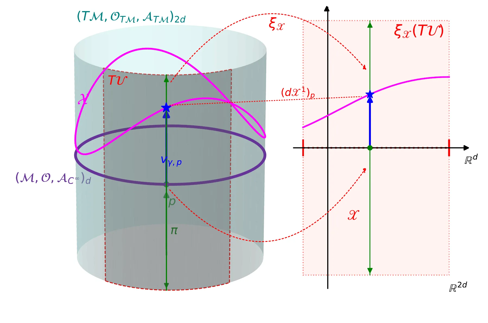

<!-- GENERATED by _port/convert/build.py from Chapters/Fields/Vector_Fields.tex, main.tex.
     Do not edit this file: edit the LaTeX notes and re-run the converter. -->

```{=html}
<header class="dg-head dg-head-section"><p class="dg-kicker">Chapter 5 <span class="dg-sep">•</span> <a href="index.html">Fields</a></p><h1 class="dg-title"><span class="dg-secnum">5.1</span> Vector Fields</h1></header>
<ul class="dg-itemize dg-depth-1">
<li><p>Given two (smooth) manifolds <span class="math inline">\(\left(\mathcal{M}, \mathcal{O}_\mathcal{M}, \mathcal{A}_\mathcal{M}\right)\)</span>, and <span class="math inline">\(\left(\mathcal{N}, \mathcal{O}_\mathcal{N}, \mathcal{A}_\mathcal{N}\right)\)</span>, the triple  <span class="math display">\begin{align*}
            \underbrace{(\mathcal{M}, \mathcal{O}_\mathcal{M}, \mathcal{A}_\mathcal{M})}_{\text{Total space}}
            \xlongrightarrow[]{\pi}
            \underbrace{(\mathcal{N}, \mathcal{O}_\mathcal{N}, \mathcal{A}_\mathcal{N})}_{\text{Base space}}
        \end{align*}</span>  is a (smooth) <span class="dg-term dg-term-red">bundle</span> if the <span class="dg-term dg-term-red">total space</span> <span class="math inline">\(\mathcal{M}\)</span> and the <span class="dg-term dg-term-red">base space</span> <span class="math inline">\(\mathcal{N}\)</span> are (smooth) manifolds, and the <span class="dg-term dg-term-red">projection map</span> <span class="math inline">\(\pi: \mathcal{M} \to \mathcal{N}\)</span> is a (smooth) surjective map.</p>
<ul class="dg-itemize dg-depth-2">
<li><p>A <span class="dg-term dg-term-red">fibre</span> over <span class="math inline">\(p \in \mathcal{N}\)</span> is the set <span class="math inline">\(\text{preim}_\pi(\{p\}) \subseteq \mathcal{M}\)</span>.</p></li>
<li><p>A <span class="dg-term dg-term-red">section</span> is a map <span class="math inline">\(\sigma : \mathcal{N} \to \mathcal{M}\)</span> such that <span class="math inline">\((\pi \circ \sigma) = \mathbb{I}_{\mathcal{N}}\)</span> (identity map).</p></li>
</ul></li>
<li><p>The (smooth) <span class="dg-term dg-term-red">tangent bundle</span> upon the (smooth) manifold <span class="math inline">\((\mathcal{M}, \mathcal{O}, \mathcal{A})\)</span> is:  <span class="math display">\begin{align*}
            (T\mathcal{M}, \mathcal{O}_{T\mathcal{M}}, \mathcal{A}_{T\mathcal{M}})
            \xrightarrow[]{\pi}
            (\mathcal{M}, \mathcal{O}, \mathcal{A})
        \end{align*}</span>  Here we are considering the following definitions:</p>
<ol class="dg-enumerate dg-depth-1">
<li><p><span class="math inline">\(T\mathcal{M}\)</span> is the disjoint union of tangent spaces <span class="math inline">\(T_p\mathcal{M}\)</span>, i.e.,  <span class="math display">\begin{align*}
                    T\mathcal{M} := \dot{\bigcup_{p \in \mathcal{M}}} T_p \mathcal{M}.
                \end{align*}</span></p></li>
<li><p>The projection map, <span class="math inline">\(\pi\)</span>, is given by  <span class="math display">\begin{align*}
                    \pi : T\mathcal{M} &amp;\to \mathcal{M} \\
                    v_{\gamma, p}      &amp;\mapsto \pi (v_{\gamma, p}) := p,
                \end{align*}</span>  where <span class="math inline">\( p \)</span> is the unique point such that <span class="math inline">\( v_{\gamma, p} \in T_p \mathcal{M} \)</span>.</p></li>
<li><p>The <span class="dg-term dg-term-red">bundle chart maps</span>. For every chart <span class="math inline">\((\mathcal{U}, \mathscr{X}) \in \mathcal{A}\)</span>, let <span class="math inline">\(T\mathcal{U} \coloneqq \operatorname{preim}_\pi(\mathcal{U})\)</span> be the set of all tangent vectors based at points of <span class="math inline">\(\mathcal{U}\)</span>, and define  <span class="math display">\begin{align*}
                    \xi_{\mathscr{X}} : T\mathcal{U} &amp;\longrightarrow \mathscr{X}(\mathcal{U}) \times \mathbb{R}^{d} \subseteq \mathbb{R}^{2d} \\
                    v_{\gamma, p}                    &amp;\longmapsto \xi_{\mathscr{X}} (v_{\gamma, p}),
                \end{align*}</span>  where  <span class="math display">\begin{align*}
                    \xi_{\mathscr{X}} (v_{\gamma, p}) := \big(
                    \underbrace{..., (\mathscr{X}^i \circ \pi)(v_{\gamma, p}), ...}_{\substack{i\in [1, d] \text{ terms.}\\ \text{Chart coordinates w.r.t. } (\mathcal{U}, \mathscr{X}) \\ \text{for the base point } p \text{ of } v_{\gamma, p}}} ;
                    \underbrace{..., (d\mathscr{X}^j)_{p}(v_{\gamma, p}), ... }_{\substack{j\in [1, d] \text{ terms.}\\ \text{Components of } v_{\gamma, p} \\ \text{w.r.t. the chart-induced} \\ \text{basis of } T_p \mathcal{M}}}
                    \big) = \big(
                    ..., \mathscr{X}^i(p), ...\, ; ..., \dot{\gamma}^j_\mathcal{U}(\lambda_0), ...
                    \big).
                \end{align*}</span>  Each <span class="math inline">\(\xi_{\mathscr{X}}\)</span> is a bijection onto the open set <span class="math inline">\(\mathscr{X}(\mathcal{U}) \times \mathbb{R}^d\)</span>: a tangent vector is uniquely determined by its base point together with its components in the chart-induced basis of <span class="math inline">\(T_p\mathcal{M}\)</span>, and every such choice of data is realized by some tangent vector. The inverse map is  <span class="math display">\begin{align*}
                    \xi_{\mathscr{X}}^{-1} : \mathscr{X}(\mathcal{U}) \times \mathbb{R}^{d} &amp;\longrightarrow T\mathcal{U} \\
                    (\underbrace{..., \alpha^i, ...}_{i\in [1, d]} ; \underbrace{..., \beta^j, ...}_{j\in [1, d]}) &amp;\longmapsto
                    \sum_{k=1}^{d} \beta^k \left(\frac{\partial}{\partial \mathscr{X}^k} \right)_{p=\mathscr{X}^{-1}\left(\dots, \alpha^i, \dots \right)}.
                \end{align*}</span>  Given a second chart <span class="math inline">\((\mathcal{V}, \mathscr{Y}) \in \mathcal{A}\)</span>, the overlap of the two bundle charts is <span class="math inline">\(\xi_{\mathscr{X}}(T\mathcal{U} \cap T\mathcal{V}) = \mathscr{X}(\mathcal{U} \cap \mathcal{V}) \times \mathbb{R}^d\)</span>, an open subset of <span class="math inline">\(\mathbb{R}^{2d}\)</span>. Writing <span class="math inline">\(\alpha = (\alpha^1, \dots, \alpha^d)\)</span> and <span class="math inline">\(p = \mathscr{X}^{-1}(\alpha)\)</span>, and using <span class="math inline">\((d\mathscr{Y}^j)_p\big( (\partial / \partial \mathscr{X}^k)_p \big) = \partial_k \left[ \mathscr{Y}^j \circ \mathscr{X}^{-1} \right] (\alpha)\)</span>, the transition map between bundle charts reads  <span class="math display">\begin{align*}
                    (\xi_{\mathscr{Y}} \circ \xi_{\mathscr{X}}^{-1})(\alpha \,;\, \beta)
                    &amp;= \Big( \dots, \mathscr{Y}^j(p), \dots \,;\, \dots, (d\mathscr{Y}^j)_p \Big( \sum_{k=1}^{d} \beta^k \Big(\frac{\partial}{\partial \mathscr{X}^k}\Big)_p \Big), \dots \Big) \\
                    &amp;= \Big( \dots, \big(\mathscr{Y}^j \circ \mathscr{X}^{-1}\big)(\alpha), \dots \,;\, \dots, \sum_{k=1}^{d} \partial_k \big[\mathscr{Y}^j \circ \mathscr{X}^{-1}\big](\alpha) \, \beta^k, \dots \Big) \\
                    &amp;= \Big( \textrm{\runic ᛖ}_{\mathcal{U}\mathcal{V}}(\alpha) \,;\, \dots, \sum_{k=1}^{d} \left( \textrm{\runic ᛞ}_{\mathcal{V}\mathcal{U}} \right)^j_{k}(\alpha) \, \beta^k, \dots \Big).
                \end{align*}</span>  Base coordinates change with the chart transition map, and fibre coordinates with its Jacobian, exactly as the vector components of Subsection <a class="dg-xref" href="../tangent-spaces/tangent-space.html#subsection_Basis_and_Coordinate_Components_of_TpM" data-kind="subsection" data-label="subsection_Basis_and_Coordinate_Components_of_TpM">4.1.1</a>. Since <span class="math inline">\(\textrm{\runic ᛖ}_{\mathcal{U}\mathcal{V}}\)</span> is <span class="math inline">\(C^\infty\)</span>, so are the entries of its Jacobian, and the second block is linear in <span class="math inline">\(\beta\)</span>: the transition map is <span class="math inline">\(C^\infty\)</span>, and so is its inverse <span class="math inline">\(\xi_{\mathscr{X}} \circ \xi_{\mathscr{Y}}^{-1}\)</span>, by the same argument with the roles of the charts exchanged.</p></li>
<li><p>The <span class="dg-term dg-term-red">topology</span> <span class="math inline">\(\mathcal{O}_{T\mathcal{M}}\)</span> on <span class="math inline">\(T\mathcal{M}\)</span> is the one that turns every bundle chart map into a homeomorphism<sup class="dg-fnref"><a href="#fn-1" id="fnref-1" role="doc-noteref" aria-label="Footnote 1">1</a></sup>: a set of tangent vectors is declared open if and only if it looks open in every bundle chart,  <span class="math display">\begin{align*}
                    \mathcal{O}_{T\mathcal{M}} \coloneqq \Big\{ W \subseteq T\mathcal{M} \;\Big|\;
                    \xi_{\mathscr{X}}(W \cap T\mathcal{U}) \in \mathcal{O}_{\mathbb{R}^{2d}} \;\; \forall \, (\mathcal{U}, \mathscr{X}) \in \mathcal{A} \Big\}.
                \end{align*}</span>  With this topology every <span class="math inline">\(T\mathcal{U}\)</span> is open, every <span class="math inline">\(\xi_{\mathscr{X}}\)</span> is a homeomorphism onto <span class="math inline">\(\mathscr{X}(\mathcal{U}) \times \mathbb{R}^d\)</span>, and <span class="math inline">\(\pi\)</span> is continuous, since <span class="math inline">\(\operatorname{preim}_\pi(\mathcal{U}') \in \mathcal{O}_{T\mathcal{M}}\)</span> for every <span class="math inline">\(\mathcal{U}' \in \mathcal{O}\)</span>.</p>
<p>Note that <span class="math inline">\(\mathcal{O}_{T\mathcal{M}}\)</span> is strictly finer than the collection <span class="math inline">\(\{ \operatorname{preim}_\pi(\mathcal{U}) \mid \mathcal{U} \in \mathcal{O} \}\)</span>, the initial topology w.r.t. <span class="math inline">\(\pi\)</span> alone. The latter only contains unions of <em>entire</em> fibres. It therefore cannot separate two different vectors based at the same point, and w.r.t. it the maps <span class="math inline">\(\xi_{\mathscr{X}}\)</span> would not even be continuous: e.g. <span class="math inline">\(\xi_{\mathscr{X}}^{-1}\big( \mathscr{X}(\mathcal{U}) \times (0,1)^d \big)\)</span>, the set of vectors over <span class="math inline">\(\mathcal{U}\)</span> whose components all lie in <span class="math inline">\((0,1)\)</span>, is not a union of fibres. The information about directions within each fibre is precisely what the bundle charts add.</p></li>
<li><p>The <span class="dg-term dg-term-red">smooth atlas</span>  <span class="math display">\begin{align*}
                    \mathcal{A}_{T\mathcal{M}} \coloneqq \{ (T\mathcal{U}, \xi_{\mathscr{X}}) \mid (\mathcal{U}, \mathscr{X}) \in \mathcal{A} \}.
                \end{align*}</span>  Its chart domains cover <span class="math inline">\(T\mathcal{M}\)</span> because the chart domains of <span class="math inline">\(\mathcal{A}\)</span> cover <span class="math inline">\(\mathcal{M}\)</span>. Its chart maps are homeomorphisms onto open subsets of <span class="math inline">\(\mathbb{R}^{2d}\)</span>, and they are pairwise <span class="math inline">\(C^\infty\)</span>-compatible by the transition computation above. Hence <span class="math inline">\((T\mathcal{M}, \mathcal{O}_{T\mathcal{M}}, \mathcal{A}_{T\mathcal{M}})_{2d}\)</span> is a <span class="math inline">\(2d\)</span>-dimensional smooth manifold.</p></li>
</ol></li>
<li><p>A <span class="dg-term dg-term-red">smooth vector field</span> is a smooth section on the tangent bundle  <span class="math display">\begin{align*}
            \mathcal{X} : \mathcal{M} &amp;\to T\mathcal{M} \\
            p                         &amp;\mapsto \mathcal{X}(p) := v_{\gamma, p},
        \end{align*}</span>  with <span class="math inline">\((\pi \circ \mathcal{X}) = \mathbb{I}_{\mathcal{M}}\)</span>. In the compact notation of Subsection <a class="dg-xref" href="../tangent-spaces/tangent-space.html#notation_TpM" data-kind="subsection" data-label="notation_TpM">4.1.2</a>, <span class="math inline">\(\mathcal{X}(p) = \mathcal{X}_p\)</span>.<br></p>
<p>We will employ the following notation to define the action of a vector field <span class="math inline">\(\mathcal{X}\)</span> upon a function <span class="math inline">\(f \in C^{\infty}(\mathcal{M})\)</span>:  <span class="math display">\begin{align*}
            \mathcal{X} : C^{\infty}(\mathcal{M}) &amp;\longrightarrow C^{\infty}(\mathcal{M}) \\
            f &amp;\longmapsto \mathcal{X}\left\lfloor f \right\rceil \colon
            \begin{aligned}[t]
                \mathcal{M} &amp;\longrightarrow \mathbb{R} \\
                p &amp;\longmapsto \mathcal{X}\left\lfloor f \right\rceil(p) \coloneqq v_{\gamma, p}(f).
            \end{aligned}
        \end{align*}</span>  That is, <span class="math inline">\(\mathcal{X}\left\lfloor f \right\rceil\)</span> is itself a scalar field, returning at each point the directional derivative of <span class="math inline">\(f\)</span> along the vector that <span class="math inline">\(\mathcal{X}\)</span> places there. We can therefore think of a vector field in three equivalent ways, depending on which argument we supply first:</p>
<ol class="dg-enumerate dg-depth-1">
<li><p><em>Point first:</em> as a section, eating points <span class="math inline">\(p \in \mathcal{M}\)</span> and returning tangent vectors <span class="math inline">\(\mathcal{X}(p) = v_{\gamma, p} \in T_p\mathcal{M}\)</span>.</p></li>
<li><p><em>Function first:</em> as an operator, eating scalar fields <span class="math inline">\(f \in C^{\infty}(\mathcal{M})\)</span> and returning, <span class="math inline">\(\mathbb{R}\)</span>-linearly, new scalar fields <span class="math inline">\(\mathcal{X}\left\lfloor f \right\rceil \in C^{\infty}(\mathcal{M})\)</span>.</p></li>
<li><p><em>Both:</em> once <span class="math inline">\(f\)</span> is fixed, <span class="math inline">\(\mathcal{X}\left\lfloor f \right\rceil\)</span> eats points <span class="math inline">\(p \in \mathcal{M}\)</span> and returns the real numbers <span class="math inline">\(\mathcal{X}\left\lfloor f \right\rceil(p) \in \mathbb{R}\)</span>.</p></li>
</ol>
<p>All three readings meet in the same number, <span class="math inline">\(\mathcal{X}\left\lfloor f \right\rceil(p) = \mathcal{X}(p)(f) = v_{\gamma, p}(f)\)</span>.</p></li>
<li><p>Recall that in Section <a class="dg-xref" href="../tangent-spaces/tangent-space.html" data-kind="section" data-label="section_Tangent_Space">4.1</a> we equipped the set of scalar fields <span class="math inline">\(C^{\infty}(\mathcal{M})\)</span> with a point-wise addition and s-multiplication, yielding the triplet <span class="math inline">\((C^{\infty}(\mathcal{M}), \oplus, \odot)\)</span>, where the operations are defined as:  <span class="math display">\begin{align*}
            (f \oplus g)(p) \coloneqq f(p) + g(p), \qquad
            (\alpha \odot f)(p) \coloneqq \alpha \cdot f(p), \qquad
            \forall \, f, g \in C^{\infty}(\mathcal{M}), \; \alpha \in \mathbb{R}, \; p \in \mathcal{M}.
        \end{align*}</span>  Together with the field <span class="math inline">\((\mathbb{R}, +, \cdot)\)</span>, these operations satisfy all axioms of an <span class="math inline">\(\mathbb{R}\)</span>-vector space.</p>
<p>However, now we are interested in defining directly the triplet <span class="math inline">\((C^{\infty}(\mathcal{M}), \oplus_{C^{\infty}}, \odot_{C^{\infty}})\)</span>, with the operations defined as:  <span class="math display">\begin{align*}
            (f \oplus_{C^{\infty}} g)(p) \coloneqq f(p) + g(p), \qquad
            (f \odot_{C^{\infty}} g)(p) \coloneqq f(p) \cdot g(p), \qquad
            \forall \, f, g \in C^{\infty}(\mathcal{M}), \; p \in \mathcal{M}.
        \end{align*}</span>  Note that, in this triplet, both operations act within <span class="math inline">\(C^{\infty}(\mathcal{M})\)</span>: the role of the scalars is now played by scalar fields themselves, rather than by elements of the field <span class="math inline">\((\mathbb{R}, +, \cdot)\)</span>. Its axioms are inherited point-wise from <span class="math inline">\((\mathbb{R}, +, \cdot)\)</span>, with the zero field <span class="math inline">\(0 \colon p \mapsto 0\)</span> as neutral element of <span class="math inline">\(\oplus_{C^{\infty}}\)</span> and the unit field <span class="math inline">\(1 \colon p \mapsto 1\)</span> as neutral element of <span class="math inline">\(\odot_{C^{\infty}}\)</span>, making it a commutative, unitary ring. It is, however, not a field: the inverse <span class="math inline">\(f^{-1}\)</span> with <span class="math inline">\(f \odot_{C^{\infty}} f^{-1} = 1\)</span> exists only if <span class="math inline">\(f(p) \neq 0\)</span> for every <span class="math inline">\(p \in \mathcal{M}\)</span>, so any scalar field that vanishes at some point without being the zero field has none. The real numbers have not disappeared, though: identifying each <span class="math inline">\(\alpha \in \mathbb{R}\)</span> with the constant field <span class="math inline">\(p \mapsto \alpha\)</span>, the old s-multiplication is recovered as a special case of the new product, <span class="math inline">\(\alpha \odot f = \alpha \odot_{C^{\infty}} f\)</span>. Both structures therefore coexist compatibly: <span class="math inline">\(C^{\infty}(\mathcal{M})\)</span> is simultaneously an <span class="math inline">\(\mathbb{R}\)</span>-vector space and a commutative, unitary ring, a structure known as a commutative, unitary <span class="math inline">\(\mathbb{R}\)</span>-<em>algebra</em>. Correspondingly, the modules below are also <span class="math inline">\(\mathbb{R}\)</span>-vector spaces, a fact that will matter for connections (Chapter <a class="dg-xref" href="../covariant-derivative/index.html" data-kind="chapter" data-label="chapter_Covariant_Derivative">6</a>), which are <span class="math inline">\(\mathbb{R}\)</span>-linear, but not <span class="math inline">\(C^{\infty}(\mathcal{M})\)</span>-linear, in their second argument.</p></li>
<li><p>The <span class="dg-term dg-term-red"><span class="math inline">\(C^{\infty}(\mathcal{M})\)</span>-module <span class="math inline">\(\Gamma T \mathcal{M}\)</span></span> is the triplet <span class="math inline">\((\Gamma T \mathcal{M}, \oplus_\Gamma, \odot_\Gamma)\)</span>, built over the commutative, unitary ring <span class="math inline">\((C^{\infty}(\mathcal{M}), \oplus_{C^{\infty}}, \odot_{C^{\infty}})\)</span> of the previous item. Since its scalars now come from a ring rather than from a field, the result is a module rather than a vector space. Here <span class="math inline">\(\Gamma T \mathcal{M} \coloneqq \{\mathcal{X} : \mathcal{M} \to T\mathcal{M} \mid \text{smooth vector field}\}\)</span>, and, writing <span class="math inline">\(\mathcal{X}_1(p) = v_{\gamma, p}\)</span>, <span class="math inline">\(\mathcal{X}_2(p) = v_{\sigma, p}\)</span> and <span class="math inline">\(\mathcal{X}(p) = v_{\gamma, p}\)</span>, the operations <span class="math inline">\(\oplus_\Gamma\)</span> (addition) and <span class="math inline">\(\odot_\Gamma\)</span> (s-multiplication) are:  <span class="math display">\[
            \begin{aligned}
                &amp;\begin{array}{c}
                    \begin{aligned}
                        \oplus_\Gamma : \Gamma T \mathcal{M} \times \Gamma T \mathcal{M} &amp;\longrightarrow \Gamma T \mathcal{M} \\
                        (\mathcal{X}_1, \mathcal{X}_2) &amp;\longmapsto \mathcal{X}_1 \oplus_\Gamma \mathcal{X}_2
                    \end{aligned} \\[12pt]
                    \begin{aligned}
                        \text{with } (\mathcal{X}_1 \oplus_\Gamma \mathcal{X}_2)\left\lfloor f \right\rceil(p) &amp;\coloneqq \left(\mathcal{X}_1\left\lfloor f \right\rceil
                        \oplus_{C^{\infty}} \mathcal{X}_2\left\lfloor f \right\rceil\right)(p) \\
                        &amp;= v_{\gamma, p}(f) + v_{\sigma, p}(f),
                    \end{aligned}
                \end{array}
                \quad
                &amp;\begin{array}{c}
                    \begin{aligned}
                        \odot_\Gamma : C^{\infty}(\mathcal{M}) \times \Gamma T \mathcal{M} &amp;\longrightarrow \Gamma T\mathcal{M} \\
                        (f, \mathcal{X}) &amp;\longmapsto f \odot_\Gamma \mathcal{X}
                    \end{aligned} \\[12pt]
                    \begin{aligned}
                        \text{with } (f \odot_\Gamma \mathcal{X})\left\lfloor g \right\rceil(p) &amp;\coloneqq \left( f \odot_{C^{\infty}} \mathcal{X}\left\lfloor g \right\rceil\right)(p) \\
                        &amp;= f(p) \cdot v_{\gamma, p}(g),
                    \end{aligned}
                \end{array}
            \end{aligned}
        \]</span>  for all <span class="math inline">\(f, g \in C^{\infty}(\mathcal{M})\)</span> and <span class="math inline">\(p \in \mathcal{M}\)</span>.</p>
<p>Important remark regarding modules: In Zermelo–Fraenkel set theory with the axiom of choice (ZFC) – the set theory we are using – every vector space has a basis. This result does not extend to modules in general. In particular, <strong>globally</strong> there is no guarantee that we can find vector fields <span class="math inline">\(\left\lbrace \mathcal{X}_1, ..., \mathcal{X}_d \right\rbrace \subset \Gamma T\mathcal{M}\)</span> such that every <span class="math inline">\(\mathcal{X} \in \Gamma T \mathcal{M}\)</span> decomposes uniquely as <span class="math inline">\(\mathcal{X} = \sum_i f_i \odot_\Gamma \mathcal{X}_i\)</span> with <span class="math inline">\(f_i \in C^\infty(\mathcal{M})\)</span>, i.e. <span class="math inline">\(\Gamma T\mathcal{M}\)</span> need not be a <em>free</em> module. Manifolds for which it is are called <span class="dg-term dg-term-red">parallelizable</span>. Nevertheless, such a decomposition always exists <strong>locally</strong>, over a chart domain <span class="math inline">\(\mathcal{U}\)</span> (see below).</p>
<p>A famous obstruction is the <em>hairy ball theorem</em>: every smooth vector field on the sphere <span class="math inline">\(S^2\)</span> (more generally, on any even-dimensional sphere) vanishes at least at one point; colloquially, “you can’t comb a hairy ball flat without creating a cowlick”. One can show that the elements of a global basis would have to be linearly independent, and in particular nonzero, at every point, so <span class="math inline">\(S^2\)</span> admits no global basis: <span class="math inline">\(\Gamma TS^2\)</span> is not free. The hairy ball theorem is thus one instance of the general phenomenon, not its definition: the circle <span class="math inline">\(S^1\)</span>, the torus <span class="math inline">\(T^2\)</span> and the sphere <span class="math inline">\(S^3\)</span>, for example, are parallelizable, while <span class="math inline">\(S^2\)</span> is not.</p></li>
<li><p>This leaves us with a practical rule: we only expand a vector field in components w.r.t. a basis over a domain where such a basis exists, typically a chart domain. Nothing essential is lost, since the expansion was never needed in the first place: <span class="math inline">\(\mathcal{X}\)</span> is defined intrinsically, and its components are merely one representation of it. For a single tangent vector one could still argue that it is enough to go into a chart, since every <span class="math inline">\(p \in \mathcal{M}\)</span> lies in some chart domain; for vector fields this is no longer true, as a chart provides a basis only over its own domain, and in general no single basis covers all of <span class="math inline">\(\mathcal{M}\)</span>. Locally, though, every chart <span class="math inline">\((\mathcal{U}, \mathscr{X})\)</span> does provide such a basis. Dropping the point <span class="math inline">\(p\)</span> from the chart-induced basis vectors of <span class="math inline">\(T_p\mathcal{M}\)</span>, we define the <span class="dg-term dg-term-red">chart-induced basis vector fields</span>  <span class="math display">\begin{align*}
            \frac{\partial}{\partial \mathscr{X}^i} : \mathcal{U} &amp;\longrightarrow T\mathcal{U} \\
            p &amp;\longmapsto \left( \frac{\partial}{\partial \mathscr{X}^i} \right)_p,
        \end{align*}</span>  which are smooth, and in terms of which every vector field decomposes over <span class="math inline">\(\mathcal{U}\)</span> as  <span class="math display">\begin{align*}
            \left. \mathcal{X} \right|_{\mathcal{U}} = \sum_{i=1}^{d} x^i \odot_\Gamma \frac{\partial}{\partial \mathscr{X}^i},
            \qquad \text{with component functions} \quad
            x^i \coloneqq \left. \mathcal{X} \right|_{\mathcal{U}} \left\lfloor \mathscr{X}^i \right\rceil \in C^{\infty}(\mathcal{U}).
        \end{align*}</span></p>
<p>More generally, a <span class="dg-term dg-term-red">frame</span> over an open set <span class="math inline">\(\mathcal{U} \subseteq \mathcal{M}\)</span> is a set of <span class="math inline">\(d\)</span> smooth vector fields <span class="math inline">\(\{ e_1, \dots, e_d \} \subset \Gamma T\mathcal{U}\)</span> whose values <span class="math inline">\(\{ e_1(p), \dots, e_d(p) \}\)</span> form a basis of <span class="math inline">\(T_p\mathcal{M}\)</span> at every <span class="math inline">\(p \in \mathcal{U}\)</span>. Equivalently, it is a basis of the <span class="math inline">\(C^{\infty}(\mathcal{U})\)</span>-module <span class="math inline">\(\Gamma T\mathcal{U}\)</span>: every vector field decomposes uniquely as <span class="math inline">\(\left. \mathcal{X} \right|_{\mathcal{U}} = \sum_{a=1}^{d} w^a \odot_\Gamma e_a\)</span>, with component functions <span class="math inline">\(w^a \in C^{\infty}(\mathcal{U})\)</span>. A frame is thus the field-level counterpart of a basis: a basis belongs to a single tangent space, whereas a frame smoothly assigns one to every point of <span class="math inline">\(\mathcal{U}\)</span>. The chart-induced basis vector fields form the <span class="dg-term dg-term-red">chart-induced frame</span> <span class="math inline">\(\{ \partial / \partial \mathscr{X}^i \}\)</span> over <span class="math inline">\(\mathcal{U}\)</span>, but not every frame is chart-induced (an example is given in Appendix <a class="dg-xref" href="../examples/example-connection-torsion-curvature.html" data-kind="section" data-label="section_Example_connection_torsion_curvature">C.5</a>). In this language, the remark above on modules states that a frame over the whole of <span class="math inline">\(\mathcal{M}\)</span> exists if and only if <span class="math inline">\(\mathcal{M}\)</span> is parallelizable.</p>
<p>This does not contradict the previous remark: the frame <span class="math inline">\(\{ \partial / \partial \mathscr{X}^i \}\)</span> lives only on <span class="math inline">\(\mathcal{U}\)</span>. Note also that the existence of a global frame and the existence of a global chart are different questions. The torus <span class="math inline">\(T^2\)</span> admits a global frame, given by the two angular basis fields, which are well defined everywhere even though the angles themselves are not. Yet no single chart covers <span class="math inline">\(T^2\)</span>: being compact, it cannot be homeomorphic to an open subset of <span class="math inline">\(\mathbb{R}^2\)</span>. The sphere <span class="math inline">\(S^2\)</span>, in contrast, needs at least two charts and admits no global frame at all.</p></li>
</ul>
<figure class="dg-figure" id="fig_vector_fields"><div class="dg-paper" style="--dg-frac:1.000"></div><figcaption><span class="dg-fignum">Figure 5.1:</span>   Tangent bundle of a one-dimensional manifold (<span class="math inline">\(d = 1\)</span>): a ring <span class="math inline">\(\left( \mathcal{M}, \mathcal{O}, \mathcal{A}_{C^\infty} \right)_d\)</span> embedded in <span class="math inline">\(\mathbb{R}^3\)</span>, which sits inside the total space as its zero section. <em>Left:</em> the total space <span class="math inline">\(\left( T\mathcal{M}, \mathcal{O}_{T\mathcal{M}}, \mathcal{A}_{T\mathcal{M}} \right)_{2d}\)</span>, drawn as a cylinder by displaying every fibre vertically – a purely visual choice, faithful here because <span class="math inline">\(TS^1 \cong S^1 \times \mathbb{R}\)</span>. The green line is the fibre <span class="math inline">\(T_p\mathcal{M} = \operatorname{preim}_\pi(\{p\})\)</span>, which the projection <span class="math inline">\(\pi\)</span> collapses onto <span class="math inline">\(p\)</span>. The shaded strip is <span class="math inline">\(T\mathcal{U} = \operatorname{preim}_\pi(\mathcal{U})\)</span> over a chart domain <span class="math inline">\(\mathcal{U}\)</span>. The magenta curve is a vector field <span class="math inline">\(\mathcal{X}\)</span>, i.e. a section, which meets every fibre exactly once; over <span class="math inline">\(p\)</span> it picks the vector <span class="math inline">\(v_{\gamma, p} = \mathcal{X}_p\)</span> (blue arrow, tip marked with a star). <em>Right:</em> the image <span class="math inline">\(\xi_{\mathscr{X}}(T\mathcal{U}) = \mathscr{X}(\mathcal{U}) \times \mathbb{R} \subseteq \mathbb{R}^{2d}\)</span> of the bundle chart. Its base block is the chart map <span class="math inline">\(\mathscr{X}\)</span>, which sends <span class="math inline">\(p\)</span> to <span class="math inline">\(\mathscr{X}(p)\)</span> on the horizontal axis <span class="math inline">\(\mathbb{R}^d\)</span>, and <span class="math inline">\(\mathcal{U}\)</span> to the interval marked in red. Its fibre block is <span class="math inline">\((d\mathscr{X}^1)_p\)</span>, which sends <span class="math inline">\(v_{\gamma, p}\)</span> to its component <span class="math inline">\(\dot{\gamma}^1_{\mathcal{U}}(\lambda_0)\)</span> (vertical blue arrow). The field itself becomes the graph of its component function <span class="math inline">\(X^1 \in C^\infty(\mathcal{U})\)</span>. Since <span class="math inline">\(\mathscr{X}\)</span> is not linear, both blocks distort the picture, and the right panel is not a mere copy of the strip <span class="math inline">\(T\mathcal{U}\)</span>.  </figcaption></figure>
<section class="dg-footnotes" role="doc-endnotes"><div class="dg-fn" id="fn-1" role="doc-footnote"><a class="dg-fn-num" href="#fnref-1" aria-label="Back to the text">1</a><div class="dg-fn-body"><p>See Appendix <a class="dg-xref" href="../proofs-and-additional-material/proof-topology-tm.html" data-kind="section" data-label="section_proof_topology_TM">B.7</a> for the proof that this is indeed a topology, and that it has the properties listed here.</p></div></div></section>
<nav class="dg-web dg-prevnext" aria-label="Previous and next page"><a class="dg-prev" href="index.html" rel="prev"><span aria-hidden="true">←</span> <span><span class="dg-secnum">5</span> Fields</span></a><a class="dg-next" href="covector-fields.html" rel="next"><span aria-hidden="true">→</span> <span><span class="dg-secnum">5.2</span> Covector Fields</span></a></nav>
```
