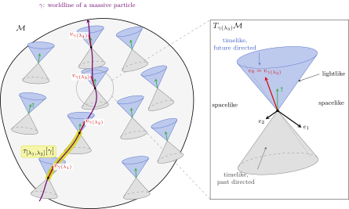

<!-- GENERATED by _port/convert/build.py from Chapters/GR.tex.
     Do not edit this file: edit the LaTeX notes and re-run the converter. -->

```{=html}
<header class="dg-head dg-head-chapter"><p class="dg-kicker">Chapter 10</p><h1 class="dg-title">General Relativity</h1></header>
<blockquote class="dg-quote"><div class="dg-it"><p>“  Spacetime is a  <span class="dg-term dg-term-green">four-dimensional topological manifold</span>  with a <span class="dg-term dg-term-purple">smooth</span>  <span class="dg-term dg-term-olive">orientable</span>  <span class="dg-term dg-term-green">atlas</span>  carrying a  <span class="dg-term dg-term-teal">torsion-free connection</span>  compatible with  a <span class="dg-term dg-term-rose">Lorentzian metric</span> and a  time orientation  satisfying the Einstein equations.  ”</p></div></blockquote>
<div class="dg-motivation"><div class="dg-motivation-title">Motivation: Spacetime, particles, and observers</div><div class="dg-motivation-upper"><p>Newton–Cartan theory (Chapter <a class="dg-xref" href="../newtonian/index.html" data-kind="chapter" data-label="chapter_Newtonian">9</a>) already places gravity in the connection, but keeps an absolute time <span class="math inline">\(t\)</span>: the covector field <span class="math inline">\(dt\)</span> classifies every tangent vector as future directed, spatial or past directed, and all observers agree on which events are simultaneous. Special relativity replaces <span class="math inline">\(dt\)</span> by a Lorentzian metric and a time orientation. On <span class="math inline">\(\mathbb{R}^4\)</span>, in inertial coordinates, the time shown by a clock carried along a curve <span class="math inline">\(\gamma\)</span> is  <span class="math display">\[
        \tau_{[\lambda_1, \lambda_2]}[\gamma] = \int_{\lambda_1}^{\lambda_2} \sqrt{ \eta_{ij} \, \dot{\gamma}^i_\mathcal{U}(\lambda) \, \dot{\gamma}^j_\mathcal{U}(\lambda) } \; d\lambda ,
        \qquad
        \big( \eta_{ij} \big) = \operatorname{diag}(1, -1, -1, -1),
    \]</span>  the vectors with <span class="math inline">\(\eta_{ij} \, x^i_p \, x^j_p = 0\)</span> form the light cone, along which light moves and inside which massive particles move, and a time orientation selects one of its two halves, the “upper” one, as the future.</p>
<div class="dg-skip dg-smallskip"></div>
<p>General relativity drops the assumption that the metric is the fixed. The components <span class="math inline">\(g_{ij}\)</span> vary from point to point, and gravity lives, as in Newton–Cartan theory, in the connection, now the Levi-Civita connection of <span class="math inline">\(g\)</span>. The metric thus measures proper time and draws the light cones, deciding which curves follow geodesics. Special relativity survives only locally, where a chart can achieve <span class="math inline">\(g_{ij} = \eta_{ij}\)</span> and <span class="math inline">\(\Gamma = 0\)</span>, but not on a neighbourhood whenever <span class="math inline">\(\mathrm{Riem} \neq 0\)</span>.</p>
<div class="dg-skip dg-smallskip"></div>
<p>The metric is determined by the matter through the <strong>Einstein equations</strong>, <span class="math inline">\(G = 8 \pi G_N \, T\)</span>, which equate the Einstein curvature <span class="math inline">\(G\)</span> of Chapter <a class="dg-xref" href="../metric/index.html" data-kind="chapter" data-label="chapter_Metric">7</a> to the energy–momentum tensor field <span class="math inline">\(T\)</span> of the matter.</p>
<div class="dg-skip dg-smallskip"></div>
<p>The opening sentence of these notes (Chapter <a class="dg-xref" href="../introduction/index.html" data-kind="chapter" data-label="chapter_Introduction">1</a>) describes spacetime as a four-dimensional manifold with a smooth orientable atlas, carrying a torsion-free connection compatible with a Lorentzian metric and a time orientation, satisfying the Einstein equations. Every ingredient except the last one is now available. This chapter assembles them into the definition of a spacetime, and identifies within it the objects of physics: particles, observers, and what observers measure.</p>
</div><div class="dg-motivation-lower">
<p><strong>Goal:</strong> carry out this programme, and complete it with the equations that determine the metric.</p>
<ul class="dg-itemize dg-depth-1">
<li><p>Define a <strong>spacetime</strong>, and use a <strong>time orientation</strong> to split causal vectors into future and past.</p></li>
<li><p>Define the <strong>worldlines</strong> of massive and massless particles, and the <strong>proper time</strong>r.</p></li>
<li><p>Define <strong>observers</strong> and derive what they can measure.</p></li>
<li><p>Recover <strong>Lorentz transformations</strong> as relations between two observer frames at a single event.</p></li>
<li><p>Derive the <strong>Einstein equations</strong> by varying the metric in the <strong>Einstein–Hilbert action</strong>.</p></li>
</ul></div></div>
<figure class="dg-figure" id="fig_light_cones"><div class="dg-paper" style="--dg-frac:0.983"></div><figcaption><span class="dg-fignum">Figure 10.1:</span>   Light cones in a region of a spacetime <span class="math inline">\(\mathcal{M}\)</span>, tilting smoothly from point to point, with one spatial dimension  suppressed. Each cone is drawn at its base point but lives in the tangent space there. The time orientation <span class="math inline">\(\textrm{\runic ᛏ}\)</span> (green) selects the future  half of every cone (shaded). Along the worldline <span class="math inline">\(\gamma\)</span> of a massive particle, every velocity <span class="math inline">\(v_{\gamma(\lambda_i)}\)</span> lies inside  the future half of the cone at <span class="math inline">\(\gamma(\lambda_i)\)</span>, i.e. is timelike and future directed, whatever the direction of  <span class="math inline">\(\gamma\)</span> in the drawing; the arrow on <span class="math inline">\(\gamma\)</span> points towards increasing <span class="math inline">\(\lambda\)</span>. The length of the highlighted segment is the  proper time <span class="math inline">\(\tau_{[\lambda_1, \lambda_2]}[\gamma]\)</span> elapsed between <span class="math inline">\(\gamma(\lambda_1)\)</span> and <span class="math inline">\(\gamma(\lambda_2)\)</span>.  Inset: the tangent space at <span class="math inline">\(\gamma(\lambda_3)\)</span>, with its timelike (future and past directed), lightlike and spacelike  vectors, and an observer frame there: <span class="math inline">\(e_0 = v_{\gamma(\lambda_3)}\)</span>, and <span class="math inline">\(e_1\)</span>, <span class="math inline">\(e_2\)</span> orthogonal to it with respect to  <span class="math inline">\(g_{\gamma(\lambda_3)}\)</span> (<span class="math inline">\(e_3\)</span>, along the suppressed dimension, is not drawn). This is not the Euclidean right angle of the drawing: as <span class="math inline">\(e_0\)</span> tilts towards the dotted light  ray, <span class="math inline">\(e_1\)</span> tilts towards the same ray from the other side. </figcaption></figure>
<nav class="dg-web dg-chapter-sections" aria-label="Sections"><ul><li><a href="spacetime.html"><span class="dg-secnum">10.1</span> Spacetime</a></li><li class="dg-pending"><span class="dg-secnum">10.2</span> The Einstein Equations from an Action</li><li><a href="matter.html"><span class="dg-secnum">10.3</span> Coupling to Matter</a></li></ul></nav>
<nav class="dg-web dg-prevnext" aria-label="Previous and next page"><a class="dg-prev" href="../newtonian/gravity-connection.html" rel="prev"><span aria-hidden="true">←</span> <span><span class="dg-secnum">9.5</span> Gravity in the Connection</span></a><a class="dg-next" href="spacetime.html" rel="next"><span aria-hidden="true">→</span> <span><span class="dg-secnum">10.1</span> Spacetime</span></a></nav>
```
