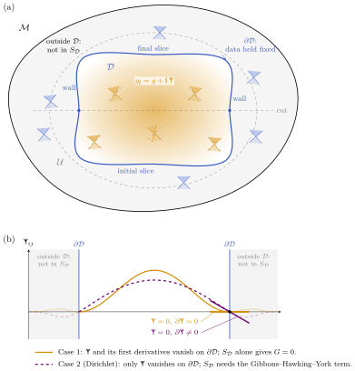

<!-- GENERATED by _port/convert/build.py from Chapters/GR.tex.
     Do not edit this file: edit the LaTeX notes and re-run the converter. -->

```{=html}
<header class="dg-head dg-head-section"><p class="dg-kicker">Chapter 10 <span class="dg-sep">•</span> <a href="index.html">General Relativity</a></p><h1 class="dg-title"><span class="dg-secnum">10.1</span> Spacetime</h1></header>
<ul class="dg-itemize dg-depth-1">
<li><p>A <strong>spacetime</strong> is the sextuple <span class="math inline">\((\mathcal{M}, \mathcal{O}, \mathcal{A}^\uparrow, \nabla^{\text{LC}}, g, \textrm{\runic ᛏ})_4\)</span>, formed by</p>
<ol class="dg-enumerate dg-depth-1">
<li><p><span class="math inline">\((\mathcal{M}, \mathcal{O}, \mathcal{A}^\uparrow, g)_4\)</span>  is a 4-dimensional oriented metric manifold whose metric <span class="math inline">\(g\)</span> is Lorentzian<sup class="dg-fnref"><a href="#fn-1" id="fnref-1" aria-label="Footnote 1">1</a></sup>, and <span class="math inline">\(\nabla^{\text{LC}}\)</span> is its Levi-Civita connection, the only torsion-free connection compatible with <span class="math inline">\(g\)</span>  ;</p></li>
<li><p><span class="math inline">\(\textrm{\runic ᛏ} \in \Gamma T\mathcal{M}\)</span> is a <strong>time orientation</strong>: a nowhere-vanishing vector field,  <span class="math inline">\(\textrm{\runic ᛏ}(p) \neq 0\)</span>, with  <span class="math inline">\(g_p\big( \textrm{\runic ᛏ}(p), \textrm{\runic ᛏ}(p) \big) &gt; 0 \, \forall p \in \mathcal{M}\)</span>.</p></li>
</ol>
<p>In general relativity, <span class="math inline">\(g\)</span> is moreover required to satisfy the Einstein equations, formulated later in this chapter.  Everything below holds for any spacetime.</p></li>
<li><p>A non-zero tangent vector <span class="math inline">\(\mathcal{X}_p \in T_p\mathcal{M}\)</span> is called</p>
<ol class="dg-enumerate dg-depth-1">
<li><p><strong>timelike</strong> if <span class="math inline">\(g_p(\mathcal{X}_p, \mathcal{X}_p) &gt; 0\)</span>,</p></li>
<li><p><strong>lightlike</strong> (or null) if <span class="math inline">\(g_p(\mathcal{X}_p, \mathcal{X}_p) = 0\)</span>,</p></li>
<li><p><strong>spacelike</strong> if <span class="math inline">\(g_p(\mathcal{X}_p, \mathcal{X}_p) &lt; 0\)</span>,</p></li>
</ol>
<p>and <strong>causal</strong> if it is timelike or lightlike. The lightlike vectors of <span class="math inline">\(T_p\mathcal{M}\)</span> form the <strong>light cone</strong> at <span class="math inline">\(p\)</span>. For the velocity of a curve, this classification is the sign of Chapter <a class="dg-xref" href="../metric/index.html" data-kind="chapter" data-label="chapter_Metric">7</a>: a non-zero <span class="math inline">\(v_{\gamma(\lambda)}\)</span> is timelike, lightlike or spacelike if and only if <span class="math inline">\(\textrm{\runic ᛇ}_\gamma(\lambda) = +1\)</span>, <span class="math inline">\(0\)</span> or <span class="math inline">\(-1\)</span>.</p></li>
<li><p><strong>Future and past.</strong> A causal vector <span class="math inline">\(\mathcal{X}_p\)</span> is called</p>
<ol class="dg-enumerate dg-depth-1">
<li><p><strong>future directed</strong> if <span class="math inline">\(g_p\big( \textrm{\runic ᛏ}(p), \mathcal{X}_p \big) &gt; 0\)</span>,</p></li>
<li><p><strong>past directed</strong> if <span class="math inline">\(g_p\big( \textrm{\runic ᛏ}(p), \mathcal{X}_p \big) &lt; 0\)</span>,</p></li>
</ol>
<p>The time orientation, <span class="math inline">\(\textrm{\runic ᛏ}\)</span>, serves to declare,  from the two “sides” of the light cone,  which one contains <span class="math inline">\(\textrm{\runic ᛏ}(p)\)</span>,  which is defined as the future direction.</p></li>
<li><p>A smooth curve <span class="math inline">\(\gamma : \mathbb{R} \to \mathcal{M}\)</span> is the <strong>worldline</strong> of</p>
<ol class="dg-enumerate dg-depth-1">
<li><p>a <strong>massive particle</strong> if <span class="math inline">\(v_{\gamma(\lambda)}\)</span> is timelike and future directed for all <span class="math inline">\(\lambda \in \mathbb{R}\)</span>, i.e. <span class="math inline">\(\textrm{\runic ᛇ}_\gamma \equiv +1\)</span> and <span class="math inline">\(g_{\gamma(\lambda)}\big( \textrm{\runic ᛏ}(\gamma(\lambda)), v_{\gamma(\lambda)} \big) &gt; 0\)</span>;</p></li>
<li><p>a <strong>massless particle</strong> if <span class="math inline">\(v_{\gamma(\lambda)}\)</span> is lightlike and future directed for all <span class="math inline">\(\lambda \in \mathbb{R}\)</span>, i.e. <span class="math inline">\(\textrm{\runic ᛇ}_\gamma \equiv 0\)</span>, <span class="math inline">\(v_{\gamma(\lambda)} \neq 0\)</span>, and <span class="math inline">\(g_{\gamma(\lambda)}\big( \textrm{\runic ᛏ}(\gamma(\lambda)), v_{\gamma(\lambda)} \big) &gt; 0\)</span>.</p></li>
</ol></li>
<li><p>The <strong>proper time</strong> along a massive worldline <span class="math inline">\(\gamma\)</span>,  between the events <span class="math inline">\(\gamma(\lambda_1)\)</span> and  <span class="math inline">\(\gamma(\lambda_2)\)</span>, <span class="math inline">\(\lambda_1 &lt; \lambda_2\)</span>, is its length  with <span class="math inline">\(\textrm{\runic ᛇ}_\gamma \equiv +1\)</span>:  <span class="math display">\[
            \tau_{[\lambda_1, \lambda_2]}[\gamma] \coloneqq L_{[\lambda_1, \lambda_2]}[\gamma]
            = \int_{\lambda_1}^{\lambda_2} s_\gamma(\lambda) \, d\lambda
            = \int_{\lambda_1}^{\lambda_2} \sqrt{ g_{\gamma(\lambda)}\big( v_{\gamma(\lambda)}, v_{\gamma(\lambda)} \big) } \, d\lambda .
        \]</span>  It does not depend on the parametrization of <span class="math inline">\(\gamma\)</span>,  i.e. it is a property of the path traced in  <span class="math inline">\(\mathcal{M}\)</span>, and it is interpreted as the time elapsed on a clock  carried along <span class="math inline">\(\gamma\)</span>. For a massless worldline, <span class="math inline">\(s_\gamma \equiv 0\)</span>.</p></li>
</ul>
```

## `<span class="dg-secnum">10.1.1</span> Observers`{=html} {#subsection_observers}

```{=html}
<ul class="dg-itemize dg-depth-1">
<li><p>An <strong>observer</strong> is a pair <span class="math inline">\((\gamma, e)\)</span> formed by a massive worldline <span class="math inline">\(\gamma\)</span> and four smooth vector fields along  <span class="math inline">\(\gamma\)</span><sup class="dg-fnref"><a href="#fn-2" id="fnref-2" aria-label="Footnote 2">2</a></sup>  <span class="math display">\begin{align*}
        e_a : \mathbb{R} &amp;\longrightarrow T\mathcal{M} \\
        \lambda &amp;\longmapsto e_a(\lambda) \in T_{\gamma(\lambda)}\mathcal{M},
        \qquad a = 0, 1, 2, 3,
    \end{align*}</span>  such that, for all <span class="math inline">\(\lambda \in \mathbb{R}\)</span>,</p>
<ol class="dg-enumerate dg-depth-1">
<li><p><em>Lorentz-orthonormality:</em> <span class="math inline">\(g_{\gamma(\lambda)}\big( e_a(\lambda), e_b(\lambda) \big) = \eta_{ab}\)</span><sup class="dg-fnref"><a href="#fn-3" id="fnref-3" aria-label="Footnote 3">3</a></sup>;</p></li>
<li><p><em>The time axis is the velocity:</em> <span class="math inline">\(e_0(\lambda) = v_{\gamma(\lambda)}\)</span>.</p></li>
</ol>
<p>Fixing <span class="math inline">\(\lambda\)</span> and dropping it from the notation, the covectors <span class="math inline">\(\epsilon^0 \coloneqq \flat(e_0)\)</span> and  <span class="math inline">\(\epsilon^\alpha \coloneqq - \flat(e_\alpha)\)</span>, with <span class="math inline">\(\flat_p(\mathcal{X}_p)(\mathcal{Y}_p) \coloneqq g_p(\mathcal{X}_p, \mathcal{Y}_p)\)</span>, satisfy  <span class="math display">\[
    \epsilon^0(e_b) \overset{\text{def.\ of } \flat}{=} g(e_0, e_b) \overset{\text{cond.\ 1}}{=} \eta_{0b} = \delta^0_b,
    \qquad
    \epsilon^\alpha(e_b) \overset{\text{def.\ of } \flat}{=} - g(e_\alpha, e_b) \overset{\text{cond.\ 1}}{=} - \eta_{\alpha b} = \delta^\alpha_b .
    \]</span>  Applying <span class="math inline">\(\epsilon^a\)</span> to <span class="math inline">\(c^b \, e_b = 0\)</span> gives <span class="math inline">\(c^a = 0\)</span>, so <span class="math inline">\(e\)</span> is a basis of <span class="math inline">\(T_{\gamma(\lambda)}\mathcal{M}\)</span> and  <span class="math inline">\(\epsilon \coloneqq \{ \epsilon^0, \dots, \epsilon^3 \}\)</span> its dual basis (Section <a class="dg-xref" href="../vector-spaces/basis-components-transformations.html" data-kind="section" data-label="section_Basis_Components_Transformations">2.3</a>). Every  <span class="math inline">\(\mathcal{X} \in T_{\gamma(\lambda)}\mathcal{M}\)</span> decomposes as <span class="math inline">\(\mathcal{X} = \epsilon^a(\mathcal{X}) \, e_a\)</span>, and the numbers  <span class="math inline">\(\epsilon^a(\mathcal{X})\)</span> are its components <strong>measured by the observer</strong>, with time component  <span class="math inline">\(\epsilon^0(\mathcal{X}) \overset{\text{cond.\ 2}}{=} g(v_\gamma, \mathcal{X})\)</span>. For <span class="math inline">\(\mathcal{X} = v_\gamma\)</span> itself,  <span class="math display">\[
    g(v_\gamma, v_\gamma) \overset{\text{cond.\ 2}}{=} g(e_0, e_0) \overset{\text{cond.\ 1}}{=} \eta_{00} = 1
    \quad \longrightarrow \quad
    s_\gamma \equiv 1,
    \quad
    \tau_{[\lambda_1, \lambda_2]}[\gamma] = \lambda_2 - \lambda_1 :
    \]</span>  an observer is parametrized by its own proper time.</p>
<p>Let <span class="math inline">\(\delta\)</span> be the worldline of a massive or massless particle through <span class="math inline">\(p = \gamma(\lambda_1) = \delta(\lambda_2)\)</span>, with  <span class="math inline">\(v_\delta \coloneqq v_{\delta(\lambda_2)}\)</span>, and <span class="math inline">\(\epsilon^a\)</span>, <span class="math inline">\(e_a\)</span> taken at <span class="math inline">\(\lambda_1\)</span>. Its measured time component is  <span class="math inline">\(\epsilon^0(v_\delta) = g_p\big( v_{\gamma(\lambda_1)}, v_\delta \big) &gt; 0\)</span> by <span class="math inline">\((\dagger)\)</span>, and its <strong>3-velocity</strong>, the spatial  displacement per unit of the observer’s time, is  <span class="math display">\[
    u_\delta \coloneqq u^\alpha \, e_\alpha,
    \qquad
    u^\alpha \coloneqq \frac{\epsilon^\alpha(v_\delta)}{\epsilon^0(v_\delta)} .
    \]</span>  A reparametrization of <span class="math inline">\(\delta\)</span> multiplies <span class="math inline">\(v_\delta\)</span> by a positive factor, hence numerator and denominator alike, so  <span class="math inline">\(u_\delta\)</span> depends only on the path of <span class="math inline">\(\delta\)</span>. Moreover,  <span class="math display">\[
    g_p(v_\delta, v_\delta)
    \overset{\substack{v_\delta \, = \, \epsilon^a(v_\delta) \, e_a \\ \text{cond.\ 1}}}{=}
    \big( \epsilon^0(v_\delta) \big)^2 - \sum_\alpha \big( \epsilon^\alpha(v_\delta) \big)^2
    = \underbrace{\big( \epsilon^0(v_\delta) \big)^2}_{&gt; \, 0} \Big( 1 - \sum_\alpha \big( u^\alpha \big)^2 \Big),
    \]</span>  so <span class="math inline">\(\sum_\alpha (u^\alpha)^2 &lt; 1\)</span> for massive particles and <span class="math inline">\(= 1\)</span> for massless ones: every observer measures light at speed <span class="math inline">\(1\)</span>,  and nothing faster.</p></li>
<li><p><strong>Lorentz transformations.</strong> Let <span class="math inline">\((\gamma, e)\)</span> and <span class="math inline">\((\tilde{\gamma}, \tilde{e})\)</span> be two observers meeting at the event <span class="math inline">\(p = \gamma(\lambda_1) = \tilde{\gamma}(\lambda_2)\)</span>, and drop <span class="math inline">\(\lambda_1\)</span>, <span class="math inline">\(\lambda_2\)</span> from the notation. Both frames are bases of <span class="math inline">\(T_p\mathcal{M}\)</span>, so <span class="math inline">\(\tilde{e}_a = \Lambda^b_a \, e_b\)</span> with <span class="math inline">\(\Lambda^b_a \coloneqq \epsilon^b(\tilde{e}_a) \in \mathbb{R}\)</span>. Since both are Lorentz-orthonormal,  <span class="math display">\[
            \eta_{ab}
            \overset{\text{cond.\ 1 for } \tilde{e}}{=} g_p(\tilde{e}_a, \tilde{e}_b)
            \overset{\text{bilinearity}}{=} \Lambda^m_a \, \Lambda^n_b \, g_p(e_m, e_n)
            \overset{\text{cond.\ 1 for } e}{=} \Lambda^m_a \, \Lambda^n_b \, \eta_{mn},
        \]</span>  and taking determinants, <span class="math inline">\((\det \Lambda)^2 = 1\)</span>, so <span class="math inline">\(\Lambda\)</span> is invertible. Since both time axes are future directed,  <span class="math display">\[
            \Lambda^0_0 = \epsilon^0(\tilde{e}_0)
            \overset{\epsilon^0 = \flat_p(v_\gamma), \; \text{cond.\ 2}}{=} g_p(v_\gamma, v_{\tilde{\gamma}})
            \overset{(\dagger)}{&gt;} 0,
            \qquad
            \big( \Lambda^0_0 \big)^2 \overset{(a, b) = (0, 0)}{=} 1 + \sum_\alpha \big( \Lambda^\alpha_0 \big)^2 \geq 1,
        \]</span>  so <span class="math inline">\(\Lambda^0_0 \geq 1\)</span>. Hence <span class="math inline">\(\Lambda\)</span> belongs to the <strong>orthochronous Lorentz group</strong> <span class="math inline">\(O^{\uparrow}(1,3)\)</span>, inside the <strong>Lorentz group</strong> <span class="math inline">\(O(1,3)\)</span>,  <span class="math display">\[
            O(1,3) \coloneqq \big\{ \Lambda \in \mathbb{R}^{4 \times 4} \;\big|\; \Lambda^m_a \, \Lambda^n_b \, \eta_{mn} = \eta_{ab} \big\},
            \qquad
            O^{\uparrow}(1,3) \coloneqq \big\{ \Lambda \in O(1,3) \;\big|\; \Lambda^0_0 \geq 1 \big\},
        \]</span>  whose elements are the <strong>Lorentz transformations</strong><sup class="dg-fnref"><a href="#fn-4" id="fnref-4" aria-label="Footnote 4">4</a></sup>. They relate the frames of any two observers who meet at an event, in special and in general relativity alike.</p>
<div class="dg-skip dg-medskip"></div>
<p><em>Frames, not coordinates.</em> <span class="math inline">\(\Lambda\)</span> relates two bases of the single tangent space <span class="math inline">\(T_p\mathcal{M}\)</span>; it does not move the points of <span class="math inline">\(\mathcal{M}\)</span>. The special-relativistic rule that transforms coordinates by a Lorentz matrix is a statement about chart transition maps, and it only holds between charts <span class="math inline">\((\mathcal{U}, \mathscr{X})\)</span>, <span class="math inline">\((\mathcal{V}, \mathscr{Y})\)</span> whose metric components equal <span class="math inline">\(\eta_{ij}\)</span> on their whole domains. Then <span class="math inline">\(\partial_m g_{ij} = 0\)</span>, so the Christoffel symbols (<a class="dg-xref" href="../metric/levi-civita-connection.html#eq_christoffel_symbols" data-kind="equation" data-label="eq_christoffel_symbols">7.2</a>) and hence <span class="math inline">\(\mathrm{Riem}\)</span> vanish there, and the transformation law of the connection coefficient functions reduces to <span class="math inline">\((\partial \mathscr{Y}^i / \partial \mathscr{X}^s) \, \partial^2 \mathscr{X}^s / \partial \mathscr{Y}^k \partial \mathscr{Y}^j = 0\)</span>, i.e. (multiplying by <span class="math inline">\(\partial \mathscr{X}^r / \partial \mathscr{Y}^i\)</span>) <span class="math inline">\(\partial^2 \mathscr{X}^r / \partial \mathscr{Y}^k \partial \mathscr{Y}^j = 0\)</span>. On each connected component of <span class="math inline">\(\mathscr{Y}(\mathcal{U} \cap \mathcal{V})\)</span> the transition map is thus affine, <span class="math inline">\(\big( \textrm{\runic ᛖ}_{\mathcal{V}\mathcal{U}} \big)^r(\beta) = \Lambda^r_k \, \beta^k + b^r\)</span>, with constant <span class="math inline">\(\Lambda^r_k = \partial \mathscr{X}^r / \partial \mathscr{Y}^k\)</span> and <span class="math inline">\(b^r\)</span>, and  <span class="math display">\[
            \eta_{kl}
            = (g_\mathscr{Y})_{kl}
            \overset{\text{transf.\ law of } g}{=} \frac{\partial \mathscr{X}^i}{\partial \mathscr{Y}^k} \, \frac{\partial \mathscr{X}^j}{\partial \mathscr{Y}^l} \, (g_\mathscr{X})_{ij}
            = \Lambda^i_k \, \Lambda^j_l \, \eta_{ij},
        \]</span>  i.e. <span class="math inline">\(\Lambda \in O(1,3)\)</span>. Such charts exist only where <span class="math inline">\(\mathrm{Riem} = 0\)</span>. In a curved spacetime, Lorentz transformations only relate the frames of observers meeting at an event, while coordinates may be changed by any transition map of the atlas.</p></li>
<li><p>A spacetime <span class="math inline">\((\mathcal{M}, \mathcal{O}, \mathcal{A}^\uparrow, \nabla^{\text{LC}}, g, \textrm{\runic ᛏ})_4\)</span> is a spacetime of <strong>general  relativity</strong> if its metric satisfies the <strong>Einstein equations</strong>  <span class="math display" id="eq_Einstein_equations">\begin{equation}
        \boxed{
            G = \mathrm{Ric} - \frac{1}{2} \, R \, g = 8 \pi G_N \, T ,
            \qquad \text{i.e.} \qquad
            \mathrm{Ric}_{ab} - \frac{1}{2} \, R \, g_{ab} = 8 \pi G_N \, T_{ab} ,
        } \tag{10.1}
    \end{equation}</span>  where <span class="math inline">\(G\)</span> is the Einstein curvature of <span class="math inline">\(\nabla^{\text{LC}}\)</span> (Chapter <a class="dg-xref" href="../metric/index.html" data-kind="chapter" data-label="chapter_Metric">7</a>), <span class="math inline">\(T\)</span> the energy-momentum tensor  field of the matter, a symmetric <span class="math inline">\((0,2)\)</span>-tensor field, <span class="math inline">\(G_N\)</span> Newton’s constant, and the speed of light is <span class="math inline">\(1\)</span>. In vacuum,  <span class="math inline">\(T = 0\)</span> and the equations read <span class="math inline">\(G = 0\)</span>.</p>
<p>The left-hand side is built from <span class="math inline">\(g\)</span> alone, the right-hand side from the matter: the matter determines the  geometry, and the geometry, through its geodesics, the motion of the matter. With (<a class="dg-xref" href="#eq_Einstein_equations" data-kind="equation" data-label="eq_Einstein_equations">10.1</a>), every  ingredient of the opening sentence of these notes is in place, and general relativity is fully defined. What follows  adds no further axiom: Section <span class="dg-xref dg-xref-pending" data-label="section_Einstein_Hilbert">10.2</span> derives (<a class="dg-xref" href="#eq_Einstein_equations" data-kind="equation" data-label="eq_Einstein_equations">10.1</a>) from an action, the  Einstein–Hilbert action, and Section <a class="dg-xref" href="matter.html" data-kind="section" data-label="section_Matter">10.3</a> shows how <span class="math inline">\(T\)</span> can also be obtained for matter described from an action.</p></li>
</ul>
<figure class="dg-figure" id="fig_variation_region"><div class="dg-paper" style="--dg-frac:0.863"></div><figcaption><span class="dg-fignum">Figure 10.2:</span>   The variation of the metric, drawn in one space and one time dimension.  (a) A region <span class="math inline">\(\mathcal{D}\)</span>, with compact closure inside a chart domain <span class="math inline">\(\mathcal{U}\)</span>, bounded by an initial and a final spacelike  slice and by two timelike walls. Light cones show the metric. Inside <span class="math inline">\(\mathcal{D}\)</span> the metric is deformed (orange shading),  and the cones of <span class="math inline">\(g_{\textrm{\runic ᛊ}}\)</span> (orange) differ from those of <span class="math inline">\(g\)</span> (dashed grey), most in the middle, less and less towards  <span class="math inline">\(\partial \mathcal{D}\)</span>, where the deformation vanishes. Outside <span class="math inline">\(\mathcal{D}\)</span> only the cones of <span class="math inline">\(g\)</span> are drawn: whatever <span class="math inline">\(\textrm{\runic ᛉ}\)</span> does there does not enter <span class="math inline">\(S_\mathcal{D}\)</span>.  (b) One component of <span class="math inline">\(\textrm{\runic ᛉ}\)</span> along the cut, aligned with (a). Both profiles vanish on <span class="math inline">\(\partial \mathcal{D}\)</span>, i.e. the metric  is held fixed there. In Case 1 (solid) the profile reaches <span class="math inline">\(\partial \mathcal{D}\)</span> with zero slope, so the first derivatives of the  metric are held fixed as well; compact support in <span class="math inline">\(\mathcal{D}\)</span>, as in Subsection <span class="dg-xref dg-xref-pending" data-label="subsection_EH_variation">10.2.2</span>, is a special  case. In Case 2 (dashed) the slope at <span class="math inline">\(\partial \mathcal{D}\)</span> is free: this is what produces the boundary term of  Subsection <span class="dg-inprep" title="This part of the notes is in preparation">in preparation</span>. Outside <span class="math inline">\(\mathcal{D}\)</span> (grey, faded) a smooth <span class="math inline">\(\textrm{\runic ᛉ}\)</span> generally continues, but <span class="math inline">\(S_\mathcal{D}\)</span> does not see it. </figcaption></figure>
<div class="dg-footnotes"><div class="dg-fn" id="fn-1"><a class="dg-fn-num" href="#fnref-1" aria-label="Back to the text">1</a><div class="dg-fn-body"><p>We take the signature convention <span class="math inline">\((n_+, n_-) = (1, 3)\)</span>, i.e. <span class="math inline">\((+, -, -, -)\)</span>. At every <span class="math inline">\(p\)</span>, Sylvester’s law of inertia  provides a basis <span class="math inline">\(\{ \hat{e}_a \}\)</span> of <span class="math inline">\(T_p\mathcal{M}\)</span>, ordered so that the positive  entry comes first, in which the components of <span class="math inline">\(g_p\)</span> are  <span class="math display">\[
            g_p(\hat{e}_a, \hat{e}_b) = \eta_{ab} \coloneqq
            \begin{pmatrix}
                1 &amp; 0 &amp; 0 &amp; 0 \\
                0 &amp; -1 &amp; 0 &amp; 0 \\
                0 &amp; 0 &amp; -1 &amp; 0 \\
                0 &amp; 0 &amp; 0 &amp; -1
            \end{pmatrix}_{ab}.
            \]</span>  With the other common convention,  <span class="math inline">\((n_+, n_-) = (3, 1)\)</span>, i.e. <span class="math inline">\((-, +, +, +)\)</span>, <span class="math inline">\(\eta_{ab}\)</span> changes sign, and so does every inequality below involving <span class="math inline">\(g\)</span>:  timelike vectors have <span class="math inline">\(g_p(\mathcal{X}_p, \mathcal{X}_p) &lt; 0\)</span>, the time orientation has  <span class="math inline">\(g_p\big( \textrm{\runic ᛏ}(p), \textrm{\runic ᛏ}(p) \big) &lt; 0\)</span>, and future-directed vectors have  <span class="math inline">\(g_p\big( \textrm{\runic ᛏ}(p), \mathcal{X}_p \big) &lt; 0\)</span>. The proper time needs no change:  <span class="math inline">\(s_\gamma = \sqrt{\textrm{\runic ᛇ}_\gamma \, g(v_\gamma, v_\gamma)}\)</span> absorbs the sign through <span class="math inline">\(\textrm{\runic ᛇ}_\gamma = -1\)</span>.</p></div></div><div class="dg-fn" id="fn-2"><a class="dg-fn-num" href="#fnref-2" aria-label="Back to the text">2</a><div class="dg-fn-body"><p>The <em>frame bundle</em> of <span class="math inline">\(\mathcal{M}\)</span> is the set  <span class="math display">\[
        L\mathcal{M} \coloneqq \dot{\bigcup}_{p \in \mathcal{M}} L_p\mathcal{M},
        \qquad
        L_p\mathcal{M} \coloneqq \big\{ \text{ordered bases } (e_0, \dots, e_3) \text{ of } T_p\mathcal{M} \big\},
        \]</span>  with projection <span class="math inline">\(\pi(e) \coloneqq p\)</span> for <span class="math inline">\(e \in L_p\mathcal{M}\)</span>. As for <span class="math inline">\(T\mathcal{M}\)</span> (Section <a class="dg-xref" href="../fields/vector-fields.html" data-kind="section" data-label="section_Vector_Fields">5.1</a>), a chart  <span class="math inline">\((\mathcal{U}, \mathscr{X})\)</span> provides coordinates on it: those of <span class="math inline">\(p\)</span>, together with the <span class="math inline">\(16\)</span> components <span class="math inline">\((dx^i)_p(e_a)\)</span> of the  basis vectors, which form an invertible <span class="math inline">\(4 \times 4\)</span> matrix. An observer’s frame is a curve  <span class="math inline">\(\lambda \mapsto e(\lambda) \in L_{\gamma(\lambda)}\mathcal{M}\)</span> lying over <span class="math inline">\(\gamma\)</span>, <span class="math inline">\(\pi \circ e = \gamma\)</span>, whose smoothness in these  coordinates is that of the four vector fields <span class="math inline">\(e_a\)</span> along <span class="math inline">\(\gamma\)</span>: the two descriptions are the same data, and we use the  second. The bundle language pays off when comparing bases: any two bases of the same <span class="math inline">\(T_p\mathcal{M}\)</span> are related by  <span class="math inline">\(e'_a = \Lambda^b_a \, e_b\)</span> for a unique <span class="math inline">\(\Lambda \in GL(4)\)</span>, and for two Lorentz-orthonormal bases <span class="math inline">\(\Lambda\)</span> is a Lorentz  transformation (defined below).</p></div></div><div class="dg-fn" id="fn-3"><a class="dg-fn-num" href="#fnref-3" aria-label="Back to the text">3</a><div class="dg-fn-body"><p>Any other bases <span class="math inline">\(e'(\lambda)\)</span> may be chosen along <span class="math inline">\(\gamma\)</span>; <span class="math inline">\((\gamma, e')\)</span> is then simply not an observer. The two  conditions are what make components <em>measured</em> quantities: by condition 2, the time component  <span class="math inline">\(\epsilon^0(\mathcal{X}) = g(v_\gamma, \mathcal{X})\)</span> is read on the observer’s own clock; by condition 1, the <span class="math inline">\(e_\alpha\)</span> have  unit length and are orthogonal to <span class="math inline">\(v_\gamma\)</span>, i.e. they span the directions the observer regards as purely spatial. A  Lorentz-orthonormal <span class="math inline">\(e'\)</span> with future-directed <span class="math inline">\(e'_0 \neq v_\gamma\)</span> is the frame of <em>another</em> observer passing  through <span class="math inline">\(\gamma(\lambda)\)</span>, with velocity <span class="math inline">\(e'_0\)</span>. Any other <span class="math inline">\(e'\)</span>, e.g. with <span class="math inline">\(e'_1 = e_1 + e_0\)</span> (lightlike), yields components  that mix clock and rod readings. Such bases remain useful, e.g. chart-induced bases, or the lightlike bases common in  the study of radiation.</p></div></div><div class="dg-fn" id="fn-4"><a class="dg-fn-num" href="#fnref-4" aria-label="Back to the text">4</a><div class="dg-fn-body"><p>That both sets are groups under matrix multiplication is not shown here. If all frames are moreover required to be positively oriented w.r.t. <span class="math inline">\(\mathcal{A}^\uparrow\)</span>, then <span class="math inline">\(\det \Lambda = +1\)</span>, and <span class="math inline">\(\Lambda\)</span> belongs to the proper orthochronous Lorentz group <span class="math inline">\(SO^{\uparrow}(1,3)\)</span>.</p></div></div></div>
<nav class="dg-web dg-prevnext" aria-label="Previous and next page"><a class="dg-prev" href="index.html" rel="prev"><span aria-hidden="true">←</span> <span><span class="dg-secnum">10</span> General Relativity</span></a><a class="dg-next" href="matter.html" rel="next"><span aria-hidden="true">→</span> <span><span class="dg-secnum">10.3</span> Coupling to Matter</span></a></nav>
```
