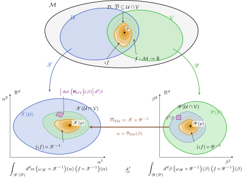

<!-- GENERATED by _port/convert/build.py from Chapters/Integrals.tex.
     Do not edit this file: edit the LaTeX notes and re-run the converter. -->

```{=html}
<header class="dg-head dg-head-chapter"><p class="dg-kicker">Chapter 8</p><h1 class="dg-title">Integrals</h1></header>
<div class="dg-motivation"><div class="dg-motivation-title">Motivation: Why integrating in a chart is not enough</div><div class="dg-motivation-upper"><p>On <span class="math inline">\(\mathbb{R}^d\)</span>, a function is integrated against the volume element <span class="math inline">\(d^d\alpha\)</span>. On a manifold, a chart <span class="math inline">\((\mathcal{U}, \mathscr{X})\)</span> turns <span class="math inline">\(f : \mathcal{M} \to \mathbb{R}\)</span> into its chart representative <span class="math inline">\(f \circ \mathscr{X}^{-1}\)</span> on <span class="math inline">\(\mathscr{X}(\mathcal{U}) \subseteq \mathbb{R}^d\)</span>, which can be integrated in the ordinary sense. The question is whether the result depends on the chart.</p>
<div class="dg-skip dg-medskip"></div>
<p>Let <span class="math inline">\((\mathcal{U}, \mathscr{X})\)</span> and <span class="math inline">\((\mathcal{V}, \mathscr{Y})\)</span> be charts, <span class="math inline">\(\mathcal{D} \subseteq \mathcal{U} \cap \mathcal{V}\)</span>, and let <span class="math inline">\(\iota : \mathcal{M} \to \mathbb{R}\)</span>, <span class="math inline">\(\iota(p) \coloneqq 1\)</span> if <span class="math inline">\(p \in \mathcal{D}\)</span> and <span class="math inline">\(0\)</span> otherwise, be the <strong>indicator function</strong> of <span class="math inline">\(\mathcal{D}\)</span>. Its chart representative <span class="math inline">\(\iota \circ \mathscr{X}^{-1}\)</span>, extended by zero outside <span class="math inline">\(\mathscr{X}(\mathcal{U})\)</span>, equals <span class="math inline">\(1\)</span> on <span class="math inline">\(\mathscr{X}(\mathcal{D})\)</span> and <span class="math inline">\(0\)</span> elsewhere on <span class="math inline">\(\mathbb{R}^d\)</span>. It turns the integral of the chart representative of <span class="math inline">\(f\)</span> over <span class="math inline">\(\mathscr{X}(\mathcal{D})\)</span> into one over all of <span class="math inline">\(\mathbb{R}^d\)</span>, which can then be rewritten in the other chart:  <span class="math display">\begin{align*}
        \int_{\mathscr{X}(\mathcal{D})} &amp;d^d\alpha \, \big( f \circ \mathscr{X}^{-1} \big)(\alpha)
        \xlongrightarrow[\text{outside } \mathscr{X}(\mathcal{D})]{\text{extend by } 0 \text{ with } \iota \, ^{\href{#fn_Integrals_Fubini}{1}}} ... \\
        ... =
        &amp;\int_{\mathbb{R}^d} d^d\alpha \, \big( (\iota f) \circ \mathscr{X}^{-1} \big)(\alpha)
        \xlongrightarrow[d^d\alpha \, = \, d^d\beta \, |\det ( \textrm{\runic ᛞ}_{\mathcal{U}\mathcal{V}} )(\beta)|]{\text{change of variables} \, ^{\href{#fn_Integrals_Volume}{2}}} ... \\
        ... =
        &amp;\int_{\mathbb{R}^d} d^d\beta \, \Big| \det \big( \textrm{\runic ᛞ}_{\mathcal{U}\mathcal{V}} \big)(\beta) \Big| \, \big( (\iota f) \circ \mathscr{Y}^{-1} \big)(\beta)
        \xlongrightarrow[\text{out of } \mathscr{Y}(\mathcal{D})]{\iota \circ \mathscr{Y}^{-1} \, = \, 0} ... \\
        ... =
        &amp;\int_{\mathscr{Y}(\mathcal{D})} d^d\beta \,
        \underbrace{\Big| \det \big( \textrm{\runic ᛞ}_{\mathcal{U}\mathcal{V}} \big)(\beta) \Big|}_{\mathclap{\text{picked up by the change of chart}}} \,
        \big( f \circ \mathscr{Y}^{-1} \big)(\beta) .
    \end{align*}</span>  The indicator and <span class="math inline">\(f\)</span> only become their representatives  in the other chart, while the volume element picks up  the factor <span class="math inline">\(\big| \det \big( \textrm{\runic ᛞ}_{\mathcal{U}\mathcal{V}} \big) \big|\)</span>.  The integral of a chart representative therefore depends on the chart.</p>
</div><div class="dg-motivation-lower">
<p><strong>Goal:</strong> a notion of integration on <span class="math inline">\(\mathcal{M}\)</span> that does not depend on the chart. Two structures achieve it:</p>
<ul class="dg-itemize dg-depth-1">
<li><p>a <strong>volume form</strong>, whose chart representative picks up <span class="math inline">\(\det \big( \textrm{\runic ᛞ}_{\mathcal{U}\mathcal{V}} \big)\)</span> under a change of chart and can thus compensate the factor above;</p></li>
<li><p>an <strong>orientation</strong>, which makes these determinants positive, so that the compensation is exact, <span class="math inline">\(|\det| / \det = 1\)</span>.</p></li>
</ul></div></div>
<figure class="dg-figure" id="fig_integration_charts"><div class="dg-paper" style="--dg-frac:0.883"></div><figcaption><span class="dg-fignum">Figure 8.1:</span>   Integration on a manifold, drawn for <span class="math inline">\(d = 2\)</span>. The chart domains <span class="math inline">\(\mathcal{U}\)</span> (blue) and <span class="math inline">\(\mathcal{V}\)</span> (green) overlap, and the  region <span class="math inline">\(\mathcal{D}\)</span> (orange outline) has its closure in <span class="math inline">\(\mathcal{U} \cap \mathcal{V}\)</span>. The function <span class="math inline">\(f\)</span> is defined everywhere (dotted level  sets); the indicator <span class="math inline">\(\iota\)</span> of <span class="math inline">\(\mathcal{D}\)</span> cuts it off outside the region, and <span class="math inline">\(\iota f\)</span> (shaded, darker for larger values) jumps  to zero at the boundary of <span class="math inline">\(\mathcal{D}\)</span>. The charts <span class="math inline">\(\mathscr{X}\)</span> and <span class="math inline">\(\mathscr{Y}\)</span> turn <span class="math inline">\(\iota f\)</span> into two chart representatives,  related by the chart transition map, <span class="math inline">\((\iota f) \circ \mathscr{Y}^{-1} = \big( (\iota f) \circ \mathscr{X}^{-1} \big) \circ \textrm{\runic ᛖ}_{\mathcal{V}\mathcal{U}}\)</span>:  they take the same value at the images of the same point <span class="math inline">\(p\)</span>, but their level sets, and the regions <span class="math inline">\(\mathscr{X}(\mathcal{D})\)</span> and  <span class="math inline">\(\mathscr{Y}(\mathcal{D})\)</span>, are deformed. </figcaption></figure>
<section class="dg-footnotes" role="doc-endnotes"><div class="dg-fn" id="fn-1" role="doc-footnote"><a class="dg-fn-num" href="#fnref-1" aria-label="Back to the text">1</a><div class="dg-fn-body"><p><span class="dg-anchor" id="fn_Integrals_Fubini"></span>For well-behaved integrands, Fubini’s theorem allows computing it as iterated integrals, <span class="math inline">\(\int_{-\infty}^{\infty} d\alpha^1 \cdots \int_{-\infty}^{\infty} d\alpha^d\)</span>, each running over the whole real line.</p></div></div><div class="dg-fn" id="fn-2" role="doc-footnote"><a class="dg-fn-num" href="#fnref-2" aria-label="Back to the text">2</a><div class="dg-fn-body"><p><span class="dg-anchor" id="fn_Integrals_Volume"></span><span class="math inline">\(\textrm{\runic ᛖ}_{\mathcal{V}\mathcal{U}}\)</span> is differentiable, so near <span class="math inline">\(\beta\)</span> it acts as its Jacobian, <span class="math inline">\(\textrm{\runic ᛖ}_{\mathcal{V}\mathcal{U}}(\beta + h) = \textrm{\runic ᛖ}_{\mathcal{V}\mathcal{U}}(\beta) + \textrm{\runic ᛞ}_{\mathcal{U}\mathcal{V}}(\beta) \, h + o(|h|)\)</span>. A small box with edges <span class="math inline">\(h_k \hat{e}_k\)</span> along the standard basis of <span class="math inline">\(\mathbb{R}^d\)</span>, of volume <span class="math inline">\(d^d\beta = h_1 \cdots h_d\)</span>, is thus mapped to the parallelepiped with edges <span class="math inline">\(h_k \, \textrm{\runic ᛞ}_{\mathcal{U}\mathcal{V}}(\beta) \, \hat{e}_k\)</span>, of volume <span class="math inline">\(\big| \det \big( \textrm{\runic ᛞ}_{\mathcal{U}\mathcal{V}} \big)(\beta) \big| \, h_1 \cdots h_d\)</span>. The determinant is the signed volume spanned by the columns of the matrix, and its sign, which only records a reversal of orientation, does not enter a volume. Summing over boxes (Riemann sums) gives the result; controlling the <span class="math inline">\(o(|h|)\)</span> terms in this limit is the content of the change of variables theorem.</p></div></div></section>
<nav class="dg-web dg-chapter-sections" aria-label="Sections"><ul><li><a href="volume-forms-orientation.html"><span class="dg-secnum">8.1</span> Volume Forms and Orientation</a></li><li><a href="integration-manifolds.html"><span class="dg-secnum">8.2</span> Integration on Manifolds</a></li><li><a href="metric-volume-form.html"><span class="dg-secnum">8.3</span> The Metric Volume Form</a></li></ul></nav>
<nav class="dg-web dg-prevnext" aria-label="Previous and next page"><a class="dg-prev" href="../metric/curvature-metric.html" rel="prev"><span aria-hidden="true">←</span> <span><span class="dg-secnum">7.4</span> Curvature of the Metric</span></a><a class="dg-next" href="volume-forms-orientation.html" rel="next"><span aria-hidden="true">→</span> <span><span class="dg-secnum">8.1</span> Volume Forms and Orientation</span></a></nav>
```
