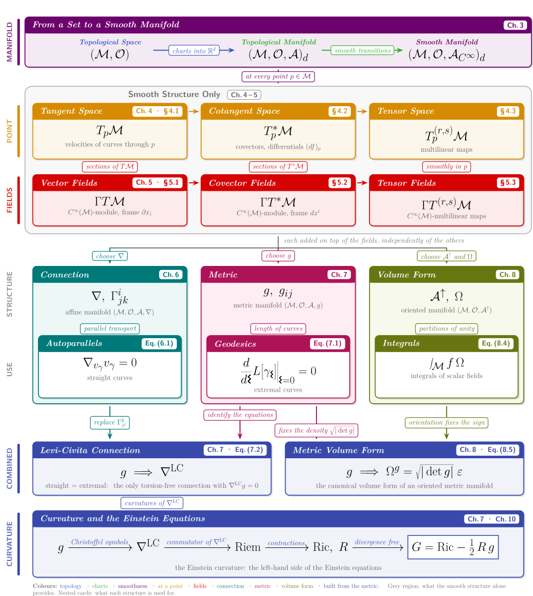
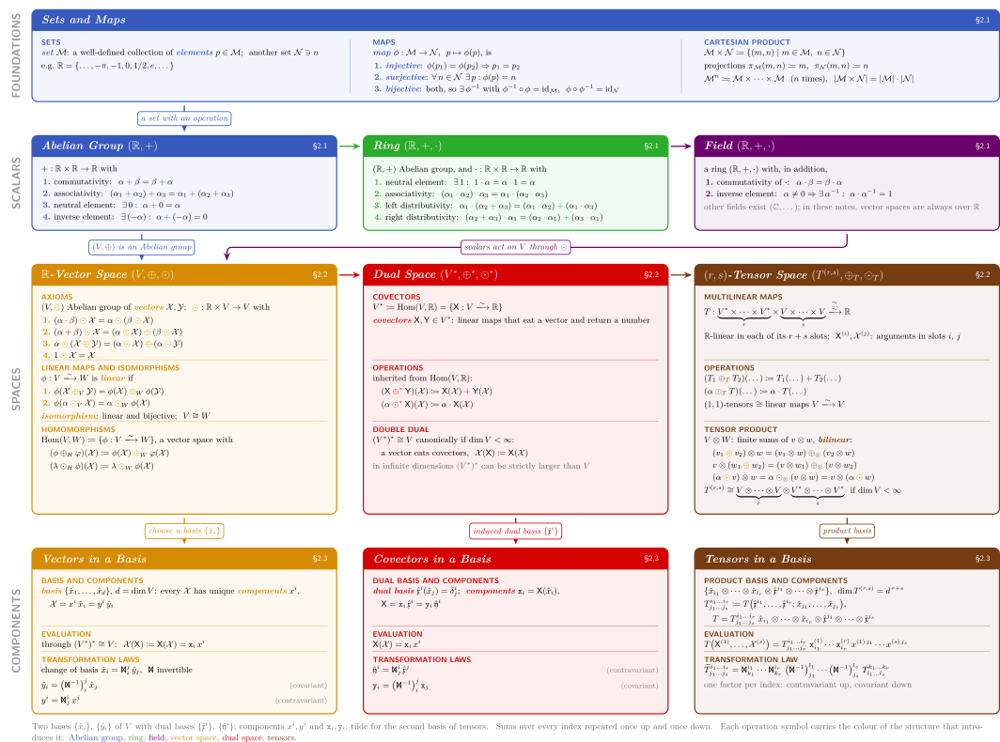
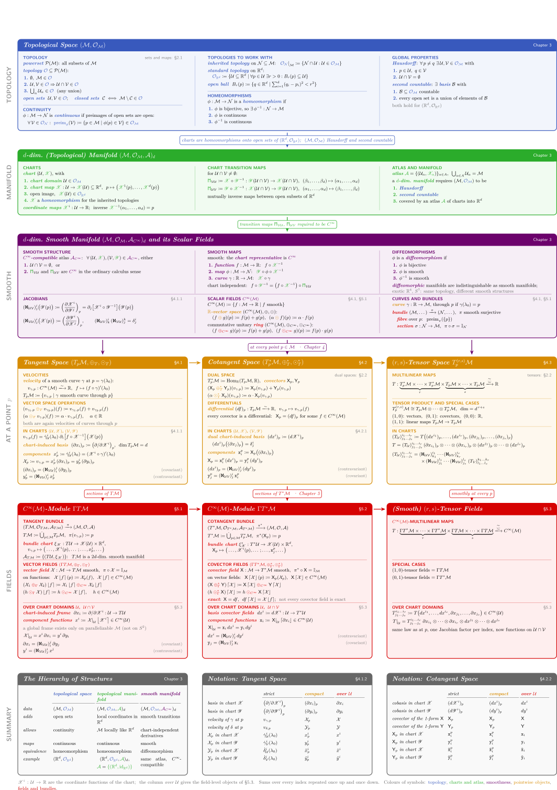
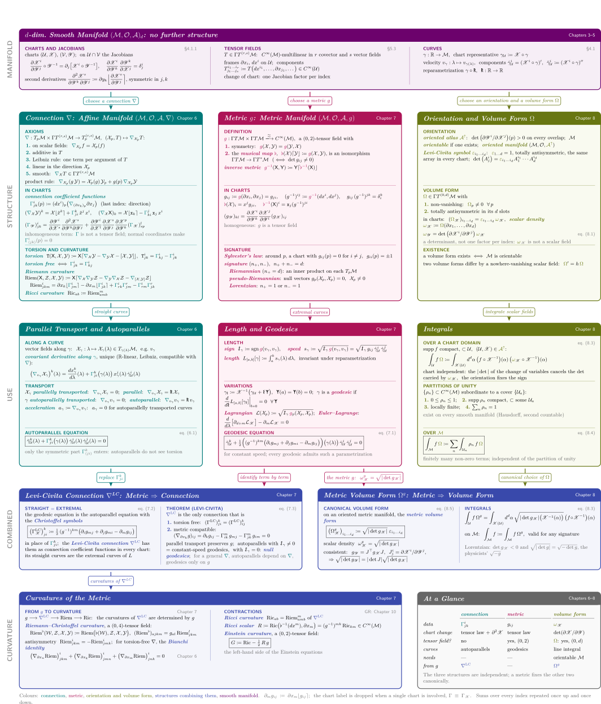

<!-- GENERATED by _port/convert/build.py from Chapters/Introduction.tex, main.tex.
     Do not edit this file: edit the LaTeX notes and re-run the converter. -->

```{=html}
<header class="dg-head dg-head-section"><p class="dg-kicker">Chapter 1 <span class="dg-sep">•</span> <a href="index.html">Introduction</a></p><h1 class="dg-title"><span class="dg-secnum">1.1</span> Roadmaps of the Notes</h1></header>
<p>Four infographics, on the large pages that follow, map the territory covered by these notes. Figure <a class="dg-xref" href="#fig_roadmap_master" data-kind="figure" data-label="fig_roadmap_master">1.1</a> gives the whole construction at a glance, with no formulas: a smooth manifold, its tangent, cotangent and tensor spaces at every point, the fields assembled from them, and the three structures that can be chosen on top of these fields, up to the Einstein curvature. The three figures after it are detailed versions of this overview. Figure <a class="dg-xref" href="#fig_vector_spaces_roadmap" data-kind="figure" data-label="fig_vector_spaces_roadmap">1.2</a> collects the algebra of Chapter <a class="dg-xref" href="../vector-spaces/index.html" data-kind="chapter" data-label="chapter_Vector_Spaces">2</a>: sets and maps, the scalars <span class="math inline">\(\mathbb{R}\)</span>, the vector space with its dual and its tensor spaces, and their components in a basis. Figure <a class="dg-xref" href="#fig_roadmap_topology_to_fields" data-kind="figure" data-label="fig_roadmap_topology_to_fields">1.3</a> carries the construction through Chapters <a class="dg-xref" href="../topological-manifolds/index.html" data-kind="chapter" data-label="chapter_Topological_Manifolds">3</a>, <a class="dg-xref" href="../tangent-spaces/index.html" data-kind="chapter" data-label="chapter_Tangent_Spaces">4</a> and <a class="dg-xref" href="../fields/index.html" data-kind="chapter" data-label="chapter_Fields">5</a>: a set with a topology becomes a topological and then a smooth manifold, whose tangent, cotangent and tensor spaces at every point are finally assembled into vector, covector and tensor fields. Figure <a class="dg-xref" href="#fig_roadmap_connection_metric_integrals" data-kind="figure" data-label="fig_roadmap_connection_metric_integrals">1.4</a> adds the remaining layers of structure on top of these fields, following Chapters <a class="dg-xref" href="../covariant-derivative/index.html" data-kind="chapter" data-label="chapter_Covariant_Derivative">6</a>, <a class="dg-xref" href="../metric/index.html" data-kind="chapter" data-label="chapter_Metric">7</a> and <a class="dg-xref" href="../integrals/index.html" data-kind="chapter" data-label="chapter_Integrals">8</a>: a connection, which allows fields to be differentiated and compared between points and gives rise to torsion and curvature; a metric, which measures lengths and angles, allowing to compute geodesics; and finally the volume form and the integral of functions and forms over the manifold.</p>
<div class="dg-skip dg-medskip"></div>
<p>All four figures share the same layout and are read from top to bottom, each level adding one piece of structure to the previous one, while columns align corresponding objects. Every card names the chapter or section where its concepts are defined, and every symbol carries the colour of the structure that introduces it. The overview can be read at a glance; the three detailed figures are not meant to be: they are a reference to come back to, to locate a definition, recall a notation, or see where a given object fits in the overall construction.</p>
<figure class="dg-figure" id="fig_roadmap_master"><div class="dg-paper" style="--dg-frac:1.000"></div><figcaption><span class="dg-fignum">Figure 1.1:</span>   Master roadmap of the notes, read from top to bottom; badges give the chapter, section or key equation where each object  is treated. The smooth structure alone (grey region) yields the tangent, cotangent and tensor spaces at every point and,  assembled smoothly, the corresponding fields. On top of these, a connection, a metric and an orientation with a volume  form are separate structures, each added independently and each with its own notion of curves or integrals (nested  cards). A metric relates them: identifying the autoparallel and geodesic equations makes it determine a connection,  <span class="math inline">\(\nabla^{\text{LC}}\)</span>, and on an oriented manifold it fixes a volume form, <span class="math inline">\(\Omega^g\)</span>; the curvatures of  <span class="math inline">\(\nabla^{\text{LC}}\)</span> lead to the Einstein curvature <span class="math inline">\(G\)</span>. Detailed versions:  Figures <a class="dg-xref" href="#fig_roadmap_topology_to_fields" data-kind="figure" data-label="fig_roadmap_topology_to_fields">1.3</a> and <a class="dg-xref" href="#fig_roadmap_connection_metric_integrals" data-kind="figure" data-label="fig_roadmap_connection_metric_integrals">1.4</a>. </figcaption></figure>
<figure class="dg-figure" id="fig_vector_spaces_roadmap"><div class="dg-paper" style="--dg-frac:0.998"></div><figcaption><span class="dg-fignum">Figure 1.2:</span>   Roadmap of Chapter <a class="dg-xref" href="../vector-spaces/index.html" data-kind="chapter" data-label="chapter_Vector_Spaces">2</a>, read from top to bottom: sets and maps, the scalars <span class="math inline">\(\mathbb{R}\)</span> as an  Abelian group, a ring and a field, then the vector space, its dual and the tensor spaces built from both, and finally  their components in a basis, aligned column by column with the corresponding space. Grey tags give the section of each  concept. </figcaption></figure>
<figure class="dg-figure" id="fig_roadmap_topology_to_fields"><span class="dg-anchor" id="manifolds_roadmap"></span><span class="dg-anchor" id="fig:tangent_spaces_and_fields_roadmap"></span><div class="dg-paper" style="--dg-frac:0.998"></div><figcaption><span class="dg-fignum">Figure 1.3:</span>   Roadmap of Chapters <a class="dg-xref" href="../topological-manifolds/index.html" data-kind="chapter" data-label="chapter_Topological_Manifolds">3</a>, <a class="dg-xref" href="../tangent-spaces/index.html" data-kind="chapter" data-label="chapter_Tangent_Spaces">4</a> and <a class="dg-xref" href="../fields/index.html" data-kind="chapter" data-label="chapter_Fields">5</a>, read  from top to bottom: a set with a topology becomes a topological and then a smooth manifold, whose tangent, cotangent and  tensor spaces at every point are assembled into vector, covector and tensor fields. Columns align corresponding  objects; within each row, definitions and chart expressions are aligned, so that every field-level formula reads as  its pointwise counterpart with numbers promoted to functions on a chart domain. Grey tags give the chapter or section  of each concept. </figcaption></figure>
<figure class="dg-figure" id="fig_roadmap_connection_metric_integrals"><div class="dg-paper" style="--dg-frac:0.999"></div><figcaption><span class="dg-fignum">Figure 1.4:</span>   Roadmap of Chapters <a class="dg-xref" href="../covariant-derivative/index.html" data-kind="chapter" data-label="chapter_Covariant_Derivative">6</a>, <a class="dg-xref" href="../metric/index.html" data-kind="chapter" data-label="chapter_Metric">7</a> and <a class="dg-xref" href="../integrals/index.html" data-kind="chapter" data-label="chapter_Integrals">8</a>. On a smooth  manifold with no further structure, a connection, a metric and an orientation with a volume form can be chosen  independently (columns). Each gives its own notion of curves or integrals; identifying the autoparallel and geodesic  equations makes the metric determine a connection, <span class="math inline">\(\nabla^{\text{LC}}\)</span>, whose curvatures follow, and a volume form,  <span class="math inline">\(\Omega^g\)</span>. Grey tags give the chapter and the key equation of each concept. </figcaption></figure>
<nav class="dg-web dg-prevnext" aria-label="Previous and next page"><a class="dg-prev" href="index.html" rel="prev"><span aria-hidden="true">←</span> <span><span class="dg-secnum">1</span> Introduction</span></a><a class="dg-next" href="../vector-spaces/index.html" rel="next"><span aria-hidden="true">→</span> <span><span class="dg-secnum">2</span> Vector Spaces</span></a></nav>
```
