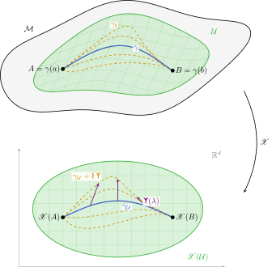

<!-- GENERATED by _port/convert/build.py from Chapters/Metric.tex.
     Do not edit this file: edit the LaTeX notes and re-run the converter. -->

```{=html}
<header class="dg-head dg-head-section"><p class="dg-kicker">Chapter 7 <span class="dg-sep">•</span> <a href="index.html">Metric</a></p><h1 class="dg-title"><span class="dg-secnum">7.2</span> Length and Geodesics</h1></header>
<ul class="dg-itemize dg-depth-1">
<li><p>Let <span class="math inline">\(\gamma : \mathbb{R} \to \mathcal{M}\)</span> be a curve, at least <span class="math inline">\(C^1\)</span>, with velocity <span class="math inline">\(v_\gamma : \lambda \mapsto v_{\gamma(\lambda)}\)</span>, on a metric manifold <span class="math inline">\((\mathcal{M}, \mathcal{O}, \mathcal{A}, g)\)</span>. The <strong>sign</strong> and the <strong>speed</strong> of <span class="math inline">\(\gamma\)</span> are the functions  <span class="math display">\begin{align*}
            \textrm{\runic ᛇ}_\gamma : \mathbb{R} &amp;\longrightarrow \{-1, 0, +1\} &amp;
            s_\gamma : \mathbb{R} &amp;\longrightarrow \mathbb{R} \\
            \lambda &amp;\longmapsto \textrm{\runic ᛇ}_\gamma(\lambda) \, \coloneq \operatorname{sgn}\left( g_{\gamma(\lambda)}\big( v_{\gamma(\lambda)}, v_{\gamma(\lambda)} \big)\right), &amp;
            \lambda &amp;\longmapsto \sqrt{ \textrm{\runic ᛇ}_\gamma(\lambda) \, g_{\gamma(\lambda)}\big( v_{\gamma(\lambda)}, v_{\gamma(\lambda)} \big) } ,
        \end{align*}</span>  i.e. <span class="math inline">\(s_\gamma = \sqrt{ \textrm{\runic ᛇ}_\gamma \, g_{ij} \, \dot{\gamma}^i_\mathcal{U} \, \dot{\gamma}^j_\mathcal{U} }\)</span> in a chart. For a Riemannian metric, <span class="math inline">\(\textrm{\runic ᛇ}_\gamma = +1\)</span> wherever <span class="math inline">\(v_\gamma \neq 0\)</span>. For an indefinite one, <span class="math inline">\(\textrm{\runic ᛇ}_\gamma = 0\)</span> also for <span class="math inline">\(v_\gamma \neq 0\)</span> (null velocities), and <span class="math inline">\(s_\gamma\)</span> is defined piecewise on intervals where <span class="math inline">\(\textrm{\runic ᛇ}_\gamma\)</span> is constant.</p></li>
<li><p>The <strong>length</strong> of <span class="math inline">\(\gamma\)</span> between the parameter values <span class="math inline">\(a &lt; b\)</span> is the functional  <span class="math display">\begin{align*}
            L_{[a,b]} : \{ \gamma : \mathbb{R} \to \mathcal{M} \mid \gamma \text{ is } C^1 \} &amp;\longrightarrow \mathbb{R} \\
            \gamma &amp;\longmapsto L_{[a,b]}[\gamma] \coloneqq \int_a^b s_\gamma(\lambda) \, d\lambda ,
        \end{align*}</span>  This satisfies that <span class="math inline">\(L_{\textrm{\runic ᚱ}^{-1}([a,b])}[\gamma \circ \textrm{\runic ᚱ}] = L_{[a,b]}[\gamma]\)</span> for every diffeomorphism <span class="math inline">\(\textrm{\runic ᚱ} : \mathbb{R} \to \mathbb{R}\)</span> (Appendix <a class="dg-xref" href="../proofs-and-additional-material/proof-length-reparametrization.html" data-kind="section" data-label="section_proof_length_reparametrization">B.13</a>).</p></li>
</ul>
```

## `<span class="dg-secnum">7.2.1</span> Variations and the Euler–Lagrange Equations`{=html} {#subsection_Variations_Euler_Lagrange}

```{=html}
<ul class="dg-itemize dg-depth-1">
<li><p>Let <span class="math inline">\(\gamma : \mathbb{R} \to \mathcal{M}\)</span> be smooth with <span class="math inline">\(\textrm{\runic ᛇ}_\gamma(\lambda) \neq 0\)</span> for all <span class="math inline">\(\lambda \in [a,b]\)</span>. Since <span class="math inline">\(\lambda \mapsto g_{\gamma(\lambda)}\big( v_{\gamma(\lambda)}, v_{\gamma(\lambda)} \big)\)</span> is continuous and does not vanish on <span class="math inline">\([a,b]\)</span>, <span class="math inline">\(\textrm{\runic ᛇ}_\gamma\)</span> is a constant <span class="math inline">\(\pm 1\)</span> there. Let <span class="math inline">\((\mathcal{U}, \mathscr{X})\)</span> be a chart with <span class="math inline">\(\gamma([a,b]) \subseteq \mathcal{U}\)</span><sup class="dg-fnref"><a href="#fn-5" id="fnref-5" aria-label="Footnote 5">5</a></sup>, and denote by <span class="math inline">\(\gamma_\mathcal{U} \coloneqq \mathscr{X} \circ \gamma : [a,b] \to \mathbb{R}^d\)</span> its chart representative. A <strong>variation</strong> of <span class="math inline">\(\gamma\)</span> with fixed endpoints w.r.t. the chart <span class="math inline">\((\mathcal{U}, \mathscr{X})\)</span> is a family of curves labelled by a real <strong>deformation parameter</strong> <span class="math inline">\(\textrm{\runic ᛊ} \in (-\textrm{\runic ᛊ}_0, \textrm{\runic ᛊ}_0)\)</span>, independent of the curve parameter <span class="math inline">\(\lambda\)</span>:  <span class="math display">\begin{align*}
            \gamma_{\textrm{\runic ᛊ}} : [a,b] &amp;\longrightarrow \mathcal{U} \\
            \lambda                            &amp;\longmapsto \gamma_{\textrm{\runic ᛊ}}(\lambda) \coloneqq \mathscr{X}^{-1}\big( \gamma_\mathcal{U}(\lambda) + \textrm{\runic ᛊ} \, \textrm{\runic ᛉ}(\lambda) \big),
        \end{align*}</span>  where <span class="math inline">\(\textrm{\runic ᛉ} : [a,b] \to \mathbb{R}^d\)</span> is smooth with <span class="math inline">\(\textrm{\runic ᛉ}(a) = \textrm{\runic ᛉ}(b) = 0\)</span>, and <span class="math inline">\(\textrm{\runic ᛊ}_0 &gt; 0\)</span> is small enough for <span class="math inline">\(\gamma_\mathcal{U} + \textrm{\runic ᛊ} \, \textrm{\runic ᛉ}\)</span> to stay in <span class="math inline">\(\mathscr{X}(\mathcal{U})\)</span>. The deformation is defined through the chart: it is the chart representative that is shifted linearly in <span class="math inline">\(\textrm{\runic ᛊ}\)</span>, <span class="math inline">\(\mathscr{X} \circ \gamma_{\textrm{\runic ᛊ}} = \gamma_\mathcal{U} + \textrm{\runic ᛊ} \, \textrm{\runic ᛉ}\)</span>, whereas in another chart <span class="math inline">\((\mathcal{V}, \mathscr{Y})\)</span>, <span class="math inline">\(\mathscr{Y} \circ \gamma_{\textrm{\runic ᛊ}}\)</span> is in general not of this form. Thus <span class="math inline">\(\gamma_{\textrm{\runic ᛊ} = 0} = \gamma\)</span>, <span class="math inline">\(\gamma_{\textrm{\runic ᛊ}}(a) = \gamma(a)\)</span>, <span class="math inline">\(\gamma_{\textrm{\runic ᛊ}}(b) = \gamma(b)\)</span> The curve <span class="math inline">\(\gamma\)</span> is a <strong>geodesic</strong> if  <span class="math display">\[
            \frac{d}{d\textrm{\runic ᛊ}} L_{[a,b]}[\gamma_{\textrm{\runic ᛊ}}] \Big|_{\textrm{\runic ᛊ}=0} = 0 \qquad \text{for every such } \textrm{\runic ᛉ} .
        \]</span>  The requirement <span class="math inline">\(\textrm{\runic ᛇ}_\gamma \neq 0\)</span> makes <span class="math inline">\(s_\gamma = \sqrt{\textrm{\runic ᛇ}_\gamma \, g(v_\gamma, v_\gamma)}\)</span> differentiable. For a Riemannian metric it only excludes <span class="math inline">\(v_\gamma = 0\)</span>. For an indefinite one it also excludes null velocities. Whether <span class="math inline">\(\gamma\)</span> is a geodesic does not depend on the chart used to deform it: the resulting condition (see below), holds in every chart.</p>
<figure class="dg-figure" id="fig_variation_curve"><div class="dg-paper" style="--dg-frac:0.743"></div><figcaption><span class="dg-fignum">Figure 7.1:</span>   Variation of a curve with fixed endpoints, as used in the variational definition of geodesics (Chapter <a class="dg-xref" href="index.html" data-kind="chapter" data-label="chapter_Metric">7</a>). <strong>Top:</strong> the curve <span class="math inline">\(\gamma\)</span> (blue) joins the points <span class="math inline">\(A = \gamma(a)\)</span> and <span class="math inline">\(B = \gamma(b)\)</span> of the manifold <span class="math inline">\(\mathcal{M}\)</span> inside the chart domain <span class="math inline">\(\mathcal{U}\)</span> (green), on which the images of the coordinate lines of <span class="math inline">\(\mathscr{X}\)</span> are drawn. The dashed orange curves are members <span class="math inline">\(\gamma_{\textrm{\runic ᛊ}}\)</span> of a variation, for a few values of the deformation parameter <span class="math inline">\(\textrm{\runic ᛊ}\)</span>; all of them share the endpoints <span class="math inline">\(A\)</span> and <span class="math inline">\(B\)</span>. <strong>Bottom:</strong> the same objects seen through the chart <span class="math inline">\((\mathcal{U}, \mathscr{X})\)</span>, where the coordinate lines become straight. Here the variation is defined: each member is the chart representative <span class="math inline">\(\gamma_\mathcal{U}\)</span> shifted linearly in the deformation parameter, <span class="math inline">\(\mathscr{X} \circ \gamma_{\textrm{\runic ᛊ}} = \gamma_\mathcal{U} + \textrm{\runic ᛊ} \, \textrm{\runic ᛉ}\)</span>, along the vectors <span class="math inline">\(\textrm{\runic ᛉ}(\lambda) \in \mathbb{R}^d\)</span> (purple, drawn for <span class="math inline">\(\textrm{\runic ᛊ} = 1\)</span>), which vanish at the endpoints, <span class="math inline">\(\textrm{\runic ᛉ}(a) = \textrm{\runic ᛉ}(b) = 0\)</span>. On the manifold the same family is no longer a linear shift: the deformation only has this simple form in the chart used to define it. The curve <span class="math inline">\(\gamma\)</span> is a geodesic if <span class="math inline">\(\textrm{\runic ᛊ} \mapsto L_{[a,b]}[\gamma_{\textrm{\runic ᛊ}}]\)</span> has vanishing derivative at <span class="math inline">\(\textrm{\runic ᛊ} = 0\)</span> for every such <span class="math inline">\(\textrm{\runic ᛉ}\)</span>.  </figcaption></figure></li>
<li><p>On <span class="math inline">\([a,b]\)</span>, the curve <span class="math inline">\(\gamma\)</span> and all its variations <span class="math inline">\(\gamma_{\textrm{\runic ᛊ}}\)</span> share the same constant sign <span class="math inline">\(\textrm{\runic ᛇ}_\gamma\)</span>. Their speeds are therefore the values, on their velocities, of a single function on the tangent bundle, the <strong>Lagrangian</strong><sup class="dg-fnref"><a href="#fn-6" id="fnref-6" aria-label="Footnote 6">6</a></sup>:  <span class="math display">\begin{align*}
            \mathcal{L} : \big\{ \mathcal{X}_p \in T\mathcal{M} \;\big|\; \textrm{\runic ᛇ}_\gamma \, g_p(\mathcal{X}_p, \mathcal{X}_p) &gt; 0 \big\} &amp;\longrightarrow \mathbb{R} \\
            \mathcal{X}_p &amp;\longmapsto \mathcal{L}(\mathcal{X}_p) \coloneqq \sqrt{ \textrm{\runic ᛇ}_\gamma \, g_p(\mathcal{X}_p, \mathcal{X}_p) } ,
        \end{align*}</span>  <span class="math display">\[
            s_{\gamma_{\textrm{\runic ᛊ}}}(\lambda) = \mathcal{L}\big( v_{\gamma_{\textrm{\runic ᛊ}}, \gamma_{\textrm{\runic ᛊ}}(\lambda)} \big),
            \qquad
            L_{[a,b]}[\gamma_{\textrm{\runic ᛊ}}] = \int_a^b \mathcal{L}\big( v_{\gamma_{\textrm{\runic ᛊ}}, \gamma_{\textrm{\runic ᛊ}}(\lambda)} \big) \, d\lambda .
        \]</span>  In the bundle chart <span class="math inline">\((T\mathcal{U}, \xi_\mathscr{X})\)</span> of Section <a class="dg-xref" href="../fields/vector-fields.html" data-kind="section" data-label="section_Vector_Fields">5.1</a>, a vector <span class="math inline">\(\mathcal{X}_p = x^k_p \, (\partial x_k)_p\)</span> is described by the <span class="math inline">\(2d\)</span> numbers <span class="math inline">\(\xi_\mathscr{X}(\mathcal{X}_p) = \big( \mathscr{X}(p) \, ; \, x_p \big)\)</span>, i.e. the coordinates <span class="math inline">\(\mathscr{X}(p) = \big( \mathscr{X}^1(p), \dots, \mathscr{X}^d(p) \big)\)</span> of its base point and its components <span class="math inline">\(x_p = (x^1_p, \dots, x^d_p)\)</span>. Since <span class="math inline">\(g_p(\mathcal{X}_p, \mathcal{X}_p) = g_{ij}(p) \, x^i_p x^j_p\)</span>, the chart representative of <span class="math inline">\(\mathcal{L}\)</span> w.r.t. <span class="math inline">\((\mathcal{U}, \mathscr{X})\)</span> is  <span class="math display">\[
            \mathcal{L}_\mathscr{X} \coloneqq \mathcal{L} \circ \xi_\mathscr{X}^{-1} : \big( \mathscr{X}(p) \, ; \, x_p \big) \longmapsto
            \sqrt{ \textrm{\runic ᛇ}_\gamma \, g_{ij}(p) \, x^i_p \, x^j_p } ,
        \]</span>  a function of <span class="math inline">\(2d\)</span> real variables: <span class="math inline">\(d\)</span> position slots and <span class="math inline">\(d\)</span> velocity slots. For the velocity of <span class="math inline">\(\gamma_{\textrm{\runic ᛊ}}\)</span>,  <span class="math display">\[
            \xi_\mathscr{X}\big( v_{\gamma_{\textrm{\runic ᛊ}}, \gamma_{\textrm{\runic ᛊ}}(\lambda)} \big)
            = \big( \gamma_\mathcal{U}(\lambda) + \textrm{\runic ᛊ} \, \textrm{\runic ᛉ}(\lambda) \, ; \, \dot{\gamma}_\mathcal{U}(\lambda) + \textrm{\runic ᛊ} \, \textrm{\runic ᛉ}'(\lambda) \big),
        \]</span>  <span class="math display">\[
            L_{[a,b]}[\gamma_{\textrm{\runic ᛊ}}] = \int_a^b \mathcal{L}_\mathscr{X}\big( \gamma_\mathcal{U} + \textrm{\runic ᛊ} \, \textrm{\runic ᛉ} \, ; \, \dot{\gamma}_\mathcal{U} + \textrm{\runic ᛊ} \, \textrm{\runic ᛉ}' \big) \, d\lambda ,
        \]</span>  and at <span class="math inline">\(\textrm{\runic ᛊ} = 0\)</span>, <span class="math inline">\(\mathcal{L}_\mathscr{X}\big( \gamma_\mathcal{U}(\lambda) ; \dot{\gamma}_\mathcal{U}(\lambda) \big) = \sqrt{ \textrm{\runic ᛇ}_\gamma \, g_{ij}\big( \gamma(\lambda) \big) \, \dot{\gamma}^i_\mathcal{U}(\lambda) \, \dot{\gamma}^j_\mathcal{U}(\lambda) } = s_\gamma(\lambda)\)</span>. By Appendix <a class="dg-xref" href="../proofs-and-additional-material/proof-euler-lagrange.html" data-kind="section" data-label="section_proof_Euler_Lagrange">B.14</a>, <span class="math inline">\(\gamma\)</span> is a geodesic if and only if, on <span class="math inline">\([a,b]\)</span>, the <strong>Euler–Lagrange equations</strong> hold:  <span class="math display">\[
            \frac{d}{d\lambda} \Big[ (\partial_{d+m} \mathcal{L}_\mathscr{X})(\gamma_\mathcal{U} ; \dot{\gamma}_\mathcal{U}) \Big]
            - (\partial_m \mathcal{L}_\mathscr{X})(\gamma_\mathcal{U} ; \dot{\gamma}_\mathcal{U}) = 0 ,
            \qquad m = 1, \dots, d ,
        \]</span>  where <span class="math inline">\(\partial_m\)</span> and <span class="math inline">\(\partial_{d+m}\)</span> differentiate <span class="math inline">\(\mathcal{L}_\mathscr{X}\)</span> w.r.t. its <span class="math inline">\(m\)</span>-th position slot and its <span class="math inline">\(m\)</span>-th velocity.</p></li>
<li><p>For the Lagrangian <span class="math inline">\(\mathcal{L}_\mathscr{X}\)</span> of the metric, the Euler–Lagrange equations become a system of <span class="math inline">\(d\)</span> second-order ordinary differential equations for the chart representative <span class="math inline">\(\gamma_\mathcal{U}\)</span>. Writing <span class="math inline">\(\partial_m g_{ij} \coloneqq \partial x_m \left\lfloor g_{ij} \right\rceil \in C^\infty(\mathcal{U})\)</span>, i.e. <span class="math inline">\((\partial_m g_{ij})(p) = \partial_m \left[ g_{ij} \circ \mathscr{X}^{-1} \right]\big( \mathscr{X}(p) \big)\)</span>, a curve with constant speed is a geodesic if and only if, on <span class="math inline">\([a,b]\)</span>,  <span class="math display" id="eq_geodesic">\begin{equation}
            \boxed{
                \ddot{\gamma}^k_\mathcal{U}(\lambda)
                + \frac{1}{2} \Big( (g^{-1})^{km} \big( \partial_i g_{mj} + \partial_j g_{mi} - \partial_m g_{ij} \big) \Big)\big( \gamma(\lambda) \big) \,
                \dot{\gamma}^i_\mathcal{U}(\lambda) \, \dot{\gamma}^j_\mathcal{U}(\lambda)
                = 0
            } \tag{7.1}
        \end{equation}</span>  and every geodesic admits a constant-speed parametrization. This is the <strong>geodesic equation</strong> in the chart <span class="math inline">\((\mathcal{U}, \mathscr{X})\)</span>. The step-by-step derivation is given in Appendix <a class="dg-xref" href="../proofs-and-additional-material/proof-geodesic-equation.html" data-kind="section" data-label="section_proof_geodesic_equation">B.16</a>.</p></li>
</ul>
<div class="dg-footnotes"><div class="dg-fn" id="fn-5"><a class="dg-fn-num" href="#fnref-5" aria-label="Back to the text">5</a><div class="dg-fn-body"><p>For the resulting equations this is no restriction: <span class="math inline">\([a,b]\)</span> is compact, so it splits into finitely many subintervals, each mapped by <span class="math inline">\(\gamma\)</span> into a single chart domain, and a variation supported in one of them is a variation of the whole curve.</p></div></div><div class="dg-fn" id="fn-6"><a class="dg-fn-num" href="#fnref-6" aria-label="Back to the text">6</a><div class="dg-fn-body"><p><span class="math inline">\(\mathcal{L}\)</span> is not a covector field: on each <span class="math inline">\(T_p\mathcal{M}\)</span> it is not linear. Functions on the tangent bundle, <span class="math inline">\(T\mathcal{M} \to \mathbb{R}\)</span>, depending on both the point and the velocity, are called <em>Lagrangians</em>, and the functionals <span class="math inline">\(\gamma \mapsto \int \mathcal{L}\big( v_{\gamma(\lambda)} \big) \, d\lambda\)</span> they induce on curves are called <em>action functionals</em>; <span class="math inline">\(L_{[a,b]}\)</span> is the one of this <span class="math inline">\(\mathcal{L}\)</span>.</p></div></div></div>
<nav class="dg-web dg-prevnext" aria-label="Previous and next page"><a class="dg-prev" href="metric.html" rel="prev"><span aria-hidden="true">←</span> <span><span class="dg-secnum">7.1</span> Metric</span></a><a class="dg-next" href="levi-civita-connection.html" rel="next"><span aria-hidden="true">→</span> <span><span class="dg-secnum">7.3</span> The Levi-Civita Connection</span></a></nav>
```
