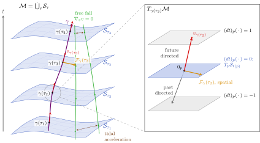

<!-- GENERATED by _port/convert/build.py from Chapters/Newtonian_Gravity.tex.
     Do not edit this file: edit the LaTeX notes and re-run the converter. -->

```{=html}
<header class="dg-head dg-head-section"><p class="dg-kicker">Chapter 9 <span class="dg-sep">•</span> <a href="index.html">Newton-Cartan Theory</a></p><h1 class="dg-title"><span class="dg-secnum">9.4</span> Pseudo-Forces</h1></header>
<p>In the spatial part of Newton II, each <span class="math inline">\(\Gamma\)</span>-term looks like an additional force. This section shows that, in the absence of gravity, all of them are produced by the choice of chart, and identifies them with the pseudo-forces of classical mechanics (Subsections <a class="dg-xref" href="#subsection_Inertial_Charts" data-kind="subsection" data-label="subsection_Inertial_Charts">9.4.1</a> and <a class="dg-xref" href="#" data-kind="section" data-label="section_Pseudo_Forces">9.4</a>). Gravity is then encoded in the same kind of term, and the curvature decides when it can be removed and when it cannot (Subsections <a class="dg-xref" href="gravity-connection.html" data-kind="section" data-label="section_Gravity_Connection">9.5</a>–<a class="dg-xref" href="gravity-connection.html#subsection_Tidal_Acceleration" data-kind="subsection" data-label="subsection_Tidal_Acceleration">9.5.2</a>).</p>
```

## `<span class="dg-secnum">9.4.1</span> Inertial Charts`{=html} {#subsection_Inertial_Charts}

```{=html}
<ul class="dg-itemize dg-depth-1">
<li><p>Without gravity, observation (Newton’s first law in its classical form) tells us that every free particle moves along a straight line at constant velocity, <span class="math inline">\(\ddot{\gamma}^\alpha_\mathcal{U} = 0\)</span>. Identifying terms, we observe that, in this chart, all connection coefficients then vanish: <span class="math inline">\(\Gamma_\mathscr{X} = 0\)</span>. A stratified chart <span class="math inline">\((\mathcal{U}, \mathscr{X})\)</span> with <span class="math inline">\(\Gamma_\mathscr{X} = 0\)</span> is called <strong>inertial</strong>. In this case <span class="math inline">\(\mathrm{Riem} = 0\)</span>.</p></li>
<li><p>Let <span class="math inline">\((\mathcal{V}, \mathscr{Y})\)</span> be any other stratified chart. Since <span class="math inline">\(\Gamma_\mathscr{X} = 0\)</span>, only the inhomogeneous term of the transformation law (Chapter <a class="dg-xref" href="../covariant-derivative/index.html" data-kind="chapter" data-label="chapter_Covariant_Derivative">6</a>) survives,  <span class="math display">\begin{align*}
            \left( \Gamma_\mathscr{Y} \right)^i_{jk}
            = \frac{\partial \mathscr{Y}^i}{\partial \mathscr{X}^s} \, \frac{\partial^2 \mathscr{X}^s}{\partial \mathscr{Y}^k \, \partial \mathscr{Y}^j},
        \end{align*}</span>  so every <span class="math inline">\(\Gamma\)</span>-term in <span class="math inline">\((\mathcal{V}, \mathscr{Y})\)</span> is produced by the change of chart alone, and which term appears depends on which second derivatives of the transition map <span class="math inline">\(\textrm{\runic ᛖ}_{\mathcal{V}\mathcal{U}} = \mathscr{X} \circ \mathscr{Y}^{-1}\)</span> are non-zero.</p></li>
<li><p>To write transition maps explicitly, we denote the coordinates of a point in <span class="math inline">\(\mathscr{X}(\mathcal{U} \cap \mathcal{V})\)</span> and <span class="math inline">\(\mathscr{Y}(\mathcal{U} \cap \mathcal{V})\)</span> by <span class="math inline">\(\xi = (\xi^0, \xi^1, \xi^2, \xi^3)\)</span> and <span class="math inline">\(\eta = (\eta^0, \eta^1, \eta^2, \eta^3)\)</span>, so that <span class="math inline">\(\xi = \textrm{\runic ᛖ}_{\mathcal{V}\mathcal{U}}(\eta)\)</span>. Both charts being stratified, <span class="math inline">\(\xi^0 = \eta^0\)</span> is the value of absolute time, written <span class="math inline">\(t\)</span>. Component functions are likewise expressed in terms of these coordinates, e.g. <span class="math inline">\(\left( \Gamma_\mathscr{Y} \right)^i_{jk}(\eta) \coloneqq \left( \Gamma_\mathscr{Y} \right)^i_{jk}\big( \mathscr{Y}^{-1}(\eta) \big)\)</span>. Along a worldline parametrized by absolute time, <span class="math inline">\(\gamma^\alpha_\mathcal{V} \coloneqq \mathscr{Y}^\alpha \circ \gamma\)</span> are its spatial coordinates in <span class="math inline">\((\mathcal{V}, \mathscr{Y})\)</span>, and <span class="math inline">\(f^\alpha_\gamma\)</span> the components of the force w.r.t. this chart.</p></li>
</ul>
<figure class="dg-figure" id="fig_newtonian_spacetime"><div class="dg-paper" style="--dg-frac:0.937"></div><figcaption><span class="dg-fignum">Figure 9.1:</span>   A Newtonian spacetime <span class="math inline">\(\mathcal{M}\)</span>, foliated by the absolute spaces <span class="math inline">\(\mathcal{S}_\tau\)</span> (level sets of the absolute time <span class="math inline">\(t\)</span>),  with the spatial coordinate lines of a stratified chart, <span class="math inline">\(\mathscr{X}^0 = t\)</span>. The worldline <span class="math inline">\(\gamma\)</span> of a massive particle,  parametrized by absolute time, has future-directed velocity and meets each absolute space exactly once,  <span class="math inline">\(\gamma(\tau_i) \in \mathcal{S}_{\tau_i}\)</span>. A force <span class="math inline">\(\mathcal{F}_\gamma\)</span> is spatial: tangent to the absolute space. Two freely falling  particles follow autoparallels of <span class="math inline">\(\nabla\)</span>, and their relative acceleration is the tidal acceleration. Inset: the tangent  space at <span class="math inline">\(p = \gamma(\tau_2)\)</span>, in which <span class="math inline">\((dt)_p\)</span> is drawn through its level planes. The spatial vectors form the plane  <span class="math inline">\((dt)_p(\,\cdot\,) = 0\)</span>, i.e. <span class="math inline">\(T_p\mathcal{S}_{t(p)}\)</span>, which separates the future-directed vectors (above) from the  past-directed ones (below). Since <span class="math inline">\(\gamma\)</span> is parametrized by absolute time, <span class="math inline">\((dt)_p\big( v_{\gamma(\tau_2)} \big) = 1\)</span>: the tip of  the velocity lies on the plane <span class="math inline">\((dt)_p(\,\cdot\,) = 1\)</span>. </figcaption></figure>
```

## `<span class="dg-secnum">9.4.2</span> Pseudo-Forces`{=html} {#subsection_Pseudo_Forces}

```{=html}
<p><strong>Rigidly moving axes</strong><sup class="dg-fnref"><a href="#fn-5" id="fnref-5" aria-label="Footnote 5">5</a></sup>. Consider axes rotating by an angle <span class="math inline">\(\theta(t)\)</span> about the third axis, with origin at <span class="math inline">\(b^\sigma(t)\)</span> in <span class="math inline">\((\mathcal{U}, \mathscr{X})\)</span>. Both charts being stratified, their time coordinate is the absolute time <span class="math inline">\(t\)</span>, and we write <span class="math inline">\(\mathscr{X}(p) = (t, \alpha_1, \alpha_2, \alpha_3)\)</span> and <span class="math inline">\(\mathscr{Y}(p) = (t, \beta_1, \beta_2, \beta_3)\)</span>. The transition map <span class="math inline">\(\textrm{\runic ᛖ}_{\mathcal{V}\mathcal{U}} = \mathscr{X} \circ \mathscr{Y}^{-1}\)</span> is <span class="math display">\begin{align*}
    \textrm{\runic ᛖ}_{\mathcal{V}\mathcal{U}} \colon
    \begin{pmatrix} t \\ \beta_1 \\ \beta_2 \\ \beta_3 \end{pmatrix}_\mathcal{V}
    \longmapsto
    \begin{pmatrix} t \\ \alpha_1 \\ \alpha_2 \\ \alpha_3 \end{pmatrix}_\mathcal{U}
    = \begin{pmatrix}
        t \\
        \beta_1 \cos \theta - \beta_2 \sin \theta + b^1 \\
        \beta_1 \sin \theta + \beta_2 \cos \theta + b^2 \\
        \beta_3 + b^3
    \end{pmatrix}_\mathcal{U},
    \qquad
    \theta = \theta(t), \quad b^\sigma = b^\sigma(t),
\end{align*}</span> with inverse <span class="math display">\begin{align*}
    \textrm{\runic ᛖ}_{\mathcal{U}\mathcal{V}} \colon
    \begin{pmatrix} t \\ \alpha_1 \\ \alpha_2 \\ \alpha_3 \end{pmatrix}_\mathcal{U}
    \longmapsto
    \begin{pmatrix} t \\ \beta_1 \\ \beta_2 \\ \beta_3 \end{pmatrix}_\mathcal{V}
    = \begin{pmatrix}
        t \\
        \big( \alpha_1 - b^1 \big) \cos \theta + \big( \alpha_2 - b^2 \big) \sin \theta \\
        - \big( \alpha_1 - b^1 \big) \sin \theta + \big( \alpha_2 - b^2 \big) \cos \theta \\
        \alpha_3 - b^3
    \end{pmatrix}_\mathcal{V},
    \qquad
    \theta = \theta(t), \quad b^\sigma = b^\sigma(t).
\end{align*}</span> The first derivatives of both transition maps, with <span class="math inline">\(\frac{d}{dt} \big( \cos \theta, \sin \theta \big) = \dot{\theta} \big( - \sin \theta, \cos \theta \big)\)</span>, are <span class="math display">\begin{align*}
    \left( \frac{\partial \mathscr{X}^s}{\partial \mathscr{Y}^j} \right)
    &amp;=
    \begin{pmatrix}
        1 &amp; 0 &amp; 0 &amp; 0 \\
        - \dot{\theta} \big( \beta_1 \sin \theta + \beta_2 \cos \theta \big) + \dot{b}^1 &amp; \cos \theta &amp; - \sin \theta &amp; 0 \\
        \dot{\theta} \big( \beta_1 \cos \theta - \beta_2 \sin \theta \big) + \dot{b}^2 &amp; \sin \theta &amp; \cos \theta &amp; 0 \\
        \dot{b}^3 &amp; 0 &amp; 0 &amp; 1
    \end{pmatrix},
    \\[8pt]
    \left( \frac{\partial \mathscr{Y}^i}{\partial \mathscr{X}^s} \right)
    &amp;=
    \begin{pmatrix}
        1 &amp; 0 &amp; 0 &amp; 0 \\
        \dot{\theta} \, \beta_2 - \dot{b}^1 \cos \theta - \dot{b}^2 \sin \theta &amp; \cos \theta &amp; \sin \theta &amp; 0 \\
        - \dot{\theta} \, \beta_1 + \dot{b}^1 \sin \theta - \dot{b}^2 \cos \theta &amp; - \sin \theta &amp; \cos \theta &amp; 0 \\
        - \dot{b}^3 &amp; 0 &amp; 0 &amp; 1
    \end{pmatrix},
\end{align*}</span> with <span class="math inline">\(\frac{\partial \mathscr{Y}^i}{\partial \mathscr{X}^s} \, \frac{\partial \mathscr{X}^s}{\partial \mathscr{Y}^j} = \delta^i_j\)</span>. Differentiating <span class="math inline">\(\partial \mathscr{X}^s / \partial \mathscr{Y}^j\)</span> once more, the second derivatives are <span class="math display">\begin{gather*}
    \frac{\partial^2 \mathscr{X}^0}{\partial \mathscr{Y}^k \, \partial \mathscr{Y}^j} = 0,
    \qquad
    \frac{\partial^2 \mathscr{X}^\sigma}{\partial \mathscr{Y}^\delta \, \partial \mathscr{Y}^\kappa} = 0,
    \\[4pt]
    \begin{aligned}
        \frac{\partial^2 \mathscr{X}^1}{\partial \mathscr{Y}^0 \, \partial \mathscr{Y}^1} &amp;= - \dot{\theta} \sin \theta, &amp;
        \frac{\partial^2 \mathscr{X}^1}{\partial \mathscr{Y}^0 \, \partial \mathscr{Y}^2} &amp;= - \dot{\theta} \cos \theta, \\
        \frac{\partial^2 \mathscr{X}^2}{\partial \mathscr{Y}^0 \, \partial \mathscr{Y}^1} &amp;= \dot{\theta} \cos \theta, &amp;
        \frac{\partial^2 \mathscr{X}^2}{\partial \mathscr{Y}^0 \, \partial \mathscr{Y}^2} &amp;= - \dot{\theta} \sin \theta,
    \end{aligned}
    \qquad
    \frac{\partial^2 \mathscr{X}^\sigma}{\partial \mathscr{Y}^0 \, \partial \mathscr{Y}^3} = \frac{\partial^2 \mathscr{X}^3}{\partial \mathscr{Y}^0 \, \partial \mathscr{Y}^\kappa} = 0,
    \\[4pt]
    \begin{pmatrix}
        \dfrac{\partial^2 \mathscr{X}^1}{\partial \mathscr{Y}^0 \, \partial \mathscr{Y}^0} \\[10pt]
        \dfrac{\partial^2 \mathscr{X}^2}{\partial \mathscr{Y}^0 \, \partial \mathscr{Y}^0} \\[10pt]
        \dfrac{\partial^2 \mathscr{X}^3}{\partial \mathscr{Y}^0 \, \partial \mathscr{Y}^0}
    \end{pmatrix}
    = \begin{pmatrix}
        - \ddot{\theta} \big( \beta_1 \sin \theta + \beta_2 \cos \theta \big) - \dot{\theta}^2 \big( \beta_1 \cos \theta - \beta_2 \sin \theta \big) + \ddot{b}^1 \\[4pt]
        \ddot{\theta} \big( \beta_1 \cos \theta - \beta_2 \sin \theta \big) - \dot{\theta}^2 \big( \beta_1 \sin \theta + \beta_2 \cos \theta \big) + \ddot{b}^2 \\[4pt]
        \ddot{b}^3
    \end{pmatrix}.
\end{gather*}</span> Since <span class="math inline">\(\Gamma_\mathscr{X} = 0\)</span>, only the inhomogeneous term of the transformation law survives, <span class="math display">\begin{align*}
    \left( \Gamma_\mathscr{Y} \right)^i_{jk}
    = \frac{\partial \mathscr{Y}^i}{\partial \mathscr{X}^0} \, \underbrace{\frac{\partial^2 \mathscr{X}^0}{\partial \mathscr{Y}^k \, \partial \mathscr{Y}^j}}_{= \, 0}
    + \sum_\sigma \frac{\partial \mathscr{Y}^i}{\partial \mathscr{X}^\sigma} \, \frac{\partial^2 \mathscr{X}^\sigma}{\partial \mathscr{Y}^k \, \partial \mathscr{Y}^j}
    \quad \longrightarrow \quad
    \begin{cases}
        \left( \Gamma_\mathscr{Y} \right)^0_{jk} = \displaystyle\sum_\sigma \underbrace{\frac{\partial \mathscr{Y}^0}{\partial \mathscr{X}^\sigma}}_{= \, 0} \, \frac{\partial^2 \mathscr{X}^\sigma}{\partial \mathscr{Y}^k \, \partial \mathscr{Y}^j} = 0, \\[18pt]
        \left( \Gamma_\mathscr{Y} \right)^\alpha_{jk} = \displaystyle\sum_\sigma \frac{\partial \mathscr{Y}^\alpha}{\partial \mathscr{X}^\sigma} \, \frac{\partial^2 \mathscr{X}^\sigma}{\partial \mathscr{Y}^k \, \partial \mathscr{Y}^j},
    \end{cases}
\end{align*}</span> so that the entries <span class="math inline">\(\partial \mathscr{Y}^\alpha / \partial \mathscr{X}^0\)</span> of the first column, although non-zero, drop out. Since the spatial second derivatives vanish, <span class="math inline">\(\left( \Gamma_\mathscr{Y} \right)^\alpha_{\beta\delta} = 0\)</span>, and since those involving <span class="math inline">\(\mathscr{Y}^3\)</span> or <span class="math inline">\(\mathscr{X}^3\)</span> vanish except <span class="math inline">\(\partial^2 \mathscr{X}^3 / \partial \mathscr{Y}^0 \partial \mathscr{Y}^0\)</span>, the only candidates are <span class="math inline">\(\Gamma^\alpha_{0\kappa} = \Gamma^\alpha_{\kappa 0}\)</span> with <span class="math inline">\(\alpha, \kappa \in \{1, 2\}\)</span>, and <span class="math inline">\(\Gamma^\alpha_{00}\)</span>: <span class="math display">\begin{align*}
    \left( \Gamma_\mathscr{Y} \right)^1_{01}
    &amp;= \frac{\partial \mathscr{Y}^1}{\partial \mathscr{X}^1} \, \frac{\partial^2 \mathscr{X}^1}{\partial \mathscr{Y}^0 \, \partial \mathscr{Y}^1}
    + \frac{\partial \mathscr{Y}^1}{\partial \mathscr{X}^2} \, \frac{\partial^2 \mathscr{X}^2}{\partial \mathscr{Y}^0 \, \partial \mathscr{Y}^1}
    = \cos \theta \, \big( - \dot{\theta} \sin \theta \big) + \sin \theta \, \big( \dot{\theta} \cos \theta \big) = 0,
    \\[4pt]
    \left( \Gamma_\mathscr{Y} \right)^1_{02}
    &amp;= \frac{\partial \mathscr{Y}^1}{\partial \mathscr{X}^1} \, \frac{\partial^2 \mathscr{X}^1}{\partial \mathscr{Y}^0 \, \partial \mathscr{Y}^2}
    + \frac{\partial \mathscr{Y}^1}{\partial \mathscr{X}^2} \, \frac{\partial^2 \mathscr{X}^2}{\partial \mathscr{Y}^0 \, \partial \mathscr{Y}^2}
    = \cos \theta \, \big( - \dot{\theta} \cos \theta \big) + \sin \theta \, \big( - \dot{\theta} \sin \theta \big) = - \dot{\theta},
    \\[4pt]
    \left( \Gamma_\mathscr{Y} \right)^2_{01}
    &amp;= \frac{\partial \mathscr{Y}^2}{\partial \mathscr{X}^1} \, \frac{\partial^2 \mathscr{X}^1}{\partial \mathscr{Y}^0 \, \partial \mathscr{Y}^1}
    + \frac{\partial \mathscr{Y}^2}{\partial \mathscr{X}^2} \, \frac{\partial^2 \mathscr{X}^2}{\partial \mathscr{Y}^0 \, \partial \mathscr{Y}^1}
    = \big( - \sin \theta \big) \big( - \dot{\theta} \sin \theta \big) + \cos \theta \, \big( \dot{\theta} \cos \theta \big) = \dot{\theta},
    \\[4pt]
    \left( \Gamma_\mathscr{Y} \right)^2_{02}
    &amp;= \frac{\partial \mathscr{Y}^2}{\partial \mathscr{X}^1} \, \frac{\partial^2 \mathscr{X}^1}{\partial \mathscr{Y}^0 \, \partial \mathscr{Y}^2}
    + \frac{\partial \mathscr{Y}^2}{\partial \mathscr{X}^2} \, \frac{\partial^2 \mathscr{X}^2}{\partial \mathscr{Y}^0 \, \partial \mathscr{Y}^2}
    = \big( - \sin \theta \big) \big( - \dot{\theta} \cos \theta \big) + \cos \theta \, \big( - \dot{\theta} \sin \theta \big) = 0,
\end{align*}</span> and, collecting the <span class="math inline">\(\ddot{\theta}\)</span>- and <span class="math inline">\(\dot{\theta}^2\)</span>-terms, which combine through <span class="math inline">\(\cos^2 \theta + \sin^2 \theta = 1\)</span>, <span class="math display">\begin{align*}
    \left( \Gamma_\mathscr{Y} \right)^1_{00}
    &amp;= \frac{\partial \mathscr{Y}^1}{\partial \mathscr{X}^1} \, \frac{\partial^2 \mathscr{X}^1}{\partial \mathscr{Y}^0 \, \partial \mathscr{Y}^0}
    + \frac{\partial \mathscr{Y}^1}{\partial \mathscr{X}^2} \, \frac{\partial^2 \mathscr{X}^2}{\partial \mathscr{Y}^0 \, \partial \mathscr{Y}^0} \\
    &amp;= \cos \theta \Big[ - \ddot{\theta} \big( \beta_1 \sin \theta + \beta_2 \cos \theta \big) - \dot{\theta}^2 \big( \beta_1 \cos \theta - \beta_2 \sin \theta \big) + \ddot{b}^1 \Big] \\
    &amp;\quad + \sin \theta \Big[ \ddot{\theta} \big( \beta_1 \cos \theta - \beta_2 \sin \theta \big) - \dot{\theta}^2 \big( \beta_1 \sin \theta + \beta_2 \cos \theta \big) + \ddot{b}^2 \Big] \\
    &amp;= - \ddot{\theta} \, \beta_2 \big( \cos^2 \theta + \sin^2 \theta \big) - \dot{\theta}^2 \, \beta_1 \big( \cos^2 \theta + \sin^2 \theta \big) + \cos \theta \, \ddot{b}^1 + \sin \theta \, \ddot{b}^2,
    \\[6pt]
    \left( \Gamma_\mathscr{Y} \right)^2_{00}
    &amp;= \frac{\partial \mathscr{Y}^2}{\partial \mathscr{X}^1} \, \frac{\partial^2 \mathscr{X}^1}{\partial \mathscr{Y}^0 \, \partial \mathscr{Y}^0}
    + \frac{\partial \mathscr{Y}^2}{\partial \mathscr{X}^2} \, \frac{\partial^2 \mathscr{X}^2}{\partial \mathscr{Y}^0 \, \partial \mathscr{Y}^0} \\
    &amp;= - \sin \theta \Big[ - \ddot{\theta} \big( \beta_1 \sin \theta + \beta_2 \cos \theta \big) - \dot{\theta}^2 \big( \beta_1 \cos \theta - \beta_2 \sin \theta \big) + \ddot{b}^1 \Big] \\
    &amp;\quad + \cos \theta \Big[ \ddot{\theta} \big( \beta_1 \cos \theta - \beta_2 \sin \theta \big) - \dot{\theta}^2 \big( \beta_1 \sin \theta + \beta_2 \cos \theta \big) + \ddot{b}^2 \Big] \\
    &amp;= \ddot{\theta} \, \beta_1 \big( \sin^2 \theta + \cos^2 \theta \big) - \dot{\theta}^2 \, \beta_2 \big( \sin^2 \theta + \cos^2 \theta \big) - \sin \theta \, \ddot{b}^1 + \cos \theta \, \ddot{b}^2,
    \\[6pt]
    \left( \Gamma_\mathscr{Y} \right)^3_{00}
    &amp;= \frac{\partial \mathscr{Y}^3}{\partial \mathscr{X}^3} \, \frac{\partial^2 \mathscr{X}^3}{\partial \mathscr{Y}^0 \, \partial \mathscr{Y}^0} = 1 \cdot \ddot{b}^3 .
\end{align*}</span> Therefore, the only non-vanishing coefficient functions are <span class="math display">\begin{align*}
    \Gamma^1_{02} = \Gamma^1_{20} = - \dot{\theta},
    \qquad
    \Gamma^2_{01} = \Gamma^2_{10} = \dot{\theta},
    \qquad
    \begin{aligned}
        \Gamma^1_{00}(\beta) &amp;= - \dot{\theta}^2 \, \beta_1 - \ddot{\theta} \, \beta_2 + \cos \theta \, \ddot{b}^1 + \sin \theta \, \ddot{b}^2, \\
        \Gamma^2_{00}(\beta) &amp;= - \dot{\theta}^2 \, \beta_2 + \ddot{\theta} \, \beta_1 - \sin \theta \, \ddot{b}^1 + \cos \theta \, \ddot{b}^2, \\
        \Gamma^3_{00}(\beta) &amp;= \ddot{b}^3.
    \end{aligned}
\end{align*}</span></p>
<p>Along a worldline parametrized by absolute time, <span class="math inline">\(\gamma^0_\mathcal{V} = \mathscr{Y}^0 \circ \gamma = t\)</span>, so that <span class="math inline">\(\dot{\gamma}^0_\mathcal{V} = 1\)</span>, and its spatial coordinates are <span class="math inline">\((\beta_1, \beta_2, \beta_3) = (\gamma^1_\mathcal{V}, \gamma^2_\mathcal{V}, \gamma^3_\mathcal{V})\)</span>. The spatial components of Newton II, <span class="math display">\begin{align*}
    \ddot{\gamma}^\alpha_\mathcal{V} + \Gamma^\alpha_{jk} \, \dot{\gamma}^j_\mathcal{V} \, \dot{\gamma}^k_\mathcal{V} = \frac{f^\alpha_\gamma}{m},
\end{align*}</span> have, splitting the sum over <span class="math inline">\(j, k\)</span> into temporal and spatial values, the <span class="math inline">\(\Gamma\)</span>-term <span class="math display">\begin{align*}
    \Gamma^\alpha_{jk} \, \dot{\gamma}^j_\mathcal{V} \, \dot{\gamma}^k_\mathcal{V}
    = \Gamma^\alpha_{00} \, \underbrace{\big( \dot{\gamma}^0_\mathcal{V} \big)^2}_{= \, 1}
    + \big( \Gamma^\alpha_{0\beta} + \Gamma^\alpha_{\beta0} \big) \, \underbrace{\dot{\gamma}^0_\mathcal{V}}_{= \, 1} \, \dot{\gamma}^\beta_\mathcal{V}
    + \underbrace{\Gamma^\alpha_{\beta\delta}}_{= \, 0} \, \dot{\gamma}^\beta_\mathcal{V} \, \dot{\gamma}^\delta_\mathcal{V}
    = \Gamma^\alpha_{00} + 2 \, \Gamma^\alpha_{0\beta} \, \dot{\gamma}^\beta_\mathcal{V},
\end{align*}</span> using <span class="math inline">\(\Gamma^\alpha_{0\beta} = \Gamma^\alpha_{\beta0}\)</span>. Inserting the coefficient functions obtained above, with <span class="math inline">\(\Gamma^\alpha_{00}\)</span> evaluated along the worldline, and moving every <span class="math inline">\(\Gamma\)</span>-term to the right-hand side, <span class="math display">\begin{align*}
    m \begin{pmatrix} \ddot{\gamma}^1_\mathcal{V} \\ \ddot{\gamma}^2_\mathcal{V} \\ \ddot{\gamma}^3_\mathcal{V} \end{pmatrix}
    = \begin{pmatrix} f^1_\gamma \\ f^2_\gamma \\ f^3_\gamma \end{pmatrix}
    + \begin{pmatrix} 2 m \dot{\theta} \, \dot{\gamma}^2_\mathcal{V} \\ - 2 m \dot{\theta} \, \dot{\gamma}^1_\mathcal{V} \\ 0 \end{pmatrix}
    + \begin{pmatrix} m \dot{\theta}^2 \, \gamma^1_\mathcal{V} \\ m \dot{\theta}^2 \, \gamma^2_\mathcal{V} \\ 0 \end{pmatrix}
    + \begin{pmatrix} m \ddot{\theta} \, \gamma^2_\mathcal{V} \\ - m \ddot{\theta} \, \gamma^1_\mathcal{V} \\ 0 \end{pmatrix}
    - m \begin{pmatrix} \cos \theta \, \ddot{b}^1 + \sin \theta \, \ddot{b}^2 \\ - \sin \theta \, \ddot{b}^1 + \cos \theta \, \ddot{b}^2 \\ \ddot{b}^3 \end{pmatrix},
\end{align*}</span> i.e., component by component, the spatial part of Newton II becomes <span class="math display">\begin{align*}
    m \, \ddot{\gamma}^1_\mathcal{V} &amp;= f^1_\gamma
    \underbrace{+ \, 2 m \dot{\theta} \, \dot{\gamma}^2_\mathcal{V}}_{\text{Coriolis}}
    \underbrace{+ \, m \dot{\theta}^2 \, \gamma^1_\mathcal{V}}_{\text{centrifugal}}
    \underbrace{+ \, m \ddot{\theta} \, \gamma^2_\mathcal{V}}_{\text{Euler}}
    \underbrace{- \, m \big( \cos \theta \, \ddot{b}^1 + \sin \theta \, \ddot{b}^2 \big)}_{\text{translational}}, \\
    m \, \ddot{\gamma}^2_\mathcal{V} &amp;= f^2_\gamma
    \underbrace{- \, 2 m \dot{\theta} \, \dot{\gamma}^1_\mathcal{V}}_{\text{Coriolis}}
    \underbrace{+ \, m \dot{\theta}^2 \, \gamma^2_\mathcal{V}}_{\text{centrifugal}}
    \underbrace{- \, m \ddot{\theta} \, \gamma^1_\mathcal{V}}_{\text{Euler}}
    \underbrace{- \, m \big( - \sin \theta \, \ddot{b}^1 + \cos \theta \, \ddot{b}^2 \big)}_{\text{translational}}, \\
    m \, \ddot{\gamma}^3_\mathcal{V} &amp;= f^3_\gamma
    \underbrace{- \, m \ddot{b}^3}_{\text{translational}}.
\end{align*}</span></p>
<p>The Coriolis force comes from <span class="math inline">\(\Gamma^\alpha_{0\beta}\)</span>, its factor <span class="math inline">\(2\)</span> from the two equal terms <span class="math inline">\(\Gamma^\alpha_{0\beta} = \Gamma^\alpha_{\beta0}\)</span>; the other three come from <span class="math inline">\(\Gamma^\alpha_{00}\)</span><sup class="dg-fnref"><a href="#fn-6" id="fnref-6" aria-label="Footnote 6">6</a></sup>. The translational force is the one felt in an accelerating vehicle, the same for every particle; for <span class="math inline">\(\theta = 0\)</span> it is the only one, <span class="math inline">\(\Gamma^\alpha_{00} = \ddot{b}^\alpha\)</span>. Since <span class="math inline">\(\Gamma^\alpha_{\beta\delta}\)</span> involves only the second derivatives <span class="math inline">\(\partial^2 \xi^\sigma / \partial \eta^\delta \, \partial \eta^\beta\)</span>, it vanishes for any change linear in the spatial coordinates. It appears only when <span class="math inline">\(\xi^\sigma\)</span> depends non-linearly on <span class="math inline">\(\eta\)</span>, where it is part of the curvilinear expression of the acceleration, such as <span class="math inline">\(\ddot{r} - r \dot{\varphi}^2\)</span>, which is not considered a pseudo-force.</p>
<div class="dg-footnotes"><div class="dg-fn" id="fn-5"><a class="dg-fn-num" href="#fnref-5" aria-label="Back to the text">5</a><div class="dg-fn-body"><p>Rigid changes are the most general ones from an inertial chart to Cartesian axes moving rigidly with respect to it. Nothing forbids more exotic stratified charts, related to an inertial one by non-rigid changes, in which the <span class="math inline">\(\Gamma\)</span>-terms take other forms. The pseudo-forces of classical mechanics are just the small subset of all chart-induced effects that arises from rigid motions of the axes.</p></div></div><div class="dg-fn" id="fn-6"><a class="dg-fn-num" href="#fnref-6" aria-label="Back to the text">6</a><div class="dg-fn-body"><p>For a general rotation matrix <span class="math inline">\(R(t)\)</span>, <span class="math inline">\(\sum_\sigma R^\sigma{}_\alpha R^\sigma{}_\beta = \delta_{\alpha\beta}\)</span>, the same computation gives <span class="math inline">\(\Gamma^\alpha_{0\beta} = \Gamma^\alpha_{\beta0} = \Omega^\alpha{}_\beta\)</span> and <span class="math inline">\(\Gamma^\alpha_{00}(\eta) = \big( \dot{\Omega}^\alpha{}_\beta + \Omega^\alpha{}_\kappa \, \Omega^\kappa{}_\beta \big) \eta^\beta + (R^{-1})^\alpha{}_\sigma \, \ddot{b}^\sigma\)</span>, with <span class="math inline">\(\Omega^\alpha{}_\beta \coloneqq (R^{-1})^\alpha{}_\sigma \, \dot{R}^\sigma{}_\beta\)</span> antisymmetric. Then <span class="math inline">\(\Omega^\alpha{}_\beta = \sum_\kappa \varepsilon_{\alpha\kappa\beta} \, \omega^\kappa\)</span> defines the angular velocity <span class="math inline">\(\omega(t) \in \mathbb{R}^3\)</span> of the axes, <span class="math inline">\(\Omega^\alpha{}_\beta \, v^\beta = (\omega \times v)^\alpha\)</span>, and with <span class="math inline">\(r \coloneqq (\gamma^1_\mathcal{V}, \gamma^2_\mathcal{V}, \gamma^3_\mathcal{V})\)</span> the four terms are the familiar <span class="math inline">\(- 2 m \, \omega \times \dot{r}\)</span>, <span class="math inline">\(- m \, \omega \times (\omega \times r)\)</span>, <span class="math inline">\(- m \, \dot{\omega} \times r\)</span> and <span class="math inline">\(- m \, R^{-1} \ddot{b}\)</span>. Above, <span class="math inline">\(\omega = (0, 0, \dot{\theta})\)</span>.</p></div></div></div>
<nav class="dg-web dg-prevnext" aria-label="Previous and next page"><a class="dg-prev" href="stratified-atlas.html" rel="prev"><span aria-hidden="true">←</span> <span><span class="dg-secnum">9.3</span> Stratified Atlas</span></a><a class="dg-next" href="gravity-connection.html" rel="next"><span aria-hidden="true">→</span> <span><span class="dg-secnum">9.5</span> Gravity in the Connection</span></a></nav>
```
