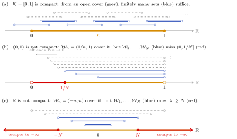

<!-- GENERATED by _port/convert/build.py from Appendices/proofs_and_comments/supports_and_compactness.tex, main.tex.
     Do not edit this file: edit the LaTeX notes and re-run the converter. -->

```{=html}
<header class="dg-head dg-head-section"><p class="dg-kicker">Appendix B <span class="dg-sep">•</span> <a href="index.html">Proofs &amp; Comments</a></p><h1 class="dg-title"><span class="dg-secnum">B.19</span> Compactness and the integral over a region (§<a class="dg-xref" href="../integrals/integration-manifolds.html" data-kind="section" data-label="section_Integration_Manifolds">8.2</a>)</h1></header>
<p>The integral (<a class="dg-xref" href="../integrals/integration-manifolds.html#eq_integral_chart" data-kind="equation" data-label="eq_integral_chart">8.3</a>) over a region <span class="math inline">\(\mathcal{D} \subseteq \mathcal{U}\)</span> assumes that <span class="math inline">\(\overline{\mathcal{D}}\)</span> is compact and contained in <span class="math inline">\(\mathcal{U}\)</span>. This appendix defines the two notions involved and shows what the assumption does: it turns the definition into an ordinary integral of a bounded function over a bounded subset of <span class="math inline">\(\mathbb{R}^d\)</span>, which is therefore finite.</p>
<ul class="dg-itemize dg-depth-1">
<li><p><strong>Closure.</strong> The closure of <span class="math inline">\(\mathcal{S} \subseteq \mathcal{M}\)</span> is the smallest closed set containing it,  <span class="math display">\[
            \overline{\mathcal{S}} \coloneqq \bigcap \big\{ \mathcal{C} \subseteq \mathcal{M} \;\big|\; \mathcal{M} \setminus \mathcal{C} \in \mathcal{O}, \; \mathcal{S} \subseteq \mathcal{C} \big\} ,
        \]</span>  i.e. <span class="math inline">\(\mathcal{S}\)</span> together with its boundary points; e.g. <span class="math inline">\(\overline{(-1, 1)} = [-1, 1]\)</span> in <span class="math inline">\(\mathbb{R}\)</span>.</p></li>
<li><p><strong>Compactness.</strong> A family <span class="math inline">\(\{ \mathcal{W}_a \}_{a \in A}\)</span> of open sets, with <span class="math inline">\(A\)</span> possibly infinite, is an <strong>open cover</strong> of  <span class="math inline">\(\mathcal{K} \subseteq \mathcal{M}\)</span> if <span class="math inline">\(\mathcal{K} \subseteq \bigcup_{a \in A} \mathcal{W}_a\)</span>. The set <span class="math inline">\(\mathcal{K}\)</span> is <strong>compact</strong> if every open  cover has a finite subcover:  <span class="math display">\[
            \mathcal{K} \subseteq \bigcup_{a \in A} \mathcal{W}_a , \quad \mathcal{W}_a \in \mathcal{O}
            \quad \longrightarrow \quad
            \mathcal{K} \subseteq \mathcal{W}_{a_1} \cup \dots \cup \mathcal{W}_{a_N}
            \quad \text{for some } a_1, \dots, a_N \in A .
        \]</span>  Figure <a class="dg-xref" href="#fig_compactness" data-kind="figure" data-label="fig_compactness">B.1</a> illustrates the definition and the two ways it fails in <span class="math inline">\(\mathbb{R}\)</span>: a missing endpoint, and  escape to infinity. In <span class="math inline">\(\mathbb{R}^d\)</span>, the compact sets are exactly the closed and bounded ones (Heine–Borel; not proved  here).</p></li>
<li><p><strong>Two consequences.</strong></p>
<ol class="dg-enumerate dg-depth-1">
<li class="dg-labelled"><span class="dg-item-label">(i)</span> <p><em>Continuous images of compact sets are compact.</em> Let <span class="math inline">\(\phi : \mathcal{U} \to \mathbb{R}^d\)</span> be continuous and  <span class="math inline">\(\mathcal{K} \subseteq \mathcal{U}\)</span> compact. If <span class="math inline">\(\{ \mathcal{W}_a \}\)</span> is an open cover of <span class="math inline">\(\phi(\mathcal{K})\)</span>, the preimages  <span class="math inline">\(\mathrm{preim}_\phi(\mathcal{W}_a)\)</span> are open (continuity) and cover <span class="math inline">\(\mathcal{K}\)</span>, so finitely many of them,  <span class="math inline">\(\mathrm{preim}_\phi(\mathcal{W}_{a_1}), \dots, \mathrm{preim}_\phi(\mathcal{W}_{a_N})\)</span>, cover <span class="math inline">\(\mathcal{K}\)</span>; then  <span class="math inline">\(\mathcal{W}_{a_1}, \dots, \mathcal{W}_{a_N}\)</span> cover <span class="math inline">\(\phi(\mathcal{K})\)</span>. <span class="math inline">\(\square\)</span></p></li>
<li class="dg-labelled"><span class="dg-item-label">(ii)</span> <p><em>Continuous functions on compact sets are bounded.</em> If <span class="math inline">\(\mathcal{K} \subseteq \mathbb{R}^d\)</span> is compact and  <span class="math inline">\(h : \mathcal{K} \to \mathbb{R}\)</span> continuous, then <span class="math inline">\(h(\mathcal{K})\)</span> is compact by (i), hence bounded by Heine–Borel:  <span class="math inline">\(|h| \leq C\)</span> on <span class="math inline">\(\mathcal{K}\)</span> for some <span class="math inline">\(C \geq 0\)</span>. <span class="math inline">\(\square\)</span></p></li>
</ol></li>
</ul>
<div class="dg-skip dg-medskip"></div>
<p><strong>Statement.</strong> In the setting of Section <a class="dg-xref" href="../integrals/integration-manifolds.html" data-kind="section" data-label="section_Integration_Manifolds">8.2</a>, if <span class="math inline">\(\overline{\mathcal{D}}\)</span> is compact and contained in <span class="math inline">\(\mathcal{U}\)</span><sup class="dg-fnref"><a href="#fn-2" id="fnref-2" aria-label="Footnote 2">2</a></sup>, then <span class="math display">\[
    \bigg| \int_\mathcal{D} \Omega f \bigg| &lt; \infty .
\]</span></p>
<p><strong>Proof.</strong> Let <span class="math inline">\(h(\alpha) \coloneqq \big( \omega_\mathscr{X} \circ \mathscr{X}^{-1} \big)(\alpha) \, \big( f \circ \mathscr{X}^{-1} \big)(\alpha)\)</span>, a continuous function on <span class="math inline">\(\mathscr{X}(\mathcal{U})\)</span>, since <span class="math inline">\(\omega_\mathscr{X} \in C^\infty(\mathcal{U})\)</span>, <span class="math inline">\(f \in C^\infty(\mathcal{M})\)</span> and <span class="math inline">\(\mathscr{X}^{-1}\)</span> is continuous.</p>
<ol class="dg-enumerate dg-depth-1">
<li><p><em>The region is bounded in the chart.</em> <span class="math inline">\(\mathscr{X}\)</span> is continuous on <span class="math inline">\(\mathcal{U} \supseteq \overline{\mathcal{D}}\)</span>, so  <span class="math inline">\(\mathscr{X}(\overline{\mathcal{D}})\)</span> is compact by (i), hence bounded by Heine–Borel:  <span class="math inline">\(\mathscr{X}(\mathcal{D}) \subseteq \mathscr{X}(\overline{\mathcal{D}}) \subseteq [-L, L]^d\)</span> for some <span class="math inline">\(L &gt; 0\)</span>.</p></li>
<li><p><em>The integrand is bounded on it.</em> <span class="math inline">\(h\)</span> is continuous on the compact set <span class="math inline">\(\mathscr{X}(\overline{\mathcal{D}})\)</span>, so, by (ii),  <span class="math inline">\(|h(\alpha)| \leq C\)</span> for all <span class="math inline">\(\alpha \in \mathscr{X}(\overline{\mathcal{D}})\)</span>.</p></li>
<li><p><em>Estimate.</em>  <span class="math display">\begin{align*}
        \bigg| \int_\mathcal{D} \Omega f \bigg|
        &amp;\overset{(8.3)}{=} \bigg| \int_{\mathscr{X}(\mathcal{D})} d^d\alpha \, h(\alpha) \bigg|
        \leq \int_{\mathscr{X}(\mathcal{D})} d^d\alpha \, |h(\alpha)| \\
        &amp;\overset{\text{step 2}}{\leq} C \int_{\mathscr{X}(\mathcal{D})} d^d\alpha
        \overset{\text{step 1}}{\leq} C \int_{[-L, L]^d} d^d\alpha
        = C \, (2L)^d &lt; \infty .
    \end{align*}</span>  The integral exists in the first place, as the integral of a bounded continuous function over a bounded open  set<sup class="dg-fnref"><a href="#fn-3" id="fnref-3" aria-label="Footnote 3">3</a></sup>. <span class="math inline">\(\square\)</span></p></li>
</ol>
<div class="dg-skip dg-medskip"></div>
<p><strong>Without the assumption.</strong> Let <span class="math inline">\(\mathcal{M} = \mathbb{R}\)</span>, with an oriented atlas containing the identity chart <span class="math inline">\((\mathbb{R}, \mathscr{X})\)</span>, <span class="math inline">\(\mathscr{X}(p) = p\)</span>, the volume form <span class="math inline">\(\Omega\)</span> with <span class="math inline">\(\omega_\mathscr{X} = 1\)</span>, and <span class="math inline">\(f = 1\)</span>, so that, in the identity chart, <span class="math inline">\(\int_\mathcal{D} \Omega f\)</span> is the length of <span class="math inline">\(\mathcal{D}\)</span>. Each part of the assumption can fail on its own:</p>
<ol class="dg-enumerate dg-depth-1">
<li><p><em><span class="math inline">\(\overline{\mathcal{D}}\)</span> not compact: escape to infinity</em> (Figure <a class="dg-xref" href="#fig_compactness" data-kind="figure" data-label="fig_compactness">B.1</a>(c)). For <span class="math inline">\(\mathcal{U} = \mathbb{R}\)</span> and  <span class="math inline">\(\mathcal{D} = (0, \infty)\)</span>, <span class="math inline">\(\overline{\mathcal{D}} = [0, \infty)\)</span> is closed but unbounded, step 1 fails, and  <span class="math display">\[
        \int_\mathcal{D} \Omega f = \int_0^\infty d\alpha = \infty .
    \]</span></p></li>
<li><p><em><span class="math inline">\(\overline{\mathcal{D}}\)</span> compact, but not contained in <span class="math inline">\(\mathcal{U}\)</span>: reaching the edge of the chart</em>  (Figure <a class="dg-xref" href="#fig_compactness" data-kind="figure" data-label="fig_compactness">B.1</a>(b)). Take the chart <span class="math inline">\((\mathcal{U}, \mathscr{Y})\)</span> with <span class="math inline">\(\mathcal{U} = (0, 1)\)</span> and  <span class="math inline">\(\mathscr{Y}(p) \coloneqq \tan\big( \pi (p - \tfrac{1}{2}) \big)\)</span>, compatible with the identity chart and in the oriented atlas, since  <span class="math inline">\(d\mathscr{Y}/dp &gt; 0\)</span>; and <span class="math inline">\(\mathcal{D} = \mathcal{U}\)</span>. Then <span class="math inline">\(\overline{\mathcal{D}} = [0, 1]\)</span> is compact, but its endpoints are not in <span class="math inline">\(\mathcal{U}\)</span>.  By (<a class="dg-xref" href="../integrals/volume-forms-orientation.html#eq_scalar_density_transformation" data-kind="equation" data-label="eq_scalar_density_transformation">8.1</a>), <span class="math inline">\(\big( \omega_\mathscr{Y} \circ \mathscr{Y}^{-1} \big)(\beta) = \frac{d}{d\beta} \mathscr{Y}^{-1}(\beta)
    = \frac{1}{\pi (1 + \beta^2)}\)</span>, and <span class="math inline">\(\mathscr{Y}(\mathcal{D}) = \mathbb{R}\)</span> is unbounded, so step 1 fails:  <span class="math display">\[
        \int_{\mathscr{Y}(\mathcal{D})} d\beta \, \big( \omega_\mathscr{Y} \circ \mathscr{Y}^{-1} \big)(\beta) \, \big( f \circ \mathscr{Y}^{-1} \big)(\beta)
        = \int_{-\infty}^{\infty} \frac{d\beta}{\pi (1 + \beta^2)} = 1 .
    \]</span>  The value is still finite, the length of <span class="math inline">\((0, 1)\)</span>, but the chart <span class="math inline">\(\mathscr{Y}\)</span> only yields it as an improper integral over  all of <span class="math inline">\(\mathbb{R}\)</span>, whose convergence rests on the decay of the integrand, and to which the Statement does not apply.</p></li>
</ol>
<p>Compactness of <span class="math inline">\(\overline{\mathcal{D}}\)</span> is thus what makes the integral finite, and its containment in <span class="math inline">\(\mathcal{U}\)</span> is what makes a single chart show this through an ordinary integral over a bounded region.</p>
<figure class="dg-figure" id="fig_compactness"><div class="dg-paper" style="--dg-frac:0.893"></div><figcaption><span class="dg-fignum">Figure B.1:</span>   Open covers of subsets <span class="math inline">\(\mathcal{K}\)</span> (orange) of <span class="math inline">\(\mathbb{R}\)</span>. Open sets are drawn as bars with hollow, i.e. excluded, endpoints;  filled endpoints are included. (a) The closed and bounded interval <span class="math inline">\([0, 1]\)</span>: whatever the open cover (grey), finitely many  of its sets (blue) already cover it, endpoints included. (b) The interval <span class="math inline">\((0, 1)\)</span>, which lacks its endpoint <span class="math inline">\(0\)</span>: the sets  <span class="math inline">\(\mathcal{W}_n = (1/n, 1)\)</span> cover it, but any finitely many of them leave a gap <span class="math inline">\((0, 1/N]\)</span> near the missing endpoint. (c) The  unbounded set <span class="math inline">\(\mathbb{R}\)</span>: the sets <span class="math inline">\(\mathcal{W}_n = (-n, n)\)</span> cover it, but any finitely many of them leave out the points  with <span class="math inline">\(|\lambda| \geq N\)</span>, which escape to infinity. Closedness rules out (b) and boundedness rules out (c); together they  characterize compactness in <span class="math inline">\(\mathbb{R}^d\)</span> (Heine–Borel). For a region <span class="math inline">\(\mathcal{D}\)</span> of integration, (c) is a region escaping to  infinity, and (b) a region reaching the edge of its chart domain, whose missing endpoints are the points of  <span class="math inline">\(\overline{\mathcal{D}}\)</span> outside <span class="math inline">\(\mathcal{U}\)</span>. </figcaption></figure>
<div class="dg-footnotes"><div class="dg-fn" id="fn-2"><a class="dg-fn-num" href="#fnref-2" aria-label="Back to the text">2</a><div class="dg-fn-body"><p>Equivalently, the closure of <span class="math inline">\(\mathcal{D}\)</span> taken within <span class="math inline">\(\mathcal{U}\)</span>, <span class="math inline">\(\mathcal{K} \coloneqq \overline{\mathcal{D}} \cap \mathcal{U}\)</span>, is compact: the condition  only involves the chart domain. Indeed, if <span class="math inline">\(\overline{\mathcal{D}} \subseteq \mathcal{U}\)</span>, then <span class="math inline">\(\mathcal{K} = \overline{\mathcal{D}}\)</span>. Conversely, a  compact <span class="math inline">\(\mathcal{K}\)</span> is closed in <span class="math inline">\(\mathcal{M}\)</span>, since <span class="math inline">\(\mathcal{M}\)</span> is Hausdorff (Chapter <a class="dg-xref" href="../topological-manifolds/index.html" data-kind="chapter" data-label="chapter_Topological_Manifolds">3</a>), and  contains <span class="math inline">\(\mathcal{D}\)</span>, so <span class="math inline">\(\overline{\mathcal{D}} \subseteq \mathcal{K} \subseteq \overline{\mathcal{D}}\)</span>.</p></div></div><div class="dg-fn" id="fn-3"><a class="dg-fn-num" href="#fnref-3" aria-label="Back to the text">3</a><div class="dg-fn-body"><p>As a Lebesgue integral always; as a Riemann integral when the boundary of <span class="math inline">\(\mathscr{X}(\mathcal{D})\)</span> has zero volume, e.g.  when it is a smooth hypersurface.</p></div></div></div>
<nav class="dg-web dg-prevnext" aria-label="Previous and next page"><a class="dg-prev" href="metric-properties.html" rel="prev"><span aria-hidden="true">←</span> <span><span class="dg-secnum">B.18</span> Properties of <span class="math inline">\(g\)</span> and of the L.C. connection (§§7.3–7.4)</span></a><a class="dg-next" href="partitions-of-unity.html" rel="next"><span aria-hidden="true">→</span> <span><span class="dg-secnum">B.20</span> Partitions of unity, paracompactness and second countability (§8.2.1)</span></a></nav>
```
