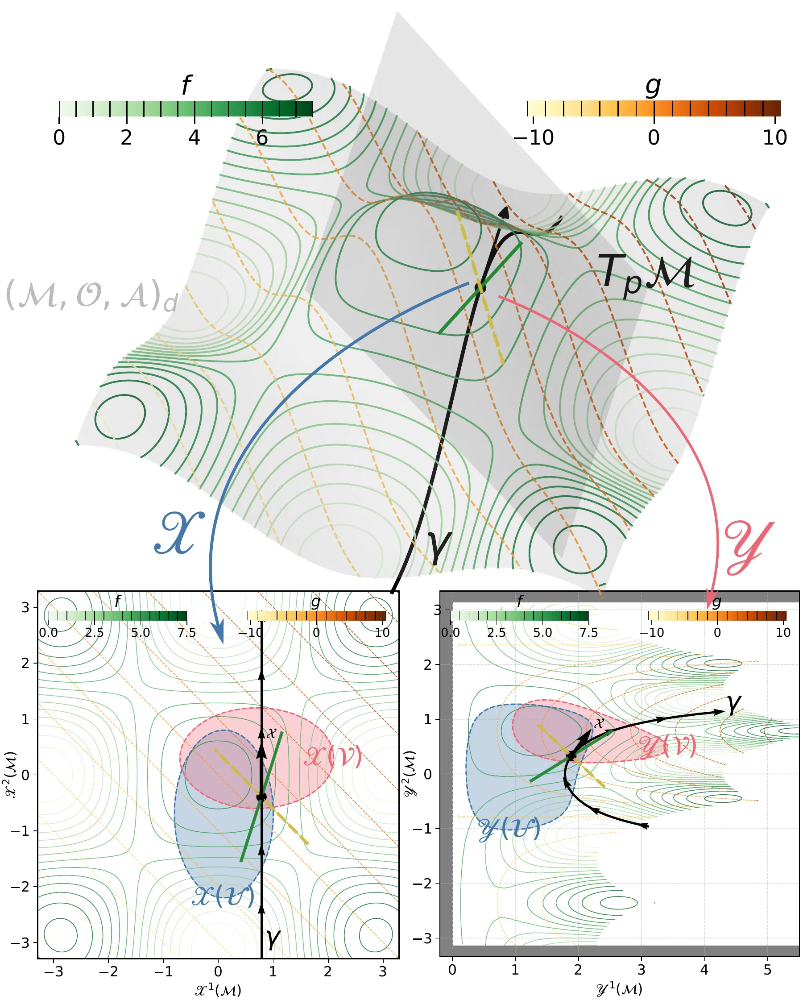

<!-- GENERATED by _port/convert/build.py from Chapters/Tangent_spaces/TstarpM.tex, main.tex.
     Do not edit this file: edit the LaTeX notes and re-run the converter. -->

```{=html}
<header class="dg-head dg-head-section"><p class="dg-kicker">Chapter 4 <span class="dg-sep">•</span> <a href="index.html">Tangent Spaces</a></p><h1 class="dg-title"><span class="dg-secnum">4.2</span> Cotangent Space <span class="math inline">\(T_p^*\mathcal{M}\)</span></h1></header>
<ul class="dg-itemize dg-depth-1">
<li><p>The <span class="dg-term dg-term-orange">cotangent (<span class="math inline">\(\mathbb{R}\)</span>-vector) space</span> <span class="math inline">\(\left(T_p^* \mathcal{M}, \oplus_{T}^*, \odot_{T}^* \right)\)</span> of the manifold <span class="math inline">\(\left(\mathcal{M}, \mathcal{O}, \mathcal{A}\right)_d\)</span> at a point <span class="math inline">\(p \in \mathcal{M}\)</span> is the dual (<span class="math inline">\(\mathbb{R}\)</span>-)vector space of the tangent (<span class="math inline">\(\mathbb{R}\)</span>-vector) space <span class="math inline">\(T_p\mathcal{M}\)</span>, this is, the set of all linear maps from <span class="math inline">\(T_p\mathcal{M}\)</span> to <span class="math inline">\(\mathbb{R}\)</span>: <span class="math inline">\(T_p^*\mathcal{M} := \mathrm{Hom}_{\mathbb{R}}(T_p\mathcal{M}, \mathbb{R})\)</span>. Each element <span class="math inline">\(\mathsf{X}_p \in T_p^*\mathcal{M}\)</span> is called a <span class="dg-term dg-term-orange">covector</span> (or cotangent vector) at the point <span class="math inline">\(p\)</span>.</p></li>
<li><p>Covectors are canonically produced as the <span class="dg-term dg-term-orange">differentials</span> (or <span class="dg-term dg-term-orange">gradients</span>) of smooth scalar fields<sup class="dg-fnref"><a href="#fn-6" id="fnref-6" aria-label="Footnote 6">6</a></sup>. Given a function <span class="math inline">\(f \in C^\infty(\mathcal{M})\)</span>, its differential at <span class="math inline">\(p\)</span> is the covector  <span class="math display">\begin{align*}
            (df)_p : T_p \mathcal{M} &amp;\xlongrightarrow{\;\;\sim\;\;} \mathbb{R} \\
            v_{\gamma, p}            &amp;\longmapsto (df)_p (v_{\gamma, p}) := v_{\gamma, p}(f),
        \end{align*}</span>  which evaluates the directional derivative of <span class="math inline">\(f\)</span> along <span class="math inline">\(v_{\gamma, p}\)</span> at the point <span class="math inline">\(p\)</span>.</p>
<p>This construction is not a special case but an exhaustive one: every element of <span class="math inline">\(T_p^*\mathcal{M}\)</span> is the differential at <span class="math inline">\(p\)</span> of some <span class="math inline">\(f \in C^\infty(\mathcal{M})\)</span><sup class="dg-fnref"><a href="#fn-7" id="fnref-7" aria-label="Footnote 7">7</a></sup>. Locally, this is made explicit in Subsection <a class="dg-xref" href="#subsection_Basis_and_Coordinate_Components_of_TstarpM" data-kind="subsection" data-label="subsection_Basis_and_Coordinate_Components_of_TstarpM">4.2.1</a>, where the differentials <span class="math inline">\((d\mathscr{X}^i)_p\)</span> of the coordinate maps are shown to form a basis of <span class="math inline">\(T_p^*\mathcal{M}\)</span>.</p></li>
</ul>
```

## `<span class="dg-secnum">4.2.1</span> Basis and Coordinate Components for <span class="math inline">\(T^*_p \mathcal{M}\)</span>`{=html} {#subsection_Basis_and_Coordinate_Components_of_TstarpM}

```{=html}
<ul class="dg-itemize dg-depth-1">
<li><p>Given a chart <span class="math inline">\((\mathcal{U}, \mathscr{X})\)</span> around a point <span class="math inline">\(p \in \mathcal{M}\)</span>, the set of differentials  <span class="math display">\begin{align*}
            \epsilon \coloneqq \left\lbrace (d\mathscr{X}^1)_p, \dots, (d\mathscr{X}^d)_p \right\rbrace,
        \end{align*}</span>  constitutes the <span class="dg-term dg-term-orange">dual chart-induced basis</span><sup class="dg-fnref"><a href="#fn-8" id="fnref-8" aria-label="Footnote 8">8</a></sup> for <span class="math inline">\(T_p^*\mathcal{M}\)</span>. This means that any covector <span class="math inline">\(\mathsf{X}_p \in T_p^*\mathcal{M}\)</span> at <span class="math inline">\(p\)</span> can be written as:  <span class="math display">\begin{align*}
            \mathsf{X}_p = \sum_{i=1}^d \mathtt{x}_i^p (d\mathscr{X}^i)_p,
        \end{align*}</span>  Therefore, at the level of a point, the cotangent space is completely and rigorously characterized as the dual of the tangent space, with gradients of scalar fields providing a natural generating set.</p>
<p>Note that, employing the dual chart-induced basis we can recover single components of <span class="math inline">\(v_{\gamma, p}\)</span>:  <span class="math display">\begin{align*}
            (d\mathscr{X}^{i})_p (v_{\gamma, p}) =
            (\mathscr{X}^{i} \circ \gamma)'(\lambda_0)
            = (\mathscr{X} \circ \gamma)_j'(\lambda_0) \cdot
            \underbrace{\partial_j \left[\mathscr{X}^{i} \circ \mathscr{X}^{-1}\right] (\mathscr{X}(p))}_{\delta^i_j}
            = (\mathscr{X} \circ \gamma)_i'(\lambda_0) = \dot{\gamma}^i_\mathcal{U}(\lambda_0).
        \end{align*}</span></p></li>
<li><p>Given a chart <span class="math inline">\((\mathcal{U}, \mathscr{X})\)</span> with <span class="math inline">\(p \in \mathcal{U}\)</span>, we can extract the components, <span class="math inline">\(\mathtt{x}_i^p\)</span>, of the covector <span class="math inline">\(\left(df\right)_p\)</span> as:  <span class="math display">\begin{align*}
            &amp;\sum_{j=1}^d \mathtt{x}_j^p (d\mathscr{X}^j)_p \left( \left( \frac{\partial}{\partial \mathscr{X}^i} \right)_{p} \right)
            = \left(df\right)_p \left( \left( \frac{\partial}{\partial \mathscr{X}^i} \right)_{p} \right) \longrightarrow \dots\\
            \sum_{j=1}^{d} \mathtt{x}_j^p
            &amp;\cdot \underbrace{\partial_i \left[\mathscr{X}^j \circ \mathscr{X}^{-1}\right] (\mathscr{X}(p))}_{\delta^j_i}
            = \left( \frac{\partial}{\partial \mathscr{X}^i} \right)_{p} (f) \longrightarrow
            \mathtt{x}_i^p
            = \partial_i \left[f \circ \mathscr{X}^{-1}\right] (\mathscr{X}(p)) \in \mathbb{R}.
        \end{align*}</span></p></li>
<li><p>Given two charts <span class="math inline">\(\left( \mathcal{U}, \mathscr{X} \right)\)</span> and <span class="math inline">\(\left( \mathcal{V}, \mathscr{Y} \right)\)</span>, the basis covectors induced by <span class="math inline">\(\mathscr{X}\)</span> and <span class="math inline">\(\mathscr{Y}\)</span> at the point <span class="math inline">\(p\)</span> are related as follows. Let us compute the action of the covector <span class="math inline">\((d\mathscr{X}^i)_p\)</span> on an arbitrary tangent vector <span class="math inline">\(v_{\gamma, p} \in T_p\mathcal{M}\)</span>:  <span class="math display">\begin{align*}
            (d\mathscr{X}^{i})_p (v_{\gamma, p})
            &amp;\coloneqq v_{\gamma, p}(\mathscr{X}^{i})
            = (\mathscr{X}^{i} \circ \gamma)'(\lambda_0)=
            \big( \underbrace{ \mathscr{X}^i \circ \mathscr{Y}^{-1} }_{\mathbb{R} \longleftarrow \mathbb{R}^d}
            \circ \underbrace{ \mathscr{Y} \circ \gamma }_{\mathbb{R}^d \longleftarrow \mathbb{R}} \big)' (\lambda_0)\\
            &amp;=
            \sum_{j=1}^{d} \left\lbrace
            \underbrace{(\mathscr{Y} \circ \gamma)_j'(\lambda_0)}_{v_{\gamma, p}(\mathscr{Y}^j)}
            \cdot
            \partial_j \left[ \mathscr{X}^{i} \circ \mathscr{Y}^{-1} \right] (\mathscr{Y}(p)) \right\rbrace\\
            &amp;=
            \sum_{j=1}^{d} \left\lbrace (d\mathscr{Y}^{j})_p (v_{\gamma, p})
            \cdot
            \left( \frac{\partial \mathscr{X}^i}{\partial \mathscr{Y}^j} \right)_{p} \right\rbrace.
        \end{align*}</span></p>
<p>Since this holds for any tangent vector <span class="math inline">\(v_{\gamma, p} \in T_p\mathcal{M}\)</span>, we conclude the transformation law for the dual basis:  <span class="math display">\begin{align*}
            (d\mathscr{X}^{i})_p
            =
            \sum_{j=1}^{d}
            \left\lbrace
            \left( \frac{\partial \mathscr{X}^i}{\partial \mathscr{Y}^j} \right)_{p}
            \cdot
            (d\mathscr{Y}^{j})_p
            \right\rbrace
            =
            \sum_{j=1}^{d}
            \left( \textrm{\runic ᛞ}_{\mathcal{U}\mathcal{V}} \right)^i_{j} \left( \mathscr{Y}(p) \right) \cdot (d\mathscr{Y}^{j})_p.
        \end{align*}</span></p>
<p>In Section <a class="dg-xref" href="tangent-space.html#subsection_Basis_and_Coordinate_Components_of_TpM" data-kind="subsection" data-label="subsection_Basis_and_Coordinate_Components_of_TpM">4.1.1</a>, we defined that contravariant objects transform exactly like this, hence, the dual chart-induced basis elements are <span class="dg-term dg-term-orange">contravariant</span>, in contrast to tangent basis vectors which transform covariantly.</p></li>
<li><p>Correspondingly, the covector components transform as follows between two intersecting chart domains <span class="math inline">\(\mathcal{U}\)</span> and <span class="math inline">\(\mathcal{V}\)</span> containing a point <span class="math inline">\(p \in \mathcal{U} \cap \mathcal{V}\)</span>. Given a covector <span class="math inline">\(\mathsf{X}_p \in T_p^*\mathcal{M}\)</span> expressed in the chart-induced bases of <span class="math inline">\(\left( \mathcal{U}, \mathscr{X} \right)\)</span> and <span class="math inline">\(\left( \mathcal{V}, \mathscr{Y} \right)\)</span>, we have:  <span class="math display">\begin{align*}
            \mathsf{X}_p
            &amp;= \sum_{i=1}^{d}
            \mathtt{x}_i^p \cdot (d\mathscr{X}^i)_p
            = \sum_{i=1}^{d}
            \mathtt{y}_i^p \cdot (d\mathscr{Y}^i)_p.
        \end{align*}</span></p>
<p>Substituting the basis change derived previously into the left-hand expression for <span class="math inline">\(\mathsf{X}_p\)</span>, we get:  <span class="math display">\begin{align*}
            \sum_{i=1}^{d}
            \mathtt{x}_i^p \cdot
            \sum_{j=1}^{d}
            \left(
            \frac{\partial \mathscr{X}^i}{\partial \mathscr{Y}^j}
            \right)_{p}
            \cdot
            (d\mathscr{Y}^j)_p
            =
            \sum_{i=1}^{d}
            \mathtt{y}_i^p \cdot
            (d\mathscr{Y}^i)_p.
        \end{align*}</span></p>
<p>Since the basis covectors <span class="math inline">\((d\mathscr{Y}^j)_p\)</span> are linearly independent, we can equate the components on both sides to obtain the transformation law for the covector components:  <span class="math display">\begin{align*}
            \mathtt{y}_j^p
            =
            \sum_{i=1}^{d}
            \left(
            \frac{\partial \mathscr{X}^i}{\partial \mathscr{Y}^j}
            \right)_{p}
            \cdot
            \mathtt{x}_i^p
            =
            \sum_{i=1}^{d}
            \left( \textrm{\runic ᛞ}_{\mathcal{U}\mathcal{V}} \right)^i_{j}\left( \mathscr{Y}(p) \right)
            \cdot
            \mathtt{x}_i^p.
        \end{align*}</span></p>
<p>In Section <a class="dg-xref" href="tangent-space.html#subsection_Basis_and_Coordinate_Components_of_TpM" data-kind="subsection" data-label="subsection_Basis_and_Coordinate_Components_of_TpM">4.1.1</a>, we defined that covariant objects transform exactly like this. Hence, covector components are <span class="dg-term dg-term-orange">covariant</span>, in contrast to vector components, which transform contravariantly.</p></li>
</ul>
<figure class="dg-figure" id="fig_TstarpM"><div class="dg-paper" style="--dg-frac:1.000"></div><figcaption><span class="dg-fignum">Figure 4.3:</span>   Visual summary of the cotangent space <span class="math inline">\(T^*_p\mathcal{M}\)</span> at a point <span class="math inline">\(p\)</span> of the smooth manifold <span class="math inline">\(\left(\mathcal{M}, \mathcal{O}, \mathcal{A}\right)_d\)</span>. <strong>Top:</strong> the manifold carries the level sets of two scalar fields, <span class="math inline">\(f\)</span> (solid, light blue) and <span class="math inline">\(g\)</span> (dashed, dark red), together with a curve <span class="math inline">\(\gamma\)</span> through <span class="math inline">\(p\)</span> and the tangent space <span class="math inline">\(T_p\mathcal{M}\)</span> at that point. The velocity <span class="math inline">\(v_{\gamma, p} \in T_p\mathcal{M}\)</span> is drawn as an arrow, while the covectors <span class="math inline">\((df)_p\)</span> and <span class="math inline">\((dg)_p \in T^*_p\mathcal{M}\)</span> are drawn as the lines they annihilate inside <span class="math inline">\(T_p\mathcal{M}\)</span>, each one tangent at <span class="math inline">\(p\)</span> to the level set of the corresponding scalar field. A covector is a linear map acting on <span class="math inline">\(T_p\mathcal{M}\)</span>, not an element of it, so this is the picture that matches the object: drawing it as an arrow would be misleading. <strong>Bottom:</strong> the same objects seen through the charts <span class="math inline">\((\mathcal{U}, \mathscr{X})\)</span> (left) and <span class="math inline">\((\mathcal{V}, \mathscr{Y})\)</span> (right), which also show the chart images of both chart domains, <span class="math inline">\(\mathscr{X}(\mathcal{U})\)</span>, <span class="math inline">\(\mathscr{X}(\mathcal{V})\)</span> and <span class="math inline">\(\mathscr{Y}(\mathcal{U})\)</span>, <span class="math inline">\(\mathscr{Y}(\mathcal{V})\)</span>. The green arrows indicate the transition maps <span class="math inline">\(\textrm{\runic ᛖ}_{\mathcal{V}\mathcal{U}}\)</span> and <span class="math inline">\(\textrm{\runic ᛖ}_{\mathcal{U}\mathcal{V}}\)</span> relating the two coordinate representations, and the hatched bands mark coordinates lying outside the image of the polar chart <span class="math inline">\(\mathscr{Y}\)</span>. Components, directions and spacings change from one chart to the other; what does not change is the value of the pairing, <span class="math inline">\((df)_p\left(v_{\gamma, p}\right) = \mathtt{x}_i^p \, \dot{\gamma}^i_{\mathcal{U}}(\lambda_0) = \mathtt{y}_i^p \, \dot{\gamma}^i_{\mathcal{V}}(\lambda_0)\)</span>.  </figcaption></figure>
```

## `<span class="dg-secnum">4.2.2</span> Notation`{=html} {#notation_TstarpM}

```{=html}
<div class="dg-skip dg-medskip"></div>
<p>As we did for the tangent space in Subsection <a class="dg-xref" href="tangent-space.html#notation_TpM" data-kind="subsection" data-label="notation_TpM">4.1.2</a>, we now introduce a simplified notation for the cotangent space <span class="math inline">\(T_p^*\mathcal{M}\)</span>, which will streamline expressions involving basis elements and components. While the underlying geometric structures remain unchanged, this notation mirrors the choices adopted earlier for the tangent space.</p>
<div class="dg-skip dg-medskip"></div>
<p>Applying the Einstein summation convention (see Subsection <a class="dg-xref" href="tangent-space.html#notation_TpM" data-kind="subsection" data-label="notation_TpM">4.1.2</a>) to express how a covector in the cotangent space <span class="math inline">\(\mathsf{X}_p \in T_p^*\mathcal{M}\)</span> can be expanded in terms of the dual chart-induced bases associated with two charts <span class="math inline">\(\left( \mathcal{U}, \mathscr{X} \right)\)</span> and <span class="math inline">\(\left( \mathcal{V}, \mathscr{Y} \right)\)</span>, both containing the point <span class="math inline">\(p \in \mathcal{M}\)</span>: <span class="math display">\begin{align*}
    \mathsf{X}_p
    =
    \mathtt{x}_i^p \cdot (d\mathscr{X}^i)_p
    =
    \mathtt{y}_i^p \cdot (d\mathscr{Y}^i)_p.
\end{align*}</span> This representation reflects the fact that the covector <span class="math inline">\(\mathsf{X}_p \in T_p^*\mathcal{M}\)</span> is an intrinsic geometric object, while its representation in terms of components and basis covectors depends on the particular chart employed.</p>
<div class="dg-skip dg-medskip"></div>
<p>Now suppose we have another covector <span class="math inline">\(\mathsf{Y}_p \in T_p^*\mathcal{M}\)</span>. It can be expanded similarly in the basis induced by either chart: <span class="math display">\begin{align*}
    \mathsf{Y}_p
    =
    \tilde{\mathtt{x}}_i^p \cdot (d\mathscr{X}^i)_p
    =
    \tilde{\mathtt{y}}_i^p \cdot (d\mathscr{Y}^i)_p.
\end{align*}</span></p>
<div class="dg-skip dg-medskip"></div>
<p>For covectors, the only new shorthand concerns the basis covectors, <span class="math display">\[
    (dx^i)_p \coloneqq (d\mathscr{X}^i)_p, \qquad (dy^i)_p \coloneqq (d\mathscr{Y}^i)_p,
\]</span> while the covectors <span class="math inline">\(\mathsf{X}_p\)</span>, <span class="math inline">\(\mathsf{Y}_p\)</span> and their components <span class="math inline">\(\mathtt{x}_i^p\)</span>, <span class="math inline">\(\mathtt{y}_i^p\)</span>, <span class="math inline">\(\tilde{\mathtt{x}}_i^p\)</span>, <span class="math inline">\(\tilde{\mathtt{y}}_i^p\)</span> keep the names already introduced. Hence, the expansions of the two covectors become: <span class="math display">\[
    \mathsf{X}_p =
    \underbrace{
        \mathtt{x}_i^p \cdot (dx^i)_p
    }_{\text{in chart } \mathscr{X}}
    =
    \underbrace{
        \mathtt{y}_i^p \cdot (dy^i)_p
    }_{\text{in chart } \mathscr{Y}},
    \qquad
    \mathsf{Y}_p =
    \underbrace{
        \tilde{\mathtt{x}}_i^p \cdot (dx^i)_p
    }_{\text{in chart } \mathscr{X}}
    =
    \underbrace{
        \tilde{\mathtt{y}}_i^p \cdot (dy^i)_p
    }_{\text{in chart } \mathscr{Y}},
\]</span></p>
<div class="dg-skip dg-medskip"></div>
<p>and the transformation law for the basis covectors, derived in the previous section, reads: <span class="math display">\[
    (dx^i)_p
    =
    \left( \frac{\partial \mathscr{X}^i}{\partial \mathscr{Y}^j} \right)_{p} \cdot (dy^j)_p
    =
    \left( \textrm{\runic ᛞ}_{\mathcal{U}\mathcal{V}} \right)^i_{j}\left( \mathscr{Y}(p) \right) \cdot (dy^j)_p.
\]</span></p>
<div class="dg-skip dg-medskip"></div>
<p>Similarly, the transformation law for the components of a covector is: <span class="math display">\[
    \mathtt{y}_i^p
    =
    \left(
    \frac{\partial \mathscr{X}^j}{\partial \mathscr{Y}^i}
    \right)_{p} \cdot \mathtt{x}_j^p
    =
    \left( \textrm{\runic ᛞ}_{\mathcal{U}\mathcal{V}} \right)^j_{i}\left( \mathscr{Y}(p) \right) \cdot \mathtt{x}_j^p,
\]</span></p>
<div class="dg-skip dg-medskip"></div>
<p>The same relation holds for the components <span class="math inline">\(\tilde{\mathtt{x}}_i^p\)</span> and <span class="math inline">\(\tilde{\mathtt{y}}_i^p\)</span> of the covector <span class="math inline">\(\mathsf{Y}_p\)</span>, since the transformation depends exclusively on the basis change induced by the transition between charts.</p>
<div class="dg-skip dg-medskip"></div>
<p>Employing this notation, the correspondence between the transformation behavior of covector basis elements (contravariant) and covector components (covariant) becomes immediately apparent depending on the index position (superscript or subscript).</p>
<div class="dg-skip dg-medskip"></div>
<p>To conclude, the notational conventions introduced for both the tangent space <span class="math inline">\(T_p\mathcal{M}\)</span> and the cotangent space <span class="math inline">\(T_p^*\mathcal{M}\)</span> are summarized in the notation cards at the bottom of the roadmap in Figure <a class="dg-xref" href="../introduction/roadmaps.html#fig_roadmap_topology_to_fields" data-kind="figure" data-label="fig_roadmap_topology_to_fields">1.3</a> (Section <a class="dg-xref" href="../introduction/roadmaps.html" data-kind="section" data-label="section_Roadmaps">1.1</a>). (Subsections <a class="dg-xref" href="tangent-space.html#notation_TpM" data-kind="subsection" data-label="notation_TpM">4.1.2</a>, and <a class="dg-xref" href="#notation_TstarpM" data-kind="subsection" data-label="notation_TstarpM">4.2.2</a> respectively). It is crucial to remember that different symbols, while visually similar, represent fundamentally different mathematical objects despite their similar appearance. This table serves as a concise reference, provided the reader remains mindful that all components and bases are chart-dependent representations of intrinsically coordinate-free geometric objects.</p>
<div class="dg-footnotes"><div class="dg-fn" id="fn-6"><a class="dg-fn-num" href="#fnref-6" aria-label="Back to the text">6</a><div class="dg-fn-body"><p><em>Proof that differentials are linear maps:</em> Consider any two velocity vectors <span class="math inline">\(v_{\gamma_1, p}, v_{\gamma_2, p} \in T_p\mathcal{M}\)</span> and any scalar <span class="math inline">\(\alpha \in \mathbb{R}\)</span>. Using the definition of vector space operations in <span class="math inline">\(T_p\mathcal{M}\)</span> (see Section <a class="dg-xref" href="tangent-space.html" data-kind="section" data-label="section_Tangent_Space">4.1</a>), the linearity of <span class="math inline">\((df)_p\)</span> amounts to verifying that it is linear over the sum and scalar multiplication; we check both conditions at the same time below:  <span class="math display">\begin{align*}
                (df)_p \left( \alpha \odot_T v_{\gamma_1, p} \oplus_T v_{\gamma_2, p} \right)
                &amp;= \left( \alpha \odot_T v_{\gamma_1, p} \oplus_T v_{\gamma_2, p} \right)(f) \\
                &amp;= \alpha \cdot v_{\gamma_1, p}(f) + v_{\gamma_2, p}(f) \\
                &amp;= \alpha \cdot (df)_p (v_{\gamma_1, p}) + (df)_p (v_{\gamma_2, p})
                \quad \square
            \end{align*}</span></p></div></div><div class="dg-fn" id="fn-7"><a class="dg-fn-num" href="#fnref-7" aria-label="Back to the text">7</a><div class="dg-fn-body"><p><em>Proof:</em> Let <span class="math inline">\(\mathsf{X}_p \in T_p^*\mathcal{M}\)</span> and let <span class="math inline">\((\mathcal{U}, \mathscr{X})\)</span> be a chart around <span class="math inline">\(p\)</span>. By Subsection <a class="dg-xref" href="#subsection_Basis_and_Coordinate_Components_of_TstarpM" data-kind="subsection" data-label="subsection_Basis_and_Coordinate_Components_of_TstarpM">4.2.1</a>, <span class="math inline">\(\mathsf{X}_p = \sum_{i} \mathtt{x}_i^p (d\mathscr{X}^i)_p\)</span> for some <span class="math inline">\(\mathtt{x}_i^p \in \mathbb{R}\)</span>. The obvious candidate, <span class="math inline">\(\sum_{i} \mathtt{x}_i^p \mathscr{X}^i\)</span>, is only defined on <span class="math inline">\(\mathcal{U}\)</span>, so we extend it to <span class="math inline">\(\mathcal{M}\)</span> with a <em>bump function</em>: a <span class="math inline">\(\psi \in C^\infty(\mathcal{M})\)</span> with <span class="math inline">\(\psi = 1\)</span> on an open neighbourhood <span class="math inline">\(\mathcal{W} \subseteq \mathcal{U}\)</span> of <span class="math inline">\(p\)</span>, and <span class="math inline">\(\psi = 0\)</span> outside a compact set <span class="math inline">\(\mathcal{K} \subset \mathcal{U}\)</span>. Such a <span class="math inline">\(\psi\)</span> is built by pulling back a bump function on <span class="math inline">\(\mathbb{R}^d\)</span> through <span class="math inline">\(\mathscr{X}\)</span> and extending it by zero; the extension is smooth because <span class="math inline">\(\mathcal{K}\)</span>, being compact in a Hausdorff space, is closed, so that <span class="math inline">\(\mathcal{U}\)</span> and <span class="math inline">\(\mathcal{M} \setminus \mathcal{K}\)</span> are two open sets covering <span class="math inline">\(\mathcal{M}\)</span>, on each of which the function is smooth. Define <span class="math inline">\(f \coloneqq \psi \cdot \sum_{i} \mathtt{x}_i^p \big( \mathscr{X}^i - \mathscr{X}^i(p) \big)\)</span> on <span class="math inline">\(\mathcal{U}\)</span> and <span class="math inline">\(f \coloneqq 0\)</span> on <span class="math inline">\(\mathcal{M} \setminus \mathcal{U}\)</span>; by the same argument, <span class="math inline">\(f \in C^\infty(\mathcal{M})\)</span>. For any curve <span class="math inline">\(\gamma\)</span> with <span class="math inline">\(\gamma(\lambda_0) = p\)</span>, continuity gives <span class="math inline">\(\gamma(\lambda) \in \mathcal{W}\)</span> for <span class="math inline">\(\lambda\)</span> close to <span class="math inline">\(\lambda_0\)</span>, where <span class="math inline">\(f = \sum_{i} \mathtt{x}_i^p \big( \mathscr{X}^i - \mathscr{X}^i(p) \big)\)</span>. Since <span class="math inline">\((f \circ \gamma)'(\lambda_0)\)</span> only depends on <span class="math inline">\(f \circ \gamma\)</span> near <span class="math inline">\(\lambda_0\)</span>,  <span class="math display">\[
                (df)_p(v_{\gamma, p}) = (f \circ \gamma)'(\lambda_0)
                = \sum_{i} \mathtt{x}_i^p \, (\mathscr{X}^i \circ \gamma)'(\lambda_0)
                = \sum_{i} \mathtt{x}_i^p \, (d\mathscr{X}^i)_p(v_{\gamma, p})
                = \mathsf{X}_p(v_{\gamma, p}),
            \]</span>  hence <span class="math inline">\((df)_p = \mathsf{X}_p\)</span>. <span class="math inline">\(\square\)</span> The argument requires <span class="math inline">\(\mathcal{M}\)</span> to be Hausdorff, an assumption made explicit in the definition of a topological manifold in Chapter <a class="dg-xref" href="../topological-manifolds/index.html" data-kind="chapter" data-label="chapter_Topological_Manifolds">3</a>.</p></div></div><div class="dg-fn" id="fn-8"><a class="dg-fn-num" href="#fnref-8" aria-label="Back to the text">8</a><div class="dg-fn-body"><p>See Appendix <a class="dg-xref" href="../proofs-and-additional-material/proof-basis-tstarpm.html" data-kind="section" data-label="section_proof_basis_TStarpM">B.6</a> for the formal proof that <span class="math inline">\(\left\lbrace (d\mathscr{X}^i)_p \right\rbrace\)</span> constitutes the induced dual basis for <span class="math inline">\(T_p^*\mathcal{M}\)</span>, verifying both linear independence and spanning.</p></div></div></div>
<nav class="dg-web dg-prevnext" aria-label="Previous and next page"><a class="dg-prev" href="tangent-space.html" rel="prev"><span aria-hidden="true">←</span> <span><span class="dg-secnum">4.1</span> Tangent Space <span class="math inline">\(T_p \mathcal{M}\)</span></span></a><a class="dg-next" href="tensor-space.html" rel="next"><span aria-hidden="true">→</span> <span><span class="dg-secnum">4.3</span> Tensor Space <span class="math inline">\(T_p^{(r,s)}\mathcal{M}\)</span></span></a></nav>
```
