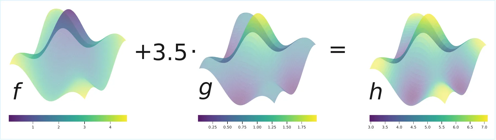
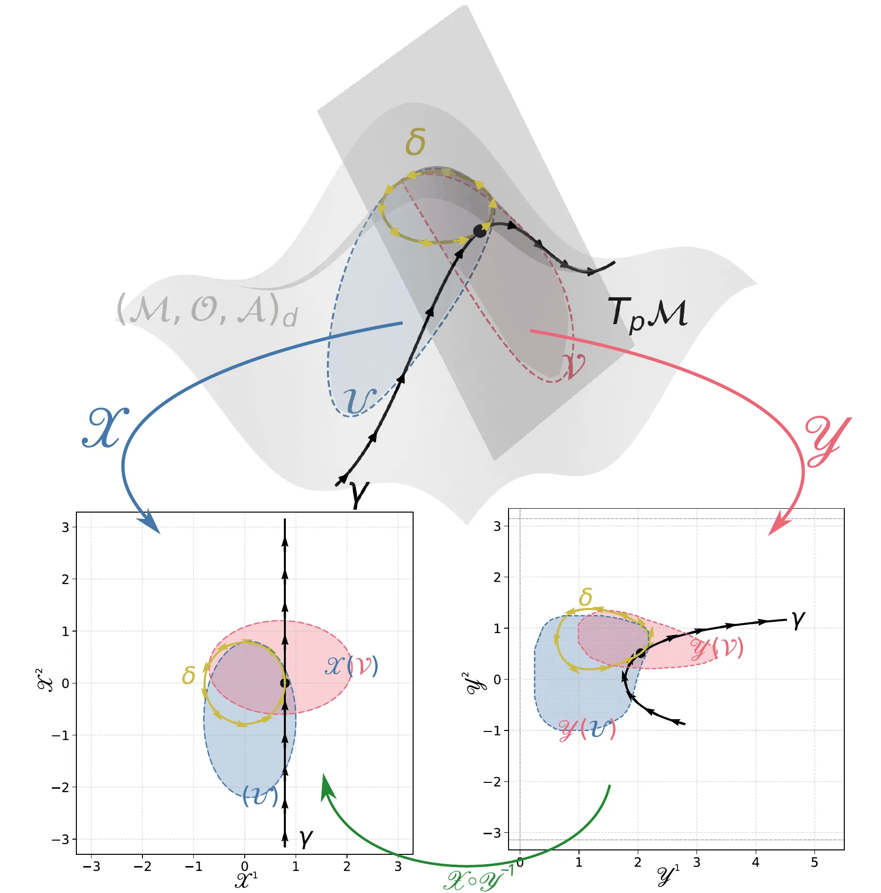

<!-- GENERATED by _port/convert/build.py from Chapters/Tangent_spaces/TpM.tex, main.tex.
     Do not edit this file: edit the LaTeX notes and re-run the converter. -->

```{=html}
<header class="dg-head dg-head-section"><p class="dg-kicker">Chapter 4 <span class="dg-sep">•</span> <a href="index.html">Tangent Spaces</a></p><h1 class="dg-title"><span class="dg-secnum">4.1</span> Tangent Space <span class="math inline">\(T_p \mathcal{M}\)</span></h1></header>
<p>Figure <a class="dg-xref" href="#fig_TpM_curves_velocities_and_chart_transitions" data-kind="figure" data-label="fig_TpM_curves_velocities_and_chart_transitions">4.2</a> illustrates the construction and the role of charts and chart transition maps, and Appendix <a class="dg-xref" href="../examples/example-tpm.html" data-kind="section" data-label="section_Example_TpM">C.3</a> works it out on an explicit example.</p>
<ul class="dg-itemize dg-depth-1">
<li><p>The <span class="dg-term dg-term-orange"><span class="math inline">\(\mathbb{R}\)</span>-vector space of scalar fields</span> (or smooth functions) on a smooth manifold <span class="math inline">\(\left(\mathcal{M}, \mathcal{O}, {\mathcal{A}}_{C^\infty}\right)_d\)</span> is the triplet <span class="math inline">\((C^{\infty}(\mathcal{M}), \oplus, \odot)\)</span>, where <span class="math inline">\(C^{\infty}(\mathcal{M}) := \{ f: \mathcal{M} \to \mathbb{R} \mid f \text{ is smooth} \}\)</span>, with smoothness in the sense of Chapter <a class="dg-xref" href="../topological-manifolds/index.html" data-kind="chapter" data-label="chapter_Topological_Manifolds">3</a> (<span class="math inline">\(f \circ \mathscr{X}^{-1}\)</span> is <span class="math inline">\(C^\infty\)</span> for every chart), and the addition and s-multiplication are defined as:  <span class="math display">\[
            \begin{aligned}
                &amp;\begin{array}{c}
                    \begin{aligned}
                        \oplus : C^{\infty}(\mathcal{M}) \times C^{\infty}(\mathcal{M}) &amp;\longrightarrow C^{\infty}(\mathcal{M}) \\
                        (f_1, f_2) &amp;\longmapsto f_1 \oplus f_2
                    \end{aligned} \\[6pt]
                    \text{with } (f_1 \oplus f_2)(p) := f_1(p) + f_2(p).
                \end{array}
                \quad
                &amp;\begin{array}{c}
                    \begin{aligned}
                        \odot : \mathbb{R} \times C^{\infty}(\mathcal{M}) &amp;\longrightarrow C^{\infty}(\mathcal{M}) \\
                        (\lambda, f) &amp;\longmapsto \lambda \odot f
                    \end{aligned} \\[6pt]
                    \text{with } (\lambda \odot f)(p) := \lambda \cdot f(p).
                \end{array}
            \end{aligned}
        \]</span></p>
<p>Figure <a class="dg-xref" href="#fig_R_vector_space_of_functions" data-kind="figure" data-label="fig_R_vector_space_of_functions">4.1</a> illustrates how two scalar fields defined upon a manifold can be multiplied and added together following the properties of a vector space.</p></li>
<li><p>A <span class="dg-term dg-term-orange">curve</span> on the manifold <span class="math inline">\(\left(\mathcal{M}, \mathcal{O}, \mathcal{A}\right)_d\)</span> is a map  <span class="math display">\begin{align*}
            \gamma : \mathbb{R} &amp;\longrightarrow \mathcal{M}\\
            \lambda             &amp;\longmapsto \gamma(\lambda).
        \end{align*}</span>  To be able to properly define the degree of differentiability of <span class="math inline">\(\gamma\)</span>, we endow the source set <span class="math inline">\(\mathbb{R}\)</span> with its standard smooth manifold structure <span class="math inline">\(\left(\mathbb{R}, \mathcal{O}_\mathbb{R}, \{(\mathbb{R}, \mathrm{id}_\mathbb{R})\}\right)_1\)</span>, so that, by the definition of smooth maps in Chapter <a class="dg-xref" href="../topological-manifolds/index.html" data-kind="chapter" data-label="chapter_Topological_Manifolds">3</a>, <span class="math inline">\(\gamma\)</span> is smooth precisely when its chart representatives <span class="math inline">\(\mathscr{X} \circ \gamma\)</span> are <span class="math inline">\(C^\infty\)</span> (and <span class="math inline">\(C^k\)</span> when they are <span class="math inline">\(C^k\)</span>).</p>
<p>A curve is said to pass through a point <span class="math inline">\(p \in \mathcal{M}\)</span> at parameter <span class="math inline">\(\lambda_0 \in \mathbb{R}\)</span> if <span class="math inline">\(\gamma(\lambda_0) = p\)</span>.</p></li>
<li><p>Given a curve <span class="math inline">\(\gamma\)</span> at least <span class="math inline">\(C^1\)</span> on the manifold <span class="math inline">\(\left(\mathcal{M}, \mathcal{O}, \mathcal{A}\right)_d\)</span>, its <span class="dg-term dg-term-orange">velocity</span> at the point <span class="math inline">\(\gamma(\lambda_0) =p \in \mathcal{M}\)</span> w.r.t. a field <span class="math inline">\(f \in C^{\infty}(\mathcal{M})\)</span> is the linear map:  <span class="math display">\begin{align*}
            v_{\gamma, p} \colon C^{\infty}(\mathcal{M}) &amp;\xlongrightarrow{\;\;\sim\;\;} \mathbb{R} \\
            f &amp;\longmapsto v_{\gamma, p}(f) \coloneqq
            \frac{d}{d\lambda} (f \circ \gamma) \Big|_{\lambda = \lambda_0}
            = (f \circ \gamma)' (\lambda_0),
        \end{align*}</span>  where the composition <span class="math inline">\((f \circ \gamma) \colon \mathbb{R} \longrightarrow \mathbb{R}\)</span> maps the curve parameter to the real line via the field <span class="math inline">\(f\)</span>. The derivative <span class="math inline">\((f \circ \gamma)'(\lambda_0)\)</span> captures the rate of change of <span class="math inline">\(f\)</span> along the curve <span class="math inline">\(\gamma\)</span> at the point <span class="math inline">\(p\)</span>.</p>
<figure class="dg-figure" id="fig_R_vector_space_of_functions"><div class="dg-paper" style="--dg-frac:0.990"></div><figcaption><span class="dg-fignum">Figure 4.1:</span>   Representation of the <span class="math inline">\(\mathbb{R}\)</span>-vector space of smooth functions <span class="math inline">\(C^{\infty}(\mathcal{M})\)</span>. Two different functions defined on the manifold <span class="math inline">\(\mathcal{M}\)</span> are shown, <span class="math inline">\(f\)</span> and <span class="math inline">\(g\)</span>. These two functions are added together (and the function <span class="math inline">\(g\)</span> is multiplied by a scalar) to obtain a new function <span class="math inline">\(h = f \oplus 3.5 \odot g\)</span>, which is also a smooth function on the manifold <span class="math inline">\(\mathcal{M}\)</span>. The addition and scalar multiplication operations are defined pointwise, meaning that for each point <span class="math inline">\(p \in \mathcal{M}\)</span>, the value of the function <span class="math inline">\(h\)</span> at <span class="math inline">\(p\)</span> is given by <span class="math inline">\(h(p) = f(p) + 3.5 \cdot g(p)\)</span>.  </figcaption></figure></li>
<li><p>The <span class="dg-term dg-term-orange">tangent (<span class="math inline">\(\mathbb{R}\)</span>-vector) space</span> to <span class="math inline">\(\left(\mathcal{M}, \mathcal{O}, \mathcal{A}\right)_d\)</span> at <span class="math inline">\(p \in \mathcal{M}\)</span> is a triplet <span class="math inline">\((T_p \mathcal{M}, \oplus_T, \odot_T)\)</span>, where <span class="math inline">\(T_p \mathcal{M} := \{ v_{\gamma, p} \mid \gamma \text{ is a smooth curve that passes through } p \}\)</span> – hence <span class="math inline">\(v_{\gamma, p} \in T_p \mathcal{M}\)</span> is a <span class="dg-term dg-term-orange">vector</span> – and the operations <span class="math inline">\(\oplus_T\)</span> (addition) and <span class="math inline">\(\odot_T\)</span> (s-multiplication) are defined as<sup class="dg-fnref"><a href="#fn-1" id="fnref-1" aria-label="Footnote 1">1</a></sup>:  <span class="math display">\[
            \begin{aligned}
                &amp;\begin{array}{c}
                    \begin{aligned}
                        \oplus_T : T_p \mathcal{M} \times T_p \mathcal{M} &amp;\to T_p \mathcal{M} \\
                        (v_{\gamma_1, p}, v_{\gamma_2, p}) &amp;\mapsto v_{\gamma_1, p} \oplus_T v_{\gamma_2, p}
                    \end{aligned} \\[6pt]
                    \text{with } (v_{\gamma_1, p} \oplus_T v_{\gamma_2, p})(f) :=
                    v_{\gamma_1, p}(f) + v_{\gamma_2, p}(f).
                \end{array}
                \quad
                &amp;\begin{array}{c}
                    \begin{aligned}
                        \odot_T : \mathbb{R} \times T_p \mathcal{M} &amp;\to T_p \mathcal{M} \\
                        (\alpha, v_{\gamma, p})                     &amp;\mapsto \alpha \odot_T v_{\gamma, p}
                    \end{aligned} \\[6pt]
                    \text{with } (\alpha \odot_T v_{\gamma, p})(f) :=
                    \alpha \cdot v_{\gamma, p}(f).
                \end{array}
            \end{aligned}
        \]</span></p></li>
</ul>
```

## `<span class="dg-secnum">4.1.1</span> Basis and Coordinate Components for <span class="math inline">\(T_p \mathcal{M}\)</span>`{=html} {#subsection_Basis_and_Coordinate_Components_of_TpM}

```{=html}
<p>At this point, we introduce a notational convention that, while extremely convenient and widely used, can be deceptively suggestive. It creates the illusion that the abstract objects we have defined are intrinsically tied to coordinates, when in fact, this is merely an artifact of expressing them in terms of a chart. Keeping this in mind, let us proceed.</p>
<ul class="dg-itemize dg-depth-1">
<li><p>Given a chart <span class="math inline">\((\mathcal{U}, \mathscr{X})\)</span> around the point <span class="math inline">\(p \in \mathcal{M}\)</span> such that <span class="math inline">\(p \in \mathcal{U}\)</span>, we can expand the velocity of the curve <span class="math inline">\(\gamma\)</span> at <span class="math inline">\(p\)</span> acting on a scalar field <span class="math inline">\(f\)</span> as<sup class="dg-fnref"><a href="#fn-2" id="fnref-2" aria-label="Footnote 2">2</a></sup>:  <span class="math display">\begin{align*}
            v_{\gamma, p} (f) := (f \circ \gamma)'(\lambda_0)
            = \big( (\underbrace{f \circ \mathscr{X}^{-1}}_{\mathbb{R}\longleftarrow\mathbb{R}^d}) \circ (\underbrace{\mathscr{X} \circ \gamma}_{\mathbb{R}^d\longleftarrow\mathbb{R}}) \big)' (\lambda_0)
            = \sum_{i=1}^{d} \underbrace{(\mathscr{X} \circ \gamma)_i'(\lambda_0)}_{\dot{\gamma}^i_\mathcal{U}(\lambda_0)} \underbrace{\cdot \partial_i \left[f \circ \mathscr{X}^{-1}\right] (\mathscr{X}(p))}_{\left( \frac{\partial}{\partial \mathscr{X}^i} \right)_{p} (f)}.
        \end{align*}</span>  This motivates the following expression:  <span class="math display">\begin{align*}
            v_{\gamma, p} (f) = \sum_{i=1}^{d} \dot{\gamma}^i_{\mathcal{U}}(\lambda_0)
            \cdot \left( \frac{\partial}{\partial \mathscr{X}^i} \right)_{p} (f)
            &amp;\longrightarrow v_{\gamma, p} = \sum_{i=1}^{d}
            \underbrace{\dot{\gamma}^i_{\mathcal{U}}(\lambda_0)}_{\substack{\text{i-th component} \\ \text{of } v_{\gamma, p} \text{ w.r.t. } \mathscr{X}}}
            \cdot
            \underbrace{\left( \frac{\partial}{\partial \mathscr{X}^i} \right)_{p}}_{\substack{\text{i-th basis element} \\ \text{on } T_p\mathcal{U} \text{ w.r.t. } \mathscr{X}}}
        \end{align*}</span></p>
<p>We refer to the elements <span class="math inline">\(\dot{\gamma}^i_{\mathcal{U}}(\lambda_0)\in \mathbb{R}\)</span> as the i-th <span class="dg-term dg-term-orange">coordinate component</span> of <span class="math inline">\(v_{\gamma, p}\)</span> w.r.t. the chart <span class="math inline">\((\mathcal{U}, \mathscr{X})\)</span>; and the terms <span class="math inline">\(\left( \frac{\partial}{\partial \mathscr{X}^i} \right)_{p}\in T_p\mathcal{U}\)</span> as the i-th <span class="dg-term dg-term-orange">basis element</span> of <span class="math inline">\(T_p\mathcal{U}\)</span> w.r.t. the same chart <span class="math inline">\((\mathcal{U}, \mathscr{X})\)</span>.</p></li>
<li><p>The set  <span class="math display">\begin{align*}
            e \coloneqq
            \left\lbrace \left( \frac{\partial}{\partial \mathscr{X}^1} \right)_{p},\;
            \ldots,\; \left( \frac{\partial}{\partial \mathscr{X}^d} \right)_{p} \right\rbrace
        \end{align*}</span>  is the <span class="dg-term dg-term-orange">chart-induced basis</span> of <span class="math inline">\(T_p\mathcal{M}\)</span> associated with the chart <span class="math inline">\((\mathcal{U}, \mathscr{X})\)</span>. The proof that this set constitutes a basis for <span class="math inline">\(T_p\mathcal{M}\)</span> is given in Appendix <a class="dg-xref" href="../proofs-and-additional-material/proof-basis-tpm.html" data-kind="section" data-label="section_proof_basis_TpM">B.5</a>.</p>
<p>From this, it follows that the dimension of the tangent space <span class="math inline">\(T_p\mathcal{M}\)</span> coincides with the dimension <span class="math inline">\(d\)</span> of the smooth manifold<sup class="dg-fnref"><a href="#fn-3" id="fnref-3" aria-label="Footnote 3">3</a></sup> <span class="math inline">\(\mathcal{M}\)</span>.</p></li>
<li><p>Given a chart <span class="math inline">\((\mathcal{U}, \mathscr{X})\)</span> around the point <span class="math inline">\(p \in \mathcal{M}\)</span>, we can extract the components, <span class="math inline">\(\dot{\gamma}^i_{\mathcal{U}}(\lambda_0)\in \mathbb{R}\)</span>, of the tangent vector <span class="math inline">\(v_{\gamma, p} \in T_p\mathcal{M}\)</span> as<sup class="dg-fnref"><a href="#fn-4" id="fnref-4" aria-label="Footnote 4">4</a></sup>:  <span class="math display">\begin{align*}
            &amp;\sum_{j=1}^{d} \dot{\gamma}^j_{\mathcal{U}}(\lambda_0)
            \cdot \left( \frac{\partial}{\partial \mathscr{X}^j} \right)_{p} (\mathscr{X}^i)
            = v_{\gamma, p} (\mathscr{X}^i) \longrightarrow \dots\\
            \sum_{j=1}^{d} \dot{\gamma}^j_{\mathcal{U}}(\lambda_0)
            &amp;\cdot \underbrace{\partial_j \left[\mathscr{X}^i \circ \mathscr{X}^{-1}\right] (\mathscr{X}(p))}_{\delta^i_j}
            = (\mathscr{X}^i \circ \gamma)'(\lambda_0) \longrightarrow
            \dot{\gamma}^i_{\mathcal{U}}(\lambda_0)
            = (\mathscr{X}^i \circ \gamma)'(\lambda_0) \in \mathbb{R}
        \end{align*}</span></p></li>
<li><p>Given two intersecting charts <span class="math inline">\(\left( \mathcal{U}, \mathscr{X} \right)\)</span> and <span class="math inline">\(\left( \mathcal{V}, \mathscr{Y} \right)\)</span>, with <span class="math inline">\(\mathcal{U} \cap \mathcal{V} \neq \emptyset\)</span>, the <span class="dg-term dg-term-orange">Jacobian</span> of the chart transition map <span class="math inline">\(\textrm{\runic ᛖ}_{\mathcal{V}\mathcal{U}} \coloneqq \mathscr{X} \circ \mathscr{Y}^{-1}\)</span> at a point <span class="math inline">\(p \in \mathcal{U} \cap \mathcal{V}\)</span> is defined as follows:  <span class="math display">\begin{align*}
            \left( \textrm{\runic ᛞ}_{\mathcal{U}\mathcal{V}} \right)^i_{j}\left( \mathscr{Y}(p) \right) \coloneqq
            \left( \frac{\partial \mathscr{X}^i}{\partial \mathscr{Y}^j} \right)_p
            =
            \underbrace{\partial_j \left[ \mathscr{X}^i \circ \mathscr{Y}^{-1} \right]}_{
                \left(\mathbb{R}^d\right)_\mathcal{U} \longleftarrow \left(\mathbb{R}^d\right)_\mathcal{V}
            } \big( \mathscr{Y}(p) \big).
        \end{align*}</span></p>
<p>Similarly, the Jacobian of the inverse transition map <span class="math inline">\(\textrm{\runic ᛖ}_{\mathcal{U}\mathcal{V}} \coloneqq \mathscr{Y} \circ \mathscr{X}^{-1}\)</span> is given by:  <span class="math display">\begin{align*}
            \left( \textrm{\runic ᛞ}_{\mathcal{V}\mathcal{U}} \right)^i_{j}\left( \mathscr{X}(p) \right) \coloneqq
            \left( \frac{\partial \mathscr{Y}^i}{\partial \mathscr{X}^j} \right)_p
            =
            \underbrace{\partial_j \left[ \mathscr{Y}^i \circ \mathscr{X}^{-1} \right]}_{
                \left(\mathbb{R}^d\right)_\mathcal{V} \longleftarrow \left(\mathbb{R}^d\right)_\mathcal{U}
            } \big( \mathscr{X}(p) \big).
        \end{align*}</span></p>
<p>By construction, Jacobians satisfy the following property:  <span class="math display">\begin{align*}
            \sum_{k=1}^{d}
            \left( \textrm{\runic ᛞ}_{\mathcal{U}\mathcal{V}} \right)^i_{k} \left( \mathscr{Y}(p) \right)
            \cdot
            \left( \textrm{\runic ᛞ}_{\mathcal{V}\mathcal{U}} \right)^k_{j} \left( \mathscr{X}(p) \right)
            &amp;=
            \sum_{k=1}^{d}
            \left\lbrace
            \left( \frac{\partial \mathscr{X}^i}{\partial \mathscr{Y}^k} \right)_{p}
            \cdot
            \left( \frac{\partial \mathscr{Y}^k}{\partial \mathscr{X}^j} \right)_{p}
            \right\rbrace\\
            &amp;=
            \sum_{k=1}^{d}
            \left\lbrace
            \partial_j \left[ \mathscr{Y}^k \circ \mathscr{X}^{-1} \right] \big( \mathscr{X}(p) \big)
            \cdot
            \partial_k \left[ \mathscr{X}^i \circ \mathscr{Y}^{-1} \right] \big( \mathscr{Y}(p) \big)
            \right\rbrace\\
            &amp;=
            \partial_j
            \left[
            \left( \mathscr{X}^i \circ \mathscr{Y}^{-1} \right)
            \circ
            \left( \mathscr{Y} \circ \mathscr{X}^{-1} \right)
            \right]
            \big( \mathscr{X}(p) \big)\\
            &amp;=
            \partial_j
            \left[
            \mathscr{X}^i \circ
            \left( \mathscr{Y}^{-1} \circ \mathscr{Y} \right)
            \circ
            \mathscr{X}^{-1}
            \right]
            \big( \mathscr{X}(p) \big)\\
            &amp;=
            \partial_j
            \left[
            \mathscr{X}^i \circ \mathscr{X}^{-1}
            \right]
            \big( \mathscr{X}(p) \big) = \delta^i_j.
        \end{align*}</span></p>
<p>This expresses the fact that the Jacobian of the transition map <span class="math inline">\(\textrm{\runic ᛖ}_{\mathcal{U}\mathcal{V}}\)</span> is the inverse of the Jacobian of the transition map <span class="math inline">\(\textrm{\runic ᛖ}_{\mathcal{V}\mathcal{U}}\)</span>; in particular, both are invertible at every point of the overlap. This is a consequence of the <span class="math inline">\(C^1\)</span>-compatibility of the two charts (the chain rule applied to two mutually inverse differentiable maps), not a criterion for it. It is, however, a useful sanity check when computing Jacobians explicitly.</p></li>
<li><p>The chart-induced basis transforms as follows between two intersecting chart domains <span class="math inline">\(\mathcal{U}\)</span> and <span class="math inline">\(\mathcal{V}\)</span> containing a point <span class="math inline">\(p \in \mathcal{U} \cap \mathcal{V}\)</span>. Given two charts <span class="math inline">\(\left( \mathcal{U}, \mathscr{X} \right)\)</span> and <span class="math inline">\(\left( \mathcal{V}, \mathscr{Y} \right)\)</span>, the basis vectors induced by <span class="math inline">\(\mathscr{X}\)</span> and <span class="math inline">\(\mathscr{Y}\)</span> at the point <span class="math inline">\(p\)</span> are related by:  <span class="math display">\begin{align*}
            \left( \frac{\partial}{\partial \mathscr{X}^i} \right)_{p} (f)
            &amp;\coloneqq
            \partial_i \left[ f \circ \mathscr{X}^{-1} \right] \big( \mathscr{X}(p) \big)
            = \partial_i \left[ \left( f \circ \mathscr{Y}^{-1} \right) \circ \left( \mathscr{Y} \circ \mathscr{X}^{-1} \right) \right] \big( \mathscr{X}(p) \big)\\
            &amp;= \sum_{j=1}^{d}\left\lbrace \partial_i\left[ \mathscr{Y} \circ \mathscr{X}^{-1} \right]_j (\mathscr{X}(p)) \cdot \left\lbrace \partial_j \left[ f \circ \mathscr{Y}^{-1}\right] \circ ( \mathscr{Y} \circ \mathscr{X}^{-1}) \right\rbrace (\mathscr{X}(p)) \right\rbrace\\
            &amp;= \sum_{j=1}^d
            \left\{
            \partial_i \left[ \mathscr{Y}^j \circ \mathscr{X}^{-1} \right] \big( \mathscr{X}(p) \big)
            \cdot
            \partial_j \left[ f \circ \mathscr{Y}^{-1} \right] \big( \mathscr{Y}(p) \big)
            \right\}\\
            &amp;= \sum_{j=1}^d
            \left\{
            \left( \frac{\partial \mathscr{Y}^j}{\partial \mathscr{X}^i} \right)_{p}
            \cdot
            \left( \frac{\partial}{\partial \mathscr{Y}^j} \right)_{p} (f)
            \right\}.
        \end{align*}</span></p>
<p>Since this holds <span class="math inline">\(\forall f \in C^\infty(\mathcal{M})\)</span>, we conclude the transformation law for the basis vectors:  <span class="math display">\begin{align*}
            \left( \frac{\partial}{\partial \mathscr{X}^i} \right)_{p}
            =
            \sum_{j=1}^d
            \left( \frac{\partial \mathscr{Y}^j}{\partial \mathscr{X}^i} \right)_{p}
            \cdot
            \left( \frac{\partial}{\partial \mathscr{Y}^j} \right)_{p}
            =
            \sum_{j=1}^d
            \left( \textrm{\runic ᛞ}_{\mathcal{V}\mathcal{U}} \right)^j_{i}\left(\mathscr{X}(p)\right)
            \cdot
            \left( \frac{\partial}{\partial \mathscr{Y}^j} \right)_{p}.
        \end{align*}</span></p>
<p>We say that <span class="dg-term dg-term-orange">covariant</span> objects follow this transformation law.</p></li>
<li><p>Correspondingly, the vector components transform as follows between two intersecting chart domains <span class="math inline">\(\mathcal{U}\)</span> and <span class="math inline">\(\mathcal{V}\)</span> containing a point <span class="math inline">\(p \in \mathcal{U} \cap \mathcal{V}\)</span>. Given a vector <span class="math inline">\(v_{\gamma, p}\)</span> expressed in the chart-induced bases of <span class="math inline">\(\left( \mathcal{U}, \mathscr{X} \right)\)</span> and <span class="math inline">\(\left( \mathcal{V}, \mathscr{Y} \right)\)</span>, we have:  <span class="math display">\begin{align*}
            v_{\gamma, p}
            &amp;= \sum_{i=1}^{d}
            \dot{\gamma}^i_{\mathcal{U}}(\lambda_0) \cdot \left( \frac{\partial}{\partial \mathscr{X}^i} \right)_{p}
            = \sum_{i=1}^{d}
            \dot{\gamma}^i_{\mathcal{V}}(\lambda_0) \cdot \left( \frac{\partial}{\partial \mathscr{Y}^i} \right)_{p}.
        \end{align*}</span></p>
<p>Substituting the basis change derived previously into the left-hand expression for <span class="math inline">\(v_{\gamma, p}\)</span>, we get:  <span class="math display">\begin{align*}
            \sum_{i=1}^{d}
            \dot{\gamma}^i_{\mathcal{U}}(\lambda_0) \cdot
            \sum_{j=1}^{d}
            \left(
            \frac{\partial \mathscr{Y}^j}{\partial \mathscr{X}^i}
            \right)_{p}
            \cdot
            \left( \frac{\partial}{\partial \mathscr{Y}^j} \right)_{p}
            =
            \sum_{i=1}^{d}
            \dot{\gamma}^i_{\mathcal{V}}(\lambda_0) \cdot
            \left( \frac{\partial}{\partial \mathscr{Y}^i} \right)_{p}.
        \end{align*}</span></p>
<p>Since the basis vectors <span class="math inline">\(\left( \frac{\partial}{\partial \mathscr{Y}^j} \right)_{p}\)</span> are linearly independent, we can equate the components on both sides to obtain the transformation law for the vector components:  <span class="math display">\begin{align*}
            \dot{\gamma}^k_{\mathcal{V}}(\lambda_0)
            =
            \sum_{i=1}^{d}
            \left(
            \frac{\partial \mathscr{Y}^k}{\partial \mathscr{X}^i}
            \right)_{p}
            \cdot
            \dot{\gamma}^i_{\mathcal{U}}(\lambda_0)
            =
            \sum_{i=1}^{d}
            \left( \textrm{\runic ᛞ}_{\mathcal{V}\mathcal{U}} \right)^k_{i}\left( \mathscr{X}(p) \right)
            \cdot
            \dot{\gamma}^i_{\mathcal{U}}(\lambda_0).
        \end{align*}</span></p>
<p>We say that <span class="dg-term dg-term-orange">contravariant</span> objects follow this transformation law.</p></li>
</ul>
<figure class="dg-figure" id="fig_TpM_curves_velocities_and_chart_transitions"><div class="dg-paper" style="--dg-frac:1.000"></div><figcaption><span class="dg-fignum">Figure 4.2:</span>   Visual summary of a tangent space <span class="math inline">\(T_p\mathcal{M}\)</span> and the components of curve velocities in different charts. A smooth manifold is shown in blue, with the overlap between two charts <span class="math inline">\(\mathcal{U} \cap \mathcal{V}\)</span> shaded in purple. The point <span class="math inline">\(p\)</span> is marked by a black dot, and the tangent space <span class="math inline">\(T_p\mathcal{M}\)</span> is depicted as a purple tangent plane at <span class="math inline">\(p\)</span>. Two curves, <span class="math inline">\(\gamma\)</span> (yellow) and <span class="math inline">\(\delta\)</span> (green), pass through <span class="math inline">\(p\)</span>; their velocities at different points are drawn as arrows tangent to the surface. This common visual device is meant to aid intuition: in reality, tangent vectors act on smooth functions over the manifold as directional derivatives and are not fundamentally “attached arrows” on the surface. However, at the chart level these arrows do have a precise meaning: they represent the coordinate components of the curve velocities in a chart–induced basis. For example, <span class="math inline">\(\dot{\gamma}^i_{\mathcal{U}}(\lambda_0)\)</span> and <span class="math inline">\(\dot{\delta}^i_{\mathcal{U}}(\lambda_0)\)</span> are the components of the velocities of <span class="math inline">\(\gamma\)</span> and <span class="math inline">\(\delta\)</span> in the basis <span class="math inline">\(\big\{\big(\frac{\partial}{\partial \mathscr{X}^i}\big)_{p}\big\}\)</span> induced by the chart <span class="math inline">\(\left(\mathcal{U}, \mathscr{X}\right)\)</span>. The bottom panels show the curves in the coordinate domains <span class="math inline">\(\mathscr{X}(\mathcal{U}\cap\mathcal{V})\)</span> (left) and <span class="math inline">\(\mathscr{Y}(\mathcal{U}\cap\mathcal{V})\)</span> (right) with the curve velocities in the corresponding coordinate bases.  </figcaption></figure>
```

## `<span class="dg-secnum">4.1.2</span> Notation`{=html} {#notation_TpM}

```{=html}
<div class="dg-skip dg-medskip"></div>
<p>At this point in the notes, we introduce a new notation that, while standard in differential geometry, may initially obscure the true nature of the objects we have previously defined. Up until now, I have deliberately avoided this notation to emphasize the fundamental nature of these objects. However, as we progress, continuing with the previous notation will become increasingly cumbersome. Thus, it is necessary to adopt the conventional notation for vectors (and in subsequent sections for covectors, and fields). Here we are not introducing any new mathematical concepts, we will just alter our previous notation to align with the commonly used language in differential geometry.</p>
<div class="dg-skip dg-medskip"></div>
<p>First, let us introduce the <strong>Einstein summation convention</strong>, a notational rule that eliminates the need to explicitly write summation symbols. According to this convention, whenever an index appears <em>once as an upper index</em> and <em>once as a lower index</em> within a single term, a summation over all possible values of that index is implicitly understood. For example, the expression <span class="math inline">\(A^i B_i\)</span> is shorthand for the full summation <span class="math inline">\(\sum_{i} A^i B_i\)</span>.</p>
<div class="dg-skip dg-medskip"></div>
<p>It is worth noting that, in some contexts, this convention is occasionally extended beyond its strict form. In particular, it is common to abuse the convention slightly by allowing summation over repeated indices even when they are not “contracted”, that is, even if the repeated index appears both in upper position or both in lower position. For instance, the expression <span class="math inline">\(A^i B^i\)</span> is often understood as shorthand for <span class="math inline">\(\sum_i A^i B^i\)</span> despite both indices being upper.</p>
<div class="dg-skip dg-medskip"></div>
<p>Throughout these notes, we will adopt the standard form of the Einstein summation convention, where summation is implied only when an index appears once upstairs and once downstairs within a term. We will avoid the extended usage where repeated indices are summed without contraction, in order to maintain notational clarity.</p>
<div class="dg-skip dg-medskip"></div>
<p>Let us now apply the Einstein summation convention to express how a vector in the tangent space <span class="math inline">\(T_p\mathcal{M}\)</span> can be expanded in terms of basis elements induced by two charts <span class="math inline">\(\left( \mathcal{U}, \mathscr{X} \right)\)</span> and <span class="math inline">\(\left( \mathcal{V}, \mathscr{Y} \right)\)</span>, both containing the point <span class="math inline">\(p \in \mathcal{M}\)</span>: <span class="math display">\begin{align*}
    v_{\gamma, p}
    =
    \dot{\gamma}^i_{\mathcal{U}}(\lambda_0) \cdot \left( \frac{\partial}{\partial \mathscr{X}^i} \right)_p
    =
    \dot{\gamma}^i_{\mathcal{V}}(\lambda_0) \cdot \left( \frac{\partial}{\partial \mathscr{Y}^i} \right)_p.
\end{align*}</span> This expression reflects the fact that the tangent vector <span class="math inline">\(v_{\gamma, p}\)</span> is an intrinsic geometric object, while its representation in terms of components and basis vectors depends on the particular chart employed.</p>
<div class="dg-skip dg-medskip"></div>
<p>Now let us suppose that we have another curve <span class="math inline">\(\delta \colon \mathbb{R} \rightarrow \mathcal{M}\)</span> that passes through the same point <span class="math inline">\(p\)</span>. Then, the tangent vector <span class="math inline">\(v_{\delta, p}\)</span> can be expressed in terms of the basis elements induced by the charts <span class="math inline">\(\left( \mathcal{U}, \mathscr{X} \right)\)</span>, and <span class="math inline">\(\left( \mathcal{V}, \mathscr{Y} \right)\)</span> as: <span class="math display">\begin{align*}
    v_{\delta, p}
    =
    \dot{\delta}^i_{\mathcal{U}}(\lambda_0) \cdot \left( \frac{\partial}{\partial \mathscr{X}^i} \right)_p
    =
    \dot{\delta}^i_{\mathcal{V}}(\lambda_0) \cdot \left( \frac{\partial}{\partial \mathscr{Y}^i} \right)_p.
\end{align*}</span> For simplicity, from now on we will typically denote these vectors in <span class="math inline">\(T_p\mathcal{M}\)</span> by the symbols <span class="math inline">\(\mathcal{X}_p \coloneqq v_{\gamma, p}\)</span> and <span class="math inline">\(\mathcal{Y}_p \coloneqq v_{\delta, p}\)</span>. This avoids repeatedly writing expressions like <span class="math inline">\(v_{\gamma, p}\)</span>, which carry unnecessary clutter when the geometric role of the object is already clear from context.</p>
<div class="dg-skip dg-medskip"></div>
<p>Now we introduce yet another shorthand notation for the basis elements induced by the charts <span class="math inline">\(\left( \mathcal{U}, \mathscr{X} \right)\)</span> and <span class="math inline">\(\left( \mathcal{V}, \mathscr{Y} \right)\)</span>, respectively: <span class="math inline">\(\partial{x_i} \coloneqq \left( \frac{\partial}{\partial \mathscr{X}^i} \right)_p\)</span> and <span class="math inline">\(\partial{y_i} \coloneqq \left( \frac{\partial}{\partial \mathscr{Y}^i} \right)_p\)</span>.</p>
<div class="dg-skip dg-medskip"></div>
<p>Taking all these notation changes into account, we can produce the following summary table: <span class="math display">\[
\begin{tabular}{c@{\hspace{1.5cm}}c@{\hspace{1.5cm}}c@{\hspace{1.5cm}}c}
\textbf{Vector notation} 
&amp; \textbf{Basis vectors} 
&amp; \textbf{In chart } $\mathscr{X}$ 
&amp; \textbf{In chart } $\mathscr{Y}$ \\[10pt]

$\mathcal{X}_p \coloneqq v_{\gamma, p}$ 
&amp; $\left(\partial{x_i}\right)_p \coloneqq \left( \dfrac{\partial}{\partial \mathscr{X}^i} \right)_p$ 
&amp; $x^i_p \coloneqq \dot{\gamma}^i_{\mathcal{U}}(\lambda_0)$ 
&amp; $y^i_p \coloneqq \dot{\gamma}^i_{\mathcal{V}}(\lambda_0)$ \\[10pt]

$\mathcal{Y}_p \coloneqq v_{\delta, p}$ 
&amp; $\left(\partial{y_i}\right)_p \coloneqq \left( \dfrac{\partial}{\partial \mathscr{Y}^i} \right)_p$ 
&amp; $\tilde{x}^i_p \coloneqq \dot{\delta}^i_{\mathcal{U}}(\lambda_0)$ 
&amp; $\tilde{y}^i_p \coloneqq \dot{\delta}^i_{\mathcal{V}}(\lambda_0)$
\end{tabular}
\]</span></p>
<div class="dg-skip dg-medskip"></div>
<p>With this convention, the basis expansions of the two vectors reads: <span class="math display">\[
    \mathcal{X}_p =
    \underbrace{
        x^i_p \cdot \left(\partial{x_i}\right)_p
    }_{\text{in chart } \mathscr{X}}
    =
    \underbrace{
        y^i_p \cdot \left(\partial{y_i}\right)_p
    }_{\text{in chart } \mathscr{Y}},
    \qquad
    \mathcal{Y}_p =
    \underbrace{
        \tilde{x}^i_p \cdot \left(\partial{x_i}\right)_p
    }_{\text{in chart } \mathscr{X}}
    =
    \underbrace{
        \tilde{y}^i_p \cdot \left(\partial{y_i}\right)_p
    }_{\text{in chart } \mathscr{Y}}.
\]</span></p>
<div class="dg-skip dg-medskip"></div>
<p>It is important to remark once again the different roles played by the symbols <span class="math inline">\(\mathscr{X}\)</span>, <span class="math inline">\(\mathcal{X}_p\)</span>, <span class="math inline">\(x^i_p\)</span>, <span class="math inline">\(\tilde{x}^i_p\)</span>, and <span class="math inline">\(\left(\partial{x_i}\right)_p\)</span>, despite their similar appearance. The symbol <span class="math inline">\(\mathscr{X}\)</span> refers to the chart map itself, i.e., the homeomorphism that assigns coordinates to points in the manifold. By contrast, <span class="math inline">\(\mathcal{X}_p\)</span> and <span class="math inline">\(\mathcal{Y}_p\)</span> are abstract tangent vectors at the point <span class="math inline">\(p \in \mathcal{M}\)</span>—geometric objects that are independent of any chart. The symbols <span class="math inline">\(x^i_p\)</span> and <span class="math inline">\(\tilde{x}^i_p\)</span> denote the numerical components of the vectors <span class="math inline">\(\mathcal{X}_p\)</span> and <span class="math inline">\(\mathcal{Y}_p\)</span>, respectively, with respect to the basis induced by the chart <span class="math inline">\(\mathscr{X}\)</span> (and similarly <span class="math inline">\(y^i_p\)</span> and <span class="math inline">\(\tilde{y}^i_p\)</span> in the chart <span class="math inline">\(\mathscr{Y}\)</span>). Meanwhile, <span class="math inline">\(\left(\partial{x_i}\right)_p \coloneqq \left( \frac{\partial}{\partial \mathscr{X}^i} \right)_p\)</span> and <span class="math inline">\(\left(\partial{y_i}\right)_p \coloneqq \left( \frac{\partial}{\partial \mathscr{Y}^i} \right)_p\)</span> represent the basis vectors of the tangent space <span class="math inline">\(T_p\mathcal{M}\)</span> associated with each chart. Despite the visual similarity of these symbols, they refer to fundamentally different mathematical objects<sup class="dg-fnref"><a href="#fn-5" id="fnref-5" aria-label="Footnote 5">5</a></sup>.</p>
<div class="dg-skip dg-medskip"></div>
<p>With this notation in place, the rules governing changes of coordinates between charts become: <span class="math display">\[
    \left(\partial{x_i}\right)_p
    =
    \underbrace{\left( \frac{\partial \mathscr{Y}^j}{\partial \mathscr{X}^i} \right)_{p}}_{
        \left( \textrm{\runic ᛞ}_{\mathcal{V}\mathcal{U}} \right)^j_{i}\left( \mathscr{X}(p) \right)
    }
    \cdot\;
    \left(\partial{y_j}\right)_p
\]</span> Similarly, the transformation law for the components of a vector: <span class="math display">\[
    y^i_p
    =
    \underbrace{
        \left(\frac{\partial \mathscr{Y}^i}{\partial \mathscr{X}^j}\right)_{p}
    }_{
        \left( \textrm{\runic ᛞ}_{\mathcal{V}\mathcal{U}} \right)^i_{j}\left( \mathscr{X}(p) \right)
    }
    \cdot\;
    x^j_p.
\]</span></p>
<div class="dg-skip dg-medskip"></div>
<p>The same rule applies to the components <span class="math inline">\(\tilde{x}^i_p\)</span> and <span class="math inline">\(\tilde{y}^i_p\)</span> of the vector <span class="math inline">\(\mathcal{Y}_p\)</span>, since the transformation rule depends solely on the change of basis induced by the chart transition, not on the particular vector. In this compact notation, the correspondence between the transformation of basis vectors (covariant) and the transformation of components (contravariant) becomes immediately apparent. Up to this point in the notes, I have not placed indices arbitrarily up or down, but rather deliberately in positions that reflect their transformation behavior: upper indices for contravariant objects, and lower indices for covariant objects.</p>
<div class="dg-footnotes"><div class="dg-fn" id="fn-1"><a class="dg-fn-num" href="#fnref-1" aria-label="Back to the text">1</a><div class="dg-fn-body"><p>The fact that the sum and scalar multiplication defined in this way yield well defined velocity vectors inside of <span class="math inline">\(T_p \mathcal{M}\)</span> is not trivial. It requires proving that for any pair of smooth curves <span class="math inline">\(\gamma_1\)</span> and <span class="math inline">\(\gamma_2\)</span> passing through <span class="math inline">\(p\)</span>, there exists a third smooth curve whose velocity at <span class="math inline">\(p\)</span> realizes the sum <span class="math inline">\(v_{\gamma_1, p} \oplus_T v_{\gamma_2, p}\)</span>, and similarly for the s-multiplication. A constructive proof of this fact is provided in Appendix <a class="dg-xref" href="../proofs-and-additional-material/proof-existence-sum-prod-curves-tpm.html" data-kind="section" data-label="section_proof_existence_sum_prod_curves_TpM">B.4</a>.</p></div></div><div class="dg-fn" id="fn-2"><a class="dg-fn-num" href="#fnref-2" aria-label="Back to the text">2</a><div class="dg-fn-body"><p><em>Multivariable chain rule</em>: Given two functions <span class="math inline">\(f\)</span> and <span class="math inline">\(g\)</span> defined as:  <span class="math display">\[
                \begin{aligned}
                    &amp;\begin{array}{c}
                        \begin{aligned}
                            g : \mathbb{R}^D &amp;\to \mathbb{R}^d \\
                            (x_1, ..., x_D) &amp;\mapsto g(x_1, ..., x_D) := \left(g_1(x_1, ..., x_D), ..., g_d(x_1, ..., x_D)\right)
                        \end{aligned}
                    \end{array}
                    \quad
                    &amp;\begin{array}{c}
                        \begin{aligned}
                            f : \mathbb{R}^d &amp;\to \mathbb{R} \\
                            (x_1, ..., x_d)  &amp;\mapsto f(x_1, ..., x_d)
                        \end{aligned}
                    \end{array}
                \end{aligned}
            \]</span>  Let us define a function <span class="math inline">\(h : \mathbb{R}^D \to \mathbb{R}\)</span> such that <span class="math inline">\(h(x) := (f \circ g)(x_1, ..., x_D)\)</span>, the multidimensional chain rule states that  <span class="math display">\[
                \partial_\alpha h(x_1, ..., x_D) = \partial_\alpha(f \circ g)(x_1, ..., x_D) = \sum_{i=1}^d\left\lbrace \partial_\alpha{g_i}(x_1, ..., x_D) \cdot \left[ \partial_i f \circ g \right](x_1, ..., x_D) \right\rbrace,
            \]</span>  where <span class="math inline">\(\partial_\alpha h\)</span> represents the derivative w.r.t the <span class="math inline">\(\alpha\)</span> input variable of <span class="math inline">\(h\)</span> (the same applies to <span class="math inline">\(\partial_\alpha g_i\)</span>).<br> If <span class="math inline">\(D=1\)</span>, <span class="math inline">\(g : \mathbb{R} \to \mathbb{R}^d\)</span>, and for simplicity of notation, we can substitute the differentiation symbol “<span class="math inline">\(\partial_\alpha\)</span>” directly by “<span class="math inline">\({}'\)</span>”:  <span class="math display">\[
                {h}'(x) = (f \circ g)'(x) = \sum_{i=1}^d\left\lbrace {g_i}'(x) \cdot \left[ \partial_i f \circ g \right](x) \right\rbrace,
            \]</span></p></div></div><div class="dg-fn" id="fn-3"><a class="dg-fn-num" href="#fnref-3" aria-label="Back to the text">3</a><div class="dg-fn-body"><p>It is important to emphasize that this fact does not stem solely from the existence of a single chart around the point <span class="math inline">\(p\)</span>. Rather, it is a global structural property of the manifold: the requirement that there exists an atlas <span class="math inline">\(\mathcal{A}\)</span> whose charts cover <span class="math inline">\(\mathcal{M}\)</span> and are each homeomorphic to open subsets of <span class="math inline">\(\mathbb{R}^d\)</span> ensures that the local Euclidean structure — and hence the dimension <span class="math inline">\(d\)</span> — is consistent across all points. This guarantees that the tangent space <span class="math inline">\(T_p\mathcal{M}\)</span> has the same dimension <span class="math inline">\(d\)</span> at every point <span class="math inline">\(p \in \mathcal{M}\)</span>. In other words, the notion of dimension for a smooth manifold is globally well-defined, not merely a property observed in a single coordinate patch.</p></div></div><div class="dg-fn" id="fn-4"><a class="dg-fn-num" href="#fnref-4" aria-label="Back to the text">4</a><div class="dg-fn-body"><p>The step marked with an underbrace in the equation above is a direct consequence of the fact that the function  <span class="math display">\begin{align*}
                \mathscr{X}^i \circ \mathscr{X}^{-1} : \mathbb{R}^d &amp;\longrightarrow \mathbb{R}\\
                \left( \alpha^1, \dots, \alpha^d \right) &amp;\longmapsto
                \left(\mathscr{X}^i \circ \mathscr{X}^{-1}\right) \left( \alpha^1, \dots, \alpha^d \right) = \alpha^i.
            \end{align*}</span>  is simply the projection onto the <span class="math inline">\(i\)</span>-th coordinate, hence, computing its partial derivative with respect to the <span class="math inline">\(j\)</span>-th coordinate yields the Kronecker delta <span class="math inline">\(\delta^j_i\)</span>.</p></div></div><div class="dg-fn" id="fn-5"><a class="dg-fn-num" href="#fnref-5" aria-label="Back to the text">5</a><div class="dg-fn-body"><p>I might be overdoing this a little bit but I assure you that fundamental misconceptions in the future will be avoided if the reader interiorizes this. Don’t be fooled by this evil notation, it’s horrible but it’s what we have, if you think you can do better, go ahead and try, but I’ve spent no little time trying to figure out a better notation and this is the best I managed to do.</p></div></div></div>
<nav class="dg-web dg-prevnext" aria-label="Previous and next page"><a class="dg-prev" href="index.html" rel="prev"><span aria-hidden="true">←</span> <span><span class="dg-secnum">4</span> Tangent Spaces</span></a><a class="dg-next" href="cotangent-space.html" rel="next"><span aria-hidden="true">→</span> <span><span class="dg-secnum">4.2</span> Cotangent Space <span class="math inline">\(T_p^*\mathcal{M}\)</span></span></a></nav>
```
