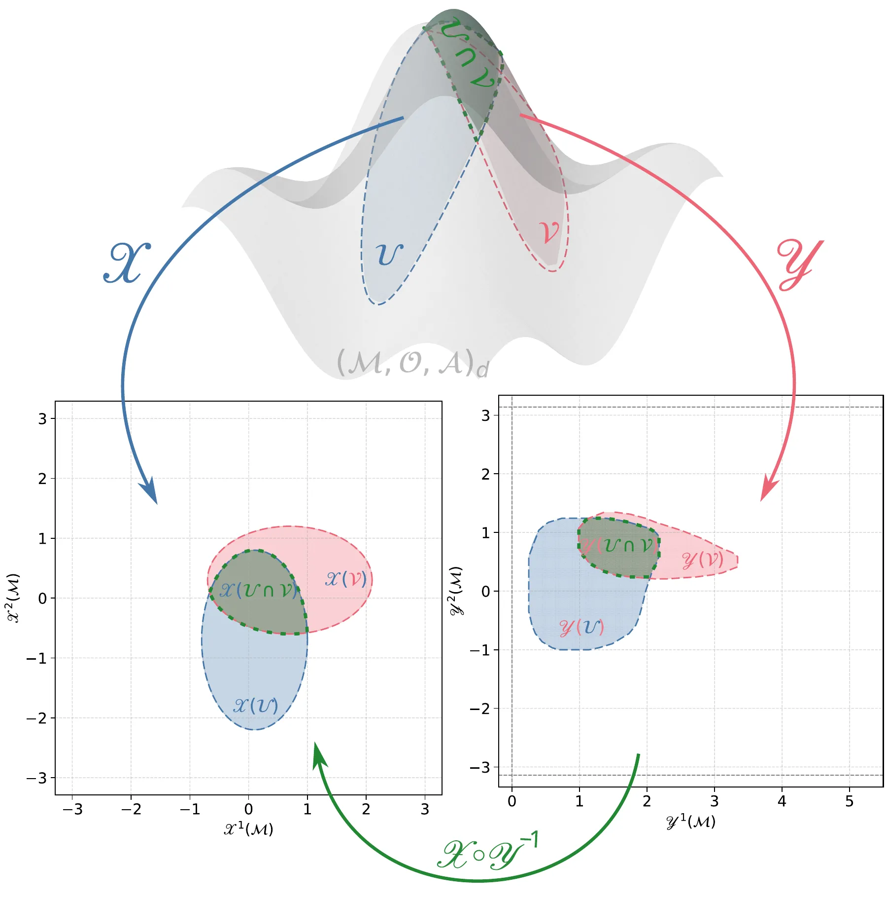

<!-- GENERATED by _port/convert/build.py from Chapters/Topological_Manifolds.tex.
     Do not edit this file: edit the LaTeX notes and re-run the converter. -->

```{=html}
<header class="dg-head dg-head-section"><p class="dg-kicker">Chapter 3 <span class="dg-sep">•</span> <a href="index.html">Topological Manifolds</a></p><h1 class="dg-title"><span class="dg-secnum">3.2</span> Charts and Topological Manifolds</h1></header>
<ul class="dg-itemize dg-depth-1">
<li><p>Given a topological space, <span class="math inline">\(\left(\mathcal{M}, \mathcal{O}_{\mathcal{M}}\right)\)</span>, and an open set <span class="math inline">\(\mathcal{U} \in \mathcal{O}_{\mathcal{M}}\)</span>, let’s suppose that we can define the following map:  <span class="math display">\begin{align*}
            \mathscr{X} \colon \mathcal{U} &amp;\longrightarrow
            \mathscr{X}(\mathcal{U}) \subseteq \mathbb{R}^d\\
            p &amp;\mapsto \mathscr{X}(p) \coloneqq
            \left(\mathscr{X}^{1}(p), \ldots, \mathscr{X}^{d}(p)\right) \in \mathbb{R}^d,
        \end{align*}</span>  where the different component functions are given by:  <span class="math display">\begin{align*}
            \mathscr{X}^{i} \colon \mathcal{U} &amp;\longrightarrow
            \mathscr{X}^{i}(\mathcal{U}) \subseteq \mathbb{R}\\
            p &amp;\mapsto \mathscr{X}^{i}(p)\in \mathbb{R}.
        \end{align*}</span>  Now let’s endow the target space with the inherited topology from the ambient standard topology in <span class="math inline">\(\mathbb{R}^d\)</span>, i.e. <span class="math inline">\(\left. \mathcal{O}_{\mathscr{X}(\mathcal{U})} \right|_{\mathbb{R}^d}\)</span>. From this we can define the topological space <span class="math inline">\(\left( \mathscr{X}(\mathcal{U}), \left. \mathcal{O}_{\mathscr{X}(\mathcal{U})} \right|_{\mathbb{R}^d} \right)\)</span> in the target of our map.</p>
<p>We say that <span class="math inline">\(\mathscr{X}\)</span> is a <span class="dg-term dg-term-green">chart map</span> of the <span class="dg-term dg-term-green">chart domain</span> <span class="math inline">\(\mathcal{U}\)</span> if its image is open, <span class="math inline">\(\mathscr{X}(\mathcal{U}) \in \mathcal{O}_{\mathbb{R}^d}\)</span><sup class="dg-fnref"><a href="#fn-1" id="fnref-1" role="doc-noteref" aria-label="Footnote 1">1</a></sup>, and it is a homeomorphism w.r.t. <span class="math inline">\(\left( \mathcal{U}, \left. \mathcal{O}_{\mathcal{U}} \right|_{\mathcal{M}} \right)\)</span> and <span class="math inline">\(\left( \mathscr{X}(\mathcal{U}), \left. \mathcal{O}_{\mathscr{X}(\mathcal{U})} \right|_{\mathbb{R}^d} \right)\)</span>. If so, the component functions of <span class="math inline">\(\mathscr{X}^i\)</span> are then called <span class="dg-term dg-term-green">coordinate maps</span>, and the fact that <span class="math inline">\(\mathscr{X}\)</span> is a homeomorphism guarantees the existence of a continuous inverse chart map:  <span class="math display">\begin{align*}
            \mathscr{X}^{-1} \colon \mathscr{X}(\mathcal{U}) \subseteq \mathbb{R}^d &amp;\longrightarrow \mathcal{U}\\
            \left(\alpha_1, \ldots, \alpha_d\right) &amp;\mapsto
            \mathscr{X}^{-1}\left(\alpha_1, \ldots, \alpha_d\right) = p \in \mathcal{U},
            \quad \alpha_i \in \mathbb{R}.
        \end{align*}</span>  <span class="dg-term dg-term-green">Charts</span>, defined as the doublet <span class="math inline">\(\left(\mathcal{U}, \mathscr{X}\right)\)</span>, provide a way to describe some local structure of <span class="math inline">\(\mathcal{M}\)</span> in terms of standard Euclidean space.</p></li>
<li><p>Given two intersecting charts, <span class="math inline">\(\left(\mathcal{U}, \mathscr{X}\right),\)</span> <span class="math inline">\(\left(\mathcal{V}, \mathscr{Y}\right): \mathcal{U} \cap \mathcal{V} \neq \emptyset\)</span>, the <span class="dg-term dg-term-green">chart transition maps</span> between the two charts are defined as:  <span class="math display">\begin{align*}
            \textrm{\runic ᛖ}_{\mathcal{V}\mathcal{U}} \colon \mathscr{Y}\left(\mathcal{U}\cap \mathcal{V}\right) \subseteq \mathbb{R}^d &amp;\rightarrow \mathscr{X}\left(\mathcal{U}\cap \mathcal{V}\right)  \subseteq \mathbb{R}^d  \\
            \left( \beta_1, ..., \beta_d \right) &amp;\mapsto
            \textrm{\runic ᛖ}_{\mathcal{V}\mathcal{U}}\left( \beta_1, ..., \beta_d \right) \coloneqq
            \left(\mathscr{X} \circ \mathscr{Y}^{-1} \right) \left( \beta_1, ..., \beta_d \right), \quad \beta_i \in \mathbb{R}
        \end{align*}</span>  <span class="math display">\begin{align*}
            \textrm{\runic ᛖ}_{\mathcal{U}\mathcal{V}} \colon \mathscr{X}\left(\mathcal{U}\cap \mathcal{V}\right) \subseteq \mathbb{R}^d &amp;\rightarrow \mathscr{Y}\left(\mathcal{U}\cap \mathcal{V}\right)  \subseteq \mathbb{R}^d  \\
            \left( \alpha_1, ..., \alpha_d \right) &amp;\mapsto
            \textrm{\runic ᛖ}_{\mathcal{U}\mathcal{V}}\left( \alpha_1, ..., \alpha_d \right) \coloneqq
            \left(\mathscr{Y} \circ \mathscr{X}^{-1} \right) \left( \alpha_1, ..., \alpha_d \right), \quad \alpha_i \in \mathbb{R}
        \end{align*}</span>  Figure <a class="dg-xref" href="#fig_chart_transition_maps" data-kind="figure" data-label="fig_chart_transition_maps">3.1</a> illustrates the role of charts and chart transition maps.</p>
<figure class="dg-figure" id="fig_chart_transition_maps"><div class="dg-paper" style="--dg-frac:0.800"></div><figcaption><span class="dg-fignum">Figure 3.1:</span>   Illustration showing how charts map open sets from a topological manifold to open sets in <span class="math inline">\(\mathbb{R}^d\)</span>, and how chart transition maps operate between overlapping charts. The manifold is represented by the surface at the top, with two overlapping open sets labeled <span class="math inline">\(\mathcal{U}\)</span> (in red) and <span class="math inline">\(\mathcal{V}\)</span> (in blue), and their intersection <span class="math inline">\(\mathcal{U} \cap \mathcal{V}\)</span> shaded in purple. The point <span class="math inline">\(p\)</span> lies within the intersection <span class="math inline">\(\mathcal{U} \cap \mathcal{V}\)</span>. The chart map <span class="math inline">\(\mathscr{X}\)</span> maps <span class="math inline">\(\mathcal{U}\)</span> to an open set <span class="math inline">\(\mathscr{X}\left( \mathcal{U} \right) \subseteq \mathbb{R}^d\)</span>, and the chart map <span class="math inline">\(\mathscr{Y}\)</span> maps <span class="math inline">\(\mathcal{V}\)</span> to <span class="math inline">\(\mathscr{Y}\left( \mathcal{V} \right) \subseteq \mathbb{R}^d\)</span>. The images of the intersection, <span class="math inline">\(\mathscr{X}\left( \mathcal{U} \cap \mathcal{V} \right)\)</span> and <span class="math inline">\(\mathscr{Y}\left( \mathcal{U} \cap \mathcal{V} \right)\)</span>, are shown as overlapping regions in <span class="math inline">\(\mathbb{R}^d\)</span>. The transition map <span class="math inline">\(\textrm{\runic ᛖ}_{\mathcal{U}\mathcal{V}} = \mathscr{Y} \circ \mathscr{X}^{-1}\)</span> allows passing from the chart <span class="math inline">\(\left(\mathcal{V}, \mathscr{Y}\right)\)</span> to the chart <span class="math inline">\(\left(\mathcal{U}, \mathscr{X}\right)\)</span> within the overlap. This diagram encapsulates the essence of local coordinate representations and the role of chart transition functions.  </figcaption></figure></li>
<li><p>Given some arbitrary index set <span class="math inline">\(A\)</span>, the set <span class="math inline">\(\mathcal{A} = \left\{\left(\mathcal{U}_{\alpha}, \mathscr{X}_{\alpha}\right)_{\alpha \in A} \right\}\)</span> is called an <span class="dg-term dg-term-green">atlas</span> of the topological space <span class="math inline">\(\left(\mathcal{M}, \mathcal{O}_{\mathcal{M}}\right)_d\)</span>, if the collection of chart domains <span class="math inline">\(\{\mathcal{U}_\alpha \in \mathcal{O}_{\mathcal{M}} \}\)</span> completely cover the manifold:  <span class="math display">\begin{align*}
            \bigcup_{\alpha\in A}\mathcal{U}_\alpha = \mathcal{M}.
        \end{align*}</span>  From this it follows that <span class="math inline">\(\forall p \in \mathcal{M},\; \exists\)</span> a chart <span class="math inline">\(\left( \mathcal{U}, \mathscr{X} \right)\in \mathcal{A} \mid p \in \mathcal{U}\)</span>.</p></li>
<li><p>A <span class="dg-term dg-term-green"><span class="math inline">\(d\)</span>-dim. (topological) manifold</span> is a triple <span class="math inline">\(\left( \mathcal{M}, \mathcal{O}_{\mathcal{M}}, \mathcal{A} \right)_d\)</span> formed by a topological space <span class="math inline">\(\left( \mathcal{M}, \mathcal{O}_{\mathcal{M}} \right)\)</span> and an atlas <span class="math inline">\(\mathcal{A}\)</span>, where the topological space is required to be Hausdorff<sup class="dg-fnref"><a href="#fn-2" id="fnref-2" role="doc-noteref" aria-label="Footnote 2">2</a></sup> and second countable<sup class="dg-fnref"><a href="#fn-3" id="fnref-3" role="doc-noteref" aria-label="Footnote 3">3</a></sup>.</p></li>
</ul>
<section class="dg-footnotes" role="doc-endnotes"><div class="dg-fn" id="fn-1" role="doc-footnote"><a class="dg-fn-num" href="#fnref-1" aria-label="Back to the text">1</a><div class="dg-fn-body"><p>Openness of the image is what later allows us to differentiate chart transition maps, since partial derivatives are only defined at interior points of their domain. Note, however, that <span class="math inline">\(\mathscr{X}(\mathcal{U})\)</span> need not be homeomorphic to <span class="math inline">\(\mathbb{R}^d\)</span> itself: the open annulus <span class="math inline">\(\{ q \in \mathbb{R}^2 \mid 1 &lt; q_1^2 + q_2^2 &lt; 4 \}\)</span> is open, but not homeomorphic to <span class="math inline">\(\mathbb{R}^2\)</span> (it contains loops that cannot be shrunk to a point within it). What makes a manifold <em>locally</em> Euclidean is that every point has <em>some</em> neighbourhood homeomorphic to <span class="math inline">\(\mathbb{R}^d\)</span>, e.g. the preimage of a small open ball inside <span class="math inline">\(\mathscr{X}(\mathcal{U})\)</span>, not that every chart image is.</p></div></div><div class="dg-fn" id="fn-2" role="doc-footnote"><a class="dg-fn-num" href="#fnref-2" aria-label="Back to the text">2</a><div class="dg-fn-body"><p>Being Hausdorff does not follow from the existence of an atlas. Take two copies of <span class="math inline">\(\mathbb{R}\)</span> and identify each <span class="math inline">\(t \in \mathbb{R} \setminus \{0\}\)</span> of the first with <span class="math inline">\(t\)</span> of the second. The result, the line with two origins <span class="math inline">\(0_A\)</span> and <span class="math inline">\(0_B\)</span>, is covered by two charts, one per copy, each a homeomorphism onto <span class="math inline">\(\mathbb{R}\)</span>, with the identity on <span class="math inline">\(\mathbb{R} \setminus \{0\}\)</span> as transition map. Every point, including each origin, has a neighbourhood homeomorphic to <span class="math inline">\(\mathbb{R}\)</span>, yet every neighbourhood of <span class="math inline">\(0_A\)</span> intersects every neighbourhood of <span class="math inline">\(0_B\)</span>. Charts only control the neighbourhood of a single point, whereas being Hausdorff is a condition on pairs of points, which may lie in different charts. In these notes, the condition guarantees uniqueness of limits, hence of solutions of ordinary differential equations such as the autoparallel equation (on the line with two origins, the curve solving <span class="math inline">\(\dot{x} = 1\)</span> with <span class="math inline">\(x(-1) = -1\)</span> can continue through either origin), and makes compact sets closed, which allows bump functions to be extended by zero.</p></div></div><div class="dg-fn" id="fn-3" role="doc-footnote"><a class="dg-fn-num" href="#fnref-3" aria-label="Back to the text">3</a><div class="dg-fn-body"><p>Second countability does not follow from the existence of an atlas either. The “long line”, obtained by gluing uncountably many copies of <span class="math inline">\([0,1)\)</span> end to end, is connected, Hausdorff and locally homeomorphic to <span class="math inline">\(\mathbb{R}\)</span>, but it cannot be covered by countably many charts. It admits no partitions of unity, and no embedding into any <span class="math inline">\(\mathbb{R}^N\)</span>. Given the other conditions, second countability is equivalent to the existence of a countable atlas: the manifold is built from countably many charts. Unlike the Hausdorff property, nothing local fails without it. It is included in the definition so that global constructions are available on every manifold: partitions of unity, which glue local objects into global ones, such as connections, metrics, and integrals, defined as countable sums of chart integrals.</p></div></div></section>
<nav class="dg-web dg-prevnext" aria-label="Previous and next page"><a class="dg-prev" href="topological-spaces.html" rel="prev"><span aria-hidden="true">←</span> <span><span class="dg-secnum">3.1</span> Topological Spaces</span></a><a class="dg-next" href="smooth-manifolds.html" rel="next"><span aria-hidden="true">→</span> <span><span class="dg-secnum">3.3</span> Smooth Manifolds</span></a></nav>
```
