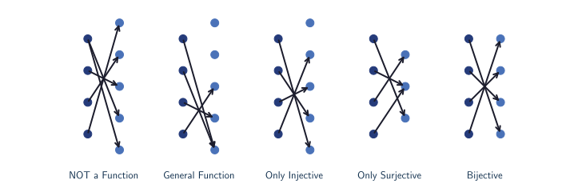

<!-- GENERATED by _port/convert/build.py from Chapters/Vector_Spaces.tex.
     Do not edit this file: edit the LaTeX notes and re-run the converter. -->

```{=html}
<header class="dg-head dg-head-section"><p class="dg-kicker">Chapter 2 <span class="dg-sep">•</span> <a href="index.html">Vector Spaces</a></p><h1 class="dg-title"><span class="dg-secnum">2.1</span> Foundations: Sets, Maps, and Algebraic Structures</h1></header>
<p>Before formally defining vector spaces, we review some necessary set-theoretic and the algebraic structures (groups, rings, fields) upon which the concept of vector spaces is built (rows 1 and 2 of Figure <a class="dg-xref" href="../introduction/roadmaps.html#fig_vector_spaces_roadmap" data-kind="figure" data-label="fig_vector_spaces_roadmap">1.2</a>).</p>
<ul class="dg-itemize dg-depth-1">
<li><p>A <span class="dg-term dg-term-blue">set</span> <span class="math inline">\(\mathcal{M}\)</span> is a well-defined collection of <span class="dg-term dg-term-blue">elements</span><sup class="dg-fnref"><a href="#fn-1" id="fnref-1" aria-label="Footnote 1">1</a></sup> <span class="math inline">\(m\in \mathcal{M}\)</span>. For example, the set of real numbers <span class="math inline">\(\mathcal{M}\coloneqq \mathbb{R}\)</span> is formed by all real numbers: <span class="math inline">\(\mathcal{M} \coloneqq \lbrace ..., -\pi, -2.34, -1, 0, 1/2, e, 10^{27}, ...\rbrace.\)</span></p></li>
<li><p>We say that <span class="math inline">\(\phi\)</span> is a <span class="dg-term dg-term-blue">map</span> from the set <span class="math inline">\(\mathcal{M}\)</span> (domain) to the set <span class="math inline">\(\mathcal{N}\)</span> (target), denoted as  <span class="math display">\begin{align*}
            \phi : \mathcal{M} &amp;\longrightarrow \mathcal{N}\\
            p                  &amp;\mapsto \phi(p),
        \end{align*}</span>  if all the elements of <span class="math inline">\(\mathcal{M}\)</span> are mapped to elements of <span class="math inline">\(\mathcal{N}\)</span>:  <span class="math display">\begin{align*}
            \forall p \in \mathcal{M},\, \exists n \in \mathcal{N} : \phi(p) = n.
        \end{align*}</span></p>
<ol class="dg-enumerate dg-depth-1">
<li><p><span class="math inline">\(\phi\)</span> is <span class="dg-term dg-term-blue">injective</span> if different elements in <span class="math inline">\(\mathcal{M}\)</span> are always mapped to different elements in <span class="math inline">\(\mathcal{N}\)</span>:  <span class="math display">\[
                    \forall p_1, p_2 \in \mathcal{M},\; \phi(p_1) = \phi(p_2) \iff p_1 = p_2.
                \]</span></p></li>
<li><p><span class="math inline">\(\phi\)</span> is <span class="dg-term dg-term-blue">surjective</span> if every element of the target <span class="math inline">\(\mathcal{N}\)</span> is covered by the map:  <span class="math display">\[
                    \forall n \in \mathcal{N},\; \exists p \in \mathcal{M} : \phi(p) = n.
                \]</span></p></li>
<li><p><span class="math inline">\(\phi\)</span> is <span class="dg-term dg-term-blue">bijective</span> if it is both injective and surjective, hence <span class="math inline">\(\phi\)</span> establishes a one-to-one correspondence between the elements of <span class="math inline">\(\mathcal{M}\)</span> and <span class="math inline">\(\mathcal{N}\)</span>. In this case, there exists an <span class="dg-term dg-term-blue">inverse map</span>,  <span class="math display">\begin{align*}
                    \phi^{-1} : \mathcal{N} &amp;\longrightarrow \mathcal{M}\\
                    n                       &amp;\mapsto \phi^{-1}(n),
                \end{align*}</span>  such that  <span class="math display">\[
                    \phi^{-1} \circ \phi = \text{id}_{\mathcal{M}} \quad \text{and} \quad \phi \circ \phi^{-1} = \text{id}_{\mathcal{N}}.
                \]</span></p></li>
</ol>
<figure class="dg-figure" id="fig_maps_examples"><div class="dg-paper" style="--dg-frac:1.000"></div><figcaption><span class="dg-fignum">Figure 2.1:</span>   Examples illustrating the fundamental properties of maps between sets: injectivity, surjectivity, and bijectivity. The first panel (“NOT a Function”) shows a relation where some elements in the domain are assigned to multiple elements in the target, which violates the definition of a function. The second panel (“General Function”) depicts a valid function where elements of the domain are assigned to elements of the target, but the function is neither injective nor surjective. The third panel (“Only Injective”) shows a function where distinct elements of the domain map to distinct elements of the target (injective), but not every element in the target is covered (not surjective). The fourth panel (“Only Surjective”) presents a function that covers every element of the target (surjective), but some distinct domain elements map to the same target element (not injective). The final panel (“Bijective”) shows a function that is both injective and surjective, establishing a one-to-one correspondence between domain and target, and admitting an inverse function.  </figcaption></figure><div class="dg-web dg-interactive" role="group" data-module="maps" data-for="fig_maps_examples" aria-label="Interactive figure"><div class="dg-interactive-bar"><span class="dg-badge">Interactive</span></div><div class="dg-interactive-body"></div></div></li>
<li><p>Given two sets <span class="math inline">\(\mathcal{M}\)</span> and <span class="math inline">\(\mathcal{N}\)</span>, their <span class="dg-term dg-term-blue">Cartesian product</span> is the set <span class="math inline">\(\mathcal{M} \times \mathcal{N}\)</span> of ordered pairs <span class="math inline">\((m, n)\)</span> with <span class="math inline">\(m \in \mathcal{M}\)</span> and <span class="math inline">\(n \in \mathcal{N}\)</span>. It satisfies the following properties:</p>
<ul class="dg-itemize dg-depth-2">
<li><p>Set membership: <span class="math inline">\((m, n) \in \mathcal{M} \times \mathcal{N} \iff m \in \mathcal{M}\)</span> and <span class="math inline">\(n \in \mathcal{N}\)</span>.</p></li>
<li><p>Projections: There exist projection maps  <span class="math display">\[
                    \begin{aligned}
                        \pi_\mathcal{M} \colon \mathcal{M} \times \mathcal{N} &amp;\longrightarrow \mathcal{M} \\
                        (m, n) &amp;\longmapsto \pi_\mathcal{M}(m, n) \coloneqq m
                    \end{aligned}
                    \qquad \text{and} \qquad
                    \begin{aligned}
                        \pi_\mathcal{N} \colon \mathcal{M} \times \mathcal{N} &amp;\longrightarrow \mathcal{N} \\
                        (m, n) &amp;\longmapsto \pi_\mathcal{N}(m, n) \coloneqq n
                    \end{aligned}
                \]</span>  which extract the first and second components of each pair, respectively.</p></li>
<li><p>Associativity: For three sets <span class="math inline">\(\mathcal{M}_1\)</span>, <span class="math inline">\(\mathcal{M}_2\)</span>, and <span class="math inline">\(\mathcal{M}_3\)</span>, the products <span class="math inline">\(\mathcal{M}_1 \times (\mathcal{M}_2 \times \mathcal{M}_3)\)</span> and <span class="math inline">\((\mathcal{M}_1 \times \mathcal{M}_2) \times \mathcal{M}_3\)</span> are technically different sets because their elements are nested pairs: <span class="math inline">\((m_1, (m_2, m_3))\)</span> versus <span class="math inline">\(((m_1, m_2), m_3)\)</span>. However, there is an obvious one-to-one correspondence between them that simply reorders the parentheses: <span class="math inline">\((m_1, (m_2, m_3)) \;\leftrightarrow\; (m_1, m_2, m_3) \;\leftrightarrow\; ((m_1, m_2), m_3).\)</span> Because of this, it is common and harmless to write <span class="math inline">\((m_1, m_2, m_3)\)</span> without worrying about how the pairs are grouped.</p></li>
<li><p>Extension to multiple factors:  <span class="math display">\[
                    \mathcal{M}^n := \underbrace{\mathcal{M} \times \dots \times \mathcal{M}}_{n\text{-times}}
                    = \{ (m_1, \dots, m_n) \mid m_k \in \mathcal{M} \;\forall k=1,\dots,n \}.
                \]</span></p></li>
<li><p>Cardinality: If <span class="math inline">\(|\mathcal{M}| = d_1\)</span> and <span class="math inline">\(|\mathcal{N}| = d_2\)</span>, then <span class="math inline">\(|\mathcal{M} \times \mathcal{N}| = d_1 \cdot d_2\)</span>. This extends to products of <span class="math inline">\(n\)</span> sets.</p></li>
</ul></li>
<li><p>An <span class="dg-term dg-term-blue">Abelian group</span> is the doublet <span class="math inline">\((\mathbb{R}, +)\)</span> where <span class="math inline">\(\mathbb{R}\)</span> is a set, and <span class="math inline">\(+\)</span> represents an addition operation, <span class="dg-term dg-term-blue"><span class="math inline">\(+: \mathbb{R} \times \mathbb{R} \to \mathbb{R}\)</span></span> satisfying (with <span class="math inline">\(\alpha, \beta \in \mathbb{R}\)</span>):</p>
<ol class="dg-enumerate dg-depth-1">
<li><p>Commutativity: <span class="math inline">\(\alpha + \beta = \beta + \alpha\)</span>,</p></li>
<li><p>Associativity: <span class="math inline">\((\alpha_1 + \alpha_2) + \alpha_3 = \alpha_1 + (\alpha_2 + \alpha_3)\)</span>,</p></li>
<li><p>Neutral element / Unitarity / Identity: <span class="math inline">\(\exists 0 \in \mathbb{R}\)</span> such that <span class="math inline">\(\alpha + 0 = \alpha\)</span>,</p></li>
<li><p>Inverse element: <span class="math inline">\(\exists (-\alpha) \in \mathbb{R}\)</span> such that <span class="math inline">\(\alpha + (-\alpha) = 0\)</span>.</p></li>
</ol></li>
<li><p>A <span class="dg-term dg-term-green">Ring</span> is a triplet <span class="math inline">\((\mathbb{R}, +, \cdot)\)</span> composed by an Abelian group <span class="math inline">\((\mathbb{R}, +)\)</span>, equipped additionally with a multiplication operator <span class="dg-term dg-term-green"><span class="math inline">\(\cdot: \mathbb{R} \times \mathbb{R} \to \mathbb{R}\)</span></span> satisfying:</p>
<ol class="dg-enumerate dg-depth-1">
<li><p>Neutral element / Unitarity / Identity: <span class="math inline">\(\exists 1 \in \mathbb{R}\)</span> such that <span class="math inline">\(\alpha \cdot 1 = \alpha \cdot 1 = \alpha\)</span>,</p></li>
<li><p>Associativity: <span class="math inline">\((\alpha_1 \cdot \alpha_2) \cdot \alpha_3 = \alpha_1 \cdot (\alpha_2 \cdot \alpha_3)\)</span>.</p></li>
</ol>
<p>And the addition and multiplication operators must also have the following properties when used in combination:</p>
<ol class="dg-enumerate dg-depth-1">
<li><p>Distributive (left): <span class="math inline">\(\alpha_1 \cdot (\alpha_2 + \alpha_3) = (\alpha_1 \cdot \alpha_2) + (\alpha_1 \cdot \alpha_3)\)</span>),</p></li>
<li><p>Distributive (right): <span class="math inline">\((\alpha_2 + \alpha_3) \cdot \alpha_1 = (\alpha_2 \cdot \alpha_1) + (\alpha_3 \cdot \alpha_1)\)</span>.</p></li>
</ol></li>
<li><p>A <span class="dg-term dg-term-purple">Field</span> is a Ring <span class="math inline">\((\mathbb{R}, +, \cdot)\)</span> with two extra properties:</p>
<ol class="dg-enumerate dg-depth-1">
<li><p>Commutativity (w.r.t <span class="math inline">\(\cdot\)</span>): <span class="math inline">\(\alpha \cdot \beta = \beta \cdot \alpha\)</span>,</p></li>
<li><p>Inverse element (w.r.t <span class="math inline">\(\cdot\)</span>): <span class="math inline">\(\exists (\alpha^{-1}) \in \mathbb{R}\)</span> such that <span class="math inline">\(\alpha \cdot (\alpha^{-1}) = 1\)</span>.</p></li>
</ol>
<div class="dg-skip dg-medskip"></div>
<p>The field of real numbers <span class="math inline">\((\mathbb{R}, +, \cdot)\)</span> serves as the prototypical example in these notes. However, in more general mathematical contexts, other fields are frequently used. Unless stated otherwise, vector spaces in these notes (see below) are always defined over the field <span class="math inline">\(\mathbb{R}\)</span>.</p></li>
</ul>
<div class="dg-footnotes"><div class="dg-fn" id="fn-1"><a class="dg-fn-num" href="#fnref-1" aria-label="Back to the text">1</a><div class="dg-fn-body"><p>Throughout these notes, I will also often use the lowercase letter <span class="math inline">\(p\)</span> to denote a generic element of a set <span class="math inline">\(\mathcal{M}\)</span>, and similarly use <span class="math inline">\(\mathcal{N}\)</span> to denote another different set with generic elements denoted by <span class="math inline">\(n \in \mathcal{N}\)</span>.</p>
<div class="dg-skip dg-medskip"></div>
<p>A brief discussion of the set-theoretic framework adopted in these notes can be found in Appendix <a class="dg-xref" href="../proofs-and-additional-material/set-theory-foundations.html" data-kind="section" data-label="appendix_Set_Theory_Foundations">B.1</a>.</p></div></div></div>
<nav class="dg-web dg-prevnext" aria-label="Previous and next page"><a class="dg-prev" href="index.html" rel="prev"><span aria-hidden="true">←</span> <span><span class="dg-secnum">2</span> Vector Spaces</span></a><a class="dg-next" href="vectors-duals-tensors.html" rel="next"><span aria-hidden="true">→</span> <span><span class="dg-secnum">2.2</span> Vector Space, Dual Space, and Tensor Space</span></a></nav>
```
